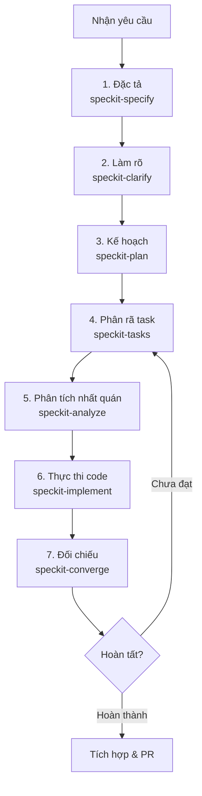

# Quy Trình Phát Triển Tính Năng với Agent & Spec-kit

Tài liệu này hướng dẫn cách phối hợp giữa lập trình viên (Developer), agent AI
và bộ công cụ **Spec-kit** để phát triển tính năng cho **Longevia Backend** một
cách nhất quán, an toàn và đúng cấu trúc.

---

## I. Tổng Quan Quy Trình

Quy trình Spec-kit chia việc phát triển một tính năng thành các giai đoạn độc
lập, tuần tự: đặc tả → làm rõ → lập kế hoạch → phân rã task → thực thi → đối
chiếu.

Chạy trọn một feature đầu-cuối có thể dùng `speckit-orchestrate`; skill này tự
điều khiển analyze → implement → converge và tự quản git, gate, verification
theo policy riêng của nó.

Cú pháp gọi phụ thuộc agent: `$speckit-orchestrate` (Codex),
`/speckit-orchestrate` (OpenCode/Claude), hoặc skill tool. Tên skill là chuẩn
chung, không phụ thuộc cú pháp. Khi orchestrator chạy, nó giao việc cho worker
(`speckit-worker`): worker chỉ chạy đúng một skill hoặc một phase được giao,
không tự chọn feature, không Git, không hỏi developer trực tiếp, không spawn
subagent và không chạy full close-out gate.

---

## II. Các Giai Đoạn & Lệnh Thực Thi

Bắt đầu một tính năng mới bằng nhánh `feat/<slug>` rồi chạy tuần tự. Repo dùng
chung cho cả nhóm: feature được định danh bằng `specs/<owner>-<NNN>-<slug>`, số
đếm riêng theo owner. Xem [`team-workflow.md`](team-workflow.md) trước khi bắt
đầu.

### 0. Giai đoạn 0 — Bind feature (bắt buộc)
- **Lệnh:** `pwsh scripts/speckit/team-feature.ps1 owner -Handle <handle>` (lần
  đầu trên máy), `... new -Slug <slug>` (khi tạo) và `... resolve -Json` (trước
  mọi skill khác).
- **Kết quả:** `.specify/owner.json` (máy-local, gitignored) +
  `specs/<owner>-<NNN>-<slug>/` + `meta.json`; `.specify/feature.json` được bind
  theo nhánh. Skill STOP nếu nhánh hiện tại không khớp feature hoặc chưa có
  handle.

### 1. Giai đoạn 1 — Đặc tả (Specification)
- **Lệnh:** `speckit-specify <mô tả tính năng>`
- **Kết quả:** `specs/<owner>-<NNN>-<slug>/spec.md` gồm User Stories, Requirements
  và Success Criteria đo lường được.

### 2. Giai đoạn 2 — Làm rõ (Clarify)
- **Lệnh:** `speckit-clarify`
- **Kết quả:** các điểm mơ hồ trong `spec.md` được hỏi và cập nhật lại.

### 3. Giai đoạn 3 — Lập kế hoạch (Plan)
- **Lệnh:** `speckit-plan`
- **Kết quả:** `plan.md` với Constitution Check, data model, contract (HTTP/gRPC/
  event) và thay đổi schema.

### 4. Giai đoạn 4 — Phân rã task (Tasks)
- **Lệnh:** `speckit-tasks`
- **Kết quả:** `tasks.md`, task nhóm theo User Story, ghi rõ file cần sửa/tạo.

### 5. Giai đoạn 5 — Phân tích nhất quán (Analyze)
- **Lệnh:** `speckit-analyze`
- **Kết quả:** đối chiếu `spec.md`, `plan.md`, `tasks.md` và constitution; báo
  cáo trùng lặp, mơ hồ, thiếu coverage. Không còn CRITICAL/HIGH mới qua bước 6.

### 6. Giai đoạn 6 — Thực thi code (Implement)
- **Lệnh:** `speckit-implement`
- **Kết quả:** code theo từng task; mỗi task xong tick `[x]` trong `tasks.md`.
  Gate mỗi phase theo `AGENTS.md` §2.

### 7. Giai đoạn 7 — Đối chiếu (Converge)
- **Lệnh:** `speckit-converge`
- **Kết quả:** phát hiện phần đã đặc tả nhưng chưa build; bổ sung task còn thiếu.

---

## III. Lệnh Bổ Trợ

### 1. Checklist chất lượng yêu cầu
- **Lệnh:** `speckit-checklist <domain>` (ví dụ `security`, `api`)
- **Kết quả:** checklist trong `specs/<owner>-<NNN>-<slug>/checklists/`.

### 2. Quản trị Constitution
- **Lệnh:** `speckit-constitution`
- **Kết quả:** khởi tạo/cập nhật `.specify/memory/constitution.md` và đồng bộ
  template liên quan.

---

## IV. Nguyên Tắc Cốt Lõi

1. **Constitution là tối cao**: `.specify/memory/constitution.md` quy định luật
   thiết kế của dự án. Mọi thiết kế ở bước plan phải tuân thủ; nếu mâu thuẫn,
   cập nhật constitution trước khi code.
2. **Làm theo từng task nhỏ**: không yêu cầu agent viết toàn bộ tính năng cùng
   lúc; đi theo `speckit-implement` để kiểm soát chất lượng từng module.
3. **Kiểm thử sau mỗi bước**: sau mỗi task/user story quan trọng chạy `make lint`
   và test scoped; trước push/tag chạy `make check`.
4. **Lưu trữ trong `specs/`**: mọi tài liệu đặc tả, kế hoạch, task của tính năng
   nằm trong `specs/<owner>-<NNN>-<slug>/` và phải commit cùng code.
5. **Gợi ý bước tiếp theo**: sau mỗi giai đoạn, agent phải chủ động đề xuất
   lệnh/skill kế tiếp cho dev.
6. **Phạm vi Spec-kit**: dành cho task lớn/feature phức tạp; task nhỏ, hotfix,
   sửa doc/config có thể làm trực tiếp nhưng vẫn theo §IV.
7. **Ngôn ngữ tài liệu trong `specs/`**: mọi tài liệu trong `specs/` (đặc tả, kế
   hoạch, checklist, tasks, báo cáo) **phải viết bằng tiếng Việt** để dev đọc và
   đối chiếu.
8. **Bàn giao tích hợp**: feature đổi HTTP endpoint, event payload hoặc DTO
   client-facing phải có `specs/<feature>/frontend-guide.md`; feature đổi gRPC
   method/message, event contract/topology hoặc surface service-to-service khác
   phải có `specs/<feature>/backend-integration-guide.md`. Chỉ đặt
   `READY_FOR_FRONTEND`/`READY_FOR_BACKEND` khi contract, implementation, test
   evidence và sync check hoàn tất. Feature không đổi surface tương ứng phải ghi
   kết luận trong `tasks.md`.
9. **Việc ngoài phạm vi**: ghi vào `specs/<feature>/deferred.md` với vấn đề, lý do
   ngoài phạm vi và điều kiện gỡ; không để lại checkbox trong `tasks.md`.
10. **Skill discovery**: canonical tại `.agents/skills/<name>/SKILL.md`. OpenCode,
    Codex, Cursor và Gemini CLI đọc trực tiếp; `.opencode/agents/*.md` chỉ là
    adapter cấu hình quyền, không chứa workflow thứ hai.
11. **Nâng cấp Spec Kit**: `specify integration upgrade` sẽ bị chặn nếu một
    skill đã được sửa tay (trạng thái `Modified managed files` trong
    `specify integration status`). Luôn review diff rồi mới dùng `--force`.
    Danh sách tuỳ biến có chủ đích ở
    [`spec-kit-customizations.md`](spec-kit-customizations.md).
12. **Feature binding**: mọi skill `speckit-*` phải xác thực feature bằng
    `scripts/speckit/team-feature.ps1 resolve -Json` trước khi ghi file. Không
    suy đoán từ thư mục mới nhất trong `specs/`, không sửa `.specify/feature.json`
    bằng tay, không làm việc trên `main`.
13. **1 feature = 1 owner = 1 nhánh**: không hai người cùng sửa `tasks.md` của
    một feature; không hai feature đang mở cùng chạm một service/migration project
    hoặc cùng file trong `contracts/`. File dùng chung phải khai trong `plan.md`
    (mục "Shared Files & Conflict Hotspots").
14. **Skill là hạ tầng dùng chung**: `.agents/skills/**` do lead sở hữu; nhánh
    feature MUST NOT sửa skill, thay đổi đi qua nhánh `chore/skills-*`.
