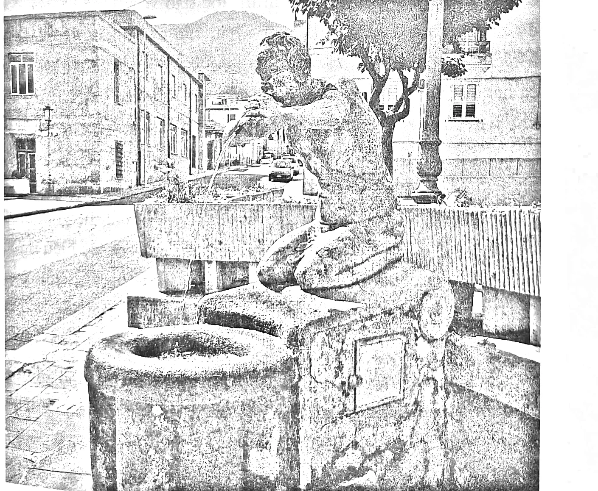

<!-- sách 22 · PDF 14 -->
# CHƯƠNG 1

## ĐÀI PHUN NƯỚC CỦA CARUSO

### TRỞ LẠI MOLOCHIO

Từ mũi cực nam nước Ý, lái xe một tiếng rưỡi về phía bắc và bạn sẽ tới một thị trấn nhỏ mang tên Molochio thuộc vùng Calabria. Tên của nó có lẽ bắt nguồn từ *molokhē* trong tiếng Hy Lạp, có nghĩa là “cẩm quỳ”, một loại thảo dược có hoa màu tím rực rỡ. Ở quảng trường trung tâm, một đài phun nước bạn có thể uống trực tiếp, dòng nước mát lạnh của nó chảy qua những mạch nước ngầm từ dãy núi Aspromonte.

Năm 1972, khi lên năm tuổi, tôi ở Molochio sáu tháng với mẹ. Bà đến đó để chăm sóc người ông bị ốm của tôi. Trong nhiều năm, ông Alfonso đã không để ý tới việc bị thoát vị, một tình trạng đơn giản có thể điều trị được. Ngày ông mất, mọi người gọi tên để đánh thức ông. Tôi bước vào phòng và nói: “Mọi người không thấy rằng ông đã mất rồi sao?” Tôi rất thân thiết với ông, sự ra đi của ông khiến tôi vô cùng đau buồn; nhưng ngay cả khi còn là một đứa trẻ, tôi cảm thấy rằng đối diện với sự lão hóa và cái chết là một việc mình phải làm, rằng tôi phải có trách nhiệm với điều đó bằng cách này hay cách khác.

Hàng xóm của chúng tôi ở Molochio, ông Salvatore Caruso, trạc tuổi ông tôi. Vào năm 2012, 40 năm sau ngày ông tôi

<!-- sách 23 · PDF 15 -->
mất, Salvatore và tôi cùng xuất hiện trên tạp chí khoa học Cell Metabolism (Chuyển hóa tế bào), công bố phát hiện của chúng tôi: một chế độ ăn ít protein, dựa trên thói quen ăn uống của người cao tuổi ở Molochio, có liên quan đến tỷ lệ ung thư và tử vong thấp hơn ở quần thể người dân Mỹ. Hình ảnh ông Salvatore 108 tuổi đứng giữa những cây ô liu ở Calabria được đăng trên nhật báo The Washington Post và các phương tiện truyền thông khắp thế giới. Hai năm sau, Salvatore là người đàn ông lớn tuổi nhất Ý, và là một trong bốn người hơn trăm tuổi ở Molochio. Vì khi ấy chỉ có khoảng 2.000 người sống ở đó, Molochio là một trong những nơi có tỷ lệ người trăm tuổi cao nhất thế giới (gấp bốn lần Okinawa, Nhật Bản, nơi được tin là có tỷ lệ người sống trên trăm tuổi cao nhất đối với một vùng rộng lớn).

Ảnh 1.1. Đài phun nước ở quảng trường Molochio.

<!-- sách 24 · PDF 16 -->
Ông Salvatore, mất năm 2015 ở tuổi 110, đã uống nước từ đài phun nước ở Molochio không lâu sau khi ra đời vào năm 1905; với tuổi thọ hiếm có của rất nhiều người cao tuổi trong thị trấn, thật hấp dẫn khi nghĩ rằng đó có thể là thứ gần nhất với Suối nguồn tuổi trẻ mà chúng ta có. Nhưng dù đó là một suy nghĩ thú vị, tôi đã dành phần lớn cuộc đời mình nghiên cứu khoa học về sự trường thọ và sự thật không có gì kỳ diệu đến như vậy. Bạn không cần phải đi đến Molochio để uống nước từ suối nguồn tuổi trẻ – nhưng nếu bạn làm vậy, bạn sẽ học được nhiều bí quyết sống lâu từ những người trăm tuổi ở đó.

### TỪ TRUYỀN THỐNG ĐẾN KHOA HỌC

Dù là may mắn hay định mệnh, cuộc đời tôi đã đi theo con đường mang đến cho tôi góc nhìn độc đáo và vô giá về các chế độ ăn uống và nền văn hóa khác nhau. Từ chế độ ăn Calabria ở Molochio, nơi tôi trải qua mùa hè thơ ấu, đến chế độ ăn chay có hải sản vùng Liguria ở Genoa, nơi tôi lớn lên, hay chế độ ăn khó tiêu của người Mỹ ở Chicago và Texas, và chế độ ăn ám ảnh về sức khỏe ở thánh địa của tuổi trẻ, Los Angeles – tôi được trải nghiệm trọn vẹn các chế độ dinh dưỡng tốt, xấu và tuyệt vời, giúp tôi hình thành nên các giả thuyết về mối quan hệ giữa thức ăn, bệnh tật và tuổi thọ. Nó cũng giúp tôi nhận ra, để hiểu được cách khiến con người có thể sống lâu và khỏe mạnh, chúng ta cần nghiên cứu các nhóm dân số thực tế đã đạt được điều đó, mà không chỉ giới hạn ở nghiên cứu khoa học, dịch tễ và lâm sàng.

Mặc dù không ý thức được điều đó khi còn nhỏ nhưng tôi lớn lên giữa hai nơi tự hào có chế độ ăn truyền thống lành mạnh nhất thế giới. Không giống như các vùng khác của nước Ý nổi tiếng về các loại thịt (Tuscany) hay nước xốt kem (Lazio, Emilia-Romagna), Liguria và Calabria gìn giữ nền ẩm thực dựa

<!-- sách 25 · PDF 17 -->
trên carbohydrate phức và rau củ, với các món ăn như minestrone (xúp rau kiểu Ý), pansotti al sugo di noce (một loại bánh giống ravioli với nhân rau và nước sốt hạt óc chó) cùng farinata (bánh nướng chảo với đậu garbanzo và dầu ô liu). Trong những mùa hè ở Calabria, chúng tôi sống đơn giản; hầu như mỗi buổi sáng, anh trai, em gái hay tôi sẽ đi bộ lên đồi để mua bánh mì tươi sẫm màu làm từ lúa mì nguyên cám, nóng hổi mới ra lò. Khoảng hai ngày một lần, chúng tôi ăn pasta e vaianeia vào bữa trưa hoặc bữa tối, gồm một ít mì ống trộn với rất nhiều rau, đặc biệt là đậu cô ve còn nguyên vỏ. Một món ăn phổ biến khác là stoccafisso, hay cá khô – cá tuyết phơi khô tương tự như baccalaⁱ nhưng không có muối – ăn kèm với một món phụ là rau. Các nguyên liệu phổ biến khác trong chế độ ăn của chúng tôi là ô liu đen, dầu ô liu, rất nhiều cà chua, dưa chuột và ớt xanh. Thịt là món ăn mỗi tuần một lần; chỉ vào chủ nhật, chúng tôi sẽ có mì maccheroni tự làm với polpette (thịt viên) – mỗi người hai viên – hoặc đôi khi là một miếng bít tết nhỏ. Các đồ uống phổ biến nhất là nước (từ suối trên núi), rượu địa phương, trà, cà phê và sữa hạnh nhân. Buổi sáng, chúng tôi thường uống sữa dê thay vì sữa bò. Giữa các bữa ăn chúng tôi chỉ được phép ăn nhẹ với đậu phộng, hạnh nhân, hạt dẻ, hạt óc chó, nho khô, nho tươi hoặc ngô bắp. Khi ăn tối xong vào khoảng 8 giờ, chúng tôi thường sẽ không ăn gì thêm cho đến sáng hôm sau. Ngay cả tại chợ phiên của làng, đồ ngọt được làm từ các loại hạt và trái cây khô. Thay vì kem, chúng tôi thường ăn granita, món tráng miệng đông lạnh tương tự như sinh tố và sorbetⁱⁱ. Được làm từ rất nhiều trái cây, theo tôi, đó là

i. Cá tuyết ướp muối phơi khô.
ii. Sorbet: một món giải khát hay tráng miệng làm từ trái cây và đường xay nhuyễn rồi đông lạnh. Sorbet khá giống kem, nhưng sorbet không sử dụng sữa hay kem tươi nên không chứa chất béo.

<!-- sách 26 · PDF 18 -->
món tráng miệng ngon nhất trên đời, nhưng nó chứa rất nhiều đường. Chúng tôi phải đi sáu dặm, đến thị trấn Taurianova, để tìm một quán ngon.

Chế độ ăn uống truyền thống của Genoa và Liguria được cho là cũng lành mạnh như chế độ ăn của Calabria; ít đường, bao gồm nhiều rau, đậu garbanzo, dầu ô liu, cá cơm, cá tuyết và trai, tất cả đại diện cho các thành phần quan trọng của Chế độ ăn Trường thọ mà tôi trình bày trong cuốn sách này.

### TỪ LIGURIA ĐẾN CHICAGO

Khi 12 tuổi, tôi thường tự nhốt mình trong phòng với cây guitar điện, vặn âm li lên mức mười và chơi theo các album của Dire Straits, Jimi Hendrix và Pink Floyd. Tôi mơ ước đến Mỹ để trở thành ngôi sao nhạc rock. Năm 1984, cơ hội đó đến khi tôi 16 tuổi, tôi rời Genoa đến sống với người cô ở Chicago. Là một thiếu niên cuồng âm nhạc, tôi đặt chân tới khu Little Italyⁱ của Melrose Park, ngoại ô Chicago, với cây đàn guitar trong ba lô, kéo theo một chiếc âm li di động. Kỹ năng nói tiếng Anh của tôi kém đến mức văn phòng nhập cư đóng dấu “Không biết tiếng Anh” lên hộ chiếu của tôi. Chicago có một nền âm nhạc đáng kinh ngạc. Tôi đã học guitar với Stewart Pearce, một nghệ sĩ bebop huyền thoại của địa phương. Tôi chủ yếu quan tâm đến nhạc rock, tôi biết học chơi jazz và bebop sẽ giúp tôi trở thành một tay guitar rock giỏi. Vào cuối tuần, tôi lẻn ra khỏi nhà cô và bắt chuyến tàu L đến trung tâm thành phố. Ở đó, tôi chơi guitar và ứng tấu với các nhạc sĩ trong câu lạc bộ nhạc blues suốt đêm.

Tôi được tiếp cận với một số bản nhạc blues hay nhất thế giới cùng với một số loại thực phẩm có hại cho sức khỏe nhất –

i. Italy nhỏ: khu dành riêng cho người Ý ở một quốc gia khác, giống như Little Saigon.

<!-- sách 27 · PDF 19 -->
tôi coi đó là "chế độ ăn gây đau tim". Khi ấy, tôi không biết gì về dinh dưỡng và lão hóa, nhưng tôi nhớ mình đã cảm thấy có gì đó không ổn với chế độ ăn ở Thành phố của Gió (biệt danh của thành phố Chicago) bởi rất nhiều người thân của tôi ở đó – hầu hết là người Calabria – đã chết vì bệnh tim mạch, một căn bệnh không hề phổ biến ở miền nam nước Ý nói chung, và đặc biệt hiếm gặp trong đại gia đình của tôi.

Những người đến từ miền nam nước Ý sống tại Mỹ thường ăn thịt xông khói, xúc xích và trứng vào bữa sáng, rất nhiều mì ống, bánh mì và thịt cho bữa trưa, và hay ăn thịt vào bữa tối. Họ cũng tiêu thụ một lượng lớn phô mai, sữa cùng các món tráng miệng nhiều đường và chất béo. Bánh pizza nổi tiếng của Chicago chứa nhiều calo từ phô mai hơn là từ bột. Đồ uống thường là soda hoặc nước ép trái cây chứa nhiều fructose. Tệ hơn nữa, phần lớn chế độ ăn của người Chicago là các món chiên rán. Không có gì ngạc nhiên khi nhiều người quen của tôi bị thừa cân hoặc béo phì ở tuổi 30. Mặc dù chưa bao giờ bị béo phì, tôi ăn uống như mọi người và cao lên rất nhiều trong thời gian ba năm ở Chicago. Tôi đạt tới 1,88 m, cao hơn cha tôi gần 20 cm và hơn anh trai tôi 10 cm. Điều này có thể giải thích là do lượng thịt tăng lên đột ngột trong chế độ ăn của tôi, bên cạnh protein, loại thịt đó còn chứa các hormone steroid.

Tôi tốt nghiệp trung học ở Chicago và đến phía nam học biểu diễn nhạc jazz tại Cao đẳng Âm nhạc của Đại học Bắc Texas nổi tiếng. Tôi không bao giờ tưởng tượng được mình có thể ăn nhiều hơn hoặc trở nên to lớn hơn so với hồi ở Chicago, cho đến khi tôi gia nhập Quân đội Dự bị như một cách để trang trải cho việc học ở Texas. Tới trại huấn luyện ở Fort Knox, Kentucky, tôi tham gia một tiểu đoàn xe tăng rèn luyện với Thủy quân lục chiến và tự hào về việc đẩy bản thân tới giới hạn. Mỗi đêm chúng

<!-- sách 28 · PDF 20 -->
tôi chỉ ngủ ba hoặc bốn giờ, tập chống đẩy và các bài tập cường độ cao khác suốt cả ngày và ăn – rất nhiều.

Tôi trải qua hai mùa hè ở Fort Knox, làm được những việc mà tôi không bao giờ tin rằng mình có thể. Đó là quá trình huấn luyện khó khăn nhất nhưng có lẽ là tuyệt vời nhất trong đời tôi. Quân đội đã dạy tôi cách hoàn thành công việc nhanh chóng, đáp ứng các tiêu chuẩn cao nhất trong khi hạn chế hoặc không mắc sai sót. Huấn luyện viên của chúng tôi luôn mong đợi điều bất khả thi. Nếu bạn có thể chống đẩy 50 lần, họ nói, bạn nên cố đạt được 100. Nếu bạn có thể chạy hai dặm trong 12 phút, họ sẽ hét lên, bạn nên về đích trong vòng 10 phút. Tôi phát hiện ra đôi khi kỳ vọng vào một việc không thể, ta có thể đạt được nó – cuối cùng tôi đã có thể chạy hai dặm trong 10 phút.

Chế độ ăn của Quân đội chủ yếu là thịt và carbohydrate, soda chỉ là phần thưởng khi tổng điểm chạy, chống đẩy và gập bụng của chúng tôi đạt 200 – khoảng 70 lần chống đẩy và 60 lần gập bụng trong chưa đầy hai phút, cộng với chạy hai dặm dưới 10,5 phút. Khi nghĩ lại, có thể thấy tất cả chúng tôi đã nghiện đồ uống có đường đến mức nào; chúng tôi ao ước hỗn hợp của axit photphoric, phẩm màu caramel và đường. Mọi người đều ghen tị với số ít người có thể đạt 200 điểm.

Chế độ ăn này, cùng với việc tập luyện khắc nghiệt, làm tôi to lớn hơn, kích thước cơ bắp tăng lên và khiến tôi khỏe hơn – ít nhất là cảm nhận của tôi lúc đó. Tôi sẽ giải thích chi tiết hơn trong chương sau, các nghiên cứu gần đây của chúng tôi chỉ ra rằng một chế độ ăn giàu protein, có thể làm tăng kích thước cơ nhưng không đồng nghĩa làm tăng sức mạnh cơ. Và chế độ ăn ít protein, ít đường xen kẽ định kỳ với các khoảng thời gian tiêu thụ lượng protein bình thường, có thể có ích trong việc tạo ra các tế bào cơ mới (hiện tại chúng tôi nghĩ chúng có vai trò quyết định

<!-- sách 29 · PDF 21 -->
sức mạnh cơ nhiều hơn chứ không phải kích thước cơ) đồng thời tăng cường sức khỏe. Trong 10 năm sau quá trình huấn luyện cơ bản, với chế độ ăn bao gồm nhiều thịt, chất béo và protein, sức mạnh và sức bền của tôi suy giảm đáng kể. Nhưng sau đó, tôi từ từ chuyển sang Chế độ ăn Trường thọ, và hơn 25 năm sau, tôi có thể thực hiện số lần chống đẩy và gập bụng tương tự như lúc 19 tuổi ở trại huấn luyện, và có lẽ là có hình thể tốt nhất.

Thời gian trong Quân đội khiến tôi quan tâm đến nguyên nhân và cách thức các chế độ ăn uống khác nhau có thể cải thiện sức khỏe mà không ảnh hưởng tiêu cực đến khối lượng và sức mạnh cơ. Câu trả lời nằm ở công nghệ dinh dưỡng, một lĩnh vực mới mà tôi góp phần xây dựng, trong đó chúng tôi coi các thành phần được tìm thấy trong thực phẩm bình thường như một tập hợp các phân tử phức tạp mà với liều lượng và sự kết hợp cụ thể, có thể có các đặc tính có lợi như thuốc nhằm trì hoãn sự lão hóa và ngăn ngừa bệnh tật.¹

## HÒA NHỊP VỚI SỰ TIẾN HÓA

Điểm đến tiếp theo của tôi sau khi kết thúc trại huấn luyện là Denton, Texas, nằm ở ngay phía bắc Dallas, quê hương của Đại học Bắc Texas và một trong những chương trình đào tạo ngành nhạc jazz lớn nhất và hay nhất thế giới, nơi tôi dự định theo đuổi bằng đại học về biểu diễn nhạc jazz. Chương trình này rất khó, đòi hỏi sự nỗ lực hết mình, 16 tiếng một ngày, bảy ngày một tuần khi là sinh viên năm nhất. Những người vĩ đại trong giới nhạc jazz như nghệ sĩ piano Dan Haerle và nghệ sĩ guitar Jack Petersen đã trở thành giáo viên của tôi.

Nhiều người trong giới khoa học khi biết khởi đầu của tôi là một nhạc sĩ nhạc jazz thắc mắc tại sao tôi lại thay đổi hoàn toàn hướng đi đời mình. Sự thật là, mặc dù âm nhạc và khoa học rõ

<!-- sách 30 · PDF 22 -->
ràng rất khác nhau, bạn có thể sẽ ngạc nhiên về việc học nhạc đã giúp ích cho tôi đến thế nào trong phòng thí nghiệm và thúc đẩy tôi đến với những khám phá yêu cầu các cách tiếp cận sáng tạo.

Nếu bạn được rèn luyện nhận diện các hợp âm từ nhỏ, không quá khó khăn để nhận ra tần số và các quãng. Nó giống như học một ngôn ngữ mới, tương tự một đứa trẻ nhận ra từ ngữ và hiểu những gì đang nói. Tuy nhiên, tôi chủ yếu tự học chơi guitar thông qua lắng nghe, vì vậy việc tiếp xúc đột ngột với ngôn ngữ mới này là một thử thách đối với tôi; trong chương trình nhạc jazz, tôi đã học cách hiểu và viết bằng ngôn ngữ mà với tôi luôn chỉ đơn giản là âm thanh.

Tương tự, là một nhà khoa học, bạn luôn quan sát; nhưng điều đó là vô ích nếu không thể chuyển nó thành dữ liệu hoặc giả thuyết. Đào tạo âm nhạc hóa ra thật sự cần thiết đối với nhiều khám phá mà tôi đã thực hiện về nguyên nhân chúng ta lão hóa và mối liên hệ của nó với dinh dưỡng. Khi tôi bắt đầu nghiên cứu về lão hóa, mọi người có thể thấy rằng sinh vật già đi và nghi ngờ rằng bằng cách nào đó, các gen đã tham gia vào quá trình này; nhưng cộng đồng khoa học không biết làm thế nào để chuyển những quan sát đó thành lời giải thích định lượng được về mặt di truyền và phân tử. Đâu là sự hòa âm và giai điệu của sự sống và cái chết? Làm thế nào chúng tôi có thể giải mã và ghi chép lại các quy trình cực kỳ phức tạp này để có thể tác động và thay đổi chúng?

Như một ví dụ về cách học nhạc hỗ trợ quá trình nghiên cứu khoa học, sau đây là một trong những phép loại suy yêu thích mà tôi sử dụng để giải thích phần thiếu sót của lý thuyết phổ biến về sự lão hóa "gốc tự do" khi cho rằng chỉ cần các chất chống oxy hóa (chẳng hạn vitamin C liều cao) có thể kéo dài thời gian sống khỏe của con người: Cố gắng kéo dài tuổi thọ của bạn bằng cách tăng lượng vitamin C tiêu thụ giống như đang

<!-- sách 31 · PDF 23 -->
cố gắng cải thiện một bản giao hưởng Mozart bằng cách tăng số người chơi cello. Cello là một nhạc cụ hay, nhưng để cải thiện một bản giao hưởng Mozart, bạn cần phải là một nhà soạn nhạc giỏi hơn Mozart. Tăng số lượng cello đơn thuần không làm được điều đó. Tuổi thọ khỏe mạnh của con người phức tạp hơn nhiều so với bản giao hưởng của Mozart. Phải mất hàng tỷ năm tiến hóa để đạt được trạng thái gần hoàn hảo như hiện tại. Chúng ta không thể mong đợi một chế phẩm bổ sung đơn giản làm điều gần như hoàn hảo tốt hơn nữa, vì vậy không thể kỳ vọng rằng chúng ta sẽ sống lâu và khỏe mạnh hơn chỉ bằng cách uống nước cam. Không ngạc nhiên khi chế phẩm bổ sung với các chất chống oxy hóa thậm chí còn không được chứng minh là có thể kéo dài tuổi thọ của chuột.

Một lợi ích khác mà chuyên ngành âm nhạc mang lại cho tôi với tư cách một nhà khoa học là được đào tạo về ứng tấu và sáng tác, những yếu tố quan trọng trong nhạc jazz; và chắc chắn, trong cả khoa học, ứng tấu đòi hỏi bạn hiểu rõ những gì bạn nghe so với những gì bạn chơi và ngay lập tức bạn có thể phản ứng lại. Nhưng đó mới chỉ là khởi đầu, bởi cuối cùng trong jazz sự ngẫu hứng thoát ra khỏi chùm hợp âm, vi phạm các quy tắc không bao giờ bị vi phạm trong nhạc cổ điển. Tuy nhiên, người ứng tấu luôn nhận thức được các hợp âm, và sự vi phạm phải tuân theo các quy tắc mới, dù là linh hoạt hơn nhiều. Trong khoa học, kỹ năng này giúp bạn luôn tìm kiếm những ý tưởng mới mẻ hoặc đáng ngạc nhiên nhưng có cơ sở vững chắc, trái ngược với những phát hiện theo trào lưu chỉ là những biến tấu của các khám phá quan trọng trước đó. Còn sáng tác buộc bạn phải viết những bản nhạc mà chưa ai từng viết; nhưng không giống như ngẫu hứng, bản nhạc đó phải có cấu trúc, giai điệu và hòa âm, cũng như các nhạc cụ và cách chơi, phải được xác định. Trong khoa học và y học, cách tiếp cận như một nhà soạn nhạc thúc đẩy bạn tìm kiếm

<!-- sách 32 · PDF 24 -->
những ý tưởng mới, giả thuyết mới, nhưng can thiệp đó phải có nền tảng toán học và hài hòa với cơ thể con người và lịch sử của nó. Tôi gọi đây là hòa nhịp với tiến hóa. Ví dụ, như tôi sẽ thảo luận ở phần khác của cuốn sách, nếu chúng ta sử dụng một loại thuốc làm giảm glucose, chúng ta đang không xem xét sự hài hòa của cơ thể con người, vì thuốc đó làm gián đoạn một chức năng bình thường của cơ thể. Mặc dù điều này có thể là một giải pháp tạm thời (giảm nồng độ glucose), nhưng về lâu dài nó sẽ dẫn đến các vấn đề (các tác dụng phụ không mong muốn). Nếu thay vào đó chúng ta có thể làm trẻ hóa các tế bào cơ kháng insulin gây ra đường huyết cao và khiến chúng hoạt động tốt hơn, chúng ta đang tạo ra những thay đổi có thể duy trì và thậm chí tăng cường sự hài hòa của cơ thể con người. Hơn nữa, nếu sự trẻ hóa này được hoạt hóa bằng cách tận dụng môi trường và điều kiện giống như quá khứ của chúng ta và các sinh vật cổ xưa hơn thì chúng ta không chỉ đang tận dụng sự hài hòa mà còn “hòa nhịp với sự tiến hóa”, bởi quá trình đó phù hợp với “tần số” của lịch sử. Nhịn ăn, chủ đề chính của phần lớn cuốn sách này, kích hoạt các phản ứng đồng điệu với tiến hóa vì tất cả các sinh vật đều trải qua điều đó, bắt đầu với vi khuẩn, hàng tỷ năm trước cả khi Homo sapiens xuất hiện. Vì thế, đây rõ ràng là một trong những biện pháp can thiệp mạnh mẽ nhất mà chúng ta có thể khám phá lại để thúc đẩy những thay đổi, mà vẫn không phá vỡ sự hài hòa của cơ thể con người.

Nếu các nhà khoa học và nghiên cứu không suy nghĩ sáng tạo và cởi mở với những khả năng và ý tưởng mới, nhiều phát minh khoa học và y học tuyệt vời nhất có thể không bao giờ được tìm ra – từ khám phá của Alexander Fleming về penicillin, đến James Watson và Francis Crick và những người khác làm sáng tỏ cấu trúc của DNA.

<!-- sách 33 · PDF 25 -->
Chính tại Đại học Bắc Texas, tôi đã quyết định chuyển từ âm nhạc sang khoa học. Vào năm thứ hai đại học, một cố vấn học tập đã hỏi tôi khi nào tôi sẽ đăng ký môn Giảng dạy Âm nhạc, khóa học mà tôi sẽ phải chỉ huy một ban nhạc diễu hành. Chính ban nhạc diễu hành đã quyết định việc đó. Tôi không có ý định dẫn dắt một ban nhạc diễu hành! Bởi một phần, tôi là một nhạc sĩ nhạc rock. Nhưng mặt khác, liệu đây có thực sự là điều tôi muốn làm với cuộc đời mình? Đột nhiên, tôi không nghĩ như vậy. Tôi vẫn chơi guitar cho đến ngày hôm nay, nhưng sau vài ngày lang thang trên đường phố ở Denton, Texas, tôi quyết định rằng tôi muốn cống hiến cuộc đời mình cho nghiên cứu về cách chúng ta lão hóa – hay đúng hơn, cách chúng ta có thể trẻ trung và khỏe mạnh nhất có thể.

Tôi nhận thấy rằng những người quen của tôi lo lắng bị “già đi” ở độ tuổi 30. Và có vẻ như 40 là độ tuổi mà người ta bắt đầu dễ mắc các bệnh nghiêm trọng. Là một người 20 tuổi, tôi tự hỏi: Tại sao chúng ta không thể đẩy lùi giai đoạn đó tới độ tuổi 50, 60, hay thậm chí xa hơn? Lĩnh vực nghiên cứu về lão hóa đem lại một cơ hội tuyệt vời. Nó kết hợp nhiệm vụ khoa học bất khả thi, hiểu tại sao chúng ta già đi và chết với ý tưởng tôi mới bắt đầu hiểu: nếu chúng ta có thể tác động hiệu quả lên quá trình lão hóa, chúng ta có thể trì hoãn và thậm chí ngăn chặn nhiều bệnh tật, cho phép con người sống trẻ và khỏe lâu nhất có thể.

Cùng với quá trình học âm nhạc, một yếu tố khác đã giúp tôi trong sự nghiệp khoa học, đó là sự thiếu tự tin. Sau quyết định chuyển đổi chương trình học, tôi đến gặp trưởng khoa hóa sinh, hào hứng để thảo luận về chương trình học mới của mình. Nói một cách nhẹ nhàng, ông rất nghi ngờ về một sinh viên chuyên ngành biểu diễn nhạc jazz chưa từng học một khóa sinh học nào, bây giờ lại muốn chuyển sang chương trình hóa sinh để nghiên cứu

<!-- sách 34 · PDF 26 -->
quá trình lão hóa. Ông nói rằng tôi thật điên rồ và tôi sẽ không qua nổi một học kỳ. Phản ứng của ông khiến tôi ngập ngừng, có lẽ ông ấy nói đúng. Cha tôi là một cảnh sát và mẹ tôi, như chuẩn mực văn hóa nơi tôi lớn lên, chăm lo nhà cửa và chỉ thỉnh thoảng làm việc như một thợ may; cha mẹ tôi, những người đã di cư đến Genoa từ miền nam, không ai học quá tiểu học. Vì vậy, tôi đã không chắc mình có thể làm được. Có lẽ tôi đã quá tự tin; có lẽ thật nực cười khi nghĩ rằng tôi có thể theo kịp. Khi nhìn lại, tôi nhận ra chính sự hoài nghi ấy đã giúp tôi thành công – trong chương trình học và trong vai trò là một nhà nghiên cứu. Phương châm và cách thức hoạt động của phòng thí nghiệm của tôi là “Đa nghi”. Một mặt, tôi dạy sinh viên của mình không bao giờ tin tưởng vào kết quả của họ, hay của người khác và luôn mong chờ chuyện gì đó không theo ý muốn sẽ xảy ra – kết quả tuyệt vời làm họ vui mừng có thể sẽ thay đổi khi được xem xét kỹ lưỡng và thử nghiệm sâu hơn hoặc khi nhìn từ một góc độ khác. Mặt khác, tôi dạy sinh viên rằng mọi thứ đều có thể. Hãy nghĩ ra những ý tưởng lớn; nếu bạn có thể mơ về nó, bạn có thể làm được.

Văn hóa đại chúng của chúng ta mô tả các nhà khoa học như những nhà lãnh đạo tự tin, chắc chắn về những gì họ đang làm và kết quả họ sẽ đạt được. Và đây đúng là quan điểm mà tôi thường xuyên thấy ở các trường đại học và bệnh viện. Ngay trong những ngày học đại học, tôi hiểu rằng tự tin là một cách để sự kiêu ngạo tước đoạt kiến thức. Tôi tin rằng những phát minh mang tính cách mạng nhất đến từ sự sáng tạo và nghi ngờ bởi ban đầu chúng xuất hiện như những ý tưởng điên rồ, nhưng sau đó trải qua một quá trình gian khổ để biến thành hiện thực và có thể lặp lại.

Tôi không để sự nghi ngại cản bước và một năm sau đó, tôi đã học rất tốt chương trình hóa sinh, làm việc trong phòng thí

<!-- sách 35 · PDF 27 -->
nghiệm cùng người bác sĩ đã nghi ngờ tôi. Không lâu sau, tôi lái xe hơn 95 km một ngày để làm việc trong phòng thí nghiệm của Tiến sĩ Robert Gracy, chuyên gia nghiên cứu hàng đầu về lão hóa ở Texas, nơi tôi bắt đầu nghiên cứu một trong những khía cạnh quan trọng nhất của lão hóa: quá trình các protein bị tổn hại. Chúng ta có thể coi protein vừa là những viên gạch nâng đỡ một sinh vật vừa là tổng đài truyền thông tin sinh học từ tế bào này sang tế bào khác hoặc bên trong các tế bào. Ví dụ, hormone tăng trưởng là protein lưu thông trong các thụ thể hormone tăng trưởng hoạt hóa bởi máu trên bề mặt tế bào, thúc đẩy sự tăng trưởng của con người. Giống như tất cả các protein, hormone tăng trưởng chỉ có thể bị biến dịi và hủy hoông do lão hóa, gây ảnh hưởng đến chức năng của nó. Nhóm nghiên cứu của Tiến sĩ Gracy nghiên cứu cách thể dạo người sự hư hại này. Nghiên cứu này là sự khởi đầu cho nghiên cứu của tôi trong lĩnh vực đặc biệt về tuổi thọ.

Hamburger, khoai tây chiên và đồ ăn không lành mạnh khác, đặc biệt là Tex-Mex, vẫn là chế độ ăn hàng ngày của tôi trong suốt thời đại học ở Texas. Tex-Mex bao gồm các thành phần thực phẩm tôi tê tê nhất, biến ẩm thực Mexico tương đối lạnh mạnh thành một thứ cực kỳ không lành mạnh bằng cách chiên mọi thứ, thêm phô mai và thịt kém chất lượng. Mặc dù đây là lĩnh vực nghiên cứu mới của tôi, tôi chưa từng nghĩ rằng chế độ ăn uống của mình có thể ảnh hưởng đến sức khỏe và có thể khiến tôi mắc bệnh. Không có gì ngạc nhiên, một vài năm sau khi tốt nghiệp đại học, tôi bị tăng cholesterol, cao huyết áp và các bác sĩ đã sẵn sàng nhồi nhét tôi với statin cùng thuốc hạ áp. Nhưng lúc đó tôi đã tham gia phòng thí nghiệm UCLA của Tiến sĩ Roy Walford, chuyên gia hàng đầu thế giới về dinh dưỡng và tuổi thọ khi đó. Chế độ ăn uống và cuộc sống của tôi, đều sắp thay đổi.
