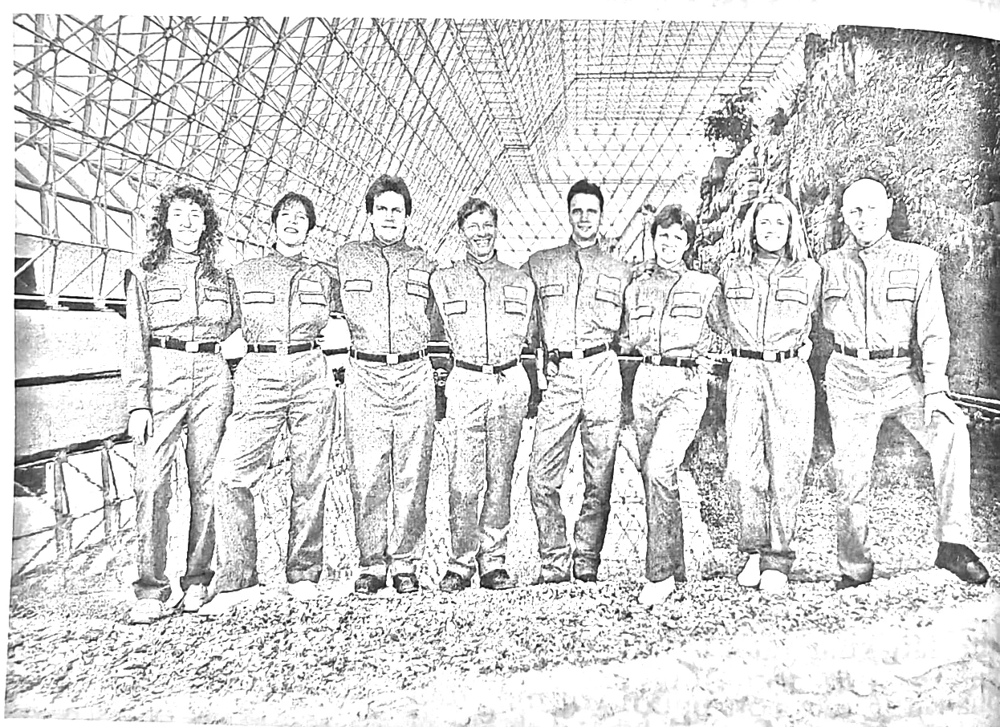
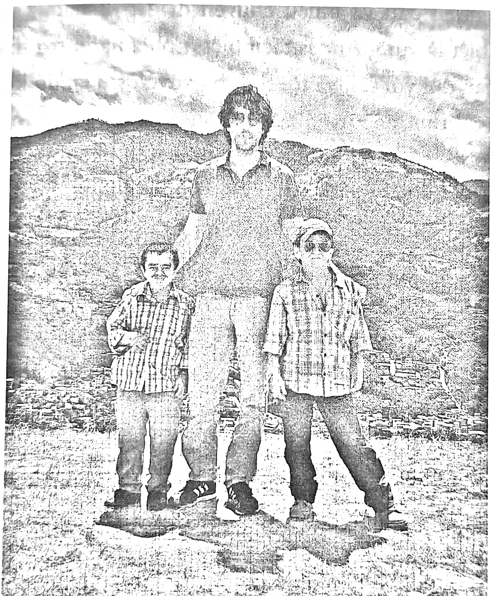
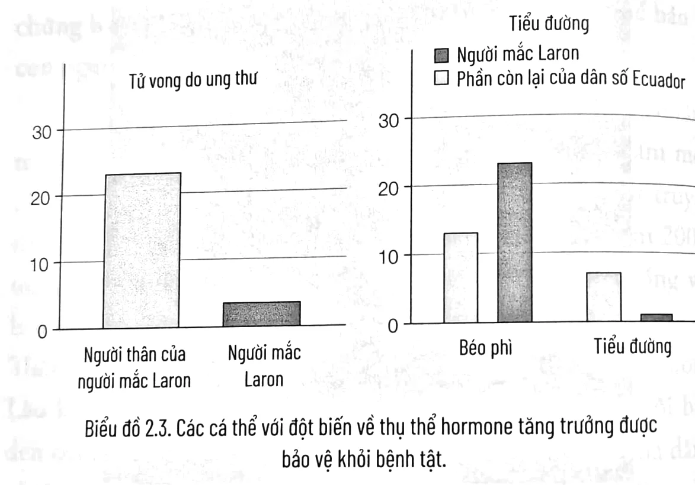
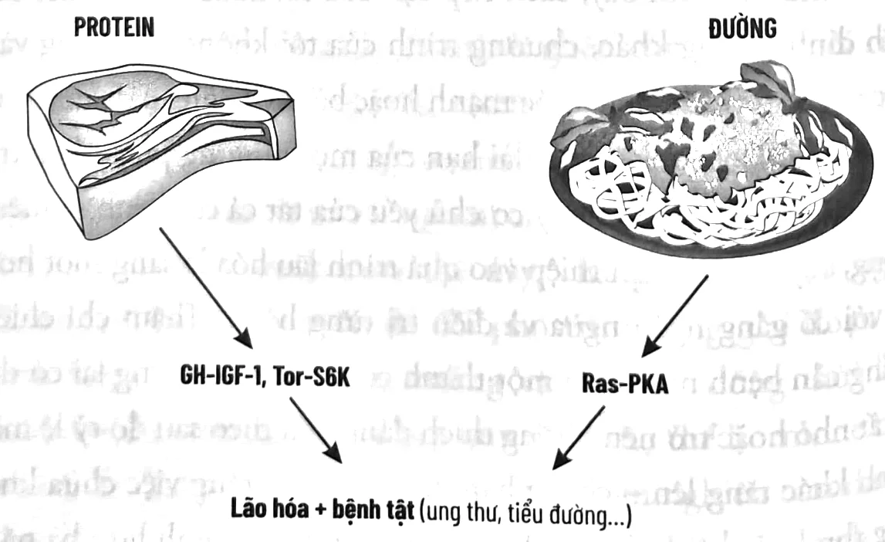

<!-- p.28 -->
# CHƯƠNG 2

## LÃO HÓA, TUỔI THỌ ĐƯỢC LẬP TRÌNH VÀ NGHIÊN CỨU VỀ TUỔI TRẺ

### TẠI SAO CHÚNG TA GIÀ ĐI

Cách tiếp cận của cuốn sách này khác với phần lớn các sách dinh dưỡng khác, vì tôi tập trung vào việc duy trì trạng thái trẻ trung của cơ thể, chứ không phải cách điều trị bệnh hoặc tình trạng cụ thể. Do đó, cần phải hiểu rõ lão hóa là gì và các chiến lược nào có khả năng tốt nhất làm chậm quá trình đó mà không gây ra tác dụng phụ.

“Lão hóa” là những thay đổi xảy ra theo thời gian đối với các sinh vật và vật thể. Sự biến đổi này không nhất thiết mang tính tiêu cực. Mặc dù khi già đi, con người và hầu hết các sinh vật khác có các rối loạn chức năng nhưng điều đó thực ra cũng cho ta vài lợi ích. Ví dụ, những người chiến thắng cuộc thi chạy marathon ở New York thường ở độ tuổi 30 còn những người trong nhóm về đích đầu tiên đều ở độ tuổi 40. Điều này cho thấy rằng có thể lão hóa liên quan đến những thay đổi tích cực trong cơ thể con người.

Vậy tại sao chúng ta già đi? Rõ ràng từng đồ vật xung quanh, từ nhà cửa đến xe cộ đều dần cũ đi và xuống cấp, vì vậy câu hỏi

<!-- p.29 -->
hay hơn có lẽ là: Tại sao con người và tất cả các sinh vật khác đều không già rồi chết đi?

Chọn lọc tự nhiên, quá trình được Charles Darwin và Alfred Wallace dùng để giải thích sự tiến hóa, dẫn đến các cơ chế bảo vệ sinh vật, chẳng hạn: sửa chữa DNA cho đến khi giống nòi các đời sau được sinh ra khỏe mạnh. Trải qua hàng triệu năm tiến hóa, tuổi thọ của một sinh vật có xu hướng sẽ kéo dài nếu khả năng sản sinh thế hệ con cháu khỏe mạnh cũng tăng lên. Wallace và Darwin đồng thời đưa ra giả thuyết rằng lão hóa và chết yểu có thể được lập trình để các sinh vật già đi một cách có chủ đích và chết sớm nếu việc đó có lợi cho giống loài – ví dụ, để tránh tình trạng quá đông đúc. Bạn có thể so sánh điều đó với một công ty quy định tuổi về hưu bắt buộc là 65 để được phép thuê các nhân viên trẻ hơn, với quan điểm rằng điều đó rốt cuộc sẽ mang lại lợi ích cho công ty. Cả hai nhà khoa học đều đã từ bỏ thuyết này bởi vì khi đó, họ không có các công cụ tính toán, sinh học phân tử và di truyền học như hiện nay để chứng minh.

Hơn một thế kỷ sau, phòng thí nghiệm của tôi đã đưa ra một trong những bằng chứng thực nghiệm đầu tiên cho giả thuyết “lão hóa được lập trình” này. Chúng tôi chỉ ra rằng nhóm vi sinh vật ích kỷ – trong trường hợp này là men làm bánh được điều chỉnh di truyền để tập trung bảo vệ bản thân và sống lâu nhất có thể – cuối cùng cũng bị tuyệt chủng, trong khi các vi sinh vật có tuổi sống ngắn hơn sẵn sàng hy sinh bản thân và chết sớm sẽ gieo mầm cho các thế hệ tương lai. Nói cách khác, những biến đổi di truyền khiến sinh vật hành động ích kỷ và sống lâu hơn sẽ làm giảm cơ hội sản sinh thế hệ con cháu khỏe mạnh. Tuy nhiên, việc con người có thực sự được lập trình để chết hay không vẫn chưa được chứng minh.

<!-- p.30 -->
Để lý giải trọn vẹn về lão hóa được lập trình, trước tiên chúng ta phải chứng minh được rằng chọn lọc nhóm – một trong những lý thuyết được tranh luận sôi nổi nhất và thách thức nhất của sinh học tiến hóa. Chọn lọc nhóm thừa nhận các nhóm sinh vật có thể hành động vì nghĩa để bảo vệ hoặc mang lại lợi ích cho nhóm dù bản thân có thể bị thiệt thòi.

Trong hầu hết các trường hợp, có thể lập luận rằng hành vi vì nghĩa – ví dụ chú chim bay đầu đàn gặp nhiều rủi ro hơn vì lợi ích của cả đàn – chỉ là sự đền đáp xứng đáng vì cuối cùng sự mạo hiểm đó lại có lợi cho chính cá thể chấp nhận mạo hiểm. Nhưng khi một sinh vật hy sinh để có lợi cho những sinh vật khác, không thể cho rằng đó là một hành động ích kỷ. Hoặc là chết tình cờ (chết không mục đích) hoặc là chết vì được lập trình sẵn và vì nghĩa cử cao đẹp. Trong 10 năm qua, tôi đã bảo vệ lý thuyết lão hóa được lập trình tại vô số cuộc tranh luận công khai với những chuyên gia ủng hộ các lý thuyết lão hóa tiến hóa truyền thống. Ở Texas và California, sau hai cuộc tranh luận như trên, khán giả là các nhà khoa học, được yêu cầu bỏ phiếu bình chọn cho lý thuyết nào có vẻ đúng đắn. Tôi đã thua cả hai lần, mặc dù số phiếu bầu và các cuộc thảo luận sau đó đã cho thấy tôi thuyết phục được gần một nửa số khán giả. Tại sao? Tôi tin rằng đó là bởi các thuyết tiến hóa hiện nay được chấp nhận như những giáo điều và hầu hết các nhà khoa học không sẵn lòng xem xét các thuyết mới có khả năng thay thế. Để tối đa hóa khả năng con người sống tới 110 tuổi một cách khỏe mạnh, điều quan trọng là phải xem xét những thuyết tiến hóa này và tận dụng các chương trình đã phát triển nhằm kéo dài tuổi thọ trước những thay đổi của môi trường. Ví dụ, chúng tôi đưa ra “chương trình tử vì nghĩa” được mô tả ở trên bị vô hiệu hóa bởi sự thiếu ăn. Điều này chỉ ra rằng một sinh vật khi không có thức ăn sẽ không chết vì lợi ích của các sinh vật khác nữa, có lẽ là bởi vì xung quanh chúng cũng chẳng còn mấy sinh vật sống sót để hưởng lợi.

<!-- p.31 -->
Có hàng trăm lý thuyết về cách thức và lý do tại sao chúng ta già đi. Nhiều lý thuyết đúng phần nào và bị trùng lặp. Ví dụ, thuyết gốc tự do về lão hóa nổi tiếng mà tôi đã đề cập ở trên cho rằng oxy và các phân tử phản ứng khác có chức năng như chất oxy hóa có thể làm tổn thương hầu hết các thành phần của tế bào, tương tự việc kim loại bị gỉ khi tiếp xúc với oxy và nước. “Thân thể dùng một lần” của Tom Kirkwood là một thuyết khác về lão hóa được đón nhận nồng nhiệt. Nó đề xuất rằng các sinh vật đầu tư vào việc sinh sản, con cái và chính bản thân chúng, nhưng chỉ đến mức cần thiết để tạo ra con cháu mạnh khỏe. Thân thể, cơ thể của chúng ta – là vật mang vật chất di truyền chứa đựng trong tinh trùng và trứng – một khi đã sinh đủ con, thân thể này có thể bỏ đi. Đúng như mô tả, theo thuyết này, chúng ta chỉ đơn thuần là những người vận chuyển DNA dùng một lần.

Bởi những lý thuyết này tập trung vào quá trình lão hóa chứ không phải tiềm năng duy trì tuổi trẻ của sinh vật, 15 năm trước, tôi đã nghĩ ra lời giải thích của riêng mình về sự lão hóa: thuyết “tuổi thọ được lập trình”¹. Tôi cho rằng trên thực tế, một sinh vật có thể đủ khả năng đầu tư nhiều hơn vào sự tự vệ để chống lại quá trình lão hóa, và điều này có thể có hàm ý quan trọng trong cuộc sống con người và phòng ngừa bệnh tật. Vì ta có thể trì hoãn độ tuổi khi con người bắt đầu yếu ớt và đau ốm bằng cách thay đổi “chương trình tuổi thọ”. Thử tưởng tượng, đẩy độ tuổi đau ốm này từ 50 lên 70 chẳng hạn. Nếu nó khả thi, có thể bạn tự hỏi, vậy tại sao chương trình tuổi thọ này lại không hoạt động?

Câu trả lời không chỉ sự khó khăn trong việc tối đa hóa cả sự bảo vệ và sinh sản, mà là mức độ bảo vệ hiện tại đã đủ để thực hiện nhiệm vụ. Một lý do khác là trong lịch sử, chúng ta đã sinh sản hoặc đã cố gắng sinh sản, với mức độ thường xuyên hơn nhiều so với hiện tại. Vì vậy trong phần lớn lịch sử loài người,

<!-- p.32 -->
kích hoạt một chương trình chuyển quá nhiều năng lượng từ sinh sản sang bảo vệ và sửa chữa sẽ không có lợi.

Xem xét câu hỏi tương tự: Liệu có thể chế tạo một chiếc máy bay với khả năng bay nhiều năm hơn so với các mẫu hiện tại mà công năng không bị suy giảm?

Câu trả lời là có và tồn tại ít nhất hai cách để thực hiện:

1. Chiếc máy bay bền bỉ đó sẽ cần nhiều nhiên liệu hơn và bảo trì nhiều hơn cho mỗi dặm bay để ngăn ngừa hư hỏng.
2. Chiếc máy bay bền bỉ đó sẽ cần công nghệ vượt trội để giảm thiểu hỏng hóc trong khi sử dụng cùng một lượng nhiên liệu và bảo trì như các mẫu hiện có.

Hãy áp dụng điều này với con người:

1. Những người sống lâu hơn sẽ cần nhiều năng lượng hơn để thực hiện “bảo trì” nhiều hơn (sửa chữa DNA, tái tạo tế bào...).
2. Những người sống lâu hơn sẽ cần phải sử dụng năng lượng tốt hơn để tăng cường bảo vệ chống lại lão hóa và duy trì chức năng bình thường lâu hơn.

Tuy nhiên, dường như không có lý do tiến hóa nào cho điều đó. Bởi lẽ để loài người tiếp tục phát triển, sự lão hóa và cái chết ở tuổi 80 là hoàn toàn chấp nhận được. Nhưng điều gì sẽ xảy ra nếu chúng ta muốn ích kỷ hơn một chút và sống thêm 30 năm khỏe mạnh? Có thể cải thiện hệ thống bảo vệ và sửa chữa để trẻ lâu hơn, hoặc thậm chí trở nên trẻ trung hơn không? Hay chúng ta đã đạt đến mức độ bảo vệ tối đa?

Tôi tin, và dữ liệu chỉ ra rằng chúng ta chưa đạt được điều đó – rằng thực sự có thể cải thiện hệ thống bảo vệ của cơ thể hoặc làm cho những hệ thống này tiếp tục hoạt động lâu hơn, để con

<!-- p.33 -->
người suy yếu và bắt đầu mắc bệnh không phải ở tuổi 40, 50 mà là 60 đến 70, hoặc thậm chí không bao giờ mắc phải những căn bệnh đó. Trong các chương sau, tôi sẽ chỉ ra các biện pháp can thiệp di truyền hoặc chế độ ăn uống không chỉ có thể trì hoãn bệnh tật mà còn thực sự loại bỏ phần lớn các bệnh mạn tính ở chuột, khỉ và thậm chí ở cả con người để kéo dài tuổi thọ. Nền tảng của những tác dụng này chính là tuổi thọ được lập trình: một chiến lược sinh học tác động đến tuổi thọ và sức khỏe thông qua bảo vệ và tái tạo tế bào để trẻ lâu hơn.

### NGHIÊN CỨU VỀ TUỔI TRẺ

Các nhà khoa học rất thích thú khi tranh luận về lý thuyết lão hóa nhưng với những người khác thì không. Trong lý thuyết tuổi thọ được lập trình, cách thức và nguyên nhân chúng ta già đi không thú vị bằng cách làm thế nào để trẻ mãi. Vì tầm quan trọng của sự khác biệt đó, tôi đặt ra một thuật ngữ cho lĩnh vực nghiên cứu này: “juventology”, nghiên cứu về tuổi trẻ. Vậy sự khác biệt là gì? Vô cùng nhiều.

Nếu bạn đang cố gắng hiểu lý do chiếc ô tô cũ đi, bạn có thể nghiên cứu về động cơ và kết luận rằng theo thời gian nó từ từ bị gỉ sét. Để kéo dài tuổi thọ của nó, bạn có thể thêm chất phụ gia chống oxy hóa vào nhiên liệu hoặc dầu động cơ. Đây thực chất là điều mà lý thuyết gốc tự do ủng hộ như một cách để kéo dài tuổi thọ khỏe mạnh. Nhưng giống như những gì tôi đã nói về vitamin C và bản giao hưởng Mozart: bạn không thể cải thiện các sáng tác của Mozart bằng cách thêm tiếng đàn cello – bạn phải viết một bản giao hưởng hay hơn. Nhưng hãy xem xét lập luận đó, giả sử rằng bạn có thể làm chậm lại quá trình “lão hóa” của động cơ bằng cách bổ sung nhiều chất chống oxy hóa. Tuy nhiên, quá trình “lão hóa” đó và tác động nhỏ của chất chống oxy hóa đối với nó trở nên vô nghĩa nếu chủ của chiếc xe cứ 10 năm sẽ làm lại động cơ, thay

<!-- p.34 -->
thể các bộ phận hư hỏng bằng những bộ phận mới. Điều tương tự cũng áp dụng với cơ thể con người: chúng ta có thể cố gắng hiểu cách nó “già đi” và cố gắng làm chậm quá trình đó hoặc chúng ta có thể xác định cách để loại bỏ các bộ phận bị lão hóa và định kỳ thay thế chúng. Trong trường hợp đó, cơ thể già đi như thế nào, do oxy hóa hay một số cơ chế khác, đều không quan trọng. Mục tiêu thay đổi từ việc bảo vệ cơ thể khỏi bị hư hại đến nâng cao khả năng bảo vệ và quan trọng hơn là sửa chữa và thay thế/tái tạo.

Trong cả hai trường hợp, cơ thể lão hóa theo thời gian, nhưng nếu chúng ta có thể lập trình tình trạng khỏe mạnh kéo dài, hệ thống sẽ kích hoạt các cơ chế bảo vệ, sửa chữa, thay thế để duy trì sức sống và chức năng của sinh vật. Đây là sự khác biệt giữa cách tiếp cận dựa trên khoa học về lão hóa hiện tại và cách tiếp cận dựa trên tuổi trẻ tôi cho là hiệu quả hơn. Điều đáng ghi nhớ là bảo vệ cơ thể khỏi lão hóa và hư hại cũng rất quan trọng vì chúng ta còn một chặng đường dài để có thể sửa chữa, thay thế hoàn hảo các phân tử, tế bào cũng như các cơ quan trong cơ thể. Do đó, lý tưởng nhất là kết hợp cả hai cách tiếp cận trên.

Xuyên suốt cuốn sách, tôi sẽ mô tả những thay đổi cụ thể về chế độ ăn uống có tác dụng bảo vệ, tái tạo và trẻ hóa. Phòng thí nghiệm của tôi đã phát hiện ra mối liên hệ rõ ràng giữa dinh dưỡng và các gen quy định tuổi thọ, nó có thể được kích hoạt để thúc đẩy tái lập trình và tái tạo tế bào, giúp một sinh vật sống khỏe mạnh lâu hơn và do đó, tối đa hóa “thời gian sống khỏe” hay tuổi thọ khỏe mạnh.

### KHÁM PHÁ VỀ CÁC GEN LÃO HÓA VÀ HỆ THỐNG LÃO HÓA

Để duy trì trạng thái trẻ trung của cơ thể, chúng ta phải “tái lập trình” “giai đoạn tuổi trẻ” trong khoảng từ 40-50 năm đến 60-70 năm hoặc hơn nữa. Để học cách lập trình lại tuổi thọ, tôi cần hiểu

<!-- p.35 -->
rõ hơn về cơ chế phân tử của nó. Các biện pháp can thiệp về dinh dưỡng ở phần sau cuốn sách đều dựa trên những khám phá được thực hiện một phần bởi phòng thí nghiệm của tôi về vấn đề này.

Năm 1992, tôi đến Đại học California, Los Angeles (khi đó là một trong những trung tâm nghiên cứu về tuổi thọ hàng đầu thế giới) để cống hiến hết mình cho di truyền và hóa sinh về tuổi thọ. Tôi đã tạm dừng sự nghiệp nghệ sĩ guitar rock của mình, mặc dù từng biểu diễn ở Los Angeles và lưu diễn ở vùng Bờ Tây trong ba năm đầu cao học. Có lẽ bị Hollywood ám ảnh về việc trẻ mãi không già, hai trường đại học này đã thu hút bậc thầy của riêng họ trong lĩnh vực lão hóa: nhà bệnh học nổi tiếng Roy Walford làm việc tại Đại học California, và nhà sinh học thần kinh nổi tiếng Caleb Finch ở Đại học Nam California.

Tôi đã chọn tham gia nhóm của Walford cho nghiên cứu tiến sĩ của mình. Dưới sự giám sát của ông, tôi nghiên cứu tác động của việc hạn chế calo – việc giảm 30% lượng calo tiêu thụ mỗi ngày ở nam giới (cũng như ở chuột) ảnh hưởng thế nào đến sự lão hóa và tuổi thọ của họ. Tuy nhiên, Roy và tôi chỉ trao đổi qua video vì ông quyết định nhốt mình cùng bảy người khác trong một môi trường kín ở giữa sa mạc Arizona trong hai năm. Gọi là Biosphere 2¹, cuộc cách ly này là thí nghiệm để tìm hiểu khả năng và cách con người có thể tồn tại trong một môi trường kín, sản xuất tất cả thực phẩm họ cần: thí nghiệm hữu ích về phản ứng của con người với một môi trường bị kiểm soát chặt chẽ với khả năng ứng dụng cho việc sống trên các trạm vũ trụ. Hai năm sau, tôi đã đến Arizona để chào đón tám nhà thám hiểm khi họ bước ra khỏi Biosphere 2. Là một phần của thí nghiệm, họ đã bị hạn chế calo và tiêu thụ rất ít calo mỗi ngày trong hai năm. Khi bước ra khỏi đó, họ rất gầy và trông thật giận dữ.

¹ i. Sinh quyển 2.

<!-- p.36 -->
Sau hai năm làm việc trong phòng thí nghiệm của Walford, tôi vẫn chưa hiểu nhiều về những bí mật của lão hóa. Chuột là sinh vật quá phức tạp để có thể xác định nhanh các gen điều hòa và ảnh hưởng đến quá trình lão hóa. Đồng thời, việc nhìn thấy khuôn mặt giận dữ của những người sống trong Biosphere khiến tôi nghĩ rằng phải có một cách tốt hơn là hạn chế calo kéo dài để trì hoãn quá trình lão hóa, và tôi nôn nóng tìm ra nó. Nó thúc giục tôi chuyển đến khoa hóa sinh và phòng thí nghiệm của Joan Valentine cùng Edith Gralla, để nghiên cứu sự lão hóa của nấm men: một sinh vật đơn bào đơn giản cho phép tôi nghiên cứu nền tảng phân tử của sự sống, lão hóa và cái chết.

*Ảnh 2.1. Roy Walford (ngoài cùng bên phải) và những người sống trong Biosphere khi bắt đầu thí nghiệm, năm 1991.*

Chúng ta nghĩ về nấm men như một nguyên liệu trong bánh mì và bia, nhưng *Saccharomyces cerevisiae* (nấm men) thực ra là một trong những sinh vật được nghiên cứu nhiều nhất trong khoa học. Làm việc với sinh vật đơn bào này không tốn nhiều

<!-- p.37 -->
chi phí và dễ nghiên cứu. Dễ đến mức một số nhà khoa học tiến hành thí nghiệm với nấm men tại nhà. Nó cũng dễ bị biến đổi về mặt di truyền, đơn giản bằng cách loại bỏ hoặc thêm vào một hay nhiều gen trong số gần 6.000 gen của nó.

Một nhóm nhỏ các nhà khoa học, bao gồm cả tôi và Brian Kennedy tại MIT, đã quyết định cách dễ nhất để hiểu con người lão hóa như thế nào là xác định các gen điều chỉnh sự lão hóa của các sinh vật đơn giản, như nấm men và cuối cùng quay lại với chuột và con người. Tuy nhiên, có một rủi ro lớn: Điều gì sẽ xảy ra nếu khám phá của chúng tôi về cách nấm men lão hóa không liên quan đến con người? Hầu hết các nhà khoa học nghiên cứu sự lão hóa ở chuột và con người có suy nghĩ đó và không quan tâm đến nghiên cứu về loại sinh vật đơn giản này của chúng tôi.

Nhưng tôi có niềm tin và quyết tâm thực hiện việc đó; rủi ro lớn nhưng kết quả tiềm năng đáng để thử – đó là tìm ra cơ chế phân tử của quá trình lão hóa. Bước đầu tiên là xác định cách tiếp cận mới mang tính khoa học để nghiên cứu lão hóa. Vì quá trình lão hóa của nấm men chỉ được nghiên cứu bằng phương pháp “lão hóa tái tạo”, tương đương với việc nghiên cứu sự lão hóa của con người bằng cách xác định số con tối đa mà một phụ nữ có thể có, tôi đã phát triển một phương pháp được gọi là “tuổi thọ theo trình tự thời gian của nấm men” và sử dụng nó để xác định các tập hợp gen quan trọng đối với sự lão hóa. Phương pháp này cho phép tôi đo lường sự lão hóa theo trình tự thời gian – nói cách khác, giống như cách chúng ta thực hiện đối với chuột hoặc người – bằng việc theo dõi số lượng vi sinh vật còn sống sau vài ngày một lần. Đó là năm 1994, khi chưa có ai từng xác định được gen điều hòa quá trình lão hóa ở bất kỳ sinh vật nào. Nhờ nghiên cứu của Thomas Johnson tại Đại học Colorado và Cynthia Kenyon tại Đại học California ở San Francisco, người

<!-- p.38 -->
ta biết rằng gen có thể làm giun sống lâu hơn – chỉ không biết chúng là gen gì hay chúng hoạt động ra sao.

Với ba người đoạt giải Nobel và bảy thành viên của Viện Khoa học Quốc gia trong ban dược lý và hóa sinh, Đại học California ở Los Angeles là thiên đường về khoa học. Quanh tôi là những nhà di truyền học, hóa sinh học và sinh học phân tử vĩ đại, tất cả luôn sẵn sàng giúp đỡ. Tôi thậm chí không cần phải gõ cửa, vì những cánh cửa từ họ – thậm chí của những người đoạt giải Nobel – hầu như luôn mở sẵn.

Tuy vậy, chúng tôi đã không nói với mọi người về nghiên cứu lão hóa. Mặc dù trong vòng 10-15 năm, lĩnh vực này sẽ bùng nổ, trước đó nó được coi là một nghiên cứu kỳ lạ, thậm chí điên rồ và chúng tôi được biết đến như một nhóm kỳ quặc. Khi mọi người hỏi tôi đang làm gì, tôi sẽ nói: “Hóa sinh gốc tự do.”

Chỉ sau một năm, tôi đã có hai phát hiện quan trọng bằng cách sử dụng phương pháp chính mình phát minh:

1. Nếu bỏ đói nấm men – bằng cách loại bỏ tất cả các chất dinh dưỡng có sẵn và chỉ giữ lại nước – chúng sống lâu gấp đôi thời gian thường.

2. Đường là một trong những chất dinh dưỡng khiến nấm men lão hóa nhanh và chết sớm. Nó kích hoạt hai gen, RAS và PKA, được biết đến với khả năng đẩy nhanh quá trình lão hóa và bất hoạt các yếu tố và enzyme bảo vệ chống lại quá trình oxy hóa và các tổn hại khác.

Trong thời gian ngắn ở khoa hóa sinh, tôi đã xác định được không chỉ gen đầu tiên có thể điều hòa quá trình lão hóa và toàn bộ con đường truyền tín hiệu, tất cả nhờ vào một sinh vật đơn giản.

<!-- p.39 -->
Hệ thống lão hóa theo trình tự thời gian và khám phá về chuỗi phản ứng của đường ủng hộ lão hóa lại đơn giản và mới mẻ đến mức cộng đồng khoa học không hề tin tưởng và phải cố gắng để hiểu, chưa nói đến việc chấp nhận nó. Các tạp chí khoa học hàng đầu từ chối công bố những phát hiện mà nhiều người cố vấn và tôi cảm thấy rất phi thường, vì vậy tôi đã sử dụng những khám phá này làm cơ sở cho luận án tiến sĩ của mình cũng như hai ấn phẩm khác. Chúng đều bị phớt lờ trong vài năm.

Cho tới năm 1996, không ai quan tâm tới những phát hiện của tôi. Nghiên cứu về lão hóa có ảnh hưởng lớn tại thời điểm đó được thực hiện trên giun; và Tom Johnson, người cố gắng xác định gen giúp giun sống lâu hơn, đã mời tôi trình bày dữ liệu về “chuỗi phản ứng của đường” tại một hội nghị. Khi bài thuyết trình của tôi kết thúc, khán phòng im lặng. Những ngôi sao của lĩnh vực lão hóa, những người nhiều năm sau trở thành đồng nghiệp và bạn bè của tôi, nhìn chằm chằm như thể tôi là quái vật – chưa ai từng nghe về thứ mà tôi đang nghiên cứu (lão hóa theo trình tự thời gian của nấm men), cũng như các gen mà tôi đã xác định, và dù sao, rất ít người tin rằng các gen và chiến lược tương tự có thể tác động đến quá trình lão hóa ở các sinh vật khác nhau đến vậy.

Vài năm sau, được động viên bởi việc tiếp tục phát hiện những điểm tương đồng giữa khám phá với nấm men của tôi và của nhóm nghiên cứu giun, nay bao gồm Gary Ruvkun ở Harvard, tôi đã công bố một bài báo đề xuất rằng nhiều sinh vật, nếu không muốn nói là tất cả, đều lão hóa theo cách tương tự nhau; và các gen cùng “chiến lược phân tử” đạt được tuổi thọ dài hơn sẽ có cách thức tương tự hoặc giống nhau như nấm men, giun, chuột và con người.² Điều đó thật kỳ lạ và đa số các nhà khoa học bác bỏ nó như một ý tưởng điên rồ không phù hợp với

<!-- p.40 -->
sự lão hóa của con người, vì nó dựa trên những khám phá được thực hiện với một vi sinh vật.

Mất thêm sáu năm nữa để xuất bản dữ liệu của chúng tôi về các gen được kích hoạt bởi đường, cùng với sự khám phá ra gen thúc đẩy lão hóa kích hoạt bởi axit amin và protein.³ Lại thêm tám năm nữa trôi qua trước khi các phòng thí nghiệm khác nhau xác nhận những dữ liệu này bằng thực nghiệm trên chuột và mười năm trước khi phòng thí nghiệm của tôi cung cấp bằng chứng ban đầu rằng các gen và quá trình tương tự có thể bảo vệ con người chống lại các bệnh liên quan đến tuổi tác.⁴

Biết rằng “nấm men tí hon” với đột biến tuổi thọ ở gen tăng trưởng (TOR-S6K) có thể sống lâu hơn gấp năm lần nấm men bình thường, “ruồi và chuột tí hon” với các đột biến di truyền tương tự có thể sống lâu gấp đôi cá thể bình thường. Năm 2006, tôi bắt đầu nghiên cứu gen tăng trưởng trên người, giống với loại gen được biết là có tương quan với tuổi thọ kỷ lục ở chuột. Thông qua đồng nghiệp Pinchas Cohen, hiệu trưởng của Trường Lão khoa Leonard Davis của Đại học Nam California, tôi biết đến công việc của Jaime Guevara-Aguirre, bác sĩ nội tiết đã dành nhiều thập kỷ nghiên cứu một cộng đồng người lùn ở Ecuador bị thiếu thụ thể đối với hormone tăng trưởng, một chứng rối loạn được gọi là hội chứng Laron. Sau năm năm làm việc cùng nhau, chúng tôi đã kết luận rằng tỷ lệ mắc bệnh ung thư và tiểu đường giảm đáng kể ở những người mắc hội chứng Laron (xem Biểu đồ 2.3), mặc dù chế độ ăn uống nghèo nàn (tiêu thụ lượng lớn thức ăn chiên rán) và lối sống không lành mạnh (hút thuốc, uống rượu...). Phát hiện của chúng tôi khiến nhóm người thấp bé đến từ những ngôi làng xa xôi của Ecuador này nổi tiếng khắp thế giới – mọi người muốn nghe về họ, những người dường như nắm giữ bí mật có thể bảo vệ mọi người khỏi ung thư, tiểu đường

<!-- p.41 -->
và có thể cả các bệnh khác. Chúng tôi thậm chí còn được mời trình bày nghiên cứu trước Đức Giáo hoàng, cùng với một trong những người Laron.

*Ảnh 2.2. Tôi cùng Freddi Salazar Aguilar và Luis Sanchez Romero (đều mang đột biến Laron) tại quê nhà của họ ở Ecuador.*

Các nhà báo viết rằng những người này đã thoát khỏi bệnh tật. Những người Laron nói với các phóng viên: “Chúng tôi ăn gì không quan trọng bởi chúng tôi miễn nhiễm với bệnh tật.” Tất nhiên, không phải như vậy; một số ít người mắc cả ung thư và tiểu đường. Những người thân của họ không mắc hội chứng Laron sống cùng nhà và có chế độ ăn như nhau thì những bệnh này lại hiếm khi xảy ra. Gần đây, chúng tôi cũng đã công bố các nghiên cứu của mình về chức năng não bộ của nhóm Laron và kết luận rằng họ có chức năng nhận thức điển hình của người

<!-- p.42 -->
trẻ tuổi hơn.⁶ Nói cách khác, bộ não của họ dường như trẻ hơn họ, phù hợp với những phát hiện do phòng thí nghiệm Andrzej Bartke công bố về những cá thể chuột có đột biến tương tự.⁷ Sau những nghiên cứu và nhiều chuyến đi đến Ecuador, đất nước này, đặc biệt là vùng Andes tách biệt ở phía nam, trở thành một nơi kỳ diệu đối với tôi, và tôi thường xuyên trở lại đó khi có thể. Jamie và tôi thường xuyên tranh luận, nhưng chúng tôi tiếp tục làm việc cùng nhau và đã xây dựng một tình bạn tốt đẹp.

Những khám phá này là mảnh ghép còn thiếu cuối cùng để chứng minh thuyết của tôi: những gen và chương trình tuổi thọ tương tự có thể bảo vệ các sinh vật, từ đơn giản như nấm men đến phức tạp như con người, chống lại sự lão hóa và bệnh tật. Các chương trình thay thế này, chẳng hạn như ở người Laron, có lẽ đã tiến triển để đối phó với những giai đoạn đói kém bằng cách giảm tăng trưởng và lão hóa, đồng thời kích thích tái tạo. Đột biến của gen quy định thụ thể hormone tăng trưởng ở những người Ecuador trong nhóm nghiên cứu dường như buộc cơ thể phải đi vào và ở trong một “chương trình tuổi thọ thay thế” đặc trưng bởi khả năng bảo vệ, tái tạo cao và tỷ lệ

<!-- p.43 -->
mắc bệnh thấp. Phần còn lại của cuốn sách tận dụng kiến thức di truyền này để xác định chế độ ăn hằng ngày và chế độ nhịn ăn không hoàn toàn định kỳ giúp điều hòa các gen bảo vệ chống lại sự lão hóa và bệnh tật.

## LIÊN KẾT CÁC CHẤT DINH DƯỠNG, GEN, LÃO HÓA VÀ BỆNH TẬT

Yếu tố nguy cơ là những gì ảnh hưởng đến xác suất mắc phải hoặc tử vong do một căn bệnh cụ thể. Ví dụ, béo phì là một yếu tố nguy cơ gây ra bệnh tiểu đường đã có từ lâu: nó làm khả năng mắc bệnh tăng gấp năm lần. Chúng ta nghĩ dinh dưỡng kém, ít vận động và các gen thừa hưởng từ cha mẹ là các yếu tố nguy cơ chính của bệnh tật. Tuy nhiên, bằng cách theo dõi độ tuổi con người được chẩn đoán mắc các bệnh khác nhau, chúng tôi biết rằng lão hóa là yếu tố nguy cơ chính gây ra ung thư, bệnh tim mạch, Alzheimer và nhiều bệnh khác. Theo số liệu gần đây, xác suất một phụ nữ 20 tuổi mắc bệnh ung thư vú trong vòng mười năm tới của cuộc đời là khoảng 1/2.000. Đối với một phụ nữ ở tuổi 70, xác suất này là 1/24 – tăng gần 100 lần.

Như đã trình bày, cách tiếp cận của tôi khác với hầu hết các sách dinh dưỡng khác, chương trình của tôi không tập trung vào việc đạt được cân nặng khỏe mạnh hoặc bất kỳ bệnh cụ thể nào mà không xem xét tới kết quả dài hạn của một phương pháp điều trị. Nếu lão hóa là yếu tố nguy cơ chủ yếu của tất cả các bệnh nghiêm trọng, vậy thì việc can thiệp vào quá trình lão hóa là sáng suốt hơn so với cố gắng ngăn ngừa và điều trị từng bệnh. Thậm chí chiến thắng căn bệnh nào đó là một thành công lớn lao nhưng lại có thể là rất nhỏ hoặc trở nên không thích đáng nếu theo sau đó tỷ lệ mắc bệnh khác tăng lên – chẳng hạn, ít người biết rằng việc chữa khỏi ung thư hoặc bệnh tim chỉ làm tăng thêm trung bình hơn ba năm tuổi thọ.

<!-- p.44 -->
Tuổi thọ của chuột là khoảng hai năm rưỡi, các khối u bắt đầu xuất hiện khi chuột được một tuổi rưỡi. Con người sống trung bình hơn 80 năm và hầu hết các khối u bắt đầu xuất hiện sau tuổi 50. Tính theo tương quan, tỷ lệ này tương đồng nhau. Do đó, chúng ta có thể giảm nguy cơ ung thư và nhiều bệnh khác bằng cách tác động lên chương trình tuổi thọ, và hiện nay chúng ta biết mình có thể làm điều đó thông qua chế độ ăn uống.

Hình 2.4 cho thấy cách đường và protein (các axit amin) ảnh hưởng tới các gen và quá trình quan trọng được công nhận rộng rãi là đẩy nhanh sự lão hóa: TOR-S6K, PKA, RAS và IGF-1. Để tối đa hóa và tái lập trình tuổi thọ của cơ thể con người, chúng ta cần tiếp tục nghiên cứu cách các chế độ ăn khác nhau kiểm soát những gen này và sau đó áp dụng chương trình tuổi thọ cho tất cả các bệnh liên quan đến lão hóa. (Xem Chương 7 đến 11 về ứng dụng đối với các bệnh cụ thể.) Rõ ràng, chiến lược của chúng tôi nghiên cứu về di truyền học và sinh học phân tử của tuổi thọ ở các sinh vật đơn giản đã có hiệu quả, mặc dù mất nhiều năm làm việc vất vả của những nhóm các nhà di truyền học và sinh học phân tử tại các trường đại học trên toàn thế giới.

*Ảnh 2.4. Điều hòa sự lão hóa và bệnh tật bằng các quá trình hoạt hóa bởi đường và protein.*

<!-- p.45 -->
### TỪ NGHIÊN CỨU QUÁ TRÌNH LÃO HÓA TỚI GIẢI QUYẾT VẤN ĐỀ Y KHOA

Sau nghiên cứu về lão hóa, niềm đam mê thứ hai của tôi hình thành trong quá trình làm việc với nhóm của Walford tại UCLA, là sử dụng hóa sinh về tuổi thọ để giải quyết các vấn đề y khoa. Nhằm tối ưu hóa việc ngăn ngừa và điều trị bệnh, chúng ta cần biết nguyên nhân gây bệnh ở cấp độ phân tử và tế bào, hiểu cách chúng ta có thể đưa những phân tử và tế bào đó trở lại trạng thái trẻ trung với đầy đủ chức năng. Cố gắng điều trị bệnh mà không có thông tin này giống như đang cố sửa một chiếc ô tô mà không biết động cơ hoặc hệ thống điện của nó hoạt động ra sao. Sửa chữa ô tô và máy bay tất nhiên là đơn giản hơn nhiều so với việc sửa chữa một cơ thể người ốm yếu.

Mặc dù đây là sự khái quát hóa, nhưng phần lớn các nghiên cứu y học đều dựa trên việc xác định các loại thuốc có thể nhắm đến một vấn đề cụ thể liên quan đến một căn bệnh. Ví dụ, để điều trị ung thư, các nhà nghiên cứu phát triển hóa trị và các loại thuốc khác đặc hiệu hơn ưu tiên tiêu diệt tế bào ung thư; để điều trị bệnh đa xơ cứng và các bệnh tự miễn, các nhà khoa học xác định các protein và thuốc làm giảm hoạt động của những nhóm tế bào miễn dịch cụ thể hoặc các yếu tố gây viêm do chúng tạo ra. Tôi cho rằng đó là cách tiếp cận không hoàn chỉnh, không “hòa nhịp với sự tiến hóa” và điều đó sẽ có lợi khi kết hợp cùng, hoặc trong một số trường hợp được thay thế bằng cách tiếp cận “dựa trên tuổi thọ”. Cách tốt nhất là đánh thức một chương trình đã có sẵn trong cơ thể con người, một khi điều đó được chứng minh là có hiệu quả. Ví dụ, bằng cách bỏ đói một cá thể chuột đang hóa trị hoặc sử dụng các liệu pháp nhắm mục tiêu khác, chúng ta bảo vệ các tế bào và cơ quan bình thường trong khi khiến liệu pháp mang độc tính hơn đối với tế bào ung thư (xem Chương 7); và bằng cách áp

<!-- p.46 -->
dụng các chu trình của chế độ nhịn ăn không hoàn toàn với một con chuột mắc bệnh tự miễn, chúng ta làm giảm số lượng tế bào tự miễn đồng thời kích hoạt quá trình tái tạo các mô bị tổn thương (xem Chương 11). Kết quả sơ bộ chỉ ra rằng những chiến lược này cũng có thể hiệu quả đối với con người.

Khi là một nhà nghiên cứu làm việc tại Đại học Nam California, tôi có cơ hội gặp các trẻ em bị ung thư đang điều trị tại Bệnh viện Nhi Los Angeles. Nhà nghiên cứu người Ý Lizzia Raffaghello, lúc đó là một học giả thỉnh giảng ở Los Angeles, đã bối rối khi thấy chúng tôi nỗ lực tìm cách giúp con người sống thọ và khỏe mạnh đến 100 tuổi và lâu hơn thế nữa, trong khi phòng bệnh của bà đầy những đứa trẻ có thể không sống được đến 10 tuổi.

Một trong những bệnh nhân này là một bé gái đến từ miền nam nước Ý. Chúng tôi xem xét phân lập các tế bào u nguyên bào thần kinh của cô bé trong phòng thí nghiệm để nghiên cứu và tìm hiểu xem liệu pháp nào có hiệu quả nhất. Nhưng chúng tôi phải đối diện với một thực tế khó khăn rằng loại nghiên cứu này không được bệnh viện hay khoa của tôi cho phép. Cô bé cuối cùng trở về Ý và đáng buồn là cô bé đã chết. Tôi sẽ không bao giờ quên cách cô bé theo dõi túi truyền nước biển với sự nghiêm túc và thuần thục như một điều dưỡng nhằm đảm bảo quy trình đang được thực hiện một cách chính xác.

Do tầm nhìn nghiên cứu của tôi chịu ảnh hưởng từ cô bé đó và những đứa trẻ ốm yếu khác tôi đã gặp, tôi quyết định chia phòng thí nghiệm của mình thành hai lĩnh vực với hai sứ mệnh khác nhau. Một nhóm sẽ tiếp tục nghiên cứu về hóa sinh và di truyền của quá trình lão hóa; nhóm còn lại sẽ làm việc để giải quyết các vấn đề y khoa sử dụng các chiến lược dựa trên hiểu biết của chúng tôi về việc bảo vệ, sửa chữa và tái tạo tế bào,

<!-- p.47 -->
hướng tới các giải pháp không tốn kém và có thể nhanh chóng chuyển thành các biện pháp trị liệu đã cải tiến. Bởi vì liệu pháp trị liệu dựa trên chế độ ăn uống không bao gồm các thuốc mới, nó có thể được Cục Quản lý Thực phẩm và Dược phẩm Hoa Kỳ (FDA) phê duyệt nhanh chóng, và trong một số trường hợp có thể được kết hợp với các liệu pháp điều trị tiêu chuẩn dựa trên thuốc mà không cần sự chấp thuận của FDA. Từ nỗ lực này, chúng tôi đã khám phá ra sự đề kháng căng thẳng và cảm ứng hóa khác nhau, áp dụng việc nhịn ăn kéo dài để đưa các tế bào bình thường vào trạng thái được bảo vệ cao, nhưng lại khiến các tế bào ung thư dễ bị tổn thương hơn do hóa trị và các liệu pháp điều trị ung thư khác (xem Chương 7). Các chiến lược dinh dưỡng khác áp dụng với bệnh tiểu đường cũng như các bệnh lý tự miễn, tim mạch và thoái hóa thần kinh cũng xuất phát từ cố gắng của chúng tôi trong việc xác định những liệu pháp mạnh nhưng đơn giản cho các vấn đề phức tạp. Nhưng trước khi chúng ta bàn tới chế độ ăn cụ thể, tôi sẽ giải thích cách tôi đã khai thác 30 năm nghiên cứu, cả của tôi và của các phòng thí nghiệm khác, để xác định chế độ ăn hằng ngày cũng như chế độ nhịn ăn không hoàn toàn theo chu kỳ với tiềm năng kéo dài tuổi thọ khỏe mạnh của con người.
