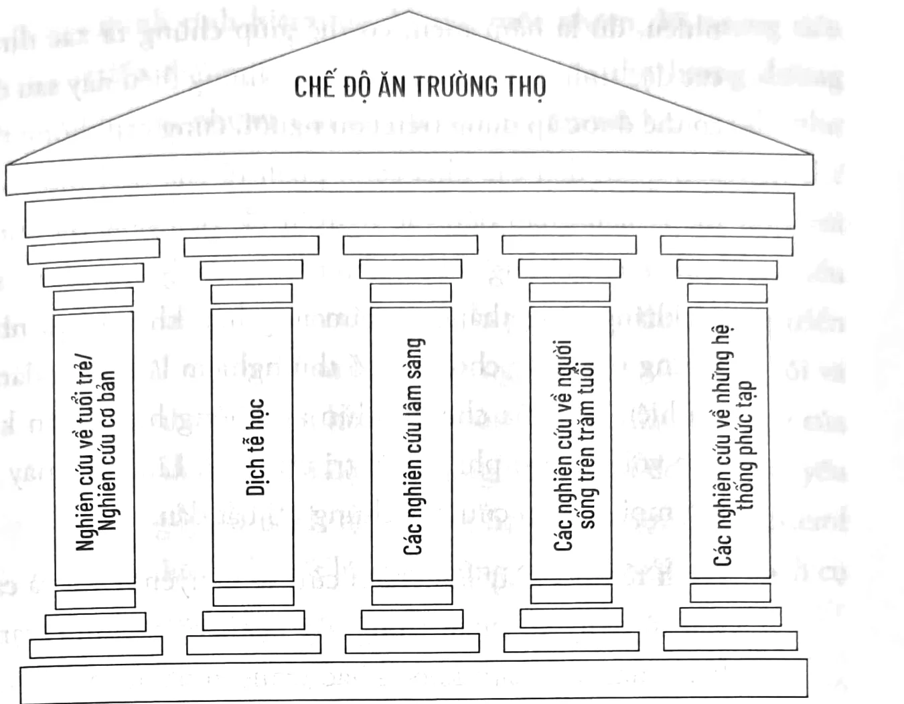

<!-- sách 56 · PDF 48 -->
## CHƯƠNG 3

### NĂM TRỤ CỘT

### CUỘC CÁCH MẠNG VỀ TUỔI THỌ

Hầu hết các chế độ ăn phổ biến và các chuyên gia đằng sau chúng không xét tới lý do quan trọng nhất khi áp dụng một chế độ ăn: đó là sống lâu và “chết khỏe mạnh”. Chúng ta quá quen với việc gắn liền cái chết với ung thư, bệnh tim hoặc các bệnh khác, khái niệm “chết khỏe mạnh” dường như xa lạ. Nhưng đó là triển vọng của “cuộc cách mạng về tuổi thọ”. Khái niệm này hiện được ủng hộ mạnh mẽ bởi thử nghiệm trên các sinh vật đơn giản, chuột, khỉ và người. Dựa vào sinh học lão khoa¹ (nghiên cứu về sinh học tuổi già), y học dự phòng và nghiên cứu tuổi thọ, hiện nay chúng ta biết rằng những năm cuối cuộc đời, ngay cả khi tuổi thọ tăng lên, không nhất thiết phải đi kèm với sức khỏe kém và bệnh tật.

Ví dụ, những cá thể chuột trong phòng thí nghiệm được cho ăn với Chế độ ăn Trường thọ sống lâu hơn tới 40% và ít mắc bệnh hơn dù tuổi thọ của chúng dài hơn so với chuột theo chế độ ăn tiêu chuẩn. Các nghiên cứu dài hạn trên khỉ với chế độ ăn hạn chế calo cho thấy tỷ lệ mắc bệnh giảm đáng kể

¹ Nguyên văn: Biogerontology.

<!-- sách 57 · PDF 49 -->
cũng như kéo dài tuổi thọ. Kết quả này tương đồng với nghiên cứu gần đây của chúng tôi cho thấy nạp nhiều protein có liên quan đến ung thư và tử vong ở người. Hơn nữa, chúng tôi phát hiện ra rằng, giống những chú chuột sống lâu và thiếu thụ thể hormone tăng trưởng, người Ecuador thiếu thụ thể GH hiếm khi mắc bệnh tiểu đường hay ung thư và dường như được bảo vệ khỏi tình trạng suy giảm nhận thức do tuổi tác và các bệnh khác. Do đó, các can thiệp về chế độ ăn ảnh hưởng đến các gen cụ thể hoặc biến đổi di truyền trong các gen đó có thể trực tiếp kéo dài không chỉ tuổi thọ mà là tuổi thọ khỏe mạnh ở chuột, động vật linh trưởng và con người. Theo các nghiên cứu này, một Chế độ ăn Trường thọ nghiêm ngặt kèm theo nhịn ăn không hoàn toàn định kỳ (được mô tả lần lượt trong Chương 4 và 6) có thể kéo dài tuổi thọ khỏe mạnh bằng việc điều hòa nhóm “gen quy định tuổi thọ”.

Tôi thật may mắn khi được chứng kiến tận mắt thế nào là tuổi thọ khỏe mạnh. Trong 10 năm qua, tôi đã nhiều lần đến thăm hai người lớn tuổi nhất nước Ý: Salvatore Caruso, 110 tuổi và Emma Morano, 117 tuổi, cả hai hiện đều đã qua đời. Emma cũng là người sống lâu nhất thế giới và là người cao tuổi nhất trong lịch sử nước Ý. Cả hai đều giữ được trí nhớ tốt, tham gia nhiều hoạt động khi ở tuổi xế chiều và là những tấm gương tuyệt vời về tuổi thọ khỏe mạnh. Emma là minh chứng cho tầm quan trọng của sự di truyền đối với tuổi thọ (chế độ ăn uống của bà không thực sự lành mạnh), trong khi Salvatore cho thấy ảnh hưởng của chế độ ăn uống đối với sức khỏe con người. Vì vậy, nghiên cứu về người và quần thể có tuổi thọ kỷ lục đại diện cho một trong những trụ cột cơ bản mà tôi sử dụng để xây dựng Chế độ ăn Trường thọ được mô tả trong cuốn sách này.

<!-- sách 58 · PDF 50 -->
### BẠN NÊN NGHE THEO AI?

Với các yếu tố quyết định tuổi thọ trong tầm kiểm soát, những thực phẩm bạn tiêu thụ là lựa chọn căn bản sẽ ảnh hưởng đến việc bạn có sống đến 60, 80, 100 hay 110 tuổi – và quan trọng hơn, liệu bạn có khỏe mạnh ở độ tuổi đó hay không. Vì thế, khi nói đến các khuyến nghị về chế độ ăn, điều cốt yếu là nghe theo đúng người. Trong một thế giới xoay quanh Internet, có lẽ thứ nguy hiểm nhất đối với sức khỏe của bạn là sự hỗn loạn do ý niệm rằng tất cả mọi người đều có thể đưa ra lời khuyên về chế độ dinh dưỡng. Cần phải xác định xem liệu người được gọi là chuyên gia về chế độ ăn uống có trình độ như thế nào trước khi quyết định họ có đủ tiêu chuẩn để đưa ra lời khuyên cho bạn hay không.

Trên một chuyến tàu từ Milan về Genoa gần đây, tôi đã có một trong nhiều trải nghiệm thú vị để thấy mọi người đều tin rằng họ là chuyên gia về chế độ ăn. Một người đàn ông quản lý tòa nhà đến từ Genoa đã giải thích cách món trứng ốp-lết của vợ ông là chìa khóa giúp ông duy trì cân nặng và sức khỏe. Người phụ nữ ngồi cạnh phản đối bởi trứng có hàm lượng cholesterol cao còn món mì ống với bí ngòi của cô mới tốt cho sức khỏe hơn. Khi năm “chuyên gia dinh dưỡng” như vậy đã đưa ra các khuyến nghị, họ băn khoăn tại sao tôi không tham gia câu chuyện.

Tôi nói với người quản lý đã nghỉ hưu: “Tôi nghĩ ông nên ăn ít trứng ốp-lết.”

Ông trả lời: “Anh biết không, tôi nghĩ tôi không ưa gì anh.”

Bởi ai cũng ăn, ai cũng cảm thấy mình đủ hiểu biết về thực phẩm và sức khỏe để khuyên răn người khác. Gần đây, một người phụ nữ hỏi tôi về việc cô và con trai nên ăn gì để khỏe mạnh. Sau khi nghe câu trả lời, cô đáp: “Tôi nghĩ tốt nhất là ăn tất cả mọi thứ một cách điều độ.”

<!-- sách 59 · PDF 51 -->
Tôi hỏi lại: “Chị có bay trên chiếc máy bay do chính mình thiết kế không?”

Cô biết câu trả lời đúng cho câu hỏi đó là chắc chắn không. Hầu hết các máy bay được thiết kế bởi đội ngũ các kỹ sư đẳng cấp thế giới làm việc tại các công ty hàng không lớn như Boeing và Airbus, sử dụng công nghệ và sự hiểu biết từ thời có anh em nhà Wright và thậm chí là Leonardo da Vinci. Tại sao bạn sẵn sàng đưa ra những quyết định quan trọng ảnh hưởng đến việc liệu bạn và những người thân yêu của mình có bị ung thư, tiểu đường, bệnh tim mạch và nhiều bệnh khác dựa trên ý nghĩ ngây thơ rằng người ta nên “ăn uống điều độ”? Điều đó có nghĩa lý gì chứ?

Trong lớp học về dinh dưỡng và tuổi thọ của tôi tại Đại học Nam California, tôi hỏi sinh viên có bao nhiêu calo trong một chiếc bánh vòng. Hầu hết nghĩ là khoảng 100 hoặc 150 calo. Trên thực tế, hầu hết các loại bánh vòng cung cấp khoảng 250-500 calo, không tính phô mai kem. Khi tôi bắt đầu hướng dẫn các thử nghiệm lâm sàng cho phép những người tham gia được biết chính xác những gì họ có thể ăn, tôi phát hiện ra rằng hầu hết mọi người không biết ăn 0,36 gram protein cho mỗi kg trọng lượng cơ thể trong một ngày nghĩa là gì. Ngay cả các nhà báo chuyên về sức khỏe giàu kinh nghiệm nói rằng: “Tôi không rõ ý anh là tôi nên ăn 50 gram protein hay 50 gram thực phẩm chứa protein mỗi ngày.”

Ý tôi là protein, không phải thực phẩm chứa protein. Chỉ hiểu lầm nhỏ này có thể khiến một người suy dinh dưỡng hoặc bị ốm – 50 gram đậu garbanzo¹ chứa 5 gram protein, chỉ bằng 10% lượng protein một người trưởng thành cần để duy trì sức khỏe.

1. Hay được gọi là đậu gà.

<!-- sách 60 · PDF 52 -->
Tôi cũng học được rằng khái niệm “điều độ” là tương đối. Hãy xem xét thực đơn hằng ngày sau: một ly sữa, hai quả trứng và thịt xông khói, một miếng bít tết nhỏ, một lát phô mai, một ít cà rốt, một ít mì ống, một miếng thăn gà, salad với nước xốt ranch, một miếng bánh và hai lon nước ngọt có ga. Với nhiều người, đây là thực đơn điển hình cho việc ăn uống điều độ. Nhưng chính chế độ ăn này đã biến Mỹ trở thành một trong những nước đứng đầu thế giới về tỷ lệ béo phì và các bệnh liên quan. Mặc dù hầu hết những người khỏe mạnh có thể tự thực hiện những thay đổi về chế độ ăn, tôi khuyên bạn, nếu có thể hãy tham khảo ý kiến của một bác sĩ đủ chuyên môn hoặc chuyên gia dinh dưỡng, ít nhất là lúc ban đầu và đặc biệt nếu bạn bị dị ứng với một số thực phẩm và có thể cần giúp đỡ để có chế độ ăn riêng theo nhu cầu của bạn. Bạn đã mua cuốn sách này, vì vậy bạn đang đi đúng hướng.

Như tôi đã nói, phần lớn các khuyến nghị về chế độ ăn trong cuốn sách này không dựa trên quan điểm của tôi, mà dựa vào Năm Trụ cột của sự Trường thọ với bằng chứng khoa học và lâm sàng vững chắc và nhất quán. Tôi không nói về “chế độ ăn thần kỳ” hay “phương pháp chữa bệnh”. Tôi cũng tránh xa các chế độ ăn theo lời hứa hẹn việc giảm cân. Thay đổi chế độ ăn của bạn để hướng tới tuổi thọ khỏe mạnh sẽ tốn chút công sức. Nhưng nó dễ hơn bạn tưởng rất nhiều. Trong nhiều trường hợp, nếu cân nhắc đến cả hiệu quả và tác dụng phụ, nó sẽ có lợi hơn liệu pháp điều trị bằng thuốc. Chưa kể bạn còn tiết kiệm được tiền khám bệnh và thuốc men. Về lâu dài, lợi ích của việc nâng cao tuổi thọ sẽ xứng đáng với nỗ lực đó.

Tôi tự tin với những tuyên bố này bởi kết quả tích cực của hàng nghìn người tham gia nghiên cứu, dù là cá nhân hay thông qua nghiên cứu cơ bản, các thử nghiệm lâm sàng, nghiên cứu

<!-- sách 61 · PDF 53 -->
di truyền hay dịch tễ học. Tôi cũng tự tin vì hầu hết các khuyến nghị của tôi về chế độ ăn hằng ngày phù hợp với chế độ ăn của những quần thể sống thọ mà tôi và các chuyên gia khác như Craig Wilcox ở Okinawa, đã nghiên cứu. Những người này tập trung ở “vùng xanh” (blue zones), một thuật ngữ do Michel Poulain và Gianni Pes đặt ra và được tác giả Dan Buettner phổ biến rộng khắp, nhằm xác định các điểm nóng về tuổi thọ, nơi chế độ ăn uống và mức độ hoạt động thể chất được cho là nhân tố quan trọng trong việc nâng cao tuổi thọ. Cuốn sách này cũng xem xét các thói quen ăn uống phổ biến trong quá khứ. Ví dụ, các khuyến nghị điều trị bệnh của tôi trong các chương sau, đặc biệt là nhịn ăn và chế độ nhịn ăn không hoàn toàn, được dựa trên các nghiên cứu khoa học và lâm sàng; nhưng nhiều biện pháp trong số đó bắt nguồn từ các thông lệ cổ xưa, như nhịn ăn theo tín ngưỡng tôn giáo. Trong lịch sử, nhịn ăn theo tôn giáo không dùng để ngăn ngừa hoặc điều trị bệnh, nhưng vì nó phổ biến đối với tổ tiên và hiện đã được thử nghiệm trên hàng nghìn người, ta biết nó khả thi và an toàn.

### NĂM TRỤ CỘT CỦA SỰ TRƯỜNG THỌ

Hầu hết mọi người đều nản chí và bối rối trước những tin tức dinh dưỡng. Các nhóm chất dinh dưỡng (chất béo, protein và carbohydrate) cùng các loại thực phẩm cụ thể như trứng và cà phê đều được mô tả trên tạp chí khoa học và các phương tiện truyền thông, lúc thì có lợi lúc thì có hại cho người tiêu thụ. Làm thế nào để có thể quyết định cái gì phù hợp với bạn và sức khỏe của bạn? Trên thực tế, protein, chất béo và carbohydrate có thể được coi là lợi hay hại tùy thuộc vào loại và lượng tiêu thụ. Ví dụ, protein cần thiết cho hoạt động bình thường của cơ thể, nhưng lượng protein cao và đặc biệt là từ thịt đỏ và các nguồn động vật khác, liên quan đến tăng tỷ lệ mắc một số bệnh. Vì thế, chúng ta

<!-- sách 62 · PDF 54 -->
cần một hệ thống tốt hơn để chọn lọc những thông tin hữu ích về chế độ ăn uống.

Đây là lý do tại sao tôi xây dựng “Năm Trụ cột của sự Trường thọ”. Phương pháp này dựa trên nghiên cứu của riêng tôi cũng như nghiên cứu của nhiều phòng thí nghiệm và bác sĩ lâm sàng khác. Nó sử dụng năm lĩnh vực nghiên cứu để xác định xem một chất dinh dưỡng hoặc sự kết hợp các chất dinh dưỡng sẽ có lợi hay có hại cho sức khỏe và xác định sự kết hợp thực phẩm lý tưởng để tối đa hóa tuổi thọ.

Tôi tin rằng nhiều chiến lược và chế độ ăn được ưa chuộng không phù hợp hoặc chỉ đúng phần nào bởi chúng chỉ dựa trên một hoặc hai trụ cột mà thôi. Điều này rất quan trọng vì một chất dinh dưỡng có thể bảo vệ cơ thể khỏi tình trạng hoặc bệnh lý nào đó nhưng có thể có tác động tiêu cực khác, hoặc nó có thể bảo vệ những người ở tuổi trung niên nhưng lại có hại cho người rất trẻ hoặc người già. Ví dụ: Với người dưới 70 tuổi, một chế độ ăn tương đối nhiều calo hầu như sẽ dẫn đến tăng cân và tăng nguy cơ mắc một số bệnh. Tuy nhiên, với những người trên 70 tuổi, chế độ ăn tương tự và tăng cân vừa phải có thể chống lại một số bệnh và tỷ lệ tử vong nói chung. Đó là lý do tại sao bạn nên nghe theo lời khuyên từ người có hiểu biết sâu sắc về mối quan hệ phức tạp giữa dinh dưỡng, lão hóa và bệnh tật.

Năm Trụ cột của sự Trường thọ tạo nên nền tảng vững chắc cho các khuyến nghị về chế độ ăn uống và một hệ thống sàng lọc để đánh giá hàng nghìn nghiên cứu liên quan đến lão hóa và bệnh tật, đồng thời giảm thiểu gánh nặng của việc thay đổi chế độ dinh dưỡng. Khi các lựa chọn về chế độ ăn dựa trên trên tất cả Năm Trụ cột, chúng hầu như không mâu thuẫn hay bị thay đổi đáng kể sau khi có những phát hiện mới.

<!-- sách 63 · PDF 55 -->

Hình 3.1. Năm trụ cột của sự trường thọ

* Nghiên cứu cơ bản/Nghiên cứu về tuổi trẻ. Nếu không hiểu các chất dinh dưỡng – chẳng hạn protein và đường – ảnh hưởng đến chức năng, sự lão hóa, tổn thương phụ thuộc vào tuổi tác và sự tái tạo của tế bào như thế nào thì rất khó có thể xác định loại và lượng chất dinh dưỡng cần thiết để tối ưu hóa tuổi thọ khỏe mạnh. Nếu không có các nghiên cứu trên động vật để xác định liệu một chế độ ăn trên thực tế có thể kéo dài tuổi thọ hay không, bên cạnh những tác động cấp tính đến sức khỏe nói chung, rất khó để chuyển những khám phá cơ bản thành biện pháp can thiệp đối với con người. Như đã đề cập trước đó, tôi bắt đầu thí nghiệm trên chuột và con người trong phòng thí nghiệm của Walford, nhưng tôi sớm phát hiện có một sinh vật đơn bào đơn giản hơn

<!-- sách 64 · PDF 56 -->
nhiều, đó là nấm men, có thể giúp chúng ta xác định các đặc tính cơ bản của sinh vật. Những điều này sau đó có thể được áp dụng trên con người, cung cấp thông tin liên quan đến các khía cạnh phân tử của tuổi thọ – cụ thể là liên quan đến các nguyên tắc tiến hóa. Sử dụng nấm men, chúng tôi có thể tạo ra các lý thuyết về sự đề kháng căng thẳng và cảm ứng hóa khác nhau như những nền tảng cho một số thử nghiệm lâm sàng đánh giá hiệu quả của chế độ nhịn ăn không hoàn toàn kết hợp với các liệu pháp điều trị ung thư. Lĩnh vực này là nơi mọi nghiên cứu của chúng tôi bắt đầu.

* **Dịch tễ học.** Đây là nghiên cứu về nguyên nhân và các yếu tố nguy cơ quan trọng gây bệnh và các tình trạng liên quan đến sức khỏe khác trong một quần thể xác định. Nghiên cứu các yếu tố nguy cơ dựa trên quần thể là điều thiết yếu để kiểm chứng các giả thuyết do nghiên cứu cơ bản đặt ra. Ví dụ, nếu bạn đưa ra giả thuyết lượng đường dư thừa thúc đẩy trữ mỡ bụng và kháng insulin, nghiên cứu dịch tễ học nên chứng minh rằng những người tiêu thụ nhiều đường có vòng bụng lớn và tăng nguy cơ mắc bệnh tiểu đường. Sau trọng tâm ban đầu là di truyền học lão hóa và nghiên cứu về tuổi trẻ, tôi đã thực hiện các nghiên cứu dịch tễ học liên quan đến lão hóa và bệnh tật. Chúng dạy cho tôi giá trị to lớn của việc hiểu các hậu quả đối với sức khỏe của hành vi trong một quần thể lớn.

* **Các nghiên cứu lâm sàng.** Những giả thuyết hình thành từ các nghiên cứu cơ bản và dịch tễ học cuối cùng phải được kiểm chứng bằng các thử nghiệm lâm sàng ngẫu nhiên có đối chứng. Đây là tiêu chuẩn vàng để chứng

<!-- sách 65 · PDF 57 -->
minh tính hiệu quả. Ví dụ, một nhóm đối tượng tiền tiểu đường sẽ được hướng dẫn tiêu thụ lượng đường ít hơn nhưng vẫn duy trì chế độ ăn với lượng calo như trước. Nhóm đối chứngⁱ cũng được yêu cầu duy trì chế độ ăn đó hoặc giảm lượng chất béo để phù hợp với lượng calo giảm xuống của nhóm nghiên cứu. Việc hiểu biết về tầm quan trọng của trụ cột này được phát triển từ các thử nghiệm lâm sàng ngẫu nhiên của riêng tôi và của nhiều người khác. Nó còn đánh giá ảnh hưởng của một thành phần cụ thể trong chế độ ăn đối với các yếu tố nguy cơ bệnh tật, chẳng hạn như lượng cholesterol hay đường huyết lúc đói, cũng như đối với một bệnh cụ thể, như bệnh tim mạch.

* **Các nghiên cứu về người sống trăm tuổi.** Sau khi có được dữ liệu từ các nghiên cứu cơ bản/nghiên cứu về tuổi trẻ, dịch tễ học và lâm sàng, vẫn chưa thể chắc chắn liệu một chế độ ăn hoặc chỉ định dinh dưỡng cụ thể có thực sự an toàn, có lợi khi áp dụng lâu dài và đủ ngon để mọi người không chỉ chấp nhận mà còn gắn bó với nó cho đến cuối đời hay không. Các nghiên cứu về những quần thể trăm tuổi ở khắp nơi trên thế giới cung cấp bằng chứng về tính an toàn, hiệu quả một chế độ ăn uống cụ thể (ví dụ: chế độ ăn ít đường) và việc tuân thủ chế độ ăn đó. Để có dữ liệu cho trụ cột thứ tư, tôi đã nghiên cứu các quần thể có tuổi thọ cao ở Ecuador và miền nam nước Ý, đồng thời tham khảo

---

i. Nhóm đối chứng: nhóm được các nhà nghiên cứu giữ nguyên trạng, không tác động vào, và được dùng như điểm mốc để đo lường những đối tượng kiểm tra khác.

<!-- sách 66 · PDF 58 -->
công việc của các đồng nghiệp tập trung vào những nhóm dân cư sống rất thọ ở các khu vực khác trên khắp thế giới.

* **Các nghiên cứu về những hệ thống phức tạp.** Trụ cột này là kết quả từ niềm đam mê của tôi với chủ nghĩa giản lược, vật lý và nhu cầu đơn giản hóa sự phức tạp của cơ thể con người bằng cách xác định các máy móc có thể dùng làm mô hình để học về chức năng, sự mất chức năng của các cơ quan và hệ thống trong cơ thể con người. Trụ cột cuối cùng này có thể bổ sung cho những trụ cột khác bằng cách cung cấp các điểm tham chiếu và phép loại suy hữu ích. Ví dụ, trên đây tôi đã thảo luận về cách đường có thể dẫn đến bệnh tật, nhưng nó cũng là chất dinh dưỡng quan trọng nhất đối với cơ thể con người. Đường đối với cơ thể như xăng đối với ô tô, là nguồn cung cấp năng lượng chính. Vì vậy, đường không phải là vấn đề. Việc tiêu thụ quá nhiều đường, kết hợp với protein và một số loại chất béo, góp phần gây bệnh một cách trực tiếp và gián tiếp – bằng cách kích hoạt các gen liên quan đến lão hóa, gây ra sự kháng insulin và tăng đường huyết – mới là vấn đề. Trụ cột cuối cùng này thúc đẩy việc phân tích một vấn đề của con người theo cách tiếp cận kỹ thuật, tạo ra một mô hình tương đối đơn giản để hiểu sự tương tác phức tạp giữa thức ăn, tổn thương tế bào và lão hóa.

### ỨNG DỤNG NĂM TRỤ CỘT CỦA SỰ TRƯỜNG THỌ

Để thí dụ về việc áp dụng Năm Trụ cột để phân tích hiệu quả của một chế độ ăn, hãy cùng xem xét một chế độ ăn rất phổ biến, giàu protein, chất béo và low-carb (ít carbohydrate), như chế độ

<!-- sách 67 · PDF 59 -->
Atkinsⁱ và Dukanⁱⁱ. Bạn có nên theo chế độ ăn này chỉ vì một “chuyên gia” nói rằng một thử nghiệm lâm sàng nhỏ hay thậm chí nghiên cứu dịch tễ học lớn cho thấy nó giúp giảm cân và có thể làm giảm cholesterol? Câu trả lời chắc chắn là không, vì khi bạn phân tích những chế độ ăn này, chúng thường chỉ dựa trên một hoặc hai trụ cột, hiếm khi xem xét toàn bộ nền tảng cần thiết cho sự lựa chọn một chế độ ăn sẽ tối ưu hóa sức khỏe và tuổi thọ. Đó là những chế độ ăn thường dần bị kém ưu chuộng theo thời gian. Khi nhìn vào các nghiên cứu đa ngành, bạn nhận thấy rằng hàm lượng cao protein và chất béo bão hòa và ít carbohydrate (carb) là một trong những điều tồi tệ nhất đối với sức khỏe của bạn. Các quần thể với tuổi thọ kỷ lục không ăn như vậy, và rất ít nghiên cứu lý thuyết, lâm sàng và dịch tễ học ủng hộ các lợi ích lâu dài đối với tuổi thọ của cách ăn kiêng này. Ngoài ra, nếu xem xét các nghiên cứu trong phòng thí nghiệm, chúng ta thấy rằng cả lượng protein cao và lượng chất béo bão hòa cao có liên quan đến lão hóa và bệnh tật, một lá phiếu bổ sung và quan trọng chống lại chế độ ăn giàu protein và chất béo bão hòa.

Như bạn có thể thấy, ngay cả khi một chế độ ăn được quảng cáo là được nghiên cứu lâm sàng, điều đó không có nghĩa là nó đã được nghiên cứu một cách chặt chẽ, vì thế bạn nên nghi ngờ trước khi áp dụng một chế độ ăn mới và kiểm tra xem nó dựa trên bao nhiêu trong số năm trụ cột trên. Như chúng tôi đã chỉ ra trong cả nghiên cứu trên người và chuột, một chế độ ăn phù

i. Chế độ ăn kiêng Atkin: do Tiến sĩ Robert C. Atkin khởi xướng từ năm 1972. Chế độ này khuyến khích tiêu thụ các loại thực phẩm giàu đạm, chất béo, rau củ và cắt bỏ hoặc hạn chế các loại tinh bột hấp thụ nhanh.
ii. Chế độ ăn kiêng Dukan: do Tiến sĩ Pierre Dukan tạo ra vào những năm 1970. Chế độ ăn này khuyến khích nạp nhiều thực phẩm chứa nhiều protein, nhưng hạn chế carb và chất béo.

<!-- sách 68 · PDF 60 -->
hợp với hầu hết nhưng không phải với tất cả và mức độ của một số thành phần dinh dưỡng phải được điều chỉnh tùy theo tuổi tác và trạng thái thể chất của mỗi người và dựa trên bộ gen của người đó. Trong phòng thí nghiệm của tôi, chúng tôi coi thực phẩm như một hỗn hợp phức tạp các phân tử – mỗi thành phần có khả năng gây ra những thay đổi đáng kể trong cơ thể bạn và là hỗn hợp phức tạp các phân tử của riêng chúng.

Nếu điều đó nghe có vẻ khó hiểu hoặc khó theo dõi, đừng lo lắng, tôi sẽ khiến nó đơn giản nhất có thể trong Chương 4.
