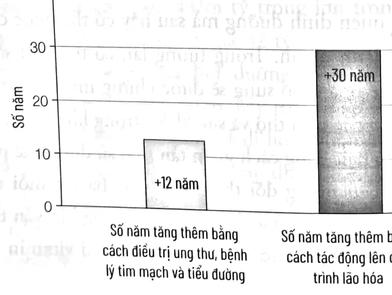
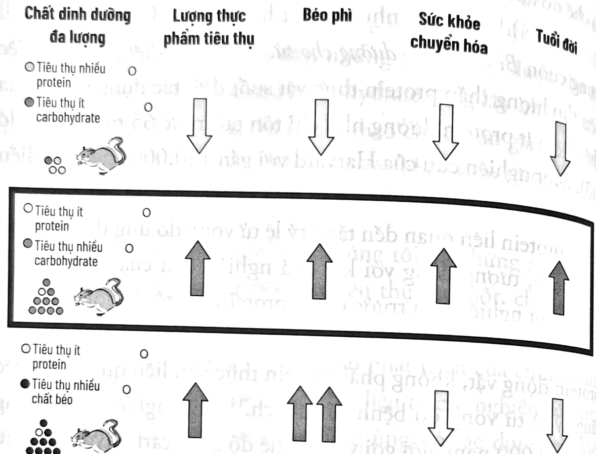
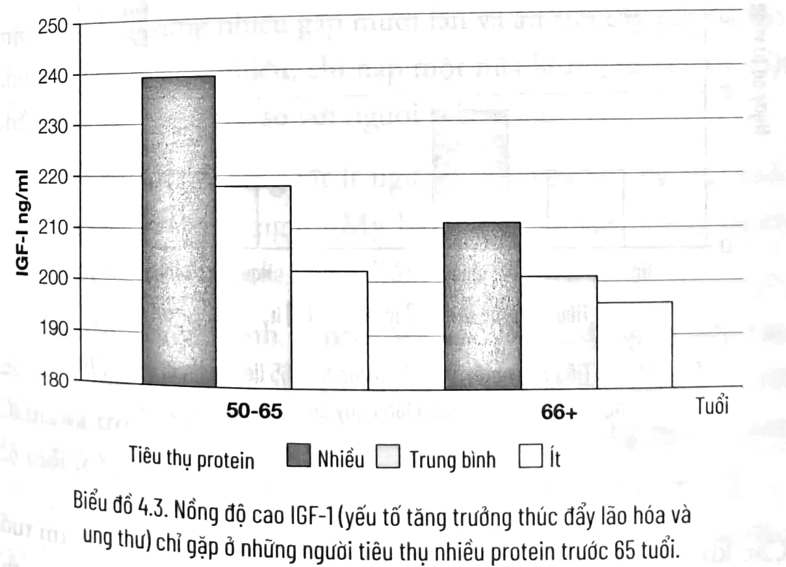
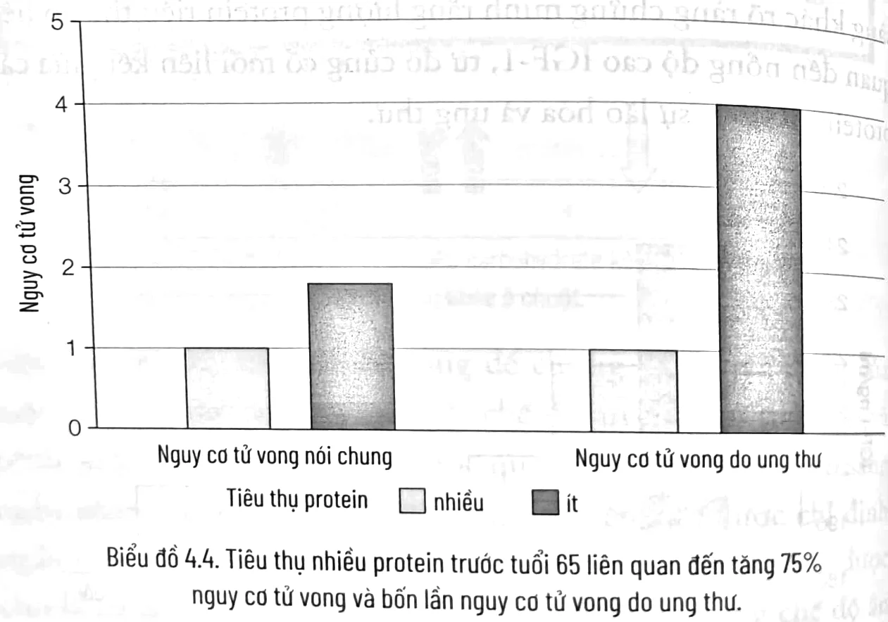
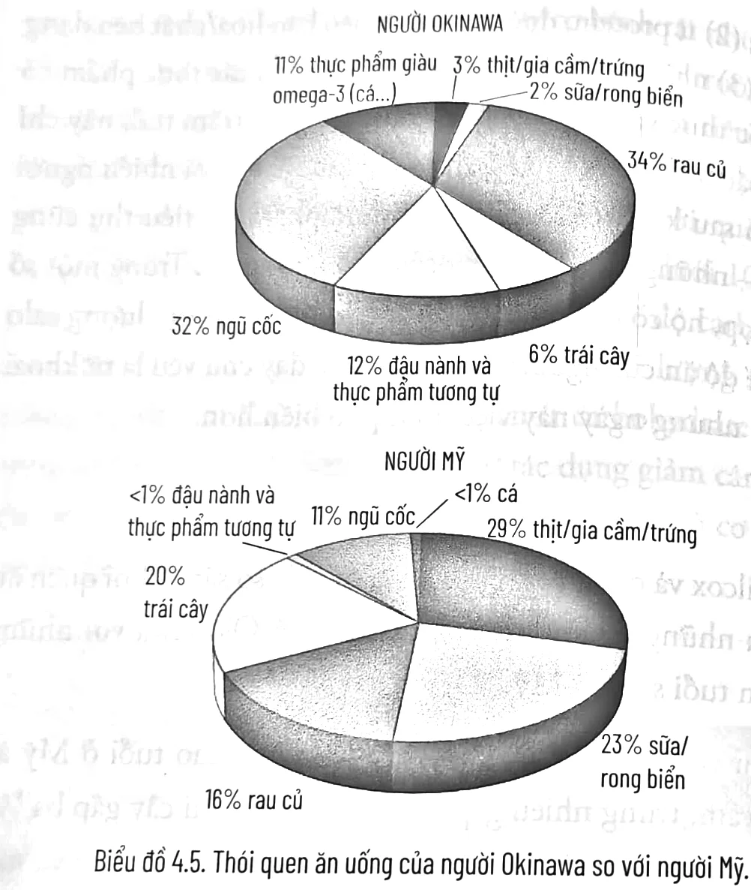
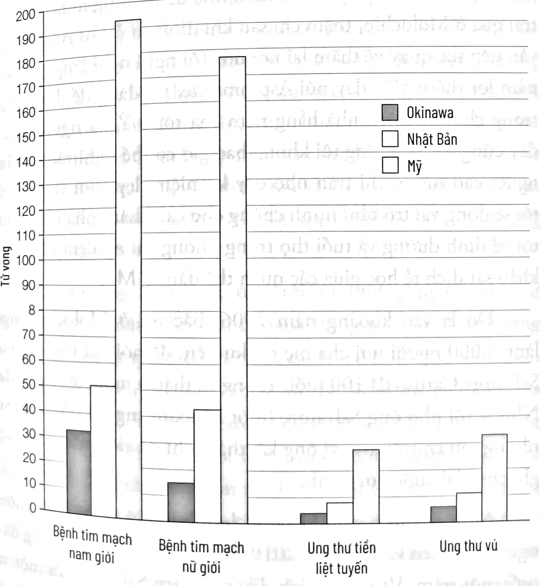
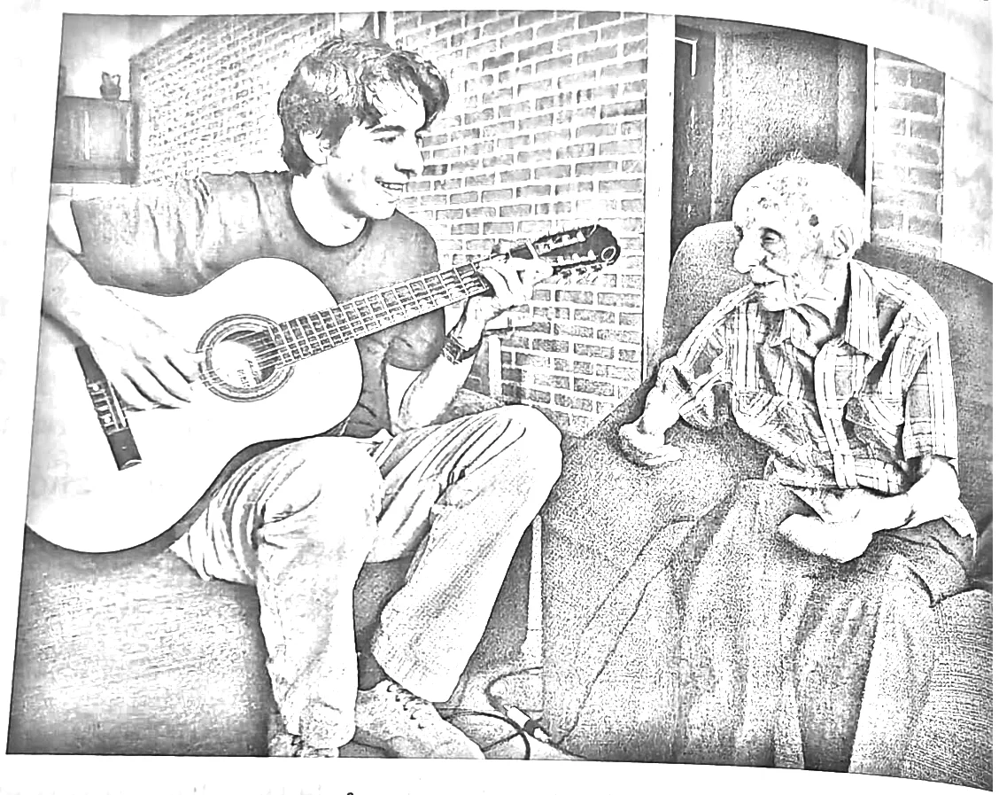
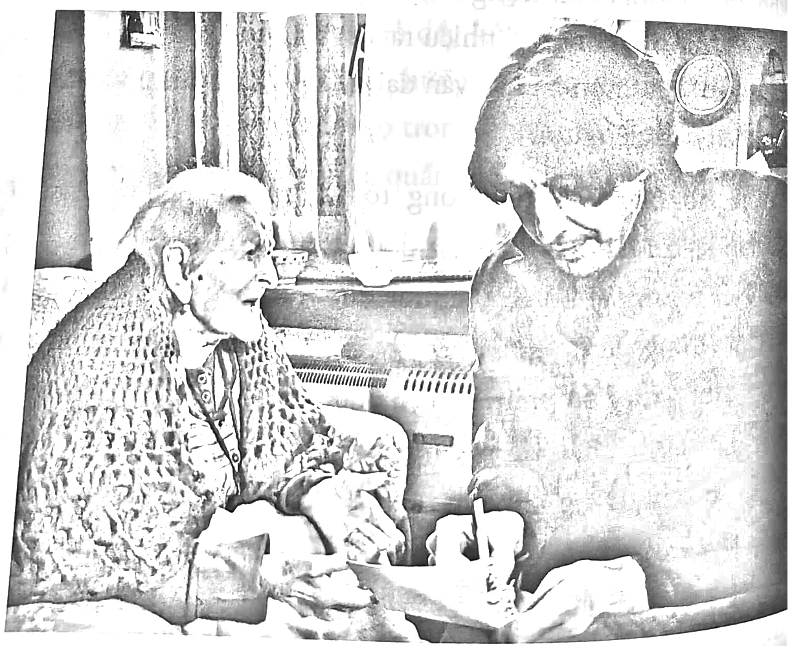

<!-- sách 69 · PDF 61 -->
# CHƯƠNG 4

## CHẾ ĐỘ ĂN TRƯỜNG THỌ

### BẠN LÀ HIỆN THÂN CỦA NHỮNG GÌ BẠN ĂN

Tất cả chúng ta đều biết câu nói “Bạn là hiện thân của những gì bạn ăn.” Hầu hết mọi người đều hiểu câu đó nghĩa là “tránh đồ ăn vặt”. Nhưng câu nói quen thuộc này có ý nghĩa sâu xa hơn thế. Thứ bạn ăn có thể quyết định ngoại hình và hiệu quả hoạt động của bạn, ban đêm bạn có ngủ ngon giấc hay không, bạn sẽ mảnh mai hay tăng cân, và cơ thể của bạn giống hình quả lê hay quả táo. Loại thực phẩm bạn ăn quyết định bộ não của bạn sẽ sử dụng năng lượng từ glucose hay các thể ketone; và nếu bạn là phụ nữ, loại thức ăn và số lượng bạn ăn có thể ảnh hưởng đến khả năng mang thai. Ăn đồ ăn khoái khẩu của mình rất quan trọng, nhưng cũng cần phải loại bỏ hoặc hạn chế tối đa việc tiêu thụ những thực phẩm sẽ khiến cuộc đời của bạn ngắn hơn và cuộc sống ốm yếu hơn, tăng cường tiêu thụ những chất dinh dưỡng sẽ giúp bạn sống lâu hơn và khỏe mạnh hơn.

Nhiều thành phần không chỉ là thức ăn; chúng thực ra là các phân tử gây ra thay đổi đáng kể trong cơ thể – những thay đổi về nồng độ và sự kết hợp của chúng có thể tái lập trình chức năng của các tế bào và cơ quan trong cơ thể. Như đã nói ở trên, tôi gọi sự hiểu biết và ứng dụng các cách phối hợp thực phẩm

<!-- sách 70 · PDF 62 -->
nhằm kiểm soát những thay đổi này là “công nghệ dinh dưỡng”. Trong chương này, tôi sẽ mô tả ngắn gọn các thành phần này và tác dụng của chúng. Sau đó, tôi sẽ giải thích vai trò của chúng trong quá trình lão hóa và bệnh tật, dựa trên bằng chứng sử dụng Năm Trụ cột của sự Trường thọ. Tôi cũng tập trung vào sự hấp dẫn của thức ăn – một yếu tố quan trọng có thể quyết định khả năng ai đó tiếp tục duy trì một chế độ ăn.

### PROTEIN, CARBOHYDRATE, CHẤT BÉO VÀ CÁC VI CHẤT DINH DƯỠNG

Có ba thành phần chính – gọi là các chất dinh dưỡng đa lượng – trong thức ăn của chúng ta.

1. **Protein** cơ bản được cấu thành từ 20 axit amin, trình tự sắp xếp của chúng xác định chức năng cụ thể của mỗi loại protein. Ví dụ, một miếng bít tết 85 gram chứa khoảng 25 gram protein. Một trong những protein có nhiều nhất trong thịt là actin, nó tham gia vào sự co cơ và nhiều chức năng khác của tế bào. Sau khi ăn thịt, hệ tiêu hóa phân giải thịt thành protein, sau đó thành các axit amin. Những axit amin này đầu tiên được giải phóng ở dạ dày và sau đó đến ruột. Chúng được hấp thụ vào máu ở dạng axit amin đơn hoặc các chuỗi gồm nhiều axit amin. Cuối cùng, các axit amin được phân bổ đến các loại tế bào khác nhau khắp cơ thể, nơi chúng được sử dụng để tạo ra protein mới, bao gồm cả actin được tìm thấy trong tế bào cơ của con người.

2. **Carbohydrate** có trong hầu hết các loại thực phẩm, ở dạng đơn giản (đường trong nước trái cây, mật ong, kẹo, hoặc soda) hay ở dạng phức tạp (các chuỗi glucose và các loại đường khác trong rau củ hoặc ngũ cốc). Đường ở dạng đơn có thể đi vào máu ngay lập tức, làm

<!-- sách 71 · PDF 63 -->
tăng nồng độ glucose trong máu và kích hoạt tuyến tụy nhanh chóng giải phóng insulin. Carbohydrate phức tạp phải được phân tách khỏi các thành phần khác trong thực phẩm và được phân giải thành đường đơn trước khi cơ thể có thể hấp thụ được.

Khi phân tích giá trị dinh dưỡng của một loại thực phẩm về mặt carbohydrate và chất lượng, có một vài tiêu chuẩn đo lường khác nhau. Bạn có thể đã nghe qua thuật ngữ “chỉ số đường huyết”(glycemic index) và “tải lượng đường huyết” (glycemic load). Chỉ số đường huyết đề cập đến tác động của một thực phẩm cụ thể lên nồng độ glucose trong máu. Nước cam có chỉ số đường huyết khoảng 50; bánh mì trắng có chỉ số là 95; một thức uống chỉ chứa glucose có chỉ số là 100. Tuy nhiên, chỉ số đường huyết giả định rằng bạn đang ăn một khẩu phần carbohydrate tiêu chuẩn. *Tải lượng đường huyết* là một phép đo hữu ích hơn bởi chỉ số này thể hiện thông tin về cả đặc điểm của một loại carbohydrate cụ thể và số lượng của nó. Ví dụ, bánh mì nguyên cám có chỉ số đường huyết cao (71) nhưng một lát bánh mì nguyên cám có tải lượng đường huyết tương đối thấp (9). So sánh với bánh bông lan, chỉ số đường huyết tương đối thấp (46) nhưng tải lượng đường huyết cao hơn (17). Bạn nên chú tâm hơn đến tải lượng đường huyết, vì nó tính đến cả chất lượng và số lượng của đường trong thực phẩm.¹

3. **Chất béo** là nguồn năng lượng dự trữ chính của cơ thể, ở người cũng như các loài động vật có vú khác và các sinh vật đơn giản hơn. Các phân tử chất béo biến đổi cũng có những đóng góp quan trọng khác trong tế bào, chẳng hạn như vai trò chính trong việc tạo ra màng ngăn cách thành

<!-- sách 72 · PDF 64 -->
phần bên trong tế bào với máu, và tạo ra các hormone, kể cả steroid. Chất béo chủ yếu được tiêu thụ dưới dạng triglyceride, bao gồm ba chuỗi phân tử carbon và hydro (axit béo) liên kết với nhau bởi một phân tử glycerol. Sau khi tiêu hóa, chúng bị phân giải trong ruột bởi muối mật, tiết ra từ túi mật, và bởi các enzyme lipase được giải phóng từ tuyến tụy và các cơ quan khác để có thể hấp thụ được vào máu. Chất béo có thể ở dạng bão hòa (khi mỗi nguyên tử carbon liên kết với số lượng tối đa nguyên tử hydro) hoặc không bão hòa (khi carbon liên kết với ít hơn số nguyên tử hydro tối đa). Các chất béo không bão hòa có thể được chia thành chất béo không bão hòa đơn (ví dụ như axit oleic trong dầu ô liu) hoặc chất béo không bão hòa đa (chẳng hạn như trong cá hồi và dầu ngô). Chất béo không bão hòa đa omega-3 và omega-6 được gọi là “axit béo thiết yếu” vì cơ thể con người không thể tạo ra chúng, nhưng chúng rất cần thiết cho chức năng bình thường của các tế bào và cơ quan.

Ngoài ba chất dinh dưỡng đa lượng chính này, vi chất là một phần dinh dưỡng không thể thiếu. Vi chất dinh dưỡng, như các vitamin và khoáng chất, chiếm tỷ trọng lớn trong ngành công nghiệp chế phẩm bổ sung trị giá 37 tỷ đô la ở Mỹ. Tuy nhiên, nghiên cứu của chuyên gia dinh dưỡng là Tiến sĩ Bruce Ames và cộng sự cho thấy 50-90% người Mỹ trưởng thành thiếu vitamin D, E, magiê, vitamin A, canxi, kali hoặc vitamin K. Đồng thời, một số bài báo gần đây chỉ ra rằng thực phẩm chức năng chứa lượng vitamin và khoáng chất dư thừa không hiệu quả trong việc ngăn ngừa các bệnh nghiêm trọng cũng như kéo dài sự sống.² Một ngoại lệ trong thử nghiệm ngẫu nhiên có đối chứng lớn đã báo cáo rằng có sự giảm nhẹ tỷ lệ ung thư và đục thủy tinh thể ở những người dùng vitamin tổng hợp hằng ngày.³

<!-- sách 73 · PDF 65 -->
Mặc dù bổ sung hàm lượng cao vitamin và khoáng chất có thể không ngăn chặn được lão hóa hoặc bệnh tật, chúng tôi biết chúng rất quan trọng đối với nhiều chức năng thiết yếu của cơ thể. Ví dụ, vitamin D, kẽm và sắt rất quan trọng đối với chức năng miễn dịch. Canxi và vitamin D rất cần thiết trong việc duy trì mật độ khoáng xương bình thường.

Một chế độ ăn nhiều rau, cá, các loại hạt và ngũ cốc nguyên cám là cách lý tưởng để bổ sung các chất dinh dưỡng thiết yếu, nhưng ngay cả những chế độ ăn đó vẫn có thể thiếu vitamin D và vitamin B₁₂ đối với người ăn chay và người già. Hầu hết những người trên thế giới đang tuân theo chế độ ăn được coi là giàu dinh dưỡng cũng có những thiếu hụt tương tự. Một số nghiên cứu đã chỉ ra rằng liều cao của một số vitamin có thể gây độc, vì vậy, khuyến nghị lý tưởng, dựa trên ý kiến của cả những người ủng hộ và phản đối việc sử dụng chế phẩm bổ sung, là uống một loại vitamin tổng hợp được sản xuất bởi một công ty uy tín, có chứa ít nhất là vitamin D, E, magiê, vitamin A, canxi, kali, hay vitamin K, hai đến ba ngày một lần.

Như đã giải thích ở Chương 3, việc tìm tiếng nói chung để ủng hộ lợi ích của một chất bổ sung sẽ đảm bảo bạn không áp dụng một thói quen dinh dưỡng mà sau này có thể được chứng minh là không lành mạnh. Trong tương lai, có thể một số loại vitamin hoặc chế phẩm bổ sung sẽ được chứng minh có lợi cho khía cạnh nào đó của tuổi thọ và sức khỏe, trong khi những chất khác có thể sẽ có hại. Bằng cách giảm tần suất sử dụng chế phẩm bổ sung xuống liều tương đối thấp, hai hoặc ba lần mỗi tuần, chúng ta có thể giảm thiểu tác dụng độc hại trong khi vẫn tránh được tình trạng suy dinh dưỡng do thiếu một loại vitamin hoặc khoáng chất nào đó.

<!-- sách 74 · PDF 66 -->
# GIẢI QUYẾT VẤN ĐỀ LÃO HÓA: 100 TUỔI TRÔNG NHƯ 50 TUỔI? HAY 50 TUỔI TRÔNG NHƯ 100 TUỔI?

Dinh dưỡng rõ ràng là yếu tố quan trọng nhất bạn có thể kiểm soát, sẽ ảnh hưởng đến việc bạn sống đến bao nhiêu tuổi, liệu có mắc các bệnh thường gặp hay không; bạn sẽ nhanh nhẹn, khỏe mạnh hoặc ngồi một chỗ và yếu ớt khi về già.

Một nghiên cứu gần đây đánh giá khoảng 1.000 đối tượng nam giới và nữ giới trong độ tuổi 38.³ Người ta thấy rằng, xét về tình trạng sinh học của họ, một số nhìn dường như không quá 30 tuổi trong khi những người khác trông giống gần 60 tuổi. Hơn nữa, tất cả những người già hơn tuổi thật của họ về mặt sinh học, tiếp tục già đi nhanh chóng trong những năm tiếp theo. Sinh viên ngạc nhiên khi tôi nói rằng một số người 100 tuổi khỏe mạnh hơn so với người 50 tuổi, về khía cạnh nào đó, họ còn trẻ hơn. Rõ ràng điều đó giới hạn ở rất ít người và ở một số các cơ quan hoặc hệ thống, nhưng nó nhấn mạnh giá trị tương đối của việc biết tuổi đời của một người. Có thể một ngày nào đó chúng ta sẽ xác định một người bao nhiêu tuổi không dựa trên năm sinh của họ, mà dựa vào tuổi sinh học, thứ chúng ta đang bắt đầu có thể đo lường một cách chính xác.

Biểu đồ 4.1. So sánh khả năng kéo dài tuổi thọ của điều trị ung thư, bệnh tim mạch và tiểu đường với trì hoãn quá trình lão hóa (với chế độ ăn...).

<!-- sách 75 · PDF 67 -->
Trong phần còn lại của chương này, tôi sử dụng Năm Trụ cột của sự Trường thọ để trì hoãn lão hóa và ngăn ngừa bệnh tật bằng cách đánh thức khả năng tiềm tàng của cơ thể để chữa lành, bảo vệ, tái tạo và trẻ hóa chính nó.

### “TÔI THÀ CHẾT SỚM CÒN HƠN PHẢI ĂN NHƯ VẬY.”

Khi nghe về Chế độ ăn Trường thọ, mọi người thường nhận xét đại loại như: “Tôi thà chết sớm còn hơn phải ăn như vậy.”

Nó làm tôi nhớ đến câu chuyện cười về người đàn ông hỏi bác sĩ của mình làm thế nào để có thể sống lâu hơn. Bác sĩ khuyên anh ta nên ăn ít, bỏ rượu và ngừng quan hệ tình dục.

Người đàn ông hỏi: “Ông có chắc là làm vậy có tác dụng không?”

Bác sĩ trả lời: “Tôi thực sự không biết, nhưng dù anh sống bao lâu, cuộc sống đó dường như là vô tận!”

May thay, Chế độ ăn Trường thọ không ngặt nghèo *đến vậy*. Nó cho phép bạn thưởng thức cà phê và rượu, và không giới hạn quan hệ tình dục. Trái ngược với những gì bạn có thể mong đợi, nó thường đòi hỏi bạn ăn nhiều hơn. Như tôi sẽ mô tả chi tiết trong Chương 8, một đĩa mì ống và phô mai có thể chỉ 340 gram và rất không tốt cho sức khỏe, chứa đầy calo xấu. Nhưng đĩa mì ấy có thể có khối lượng gấp đôi, khoảng 680 gram và rất lành mạnh, với calo chất lượng cao – nếu bạn giảm lượng mì ống và phô mai xuống mức vừa phải và thêm nhiều rau, các loại đậu và một lượng hào phóng dầu ô liu.

Với thức ăn, cũng như với hầu hết mọi thứ, người ta hay cho rằng bất cứ cái gì họ muốn và có càng nhiều thì càng làm họ hạnh phúc hơn, nhưng thực tế đó chỉ là ảo tưởng. Trong số những bài nói chuyện TED hay nhất mà tôi từng nghe, giáo sư

<!-- sách 76 · PDF 68 -->
Daniel Gilbert ở Harvard so sánh mức độ hạnh phúc của hai nhóm người: một nhóm trúng xổ số, nhóm còn lại gồm những người bị liệt hai chân. Một năm sau khi xảy ra những sự kiện thay đổi cuộc đời đó, cả hai nhóm có mức độ hạnh phúc như nhau. Tương tự, hạnh phúc của một người phần lớn không phụ thuộc vào chế độ ăn uống. Trái ngược với ý bác sĩ trong câu chuyện đùa trên, việc áp dụng một chế độ ăn thúc đẩy cuộc sống dài lâu, khỏe mạnh không khiến cho cuộc sống trở thành chuỗi ngày dài chịu đựng bất tận. Thực tế, tôi cho rằng những chế độ ăn lành mạnh hơn có thể ngon miệng hơn, vì rau, các loại đậu, hạt, dầu ô liu và các thực phẩm có nguồn gốc thực vật khác có thành phần và mùi vị đa dạng hơn nhiều, so với những món ăn không lành mạnh giàu chất béo bão hòa và đường, đã che khuất mùi vị tự nhiên. Tôi nghĩ chế độ ăn nhiều chất béo bão hòa, thịt đỏ, đồ chiên rán và phô mai cũng tương tự như các loại nước có đường mà hầu hết chúng ta uống khi còn nhỏ. Dần dần, chúng ta lớn lên và bắt đầu thích rượu vang đỏ, song nhiều người trong chúng ta chưa bao giờ từ bỏ các món ăn không lành mạnh. Nhưng không bao giờ là quá muộn.

### HẠN CHẾ CALO: CHUỘT, KHỈ VÀ CON NGƯỜI

Trong chương 2, tôi đã mô tả những cá thể chuột có khiếm khuyết về gen thụ thể hormone tăng trưởng có thể sống lâu hơn 50% so với nhóm đối chứng như thế nào và một nửa trong số chúng sẽ không mắc các bệnh có thể chẩn đoán được. Tôi cũng đề cập đến những người Ecuador có khiếm khuyết ở gen đó hiếm khi mắc tiểu đường hay ung thư và tỷ lệ mắc các bệnh khác cũng giảm. Tiêu thụ nhiều protein, như tôi đã giải thích, làm hoạt hóa thụ thể hormone tăng trưởng, do đó làm tăng nồng độ insulin và yếu tố tăng trưởng giống insulin 1 (insulin-like growth factor 1: IGF-1), sự thay đổi nồng độ này liên quan đến bệnh tiểu đường

<!-- sách 77 · PDF 69 -->
và ung thư. Các protein và một số các axit amin có nguồn gốc từ chúng, bao gồm leucine, có thể kích hoạt TOR-S6K, một nhóm các gen đẩy nhanh quá trình lão hóa. Một gen khác dường như đóng vai trò quan trọng trong quá trình lão hóa là PKA, được kích hoạt bởi đường, ở cả sinh vật đơn giản và chuột. Những con chuột với PKA giảm hoạt động sống lâu hơn và được bảo vệ chống lại các bệnh liên quan đến tuổi tác.⁵

Bằng cách giảm lượng calo tiêu thụ, đặc biệt là từ protein và đường, bạn có thể làm giảm hoạt động của thụ thể hormone tăng trưởng, cũng như hoạt động của gen TOR-S6K và PKA, được biết đến là thúc đẩy lão hóa. Những phát hiện này đại diện cho trụ cột “nghiên cứu cơ bản/nghiên cứu về tuổi trẻ”, cần thiết để chứng minh cách các chất dinh dưỡng tác động đến quá trình lão hóa.

Là hậu quả của việc không nhận ra mối liên kết giữa protein, đường và lão hóa, trong 30 năm qua, chúng ta đã thấy sự gia tăng các chế độ ăn nhiều đường và nhiều protein được gắn nhãn “lành mạnh” một cách sai lầm. Chúng ta bắt đầu chấp nhận rằng một chế độ ăn nhiều đường là không tốt cho sức khỏe. Không may thay, nhiều người đang chuyển sang protein và một số chuyển sang các chất béo xấu nhằm thay thế cho đường. Lẽ ra, họ nên sử dụng các loại carbohydrate phức lành mạnh hơn và chất béo tốt, như tôi sẽ giải thích sau trong chương này.

Chế độ ăn nào kéo dài tuổi thọ? Chúng ta đã biết gần 100 năm nay rằng khi cho chuột ăn ít hơn 30-40% calo, chúng sống lâu hơn và tỷ lệ phát triển các khối u và các bệnh khác giảm một nửa so với những nhóm chuột theo chế độ ăn bình thường. (Giảm một lượng tương đương trong khẩu phần ăn của con người sẽ làm một người đàn ông cao 1,83 m có cân nặng khoảng 59 kg.) Tuy nhiên, kể từ phát hiện đó, nhiều nghiên cứu sâu hơn về chuột

<!-- sách 78 · PDF 70 -->
và khỉ cũng cho thấy rõ rằng hạn chế calo kéo dài cũng có thể gây hại. Như tôi đã chia sẻ trước đó, khi thấy cố vấn tiến sĩ đầu tiên của mình Roy Walford và bảy người khác ra khỏi Biosphere 2 ở Arizona, trông họ thật khủng khiếp; và hóa ra, gần hai năm hạn chế calo có thể đã rút ngắn tuổi thọ của Walford. Ông qua đời 12 năm sau do biến chứng của bệnh Lou Gehrig, khiến nhiều người suy đoán có lẽ nó liên quan đến sự kết hợp của stress, hạn chế calo và tuổi cao.

Vì vậy, một mặt, chúng ta biết rằng việc hạn chế calo thường xuyên có thể rất có lợi đối với các yếu tố nguy cơ bệnh tật. Mặt khác, chúng ta biết rằng các chế độ ăn cực đoan kéo dài – giảm từ 20% calo trở lên và duy trì trong thời gian dài hoặc liên tục – có thể ảnh hưởng xấu đến các quá trình cần thiết, bao gồm làm lành vết thương, đáp ứng miễn dịch và khả năng chịu lạnh. Nói một cách đơn giản, ngoài việc khiến một người trở nên cực kỳ gầy, tác hại của việc hạn chế calo kéo dài dường như làm giảm thiểu lợi ích của nó bằng cách gây ra sự gia tăng đáng kể các loại bệnh tật và tình trạng ít được hiểu rõ. Trọng tâm phần còn lại của cuốn sách này là làm thế nào để đạt được những tác dụng có lợi tuyệt vời của việc hạn chế calo và tránh những ảnh hưởng tiêu cực.

### CHẾ ĐỘ ĂN TRƯỜNG THỌ

Sau đây là chế độ ăn tối ưu nhằm giảm thiểu bệnh tật và tối đa hóa thời gian sống khỏe mạnh dựa trên năm trụ cột.

* **Tuân theo chế độ ăn pescetarian (ăn chay có hải sản).** Hướng tới chế độ ăn gần như chỉ bao gồm thực vật và cá, giới hạn lượng cá tiêu thụ ở mức hai hoặc ba phần một tuần và tránh các loại cá có hàm lượng thủy ngân cao (cá ngừ, cá kiếm, cá thu, cá bơn). Đối với người trên 65 tuổi bắt đầu giảm khối lượng cơ, sức mạnh và cân nặng, hãy

<!-- sách 79 · PDF 71 -->
thêm cá vào chế độ ăn, cùng với các loại thực phẩm từ động vật khác thường được sử dụng ở những vùng dân cư có tuổi thọ kỷ lục, như trứng và một số loại phô mai (tốt nhất là feta hoặc pecorino) và sữa chua dê.

* **Protein ít nhưng đủ.** Tiêu thụ 0,31-0,36 gram protein trên mỗi pound (0,45 kg) khối lượng cơ thể một ngày. Nếu bạn nặng 59 kg, bạn cần 40-47 gram protein mỗi ngày, trong đó 30 gram nên được tiêu thụ trong một bữa để tối đa hóa quá trình tổng hợp cơ bắp. Nếu bạn nặng 90-100 kg và có tỷ lệ mỡ cơ thể từ 35% trở lên, 60-70 gram protein mỗi ngày là đủ, vì tế bào mỡ cần ít protein hơn cơ bắp. Do nhu cầu tối thiểu này khác nhau đối với mỗi người, đôi khi bạn nên tham khảo ý kiến của chuyên gia dinh dưỡng để đảm bảo duy trì khối lượng cơ thể không tính mỡ. Lượng protein nên tăng thêm một chút ở những người sau 65 tuổi với cân nặng và cơ bắp đang giảm dần. Đối với hầu hết mọi người, tăng thêm 10-20% (5-10 gram mỗi ngày) là đủ. Cuối cùng, chế độ ăn không nên bao gồm protein động vật (thịt đỏ, thịt trắng, phô mai) ngoại trừ protein từ cá để giảm thiểu những tác động tiêu cực của chúng đối với bệnh tật; và nên bổ sung thực vật tương đối giàu protein (đậu đỗ, các loại hạt...) nhằm tối đa hóa tác dụng nuôi dưỡng.
* **Giảm thiểu chất béo xấu và đường trong khi tối đa hóa chất béo tốt và carbohydrate phức.** Một phần của các khuyến nghị rắc rối và thay đổi liên tục về chế độ ăn bắt nguồn từ việc đơn giản hóa quá mức các thành phần thực phẩm, phân loại chúng thành chất béo, carbohydrate hoặc protein. Chúng ta thường nghe về những điều như “ít carb so với nhiều carb” hay “ít chất béo so với nhiều chất béo”.

<!-- sách 80 · PDF 72 -->
Đó không nên là một câu hỏi lựa chọn một trong hai, mà nên là câu hỏi về loại nào và mỗi loại bao nhiêu. Thực tế, chế độ ăn của bạn nên giàu chất béo tốt không bão hòa, ví dụ như trong dầu ô liu, cá hồi, hạnh nhân và hạt óc chó, nhưng có lượng chất béo bão hòa, hydro hóa và trans ít nhất có thể. Tương tự như vậy, chế độ ăn nên giàu carbohydrate phức, chẳng hạn như trong bánh mì nguyên cám, các loại đậu và rau, nhưng ít đường và hạn chế mì ống, gạo, bánh mì, trái cây và nước ép trái cây, những thực phẩm này chuyển hóa nhanh chóng thành đường trước khi chúng đi tới ruột.

* **Đảm bảo đủ dưỡng chất.** Bạn có thể coi cơ thể con người như một đội quân tế bào luôn ở vị trí chiến đấu. Kẻ thù của chúng ta là oxy và các phân tử khác làm tổn thương DNA và tế bào; vi khuẩn; và virus, vốn luôn cố gắng đánh bại hệ thống miễn dịch. Giống một đội quân cần lương thực, đạn dược và trang thiết bị, cơ thể cần protein, các axit béo thiết yếu (omega-3, omega-6), khoáng chất, vitamin và một lượng đường đủ để tham gia các trận chiến ác liệt diễn ra bên trong và ngoài tế bào. Khi chế độ ăn của bạn thiếu dưỡng chất nào đó, các hệ thống sửa chữa, thay thế và bảo vệ của cơ thể sẽ chậm chạp hoặc ngừng hoạt động, cho phép các tổn thương tích lũy hoặc nấm, vi khuẩn và virus phát triển. (Phần phụ lục bao gồm danh sách các thực phẩm là nguồn cung cấp các dưỡng chất quan trọng, cũng như thực đơn mẫu theo tuần, đáp ứng các mục tiêu dinh dưỡng đã được đặt ra.) Để chắc chắn hơn nữa, hãy uống một viên vitamin tổng hợp và khoáng chất cùng một viên nang dầu cá omega-3 một lần sau hai hoặc ba ngày. Chỉ mua những sản phẩm này từ các công ty uy tín, được kiểm

<!-- sách 81 · PDF 73 -->
soát đảm bảo chất lượng, hàm lượng thích hợp và độ ổn định của chế phẩm bổ sung.

* **Ăn đa dạng các loại thực phẩm từ thế hệ tổ tiên đi trước của bạn.** Để nhận được tất cả các chất dinh dưỡng cần thiết, bạn cần ăn nhiều loại thực phẩm và tốt nhất nên chọn từ những gì thường thấy trên bàn ăn của cha mẹ, ông bà và cụ cố của mình. Điều đó không có nghĩa là bạn nên ăn như ông bà mình. Trong khuôn khổ các hướng dẫn của cuốn sách này, bạn nên chọn những thực phẩm ông bà đã ăn. Cơ thể con người là kết quả của hàng tỷ năm tiến hóa và thậm chí một ngàn năm cuối cùng đã giúp lọc ra những người không phù hợp với một môi trường cụ thể hoặc thực phẩm không thích hợp cho một bộ gen cụ thể (tập hợp tất cả các gen của một người). Ví dụ, ở nhiều quốc gia Bắc Âu nơi thường tiêu thụ sữa, tình trạng không dung nạp lactose (loại đường trong sữa) tương đối hiếm gặp, trong khi đó ở các nước phía nam châu Âu và châu Á trước đây, sữa không phải là một phần thuộc chế độ ăn uống truyền thống của người trưởng thành, tình trạng đó rất phổ biến. Nếu một phụ nữ gốc Nhật Bản sống ở Mỹ đột nhiên quyết định bắt đầu uống sữa, thứ có lẽ rất hiếm khi xuất hiện trong bữa ăn của ông bà, cô ấy có thể sẽ bắt đầu bị ốm. Cho dù đó là lactose hay cải xoăn, hạt quinoa hay nghệ, bạn phải đặt câu hỏi rằng liệu đây có phải là những thực phẩm phổ biến trên bàn ăn khi bạn, cha mẹ bạn hoặc ông bà của bạn lớn lên. Nếu không, tốt nhất nên tránh hoặc chỉ thỉnh thoảng ăn mà thôi. Các vấn đề có thể gặp phải là không thể dung nạp (ví dụ, không có khả năng phân giải lactose trong sữa) hoặc các tình trạng tự miễn, chẳng hạn phản ứng với thực phẩm giàu gluten như bánh

<!-- sách 82 · PDF 74 -->
mì và mì ống gặp ở người mắc bệnh celiacⁱ. Mặc dù chưa chứng minh được các mối liên kết rõ ràng, tiêu thụ các thực phẩm không phù hợp dựa trên nguồn gốc tổ tiên có thể liên quan đến nhiều rối loạn tự miễn, bao gồm bệnh Crohnⁱⁱ, viêm đại tràng và tiểu đường type 1.

* **Ăn hai bữa chính một ngày và một bữa phụ.** Trừ khi vòng eo và cân nặng của bạn ở mức bình thường hoặc thấp, tốt nhất hằng ngày nên ăn bữa sáng và một bữa chính cộng với một bữa ăn nhẹ bổ dưỡng ít calo, ít đường. Nếu cân nặng hoặc khối lượng cơ của bạn quá thấp hoặc đang giảm xuống ngoài ý muốn, hãy ăn ba bữa một ngày cộng với một bữa ăn nhẹ. Một trong những sai lầm lớn của các hướng dẫn về dinh dưỡng là làm mờ ranh giới giữa hiệu quả trên lý thuyết và tác dụng thực sự trong thực tế. Chúng ta thường nghe nói rằng nên ăn năm đến sáu bữa ăn nhỏ một ngày. Ngoài việc thiếu bằng chứng rằng chế độ ăn đó giúp con người sống lâu và khỏe mạnh, hầu hết mọi người đều gặp khó khăn điều chỉnh lượng thức ăn tiêu thụ khi họ ăn quá thường xuyên. Ngay cả khi mỗi bữa ăn chứa 305 calo, thay vì mức khuyến nghị 300 calo, tức là dư 30 calo mỗi ngày, hoặc hơn 900 calo mỗi tháng, điều đó có nghĩa là thêm gần 1,5 kg mỡ mỗi năm. Không có gì ngạc nhiên khi 20 năm qua – thời kỳ chế độ ăn sáu bữa được ưa chuộng – Mỹ đạt kỷ lục 70% dân số thừa cân và béo phì. Nếu bạn chỉ ăn hai bữa rưỡi mỗi ngày, với chỉ một bữa chính, rất khó để có thể ăn quá nhiều, đặc biệt là đối với

i. Bệnh celiac là một rối loạn tự miễn khởi phát khi người mắc bệnh tiêu thụ sản phẩm có chứa gluten (một loại protein tự nhiên có trong lúa mì, lúa mạch...).
ii. Bệnh Crohn là sự viêm nhiễm lây lan và đi sâu vào thành của đường tiêu hóa, gây loét, chảy máu.

<!-- sách 83 · PDF 75 -->
chế độ ăn chủ yếu dựa trên thực vật. Phải ăn rất nhiều cá, đậu và rau để đạt được mức calo có thể gây béo phì. Hàm lượng dinh dưỡng cao trong thức ăn, cộng với khối lượng của bữa ăn, báo hiệu cho dạ dày và não của bạn rằng bạn đã ăn đủ.

Với người cao tuổi, chế độ một bữa ăn chính này có thể phải chia thành hai bữa ăn nhỏ hơn để tránh các vấn đề về tiêu hóa. Người cao tuổi và những người trưởng thành dễ bị giảm cân, do đó họ nên duy trì ăn ba bữa một ngày cộng với một bữa ăn nhẹ. Đối với những người đang cố giảm cân hoặc có xu hướng thừa cân, lời khuyên dinh dưỡng tốt nhất là ăn sáng hằng ngày; ăn bữa trưa hoặc bữa tối, chứ không phải cả hai; và thay thế một trong hai bữa đó bằng một bữa ăn nhẹ dưới 100 calo và không nhiều hơn 3-5 gram đường. (Đừng bỏ bữa sáng, vì theo nhiều nghiên cứu, việc này có thể tăng nguy cơ các bệnh lý liên quan đến tuổi tác.) Bỏ ăn bữa nào là tùy vào lối sống của bạn. Lợi thế của việc bỏ bữa trưa là nhiều thời gian rảnh hơn và nhiều năng lượng hơn. Tuy nhiên, nhược điểm là có thể ngủ đêm không yên giấc do ăn nhiều vào bữa tối, đặc biệt với những người bị trào ngược dạ dày. Bất lợi khi bỏ bữa tối là bỏ qua bữa ăn đông đủ thành viên gia đình nhất trong ngày.

- **Giới hạn thời gian ăn uống.** Một thói quen phổ biến khác được nhiều nhóm người sống trăm tuổi áp dụng là hạn chế thời gian ăn uống hoặc giới hạn tất cả các bữa ăn chính và phụ trong 11-12 tiếng mỗi ngày hoặc ít hơn. Hiệu quả của phương pháp này đã được chứng minh trong nghiên cứu trên cả động vật và người.⁶ Thông thường bạn sẽ ăn sáng sau 8 giờ sáng và kết thúc bữa tối trước 8 giờ tối. Một khoảng thời gian ăn uống ngắn hơn nữa (10 tiếng hoặc ít

<!-- sách 84 · PDF 76 -->
hơn) thậm chí có hiệu quả giảm cân tốt hơn, nhưng khó duy trì hơn nhiều và có thể làm tăng nguy cơ các tác dụng phụ, ví dụ hình thành sỏi mật và có thể làm tăng nguy cơ bệnh tim mạch. Bạn cũng không nên ăn trong vòng ba đến bốn tiếng trước khi đi ngủ.

- **Thực hành nhịn ăn kéo dài định kỳ.** Người dưới 65 tuổi không ốm yếu, không suy dinh dưỡng và không mắc các bệnh lý nghiêm trọng nên thực hiện chế độ nhịn ăn không hoàn toàn (FMD) với lượng calo tương đối cao hai đợt một năm, mỗi đợt năm ngày. Hầu hết các nhóm tôn giáo – bao gồm Hồi giáo, Cơ đốc giáo, Do Thái và Phật giáo – đều thực hành một số hình thức nhịn ăn, mặc dù một vài trong số đó đã được sửa đổi hoặc loại bỏ theo thời gian. Người Hồi giáo nhịn ăn trong tháng Ramadan, nhưng hiện nay, nhịn ăn ban ngày thường kèm theo ăn quá nhiều vào ban đêm. Vào Mùa Chay, trước đây, người theo đạo Cơ đốc giáo trải qua một tháng hạn chế calo nghiêm ngặt, kết thúc bằng một tuần nhịn ăn, nhưng ngày nay tục lệ này hầu như không còn được duy trì. Trong chương 6, tôi sẽ thảo luận về những tác động đáng chú ý của chu kỳ năm ngày trong chế độ nhịn ăn không hoàn toàn đối với các yếu tố nguy cơ bệnh tật và tối ưu hóa tuổi thọ khỏe mạnh.

- **Thực hiện theo tám nguyên tắc trên nhằm đạt được và duy trì cân nặng cùng vòng bụng khỏe mạnh.** Theo một nghiên cứu dọc trên 359.000 người châu Âu trưởng thành trong vòng 10 năm, vòng eo lớn và mỡ bụng có liên quan đến tăng tỷ lệ bệnh tiểu đường, cao huyết áp, tăng cholesterol và bệnh tim. Nam giới có vòng eo trên 101,6 cm và nữ giới có vòng eo trên 89 cm sẽ có nguy cơ tử vong sớm cao gấp đôi so với nam giới có vòng eo dưới 83,8 cm

<!-- sách 85 · PDF 77 -->
... và nữ giới có vòng eo dưới 68,6 cm. Tuân theo tám nguyên tắc trên sẽ cho phép bạn đạt được và duy trì lượng mỡ nội tạng thấp, cân nặng và vòng eo khỏe mạnh.

Với hầu hết mọi người, Chế độ ăn Trường thọ có thể được áp dụng đơn giản bằng cách thay thế số ít các thực phẩm bằng loại khác không kém phần ngon miệng, thậm chí còn ngon hơn. Hầu như tất cả các chế độ ăn kiêng đều thất bại vì chúng quá cực đoan để có thể duy trì lâu dài và những yêu cầu thay đổi lớn trong thói quen và lối sống. Ví dụ, nhiều chế độ ăn kiêng mới yêu cầu lượng carbohydrate thấp, nhưng carbohydrate là thực phẩm mà mọi người trên khắp thế giới yêu thích nhất, cho dù đó là khoai tây đối với người Bắc Âu, mì ống đối với người Ý và người Mỹ hoặc gạo với người châu Á. Do đó, các chế độ ăn rất ít carbohydrate, bên cạnh việc liên quan đến tăng tỷ lệ tử vong và giảm tuổi thọ, chúng không bền vững đối với hầu hết mọi người. Do Chế độ ăn Trường thọ gần với chế độ ăn thường được người Mỹ, người châu Âu và châu Á sử dụng, nó có thể được đón nhận trên khắp thế giới.

Trong các phần sau, tôi sẽ giải thích cách các khuyến nghị về chế độ ăn uống trên đây bắt nguồn từ Năm Trụ cột của sự Trường thọ, đây là chìa khóa để hiểu được hiệu quả của chúng. Tôi sẽ thảo luận về các nghiên cứu của các phòng thí nghiệm do tôi chỉ đạo, cũng như của các phòng thí nghiệm và phòng khám khác.

### Trụ cột 1: Nghiên cứu cơ bản/Nghiên cứu về tuổi trẻ

Việc thực hiện nghiên cứu về các chế độ ăn cụ thể của con người trên chuột và các sinh vật đơn giản khác là rất khó. Tuy nhiên, nghiên cứu cơ bản mang lại hiểu biết nền tảng về mối quan hệ giữa các thành phần thực phẩm, lão hóa và bệnh tật. Ví dụ, chúng ta biết rằng các protein (axit amin) luôn đẩy nhanh quá trình lão

<!-- sách 86 · PDF 78 -->
hóa ở hầu hết các sinh vật, bao gồm cả nấm men, ruồi và chuột. Chúng ta cũng biết rằng IGF-1 và TOR-S6K, đều tăng lên hoặc được hoạt hóa bởi lượng protein đưa vào cơ thể, là các chất xúc tác chính của quá trình lão hóa và các bệnh liên quan đến tuổi tác ở chuột.⁷ Trong một nghiên cứu thử nghiệm nhiều sự kết hợp các thành phần thực phẩm gần đây, những con chuột được cho ăn theo chế độ ít protein, nhiều carbohydrate sống lâu nhất và còn cải thiện về sức khỏe. Cá thể chuột theo chế độ ăn giàu protein, ít carbohydrate sống ngắn nhất và có sức khỏe kém nhất, mặc dù chế độ ăn đó có tác dụng trong việc giảm cân (xem Hình 4.2).⁸

Trong nghiên cứu gần đây, chúng tôi đã chứng minh rằng chỉ bằng việc giảm lượng protein tiêu thụ ở chuột, chúng ta có thể làm giảm tỷ lệ mắc khối u ác tính và ung thư vú.⁹ Ngay cả khi các khối u đã hình thành, tốc độ phát triển của chúng cũng chậm lại khi lượng protein giảm. Dữ liệu từ các nghiên cứu trên chuột và các sinh vật đơn giản cũng ủng hộ tác dụng của việc cho ăn giới hạn thời gian và nhịn ăn kéo dài định kỳ với sự kéo dài tuổi thọ và giảm các bệnh liên quan đến tuổi tác.¹⁰ Mới đây, chúng tôi cũng chỉ ra rằng nồng độ đường cao làm tế bào tim và chuột nhạy cảm hơn với tổn thương và tử vong trong khi hóa trị, xác nhận giả thuyết rằng đường làm cho các tế bào dễ bị tổn hại hơn.¹¹ Do đó, nghiên cứu cơ bản/nghiên cứu về tuổi trẻ xác nhận vai trò thúc đẩy lão hóa của protein và đường.

### Trụ cột 2: Dịch tễ học

Hầu hết các nghiên cứu trên quần thể lớn cho thấy mối liên hệ giữa sống thọ và phòng bệnh, với một chế độ ăn ít protein; chủ yếu từ thực vật, cá; và giàu carbohydrate phức tạp, dầu ô liu cùng các loại hạt. Ví dụ, nghiên cứu dịch tễ học của chúng tôi trên 6.000 người Mỹ gợi ý rằng một chế độ ăn giàu protein liên quan

<!-- sách 87 · PDF 79 -->
đến tăng nồng độ yếu tố tăng trưởng thúc đẩy lão hóa IGF-1 (xem *Biểu đồ 4.3*), tăng 75% nguy cơ tử vong nói chung và tăng ba đến bốn lần nguy cơ tử vong do ung thư so với việc tiêu thụ ít protein và chế độ ăn có nguồn gốc thực vật được khuyến nghị ở đây (xem *Biểu đồ 4.4*).¹² Trái với những phát hiện của T. Colin Campbell trong cuốn *Bí mật dinh dưỡng cho sức khỏe toàn diện*, ủng hộ việc tiêu thụ lượng thấp protein thực vật suốt đời, tác dụng có lợi của chế độ ăn ít protein dường như chỉ tồn tại trước 65 tuổi (Biểu đồ 4.3). Một nghiên cứu của Harvard với gần 130.000 bác sĩ và điều dưỡng cũng chỉ ra rằng chế độ ăn ít carbohydrate, nhiều mỡ động vật và protein liên quan đến tăng tỷ lệ tử vong do ung thư và bệnh tim mạch, tương đồng với kết quả nghiên cứu của chúng tôi.¹³ Cũng như nghiên cứu trước đó về protein mà tôi là đồng tác giả, nghiên cứu theo dõi trên nhóm này cho thấy mức tiêu thụ cao protein động vật, không phải protein thực vật, liên quan đến việc tăng tỷ lệ tử vong do bệnh tim mạch.¹⁴ Một nghiên cứu tương tự với 40.000 nam giới gợi ý một chế độ ăn ít carbohydrate, giàu protein động vật dẫn đến gia tăng gấp hai lần bệnh tiểu đường, một phát hiện cũng phù hợp với kết quả nghiên cứu của chúng tôi về protein trên 6.000 người.¹⁵ Một số nghiên cứu dịch tễ học khác cho thấy mối liên quan nhất quán giữa nồng độ IGF-1 cao trong máu với sự gia tăng gấp hai lần trở lên tỷ lệ mắc các loại ung thư vú, tuyến tiền liệt và các ung thư khác.¹⁶ Bởi chúng ta biết rằng tiêu thụ protein giữ vai trò chính trong việc điều hòa nồng độ IGF-1, đồng thời tiêu thụ protein động vật thường liên quan đến tiêu thụ chất béo bão hòa từ động vật, những nghiên cứu này củng cố mối liên hệ giữa ung thư, tiểu đường và việc nạp nhiều protein và chất béo bão hòa.

Các nghiên cứu dịch tễ học cũng ủng hộ vai trò quan trọng của dinh dưỡng trong phòng bệnh, vì nhiều quần thể bị thiếu hụt một số loại vitamin nhất định được chứng minh làm tăng tỷ

<!-- sách 88 · PDF 80 -->
lệ mắc nhiều loại bệnh. Ví dụ, thiếu vitamin D có liên quan đến tăng nguy cơ mắc tiểu đường, bệnh tự miễn và bệnh tim mạch.¹⁷

### Trụ cột 3: Các nghiên cứu lâm sàng

*Hình 4.2. Tiêu thụ ít protein và nhiều carbohydrate kéo dài tuổi thọ và nâng cao sức khỏe ở chuột.*

Như tôi đã nêu, tiêu chuẩn vàng để chứng minh tác dụng của một thành phần thực phẩm hoặc chế độ ăn đối với tuổi thọ và bệnh tật là đánh giá trực tiếp thông qua một thử nghiệm lâm sàng ngẫu nhiên có đối chứng. Đối tượng nghiên cứu được chỉ định ngẫu nhiên vào nhóm áp dụng chế độ ăn đối chứng (không được cho là có ảnh hưởng đến sức khỏe) và nhóm áp dụng chế độ ăn thử nghiệm (được kỳ vọng là có lợi cho sức khỏe). Nghiên cứu ngẫu nhiên quy mô lớn để đánh giá một chế độ ăn kéo dài tuổi thọ so với một chế độ ăn tiêu chuẩn vẫn chưa được thực hiện, nhưng chúng tôi đang bắt đầu một số thử nghiệm nhằm đạt được mục tiêu đó. Tuy nhiên, vài nghiên cứu hiện nay ủng hộ cho các khuyến nghị nói trên. Ví dụ, chúng tôi đã chỉ ra rằng ngay cả việc

<!-- sách 89 · PDF 81 -->
áp dụng định kỳ một chế độ ăn ít protein, dựa trên thực vật cũng có thể làm giảm nhiều dấu hiệu hoặc yếu tố nguy cơ gây lão hóa và bệnh tật ở các đối tượng tuổi từ 20 đến 70. (Xem Chương 6 về nhịn ăn và chế độ nhịn ăn không hoàn toàn.) Một nhóm nghiên cứu ở Tây Ban Nha đã chia ngẫu nhiên những người có nguy cơ mắc bệnh tim mạch theo “chế độ ăn ít chất béo lành mạnh” hoặc chế độ ăn nhiều dầu ô liu hoặc các loại hạt. Chế độ ăn Địa Trung Hải với hàm lượng cao dầu ô liu hoặc 30 gram các loại hạt (óc chó, hạt dẻ, hạnh nhân) mỗi ngày liên quan đến việc giảm khả năng liên quan đến tim mạch và tử vong.¹⁸ Một phân tích gộp nhiều nghiên cứu cũng ủng hộ vai trò của các loại hạt trong việc phòng ngừa nhiều bệnh lý.¹⁹ Một loạt các thử nghiệm lâm sàng khác rõ ràng chứng minh rằng lượng protein tiêu thụ có liên quan đến nồng độ cao IGF-1, từ đó củng cố mối liên kết giữa các protein, IGF-1, sự lão hóa và ung thư.

*Biểu đồ 4.3. Nồng độ cao IGF-1 (yếu tố tăng trưởng thúc đẩy lão hóa và ung thư) chỉ gặp ở những người tiêu thụ nhiều protein trước 65 tuổi.*

Mặc dù không phải là một thử nghiệm lâm sàng ngẫu nhiên, Satchidananda Panda và các đồng nghiệp của mình tại Viện Salk đã nghiên cứu tổng thời gian ăn uống hằng ngày và thời điểm ăn

<!-- sách 90 · PDF 82 -->
liên quan tới giấc ngủ và các yếu tố nguy cơ bệnh tật như thế nào. Họ xác định rằng những người tiêu thụ thực phẩm trong khoảng 12 tiếng trở lên hưởng lợi từ việc giảm thời gian tiêu hóa này xuống dưới 12 tiếng.²⁰ Ủng hộ việc chế độ ăn giàu carbohydrate phức tạp và chất béo tốt là tối ưu ngay cả đối với quản lý cân nặng, khi so sánh chế độ ăn rất ít carbohydrate (dưới 10% calo), giàu protein (hơn 20% calo) và chất béo với chế độ carbohydrate vừa phải như chế độ ăn Okinawa cho kết quả lượng mỡ giảm tương tự nhau.²¹ Tuy nhiên, chế độ ăn ít carbohydrate gây mất nước và protein nhiều hơn, có vẻ như tác dụng giảm cân của chế độ ăn rất ít carbohydrate thực sự là do mất nước và cơ bắp hơn là việc giảm mỡ.

*Biểu đồ 4.4. Tiêu thụ nhiều protein trước tuổi 65 liên quan đến tăng 75% nguy cơ tử vong và bốn lần nguy cơ tử vong do ung thư.*

### Trụ cột 4: Các nghiên cứu về người sống trăm tuổi

Các khu vực trên thế giới được biết đến với tỷ lệ người trăm tuổi cao nhất – Okinawa, Nhật Bản; Loma Linda, California; các thị trấn nhỏ ở Calabria và Sardinia, Ý; ở Costa Rica và Hy Lạp – tất cả đều có chế độ ăn (1) chủ yếu là thực vật với nhiều loại hạt và

<!-- sách 91 · PDF 83 -->
một ít cá; (2) ít protein, đường và chất béo bão hòa/chất béo dạng trans; và (3) nhiều carbohydrate phức từ đậu và các thực phẩm có nguồn gốc thực vật khác. Hầu hết những người trăm tuổi này chỉ ăn hai hoặc ba bữa một ngày, ăn nhẹ vào buổi tối, và nhiều người không ăn sau khi trời tối. Các loại thực phẩm họ tiêu thụ cũng giới hạn – những loại đặc trưng của quê hương họ. Trong một số trường hợp, họ có thay đổi chế độ ăn của mình. Ví dụ, lượng calo trong chế độ ăn của người Okinawa trước đây chủ yếu là từ khoai lang tím, nhưng ngày nay việc đó ít phổ biến hơn.

### OKINAWA

Craig Wilcox và các đồng nghiệp của ông đã so sánh thói quen ăn uống của những người lớn tuổi tiêu biểu ở Okinawa với những người lớn tuổi sống ở Mỹ.

Như chúng ta có thể thấy, những người cao tuổi ở Mỹ ăn thịt, gia cầm, trứng nhiều gấp mười lần và ăn trái cây gấp ba lần, nhưng ăn ít cá hơn nhiều, chỉ nạp một nửa lượng rau củ và một phần ba lượng ngũ cốc so với người Okinawa.

Chúng ta thấy rằng rất ít người Okinawa bị ung thư hoặc bệnh tim mạch so với người Mỹ hay thậm chí với những người sống ở các vùng khác của Nhật Bản.

Về lão hóa và bệnh lý não, Wilcox và các đồng nghiệp báo cáo tỷ lệ mắc chứng sa sút trí tuệ giảm 30-50% ở những người Okinawa trong các độ tuổi khác nhau so với những người cùng độ tuổi ở Mỹ.

Ngoài chế độ ăn, điều gì khiến người Okinawa sống thọ đến vậy? Wilcox và các đồng nghiệp tin rằng hoạt động thể chất là yếu tố quan trọng đối với tuổi thọ và sức khỏe của họ. Những hoạt động đó bao gồm: làm vườn, võ thuật, cho đến khiêu vũ.

<!-- sách 92 · PDF 84 -->

Tôi quan sát thấy thói quen tập luyện thường xuyên tương tự ở những người cao tuổi khi tôi đến thăm ba vùng có tuổi thọ cao khác: Loma Linda, California, Sardinia và Calabria, cả hai đều ở Ý. Tôi sẽ nói chi tiết hơn về mối liên quan giữa việc tập thể dục và tuổi thọ khỏe mạnh trong chương 5.

Wilcox và các đồng nghiệp cũng chỉ ra rằng những người Okinawa có xu hướng tâm linh, tin tưởng vào cả bác sĩ và pháp sư. Ảnh hưởng của tâm linh đối với tuổi thọ không rõ ràng như chế độ ăn, nhưng người ta thường thấy nó có liên quan đến các quần thể người sống lâu. Nhiều nghiên cứu khoa học cho thấy tinh thần có thể hiệu quả trong cả phòng và điều trị một số bệnh và tình trạng sức khỏe. Sau khi phỏng vấn những người trăm tuổi

<!-- sách 93 · PDF 85 -->
trên khắp thế giới, tôi nghĩ đặc điểm chung không phải là tâm linh, mà là mục đích và ý chí sống. Một đồng nghiệp nổi tiếng đã từng nói với tôi về một giả thuyết của ông ấy: “Nhiều người sống thọ nhất trên thế giới có điểm chung là họ rất cứng rắn. Họ là những chiến binh và họ sẽ kiên cường sống tiếp ngay cả khi con cái họ đã chết.” Như bà Jeanne Calment người Pháp, người đạt kỷ lục sống tới 122 tuổi, sống lâu hơn vài thập niên so với con gái và cháu trai của bà. Calment bỏ thuốc lá ở tuổi 117, không phải vì lý do sức khỏe, mà vì mắt bà quá kém để tự mình châm thuốc và không muốn được giúp đỡ. Nổi tiếng hóm hỉnh, bà đã nói rằng: “Tôi chỉ có một nếp nhăn và tôi đang ngồi trên nó.”

Biểu đồ 4.6. Tử vong vì bệnh tật: Okinawa - Nhật Bản - Mỹ.

<!-- sách 94 · PDF 86 -->
Mặc dù sẽ rất khó để định lượng được việc này, nhưng kết luận của tôi là một số người sống trăm tuổi tìm thấy sức mạnh của họ từ Chúa, một số từ gia đình, nhưng nhiều người tìm thấy nó trong niềm vui cuộc sống – được thưởng thức một quả trứng sau khi trải qua nhiều năm chiến tranh và đói kém khi họ chỉ có thể mơ thấy trứng, hoặc đơn giản là uống một ly rượu. Điều đó đưa tôi đến Ý và gặp hai trong số những người tôi yêu quý nhất trên thế giới.

### SALVATORE CARUSO VÀ MOLOCHIO, Ý

Mặc dù ông bà tôi đã mất cách đây nhiều năm và ngay cả cha mẹ tôi cũng hiếm khi quay về, tôi luôn nhớ đến những mùa hè tôi đã trải qua ở Molochio, thậm chí sau khi định cư ở Los Angeles, tôi vẫn tiếp tục quay về thăm lại nơi đó. Tôi nghĩ ngôi làng nhỏ này, nằm lọt thỏm giữa dãy núi Aspromonte, rất đáng để dừng chân trong chuyến thăm nhà hằng năm của tôi ở Ý, và người dân ở đây cũng vậy – nhưng tôi không bao giờ có thể nghĩ rằng những người cao tuổi ở thị trấn nhỏ đầy kỷ niệm đẹp thời thơ ấu của tôi sẽ đóng vai trò như minh chứng cho các khám phá của chúng tôi về dinh dưỡng và tuổi thọ trong phòng thí nghiệm cũng như khảo sát dịch tễ học giữa các quần thể dân số Mỹ.

Đó là vào khoảng năm 2006, bác tôi ở Molochio, ngôi làng 2.000 người nơi cha mẹ tôi lớn lên, đã nói với tôi rằng ông Salvatore Caruso đã 100 tuổi. Tôi nghĩ, thật là một việc trọng đại. Nhưng tôi nhớ ông Salvatore (một kế toán), người nổi tiếng với những câu chuyện thú vị ông kể, thậm chí đã viết một cuốn sách ghi chép lại cuộc đời mình.

Năm này qua năm khác, số lượng người trăm tuổi không ngừng tăng lên và đến năm 2010, bốn người dân trong làng đã ở tuổi một trăm. Vì thế, tôi bắt đầu tới thăm Salvatore và một vài người khác để hỏi về lối sống cũng như chế độ ăn của họ. Ngoài

<!-- sách 95 · PDF 87 -->
những thông tin vô giá về chế độ ăn và tuổi thọ, một món quà tuyệt vời khác từ những người trăm tuổi này là khả năng nhớ lại hành trình 100 năm cuộc đời họ với những cuộc phiêu lưu, chiến tranh và đủ các câu chuyện chỉ trong vài giây, làm bạn ngạc nhiên và khiến bạn bật cười. Không lâu sau tôi nhận ra rằng Molochio là một trong những nơi tập trung nhiều người sống đến trăm tuổi nhất trên thế giới.

Salvatore, người cũng sở hữu mảnh đất nơi ông chăm bón cây ô liu, luôn nói tôn chỉ của ông là “*No Bacco, no tobacco, no Venere*” làm cho ông không được yêu quý nhiều trong thị trấn, vì nó có nghĩa là không rượu (Bacco), không hút thuốc, không phụ nữ (Venere). Tuy nhiên, như với hầu hết những người trăm tuổi khác, những câu chuyện họ kể có thể rất khác với thực tế; Salvatore đã kết hôn, có con và ông thích uống rượu vang thường xuyên. Tôi không hỏi nhiều về chế độ ăn của ông, vì nó giống với của ông tôi: bánh mì đen, ô liu, dầu ô liu, quả óc chó, hạnh nhân, cá khô, cà chua và quan trọng nhất và gần như hằng ngày là *pasta e vaianeia*, món mì ống với nhiều rau và đậu, bao gồm đậu cô ve. Các biến thể của món ăn này vẫn đại diện cho các bữa ăn thường xuyên nhất của riêng tôi.

Tại sao ông Salvatore, ông tôi và những người khác ở Molochio lại ăn đậu? Bởi chúng được trồng nhiều ở địa phương và là tất cả những gì họ có thể mua được. Không ngạc nhiên khi nghèo khó đóng vai trò quan trọng với chế độ ăn truyền thống của nơi này. Trong một bộ phim tài liệu được quay ở Molochio, phóng viên truyền hình Pháp đã hỏi một trong những người trăm tuổi khác ở Molochio rằng khi còn trẻ, bà ăn thịt bao nhiêu lần trong tuần. Lúc đầu, bà không hiểu câu hỏi. Khi con gái bà dịch lại câu hỏi bằng tiếng địa phương, bà bắt đầu cười lớn. “Thịt, vâng, tôi đã ăn thịt. Một lần tôi cùng bạn bè lẻn vào một đám cưới và chúng tôi đã ăn thịt.” Chúng ta đã quá quen với suy nghĩ về việc ăn thịt bao

<!-- sách 96 · PDF 88 -->
nhiều lần một tuần mà không nhận ra rằng đối với một số người trăm tuổi ở Molochio, cơ hội ăn thịt thật sự rất hiếm.

*Ảnh 4.7. Với Salvatore Caruso*

*Ảnh 4.8. Với Emma Morano.*

<!-- sách 97 · PDF 89 -->
Một vài năm sau, tôi đã ở một nơi kỳ diệu khác mà tôi thích đến thăm hằng năm – những ngọn núi phía nam Ecuador, nơi tôi nghiên cứu những người dân làng mắc hội chứng Laron – nhà báo Stephen Hall, người đã viết một câu chuyện trang bìa về các nơi trên thế giới có tuổi thọ phi thường cho tờ báo *National Geographic* (2013) đã phỏng vấn tôi. Tôi đã kể cho anh ấy nghe về ngôi làng của ông tôi. “Nếu bạn thực sự muốn gặp những người sống đến rất già mà không bệnh tật, bạn nhất định phải tới quê nhà của bố mẹ tôi,” tôi nói với anh ấy. Stephen hỏi một vài câu, nhưng có lẽ cũng nghĩ như tôi: nghe có vẻ hơi tiện thể. Tôi ngạc nhiên khi một vài tháng sau, anh ấy gửi email cho tôi từ đó. “Tôi đang ở Molochio, và tôi vừa xác nhận rằng có bốn người trăm tuổi và bốn cụ 99 tuổi trong số 2.000 cư dân ở đây.” Những người Molochio trăm tuổi trở thành trung tâm của câu chuyện.

Một quan sát quan trọng, được thực hiện với sự cộng tác của đồng nghiệp tôi Giuseppe Passarino, là những người sống trăm tuổi ở Molochian có xu hướng sống với gia đình con trai hoặc con gái của họ. Vì thế hệ trẻ đã áp dụng một chế độ ăn uống hiện đại hơn, chúng tôi suy đoán rằng sự chuyển đổi sang chế độ ăn giàu protein hơn với nhiều thực phẩm nguồn gốc động vật hơn – như nhiều người trăm tuổi đã làm ở tuổi 80 và 90 – có thể góp phần vào tuổi thọ rất cao của họ. Nói cách khác, duy trì chế độ ăn nhiều rau, ít protein trong 70 hoặc 80 năm đầu cuộc đời, sau đó chuyển sang chế độ ăn giàu protein hơn, bao gồm cả thực phẩm có nguồn gốc động vật như trứng, thịt gà, sữa và một số loại phô mai, có thể làm chậm quá trình lão hóa và tối ưu hóa sức khỏe của những người trăm tuổi ở Molochio. Lời giải thích này phù hợp với phát hiện của chúng tôi rằng mức tiêu thụ protein thấp có liên quan đến kéo dài tuổi thọ và giảm đáng kể tỷ lệ ung thư ở người dưới 65 tuổi, nhưng không đúng với những người trên 66 tuổi.²¹ Trên thực tế, chúng ta biết rằng IGF-1 và

<!-- sách 98 · PDF 90 -->
các hormone tham gia vào quá trình lão hóa có thể ở mức rất thấp sau 80 tuổi. Điều này có thể khiến một chế độ ăn ít protein nghiêm ngặt ít có lợi hơn trong việc chống lại ung thư và tiểu đường khi già đi, đồng thời trở thành yếu tố nguy cơ gây ốm yếu và các khiếm khuyết trong hệ thống miễn dịch và chữa lành vết thương. Một lần nữa, vấn đề này không yêu cầu những thay đổi phức tạp và được giải quyết bằng cách duy trì Chế độ ăn Trường thọ cho đến 65 hoặc 70 tuổi, sau đó tăng dần mức protein và dinh dưỡng chung của một người từ 10-20% để duy trì cân nặng khỏe mạnh và sức mạnh cơ bắp.

### EMMA MORANO, VERBANIA, Ý

Một trong những người yêu quý khác của tôi là bà Emma Morano, ở Verbania, Ý. Emma qua đời năm 2017 ở tuổi 117. Các ghi chép cho thấy Emma là người sống lâu nhất nước Ý, và cho đến khi qua đời, bà giữ danh hiệu người sống thọ nhất thế giới. Phóng viên từ *The New York Times* (Thời báo New York) hỏi tôi tại sao Emma, người ăn ba quả trứng mỗi ngày và rất nhiều thịt, lại là một trong những phụ nữ sống lâu trong lịch sử loài người. Câu trả lời của tôi được trích dẫn trong bài báo: “Nếu bạn hỏi 100 người thọ trăm tuổi, bạn sẽ nhận được 100 liều thuốc khác nhau cho sự trường thọ.”²³

Mặc dù bà ăn trứng và thịt khi về già, nhưng chế độ ăn uống của Emma có lẽ dựa trên thực vật nhiều hơn, với nhiều gạo và minestrone (súp rau kiểu Ý) trong nhiều thập niên của cuộc đời. Quan trọng hơn, Emma có lẽ có các gen phù hợp, có thể làm tăng lên nhiều lần cơ hội ai đó sẽ sống đến 100 tuổi. Mẹ bà đã qua đời ở tuổi 94, còn chị gái của bà là tuổi 102, hai chị em khác sống đến 98 và anh trai bà qua đời ở tuổi 90.

Nghiên cứu cho thấy con trai của những người trăm tuổi nói chung giảm 50% nguy cơ khởi phát các bệnh như tăng huyết áp,

<!-- sách 99 · PDF 92 -->
đột quỵ và co giật, bệnh tim và tiểu đường. Theo những số liệu này, chỉ cần cha hoặc mẹ của bạn sống qua 87 tuổi, khả năng mắc ung thư của bạn giảm 24%.²⁴ Điều này tương tự như với những người Laron ở Ecuador: rất ít người có chế độ ăn uống không lành mạnh trở nên thừa cân hoặc béo phì nhưng vẫn sống lâu và khỏe mạnh. Hơn nữa, Emma có được sự chăm sóc của một bác sĩ tuyệt vời, Carlo Bava, những quyết định y khoa của ông trong 30 năm qua chắc chắn đã giúp ích cho tuổi thọ kỷ lục của bà.

Các nhà khoa học cố gắng thử nghiệm và sản xuất các thuốc có khả năng gây ra tác động tương tự như các đột biến di truyền kéo dài tuổi thọ khỏe mạnh, nhưng nhiều năm tới nữa, việc này vẫn chưa khả thi. Tại thời điểm này, thực phẩm chúng ta ăn là sự can thiệp tốt nhất hiện có để phòng và chữa bệnh.

Bà Emma nhớ rất nhiều chuyện, nhưng bà hay kể nhất là về cái chết của con trai mình – khi nó mới bảy tháng tuổi – và bà đã thu xếp đồ đạc, bỏ người chồng cũ sau khi ông ta lạm dụng bà như thế nào. Việc đó đã xảy ra vào cuối những năm bà 30 tuổi, gần 80 năm trước thời điểm bà kể lại những câu chuyện của mình. Tôi cũng rất ấn tượng bởi cách bà gìn giữ album ảnh, không để tôi chạm vào nó và gạt tay ra bất cứ khi nào tôi đến quá gần, ám chỉ rằng bà sẽ cần đến nó trong một thời gian dài sắp tới.

Niềm vui cuộc sống của bà cũng thể hiện rõ rệt theo những cách khác. Khi chúng tôi đến thăm Emma vào năm 2015, một nhà nghiên cứu ở nhóm của tôi đã đề xuất tặng bà một chiếc khăn choàng. Nhưng tôi nghĩ tốt hơn là nên mang theo thứ gì đó bà Emma có thể thích hơn. Vì vậy, chúng tôi đã mang đến cho bà một chiếc bánh trái cây. Khi tôi đưa bánh cho Emma, bà ấy mệt mỏi và lơ đễnh, vì vậy bà không nói gì về chiếc bánh. Phản ứng của bà khiến tôi nghĩ rằng bà không thích nó và có lẽ sẽ tốt hơn nếu tôi mang đến cho bà một chiếc khăn. Khi chúng

<!-- sách 100 · PDF 93 -->
tôi chào hỏi, một trong những cháu gái của bà nói: “Dì đừng lo. Cháu sẽ đặt chiếc bánh ở kia, ngay cạnh dì, sát cái gối.” Chỉ sau năm phút, bà Emma ăn bánh một cách nhiệt tình. Mười phút sau, chiếc bánh đã không còn. Bà Emma đã ăn nó một cách gọn gàng, không làm rớt một mảnh vụn. Bà cũng ăn một bát súp và vài quả trứng.

### SARDINIA: HÒN ĐẢO CỦA SỰ TRƯỜNG THỌ

Mặc dù bây giờ tôi chỉ mới bắt đầu theo dõi những người trăm tuổi của vùng Nuoro ở Sardinia, Ý, các nhà nghiên cứu Gianni Pes, Michel Poulain và Luca Deiana, cũng như tác giả Dan Buettner, đã làm cho khu vực này trở nên nổi tiếng khắp thế giới. Một số ngôi làng trong “vùng màu xanh” của Sardinia có số lượng người trăm tuổi ở mức cao trên thế giới và thậm chí có thể cao hơn cả Molochio.

Ngày nay, nhiều khu vực (đặc biệt là Nga và Nam Mỹ) tuyên bố sự xuất hiện của các vùng tuổi thọ cao. Những câu chuyện về tuổi thọ từ những khu vực này thường được cư dân nghĩ ra để thu hút các nhà báo và khách du lịch. Nhưng ngược lại, Sardinia là một khu vực có tuổi thọ kỷ lục được các nhà nhân khẩu học xác nhận. Người Sardinia có một chế độ ăn mà có lẽ đến giờ bạn đã quen thuộc: chủ yếu là thực vật, với đậu, bánh mì ngũ cốc nguyên cám và nhiều rau củ. Do sản lượng cao tại địa phương, họ cũng tiêu thụ pecorino, loại phô mai giàu omega-3 làm từ sữa cừu.

### LOMA LINDA: VÙNG ĐẤT TRƯỜNG THỌ Ở CALIFORNIA

Cách Los Angeles một giờ lái xe là một nhà thờ Cơ Đốc Phục Lâm được Tiến sĩ Gary Fraser và những đồng sự tại Đại học Loma Linda theo dõi chặt chẽ. Khi các nhà nghiên cứu so sánh

<!-- sách 101 · PDF 94 -->
tuổi thọ của người dân California thuộc về nhà thờ này với tất cả dân số California, họ nhận thấy rằng nam giới theo đạo Cơ Đốc Phục Lâm – là những người ăn chay – sống lâu hơn gần mười năm so với tuổi thọ trung bình của nam giới ở California. Phụ nữ Cơ Đốc Phục Lâm sống trung bình lâu hơn phụ nữ ở California nói chung sáu năm. Một lần nữa, không ngạc nhiên, trong số những người California ăn chay theo đạo Cơ Đốc Phục Lâm có tuổi thọ cao, đối tượng tiêu thụ các loại hạt ít nhất năm lần một tuần, hai khẩu phần rau hoặc nhiều hơn mỗi ngày và ba khẩu phần đậu hoặc nhiều hơn mỗi tuần chính là người sống lâu nhất và có tỷ lệ mắc bệnh thấp hơn. Các đặc điểm chung khác của người Cơ Đốc Phục Lâm California, bên cạnh ăn chay, là họ ăn tối sớm, tập thể dục thường xuyên, duy trì cân nặng và vòng eo hợp lý. Ngay cả ở Nam California, trung tâm của các chế độ ăn kiêng theo trào lưu, các thành viên của cộng đồng sống lâu nhất tiêu thụ nhiều rau, các loại đậu, quả óc chó, hạnh nhân và chia ra hai hoặc ba bữa mỗi ngày trong vòng 12 giờ.

### Trụ cột 5: Các nghiên cứu về những hệ thống phức tạp

Đây hẳn là phần trừu tượng nhất trong số các trụ cột, nhưng nó có thể đóng vai trò hỗ trợ quan trọng nhằm đạt được các kết quả đáng tin cậy. Ví dụ, chúng ta có thể hiểu rõ hơn ảnh hưởng của tuổi tác đối với nhu cầu cao hơn về lượng protein và thức ăn ở những người Mỹ cao tuổi và ốm yếu cũng như những người trăm tuổi, bằng cách xem xét những chiếc ô tô không được bảo dưỡng tốt bị giảm hiệu suất nhiên liệu khi chúng cũ đi như thế nào. Một cách khác để sử dụng các hệ thống phức tạp như ô tô hay máy bay để hiểu quá trình lão hóa của con người là so sánh sự nuôi dưỡng phức tạp của cơ thể con người với không chỉ xăng (nguồn năng lượng) mà còn với dầu phanh, chất làm mát tản nhiệt và dầu động cơ. Ví dụ, bộ tản nhiệt không liên quan đến việc vận hành

<!-- sách 102 · PDF 95 -->
ô tô, nhưng khả năng làm mát động cơ trở nên thiết yếu đối với tuổi thọ của ô tô.

Trong cơ thể người hay ô tô, thiếu chất lỏng – thậm chí những chất lỏng cần thiết cho một hệ thống phụ tương đối nhỏ, như bộ tản nhiệt – có thể đẩy nhanh quá trình lão hóa và khiến toàn bộ hệ thống hư hỏng. Suy dinh dưỡng ở con người giống như thiếu dầu động cơ hoặc các chất lỏng khác trong ô tô. Một so sánh khác: ô tô – giống như cơ thể con người – cần cả dầu và nhiên liệu chất lượng cao để hệ thống phanh và động cơ hoạt động bình thường. Nếu những sản phẩm này chất lượng thấp hoặc không đúng loại – tương tự như chất béo bão hòa trong chế độ ăn của chúng ta – động cơ và các bộ phận khác của ô tô có thể bị hư hại và hỏng nhanh hơn. Cuối cùng, sự hư hại đó sẽ dẫn đến các vấn đề phải được sửa chữa, giống như quá trình lão hóa ở con người dẫn đến bệnh tật. Những phép loại suy này giúp đơn giản hóa sự phức tạp của hệ thống hóa sinh trong cơ thể con người và nhấn mạnh sự liên quan cơ bản giữa chất dinh dưỡng, chức năng của chúng, lão hóa và bệnh tật. Như tôi đã đề cập, trong khi cung cấp lượng thích hợp protein, chất béo không bão hòa và carbohydrate cho cơ thể là có lợi, lượng dư thừa của protein, chất béo bão hòa và đường có thể đẩy nhanh quá trình lão hóa và làm tổn hại cơ thể con người. Điều này không có gì ngạc nhiên, bởi con người đã tiến hóa trong một môi trường, nơi protein, đường và chất béo bão hòa hiếm khi dồi dào sẵn có trong khoảng thời gian dài.

### Tóm tắt Chế độ ăn Trường thọ

1. Chủ yếu ăn chay, thêm một ít cá, giới hạn các bữa ăn có cá, tối đa hai đến ba lần mỗi tuần. Chọn cá, động vật giáp xác và động vật thân mềm giàu hàm lượng omega-3, omega-6, và vitamin B₁₂ (cá hồi, cá cơm, cá mòi, cá tuyết, cá tráp, cá

<!-- sách 103 · PDF 96 -->
hồi, ngao, tôm; xem Phụ lục B). Chú ý đến chất lượng của cá, chọn những loại có hàm lượng thủy ngân thấp.

2. Đối với người dưới 65 tuổi, hãy duy trì lượng protein thấp (0,31-0,36 gram trên mỗi pound (0,45 kg) trọng lượng cơ thể). Có nghĩa là 40-47 gram protein mỗi ngày cho một người nặng 59 kg và 60-70 gram protein mỗi ngày cho người nặng 90-100 kg. Với những người trên 65 tuổi, lượng protein tiêu thụ nên tăng nhẹ, bao gồm cá, trứng, thịt trắng và các sản phẩm từ dê và cừu, để duy trì khối lượng cơ. Nguồn cung cấp protein chính nên là từ các loại đậu, đậu gà, đậu hà lan, và các cây họ đậu khác.

3. Giảm tối đa chất béo bão hòa từ các nguồn động vật và thực vật (thịt, phô mai) và đường, đồng thời tối đa chất béo tốt và carbohydrate phức. Ăn ngũ cốc nguyên hạt và nhiều rau (cà chua, bông cải xanh, cà rốt, các loại đậu...) với nhiều dầu ô liu (3 muỗng canh một ngày) và các loại hạt (28,35 gram mỗi ngày). Xem kế hoạch ăn uống hai tuần trong Phụ lục A.

4. Thực hiện một chế độ ăn uống giàu vitamin và khoáng chất, bổ sung một viên vitamin tổng hợp ba ngày một lần.

5. Lựa chọn các nguyên liệu thực phẩm được nói đến trong cuốn sách này mà tổ tiên của bạn đã ăn.

6. Dựa trên cân nặng, độ tuổi và vòng eo của bạn, hãy quyết định nên ăn hai hay ba bữa một ngày (xem chương 8 với hướng dẫn về bệnh tiểu đường). Nếu bạn thừa cân hoặc có xu hướng dễ tăng cân, ăn hai bữa một ngày: bữa sáng và bữa trưa hoặc bữa tối, cộng với hai bữa ăn nhẹ ít đường (dưới 5 gram) và ít hơn 100 calo. Nếu bạn có cân nặng bình thường, hoặc có xu hướng dễ sụt cân hoặc trên 65

<!-- sách 104 · PDF 97 -->
tuổi và cân nặng bình thường, hãy ăn ba bữa một ngày và một bữa ăn nhẹ ít đường (dưới 3-5 gram), ít hơn 100 calo.

7. Giới hạn thời gian ăn uống trong khoảng 12 giờ; ví dụ, bắt đầu sau 8 giờ sáng và kết thúc trước 8 giờ tối. Không ăn bất cứ thứ gì trong vòng ba đến bốn giờ trước khi đi ngủ.

8. Cho đến 65-70 tuổi, tùy theo cân nặng và tình trạng sức khỏe, thực hiện chế độ nhịn ăn không hoàn toàn trong năm ngày (xem chương 6) cứ mỗi một đến sáu tháng, dựa trên mục tiêu của bạn và nếu có thể, hãy tham khảo lời khuyên của chuyên gia dinh dưỡng hoặc bác sĩ.

9. Thực hiện theo các điểm từ 1 đến 8 nhằm đạt được cũng như duy trì cân nặng và vòng eo hợp lý.
