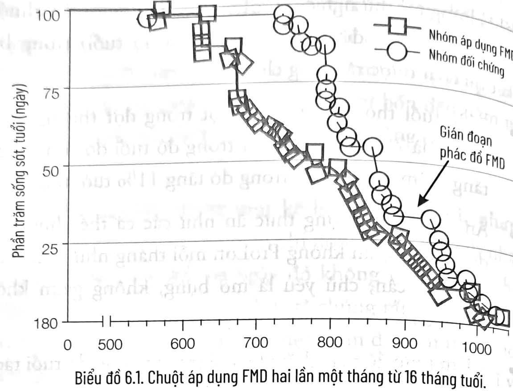
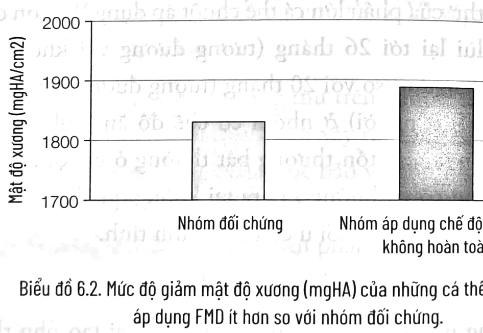
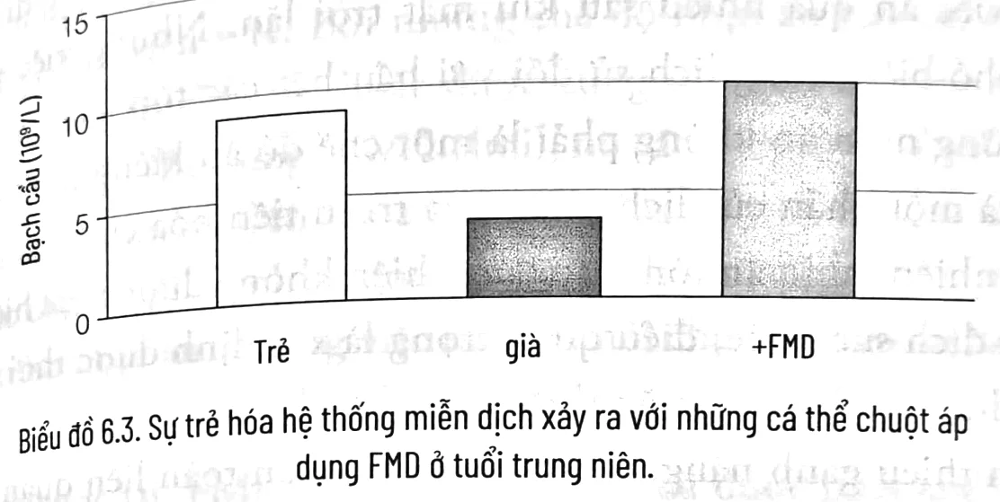
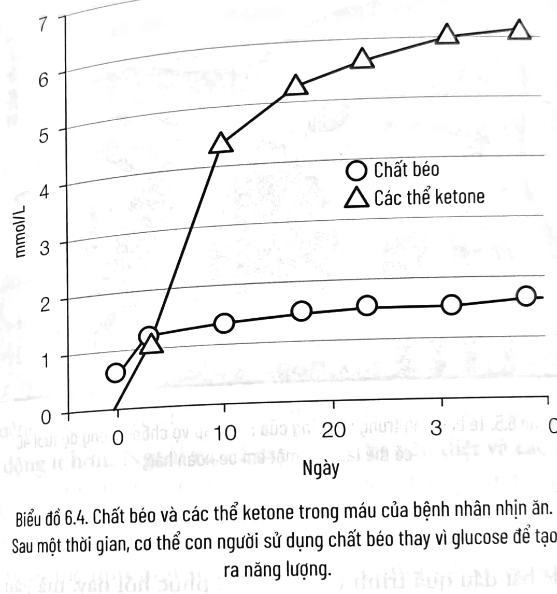
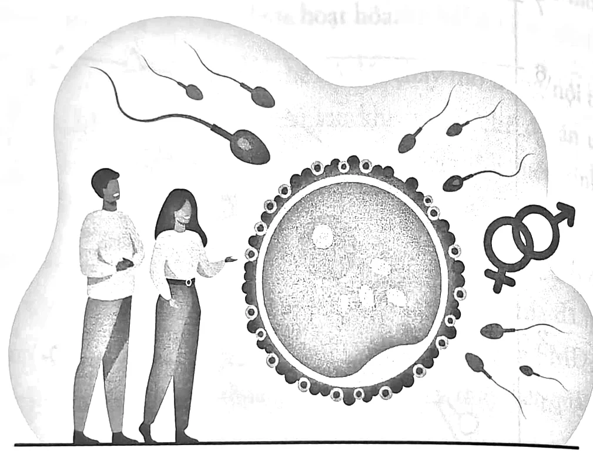
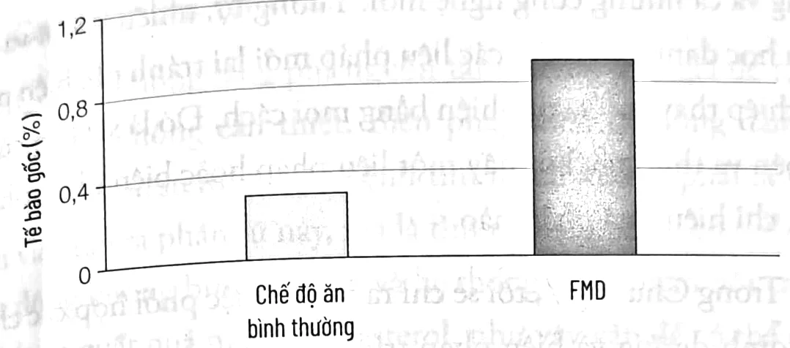
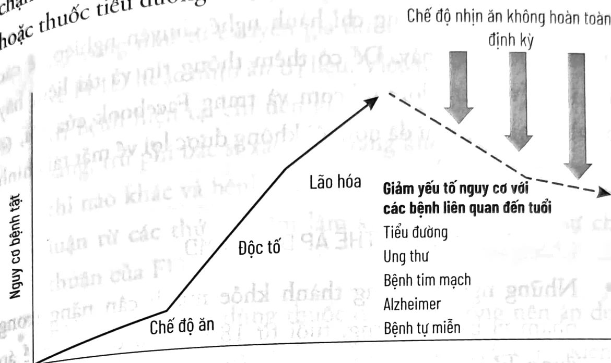

<!-- sách 113 · PDF 106 -->
# CHƯƠNG 6

## CHẾ ĐỘ NHỊN ĂN KHÔNG HOÀN TOÀN, KIỂM SOÁT CÂN NẶNG VÀ TUỔI THỌ KHỎE MẠNH

Như đã đề cập trước đó, năm 1992, khi thấy Roy Walford bước ra khỏi Biosphere 2 sau gần hai năm với chế độ ăn hạn chế calo khắc nghiệt, tôi nhìn người cố vấn của mình cùng bảy người liều tụy còn lại và nghĩ: “Phải có một cách tốt hơn để trì hoãn sự lão hóa và ngăn ngừa bệnh tật.” Mười năm sau, khi đang tìm kiếm các biện pháp bảo vệ bệnh nhân ung thư khỏi sự tấn công của các tế bào ung thư, tôi nhớ lại các thí nghiệm với nấm men lúc thực hiện nghiên cứu tiến sĩ của mình tại Đại học California, Los Angeles. Chuyển tế bào nấm men từ môi trường giàu đường sang môi trường nước tinh khiết đã bảo vệ chúng khỏi nhiều độc tố khác nhau và giúp các tế bào ấy sống lâu gấp đôi. Cuối cùng, chúng tôi quả quyết cho rằng thay đổi chế độ ăn giàu calo thông thường của chuột sang chỉ uống nước cũng bảo vệ chúng khỏi các tổn thương gây ra do cùng loại độc tố. Vì chúng tôi biết rằng khi hạn chế calo kéo dài, cả khỉ và người đều có nguy cơ mắc các tác dụng phụ – ví dụ như suy giảm hệ thống miễn dịch, gây lâu lành vết thương, cân nặng giảm nghiêm trọng, stress nặng – tôi tự hỏi: Tác dụng bảo vệ tạo ra trong các giai đoạn nhịn ăn ngắn ngày liệu có duy trì sau khi những cá thể chuột trở lại chế độ ăn uống bình

<!-- sách 114 · PDF 107 -->
thường? Nếu vậy, chúng tôi có thể thiết kế một chế độ nhịn ăn ngắn hạn định kỳ dễ áp dụng. Sẽ có rất ít áp lực, trong khi thời gian và tần suất nằm trong tầm kiểm soát của một người. Bằng cách rút ngắn giai đoạn nhịn ăn xuống từ bốn đến năm ngày và không quá một lần một tháng, chúng tôi cũng có thể giảm thiểu các tác dụng phụ.

Về lý thuyết, đó là một kế hoạch tuyệt vời, nhưng khi chúng tôi thử nghiệm nhịn ăn chỉ uống nước ở bệnh nhân ung thư, cuộc thử nghiệm ba ngày đó không thực sự thành công. Không phải vì kết quả tệ – thực tế chúng rất hứa hẹn – mà bởi vì bệnh nhân đang hóa trị vào thời điểm đó cảm thấy khó khăn khi thực hiện chế độ nhịn ăn khắc nghiệt này, các bác sĩ và điều dưỡng của họ cũng phản đối kịch liệt (xem chương 7 để biết thêm về phòng ngừa và điều trị ung thư). Vì vậy, chúng tôi cần tìm một giải pháp khác.

Trong các nghiên cứu ung thư trên chuột, chúng tôi đã xác định được bốn thay đổi chính cần xảy ra trong máu để chứng tỏ rằng chuột đã vào trạng thái được bảo vệ nhờ nhịn ăn: (1) nồng độ yếu tố tăng trưởng IGF-1 thấp hơn; (2) nồng độ glucose thấp hơn; (3) nồng độ thể ketone – sản phẩm phụ của quá trình phân hủy chất béo – cao hơn; và (4) nồng độ chất ức chế yếu tố tăng trưởng (IGFBP1) cao hơn.

Để đạt được những kết quả đó (nói cách khác, là bắt chước việc nhịn ăn), chúng tôi đã tinh chỉnh một chế độ ăn ít protein và đường, đồng thời giàu chất béo tốt. Chúng tôi tận dụng nhiều công nghệ dinh dưỡng được phát triển trong phòng thí nghiệm của mình để đảm bảo chế độ dinh dưỡng thích hợp mà vẫn đem lại hiệu quả điều trị tối đa. Chúng tôi gọi đây là chế độ nhịn ăn không hoàn toàn (FMD) và sau đó đã phát triển nó thành sản phẩm ProLon.

<!-- sách 115 · PDF 108 -->
Khi chúng tôi thử nghiệm ProLon trên những cá thể chuột 16 tháng tuổi (tương đương với con người 45 tuổi) trong ba ngày, kết quả đạt được rất đáng chú ý:

- 75% tuổi thọ các cá thể chuột trong đợt thử nghiệm (nghĩa là 75% cá thể chuột trong độ tuổi đó còn sống) tăng thêm 18%; 50% trong đó tăng 11% tuổi thọ.
- Ăn cùng một lượng thức ăn như các cá thể chuột áp dụng chế độ ăn không ProLon mỗi tháng nhưng chúng đã giảm cân, chủ yếu là mỡ bụng, không giảm khối lượng cơ.
- Giảm mức độ mất chất khoáng trong xương do tuổi tác.
- Các khối u giảm gần một nửa và thời điểm khởi phát ung thư của phần lớn cá thể chuột áp dụng ProLon được đẩy lùi lại tới 26 tháng (tương đương với khoảng 70 tuổi ở người) so với 20 tháng (tương đương với khoảng 60 tuổi ở người) ở nhóm có chế độ ăn bình thường. Hơn nữa, các tổn thương bất thường ở chuột áp dụng ProLon có xu hướng xảy ra tại không quá hai cơ quan, cho thấy nhiều khối u có thể là lành tính.
- Giảm một nửa các bệnh viêm da.
- Trong nhóm ProLon, một quá trình tái tạo phụ thuộc vào tế bào gốc đã làm trẻ hóa hệ thống miễn dịch. Sự tái tạo cũng xảy ra ở gan, cơ bắp và não bộ. Số lượng một số loại tế bào gốc tăng lên.
- Trong ba bài kiểm tra nhận thức khác nhau, những cá thể chuột già trong nhóm ProLon thể hiện tốt hơn trong phối hợp vận động (chuyển động), học tập và ghi nhớ so với nhóm đối chứng.

<!-- sách 116 · PDF 109 -->

Biểu đồ 6.1. Chuột áp dụng FMD hai lần một tháng từ 16 tháng tuổi.

Biểu đồ 6.2. Mức độ giảm mật độ xương (mgHA) của những cá thể chuột già áp dụng FMD ít hơn so với nhóm đối chứng.

Nhất quán với kết quả nghiên cứu về ProLon ở những cá thể chuột có độ tuổi trung niên, trong một số nghiên cứu khác trên chuột được thảo luận trong các chương sau, chúng tôi sẽ chỉ ra rằng nhịn ăn định kỳ thúc đẩy quá trình tái tạo phụ thuộc vào tế bào gốc trong hệ thống miễn dịch, thần kinh và tuyến tụy. Bản thân việc nhịn ăn sẽ phá hủy nhiều tế bào đã bị tổn thương và các thành phần bị hư hại bên trong tế bào, đồng thời nó kích hoạt tế bào gốc. Khi những cá thể chuột bắt đầu ăn trở

<!-- sách 117 · PDF 110 -->
lại, những tế bào gốc này trở thành một phần của chương trình tái tạo cơ quan hoặc hệ thống, với những tế bào mới mang đặc điểm của các tế bào trẻ hơn, chức năng tốt hơn.¹ Ngoài ra, thành phần bên trong nhiều loại tế bào được tái cấu trúc cục bộ như một phần của quá trình tự thực bào (autophagy), cũng góp phần làm trẻ hóa tế bào.

Biểu đồ 6.3. Sự trẻ hóa hệ thống miễn dịch xảy ra với những cá thể chuột áp dụng FMD ở tuổi trung niên.

## TÁC DỤNG CỦA PROLON TRÊN NGƯỜI:
### THỬ NGHIỆM LÂM SÀNG TRÊN 100 ĐỐI TƯỢNG

Những kết quả đáng chú ý từ các nghiên cứu trên chuột này đã thúc đẩy chúng tôi phát triển một chế độ nhịn ăn không hoàn toàn tương tự cho con người. Không giống chế độ đã phát triển cho bệnh nhân ung thư (xem chương 7), FMD này sẽ đảm bảo cung cấp đủ calo, vitamin, khoáng chất và chất dinh dưỡng thiết yếu dưới sự giám sát y tế tối thiểu.

Kiêng ăn là một truyền thống có từ hàng nghìn năm trước. Người theo đạo Cơ đốc giáo thực hiện Lễ nhịn ăn (The Black Fast) trong Mùa Chay, người Hồi giáo nhịn ăn trong tháng Ramadan, và người theo đạo Hindu ăn chay một ngày trong tuần. Mặc dù không có nhiều thông tin về tần suất nhịn ăn ở thời tiền sử nhưng chắc chắn rằng việc nhịn ăn kéo dài định kỳ

<!-- sách 118 · PDF 111 -->
khá phổ biến đối với tổ tiên của chúng ta trong thời kỳ Đồ đá Cũ và Đồ đá Mới. Tất cả các hình thức nhịn ăn liên quan đến tôn giáo đã bị loại bỏ trong thời hiện đại; với những người Cơ đốc giáo, nghi thức hạn chế calo trong 40 ngày kết thúc bằng một tuần nhịn ăn chỉ có nước vào Mùa Chay gần như đã biến mất và tháng nhịn ăn Ramadan truyền thống, lẽ ra là một khoảng thời gian hạn chế và tự giác vào ban ngày, nay lại thường đi kèm với việc ăn quá nhiều sau khi mặt trời lặn. Nhưng việc nhịn ăn phổ biến trong lịch sử đối với hầu hết các tôn giáo ủng hộ ý tưởng nhịn ăn không phải là một chế độ ăn kiêng nhất thời, mà là một phần của lịch sử và quá trình tiến hóa của chúng ta. Tuy nhiên, nhịn ăn tôn giáo đã và hiện không được thực hiện vì mục đích sức khỏe, điều quan trọng là xác định được thời gian và phương pháp nhịn ăn thực sự có lợi cho sức khỏe, đồng thời giảm thiểu gánh nặng, những lo ngại về an toàn liên quan đến nhịn ăn. Một thuật ngữ ngày nay được các phương tiện truyền thông sử dụng rộng rãi là “Nhịn ăn gián đoạn”. Tôi tin đây là điển hình cho một chỉ dẫn có vấn đề, bởi giống như “Chế độ ăn Địa Trung Hải” hoặc “ăn uống điều độ”, nó cho phép mọi người ứng biến và lựa chọn khoảng thời gian nhịn ăn từ 12 giờ đến vài tuần, như thể chúng giống nhau và đều mang lại lợi ích cho sức khỏe chỉ vì bao gồm một khoảng thời gian “kiêng ăn”. Trên thực tế, tác dụng của chúng rất khác nhau. Ví dụ, nếu chúng ta coi nhịn ăn là giai đoạn cần thiết để chuyển từ chế độ đốt cháy đường là chủ yếu sang chế độ đốt cháy chất béo, khi đó chỉ những thời gian kiêng ăn kéo dài hai hoặc ba ngày trở lên có thể được coi là nhịn ăn. Khoảng thời gian đó dường như cũng cần thiết để kích hoạt các chương trình “tái tạo”. Điều đó không có nghĩa là thời gian kiêng ăn ngắn hơn không có lợi, nhưng chúng ta không nên sử dụng những từ như “Nhịn ăn gián đoạn” để nói đến các biện pháp can thiệp khác nhau và có

<!-- sách 119 · PDF 112 -->
tác dụng khác nhau, chẳng hạn không thể xếp đi bộ 15 phút và chạy marathon vào cùng một nhóm.

Chúng tôi có được rất nhiều dữ liệu về tính an toàn của việc nhịn ăn kéo dài từ các chương trình như của Trung tâm Y tế TrueNorth ở Bắc California và các phòng khám Buchinger Wilhelmi ở Đức và Tây Ban Nha, nơi mỗi năm có hàng nghìn bệnh nhân nhịn ăn trong một tuần hoặc lâu hơn dưới sự giám sát của nhân viên y tế. Bởi những chế độ nhịn ăn chỉ được uống nước (TrueNorth) hoặc được cung cấp giới hạn vài trăm calo mỗi ngày (Buchinger Wilhelmi), nó cần phải được thực hiện tại phòng khám chuyên khoa dưới sự giám sát y tế. Một số bác sĩ và các chuyên gia dinh dưỡng hỗ trợ bệnh nhân ngoại trú trong quá trình nhịn ăn, nhưng việc này đòi hỏi chuyên môn và có thể mang nguy hiểm.

Ngược lại, FMD kéo dài năm ngày đã được phát triển với các mục tiêu sau:

1. Cung cấp đủ calo để đảm bảo an toàn dù không ở phòng khám.
2. Cung cấp nhiều loại thực phẩm hầu hết mọi người có thể thưởng thức.
3. 100% nguồn gốc thực vật như được mô tả trong Chế độ ăn Trường thọ ở chương 4.
4. Có hiệu quả tương đương với nhịn ăn, thậm chí hơn.

FMD, như được chứng minh trong các nghiên cứu trên động vật, điều trị lão hóa và thúc đẩy tuổi thọ khỏe mạnh thông qua các quá trình sau:

* Chuyển tất cả các tế bào sang chế độ bảo vệ chống lão hóa.

<!-- sách 120 · PDF 113 -->
* Thúc đẩy sự tự thực bào (tự phân hủy các phần của tế bào) và thay thế các thành phần bị hư hỏng của tế bào với thành phần mới hoạt động bình thường.
* Tiêu diệt các tế bào đã bị tổn thương trong nhiều cơ quan, hệ thống và thay thế chúng với các tế bào mới tái tạo từ tế bào gốc được hoạt hóa.
* Chuyển cơ thể sang chế độ đốt cháy mỡ bụng/nội tạng, chế độ này vẫn duy trì sau khi trở lại chế độ ăn uống bình thường (có thể do những thay đổi biểu sinh, là biến đổi của DNA và các protein liên kết DNA).

Nghiên cứu ngẫu nhiên của chúng tôi trên 100 bệnh nhân được thực hiện tại Trung tâm y tế Đại học Nam California đã mang lại kết quả ấn tượng. Những người tham gia áp dụng FMD năm ngày một tháng trong khoảng ba tháng cho thấy kết quả đáng chú ý ở các lĩnh vực sau:

1. Giảm hơn 3,6 kg ở đối tượng bị béo phì, phần lớn là giảm mỡ bụng.
2. Tăng tương xứng với cân nặng cơ thể.
3. Giảm 12 mg/dL ở đối tượng có đường huyết lúc đói cao (tiền tiểu đường) và trở về giới hạn bình thường ở đối tượng tiền tiểu đường; không có ảnh hưởng ở những người có đường huyết lúc đói thấp.
4. Giảm 6 mmHg ở đối tượng có huyết áp trung bình cao, không thay đổi ở người huyết áp thấp.
5. Giảm 20 mg/dL ở người có cholesterol cao.
6. IGF-1 (liên quan đến nguy cơ ung thư cao): Giảm 55 ng/mL với người ở mức nguy cơ cao.

<!-- sách 121 · PDF 114 -->
7. Protein phản ứng C (CRP; một yếu tố nguy cơ cho bệnh tim mạch): Giảm 1,5 mg/dL với hầu hết các trường hợp CRP tăng cao, trở về giới hạn bình thường.
8. Giảm 25 mg/dL ở người có triglyceride cao.

*Biểu đồ 6.4. Chất béo và các thể ketone trong máu của bệnh nhân nhịn ăn. Sau một thời gian, cơ thể con người sử dụng chất béo thay vì glucose để tạo ra năng lượng.*

Ba tháng sau chu kỳ ProLon FMD cuối cùng, các đối tượng thử nghiệm vẫn hưởng lợi từ việc giảm đáng kể lượng mỡ trong cơ thể và giảm vòng eo, đường máu, IGF-1 và huyết áp, tất cả gợi ý rằng việc sử dụng FMD ba tháng một lần có thể đủ để giảm nguy cơ mắc một số bệnh.

### ĐÁNH THỨC SỰ TRẺ HÓA TỪ BÊN TRONG

Nếu một cặp vợ chồng 45 tuổi có thể sinh một đứa con gần như hoàn hảo, có thể thấy rõ rằng cơ thể người trưởng thành nắm

<!-- sách 122 · PDF 115 -->
giữ tất cả thông tin cần thiết để tạo ra một tập hợp các tế bào, cơ quan và hệ thống mới có thể tồn tại, mà không chuyển bất kỳ tổn hại nào từ tế bào trứng và tinh trùng ban đầu sang cơ thể mới đó. Nhưng liệu có thể tạo ra quá trình tái tạo tương tự bên trong cơ thể người trưởng thành?

Hình 6.5. Tế bào tinh trùng và trứng của một cặp vợ chồng trong độ tuổi 40 có thể tạo nên một em bé hoàn hảo.

Có thể tôi hơi thiên vị vì chính nhóm tôi đã phát hiện ra những lợi ích của nó, nhưng tôi tin rằng FMD có lẽ là cách tốt nhất để bắt đầu quá trình tái tạo và tự phục hồi này, mà gần như không có tác dụng phụ (hãy xem bài nói chuyện TEDx của tôi, “Nhịn ăn: Đánh thức sự trẻ hóa từ bên trong,” trên YouTube). Kết quả của thử nghiệm lâm sàng ngẫu nhiên nêu trên đạt được chỉ trong ba tháng sau ba chu kỳ FMD năm ngày với đối tượng là con người. Các phát hiện đó phù hợp với kết quả nghiên cứu trên chuột của chúng tôi, cho thấy FMD hoạt động bằng cách phá vỡ và phục hồi các thành phần bên trong tế bào (tự thực bào), tiêu diệt và thay thế các tế bào bị tổn thương (tái tạo). Thực tế, ở cả chuột và người, chúng tôi phát hiện thấy sự gia tăng thoáng qua

<!-- sách 123 · PDF 116 -->
các tế bào gốc tuần hoàn trong máu trong quá trình FMD, chúng có thể chịu trách nhiệm cho việc tái tạo và trẻ hóa diễn ra ở nhiều hệ thống.

Biểu đồ 6.6. Tế bào gốc trong máu ở bệnh nhân trong quá trình FMD.

Bằng cách áp dụng một chế độ ăn uống cụ thể đánh lừa cơ thể sinh vật chuyển sang chế độ thiếu ăn, hầu hết các cơ quan và hệ thống sẽ loại bỏ các thành phần không cần thiết (protein, ty thể...) nhưng cũng giết chết nhiều tế bào. Kết quả là, sinh vật tiết kiệm năng lượng vì nó cần duy trì ít tế bào hơn và các tế bào hoạt động ít hơn. Ngoài ra, cả các tế bào bị tiêu diệt và các thành phần tế bào bị phá hủy bởi quá trình tự thực bào có thể cung cấp năng lượng cho các tế bào khác. Một phép loại suy hay ở đây là nghĩ về cơ thể như một đầu máy hơi nước đốt củi cũ kỹ bị thiếu củi. Để đến được trạm nhiên liệu tiếp theo, người thợ đốt lò có thể bắt đầu đốt những chiếc ghế gỗ, tấm vách cũ hư hỏng nhất của đoàn tàu, giúp cho tàu nhẹ hơn trong khi tạo ra hơi nước cần thiết để nó tiếp tục chạy. Cũng như ghế ngồi có thể được làm lại sau khi tàu đến trạm nhiên liệu, các tế bào, hệ thống và cơ quan có thể được tái cấu trúc bằng cách kích hoạt các tế bào gốc hoặc tế bào định hướng, hoạt hóa các hệ thống sửa chữa và thay thế bên trong tế bào để bắt đầu quá trình tái tạo – một khi cơ thể quay trở lại chế độ ăn bình thường.

<!-- sách 124 · PDF 117 -->
### FMD SO VỚI CÁC BIỆN PHÁP TRỊ LIỆU SỬ DỤNG THUỐC HOẶC TẾ BÀO GỐC

Nhiều người ủng hộ y học thay thế, tránh hoàn toàn y học truyền thống và cả những công nghệ mới. Tương tự, nhiều bác sĩ và nhà khoa học đang tìm kiếm các liệu pháp mới lại tránh các biện pháp can thiệp thay thế và tự nhiên bằng mọi cách. Đó là sai lầm của cả hai bên và thường cho thấy một liệu pháp hoặc biện pháp phòng ngừa chỉ hiệu quả phần nào.

Trong Chương 7, tôi sẽ chỉ ra tại sao việc phối hợp các chiến lược dinh dưỡng và biện pháp trị liệu thông thường là hiệu quả nhất để điều trị ung thư ở chuột, với nhiều tiềm năng đạt được kết quả tương tự ở người. Phòng thí nghiệm của tôi đã bắt đầu chứng minh những lợi ích về sự kết hợp này đối với con người. Tuy nhiên, tiềm năng đầy hứa hẹn của liệu pháp sử dụng thuốc và tế bào gốc cho các bệnh và tình trạng khác không nên là sự thay thế cho chế độ dinh dưỡng tốt và các can thiệp tự nhiên, với mục đích thúc đẩy quá trình tự chữa lành cũng như tự bảo toàn. Bởi vì thuốc và các biện pháp điều trị can thiệp khác chỉ nên được sử dụng khi can thiệp tự nhiên không đủ. Nguyên nhân chính là những can thiệp tự nhiên là kết quả của hàng tỷ năm tiến hóa. Ở nhiều trường hợp, chúng có thể được phối hợp chặt chẽ và giảm thiểu hoặc loại bỏ tác dụng phụ. Trong khi thuốc hoặc các liệu pháp khác sẽ có tác dụng phụ, một số không thể được phát hiện cho đến nhiều năm sau điều trị.

Ví dụ, thuốc statin làm giảm cholesterol bằng cách giảm hoạt động của enzyme sản xuất cholesterol, HMG-CoA reductase. Nhưng cách tiếp cận này là một giải pháp tạm thời, thay vì giải quyết vấn đề tận gốc, nó chỉ đơn thuần làm giảm một trong những triệu chứng tiêu cực do vấn đề gây ra. Tôi đã từng hỏi một

<!-- sách 125 · PDF 118 -->
chuyên gia về cholesterol: “Tại sao cơ thể của một số người sản xuất nhiều cholesterol hơn mức họ cần? Cơ thể đang cố gắng làm điều gì?” Vừa ngạc nhiên vừa khó chịu, anh ta trả lời: “Tôi không biết. Cơ thể cứ làm vậy thôi.”

Cơ thể không lãng phí nguồn tài nguyên quý giá để tạo ra các phân tử không cần thiết. Biện pháp điều trị đúng đắn cho tình trạng cholesterol cao và bệnh tim mạch không phải là ngăn chặn việc tạo ra phân tử này, mà là tìm ra phần trong cơ thể đang hoạt động không bình thường và hệ thống đang phản hồi chỉ thị gì khi sản xuất quá nhiều cholesterol, như vậy vấn đề có thể được khắc phục tại gốc rễ của nó. Ngăn chặn sự tạo ra cholesterol đơn thuần giống như thêm chất làm mát cho một động cơ ô tô bị quá nhiệt – chắc chắn việc đó có ích, nhưng vấn đề cơ bản vẫn còn đó và cuối cùng chiếc xe sẽ hỏng. Thật vậy, một phân tích của 11 nghiên cứu ngẫu nhiên chỉ ra rằng dùng statin không làm giảm nguy cơ tử vong của một người.² Điều này cũng đúng với phần lớn các loại thuốc, cho dù mục tiêu là đường huyết, cholesterol hay huyết áp: chúng không giải quyết vấn đề; chúng chỉ cố gắng hạn chế tổn hại mà nó gây ra. Đôi khi chúng có hiệu quả rất tốt, có thể cứu sống hoặc kéo dài sự sống nhưng chúng thường đại diện cho một giải pháp nửa vời và gây phát sinh các vấn đề mới. Như đã chỉ ra ở các chương trước, đó là lý do tại sao các nhà sinh học, bác sĩ và chuyên gia dinh dưỡng nên làm việc cùng nhau theo nhóm, sử dụng kỹ năng giải quyết vấn đề của mỗi người để có tác dụng tức thì và lâu dài với bệnh nhân. Riêng phòng thí nghiệm của tôi đã làm việc trong nhiều năm với các bác sĩ y khoa và chúng tôi hy vọng một ngày nào đó, việc này sẽ trở thành tiêu chuẩn lâm sàng.

Lấy ví dụ, một người 45 tuổi có cholesterol tăng nhẹ, một người đàn ông 55 tuổi bị tăng huyết áp nhẹ, hoặc một người phụ

<!-- sách 126 · PDF 119 -->
nữ có bà chết vì ung thư vú ở tuổi 85; những kiểu yếu tố nguy cơ cao này có thể giảm đi hoặc đảo ngược với sự kết hợp của Chế độ ăn Trường thọ được mô tả trước đó và một chế độ FMD định kỳ, theo kết quả từ các nghiên cứu lâm sàng của chúng tôi. Chế độ này có thể ngăn chặn thậm chí giúp loại bỏ nhu cầu sử dụng liệu pháp điều trị bằng thuốc hay tế bào gốc trong tương lai, hoặc có thể giúp giảm liều lượng sử dụng các loại thuốc đó xuống mức thấp hơn. Ưu điểm chính của cách tiếp cận FMD – so với các can thiệp bằng thuốc và tế bào gốc – chính là nó đánh thức đáp ứng phối hợp chặt chẽ có sẵn bên trong cơ thể nhưng không hoạt động do sự tiêu thụ thức ăn đều đặn và liên tục của con người. Hiện nay, FMD có lẽ là cách an toàn và hiệu quả nhất để đảo ngược nhiều vấn đề liên quan đến tuổi tác và chế độ ăn bằng cách sửa chữa hoặc thay thế, từ đó làm trẻ hóa các tế bào, hệ thống và các cơ quan một cách tự nhiên.

FMD làm được điều đó bằng cách tận dụng hàng tỷ năm tiến hóa để kích hoạt chương trình tự chữa lành giống như quá trình hình thành phôi thai (tức sự phát triển bình thường của một thai nhi). Chúng tôi đã chứng minh điều này ở chuột và tế bào của người. Ví dụ, chúng tôi có thể gây ra tổn thương nghiêm trọng và thiếu hụt insulin trong tuyến tụy ở cả chuột mắc tiểu đường type 1 và type 2, nhận thấy các chu kỳ FMD thúc đẩy sự tái tạo của các tế bào tuyến tụy để phục hồi khả năng sản xuất insulin.³ Như đã mô tả ở phần đầu Chương 6, các chu kỳ FMD cũng làm giảm đường huyết lúc đói và đưa các đối tượng nghiên cứu tiền tiểu đường trở về giới hạn glucose bình thường. Với những người tham gia có huyết áp, glucose, cholesterol và yếu tố viêm bình thường, chúng tôi không tìm thấy những thay đổi lớn về mức độ các yếu tố nguy cơ sau ba chu kỳ FMD hằng tháng, nhưng nhìn nhận được thay đổi đáng kể ở những người có mức

<!-- sách 127 · PDF 120 -->
độ các yếu tố nguy cơ cao nhất trước khi bắt đầu FMD. Điều này phù hợp với tác động trẻ hóa – sự đảo ngược thực sự của tổn thương thể chất hoặc vấn đề cốt lõi, không chỉ đơn thuần là ngăn chặn tổng hợp cholesterol hoặc hạ đường huyết khi dùng statin hoặc thuốc tiểu đường.

*Biểu đồ 6.7. Các tác động làm trẻ hóa của FMD.*

## CHẾ ĐỘ NHỊN ĂN KHÔNG HOÀN TOÀN

Dưới đây là phiên bản đơn giản hóa của FMD được thử nghiệm trong nghiên cứu lâm sàng của chúng tôi trên 100 bệnh nhân tại Trung tâm Y tế Keck của Đại học Nam California và cũng được hàng ngàn bác sĩ ở Mỹ và Vương quốc Anh khuyến nghị cho các bệnh nhân. Ít nhất 10.000 bệnh nhân đã sử dụng liệu pháp ProLon FMD và không có báo cáo về các tác dụng phụ đáng kể nào. Mục tiêu trong phần này là cung cấp thông tin tổng quát giúp bạn có thể nhận được tư vấn từ bác sĩ và chuyên gia dinh dưỡng khi áp dụng chế độ ăn này, thay vì các công thức cụ thể để độc giả tự thực hiện. Chế độ FMD được thử nghiệm lâm sàng và thương mại hóa bởi công ty L-Nutra phức tạp hơn nhiều so với những gì tôi mô tả dưới đây, bao gồm một công thức chính xác với các thành phần thường không thể tìm thấy ở các cửa hàng,

<!-- sách 128 · PDF 121 -->
cũng như hướng dẫn về liều lượng của các thành phần cụ thể dựa trên cân nặng của bệnh nhân. Vì lý do an toàn và hiệu quả, bệnh nhân được khuyến cáo sử dụng ProLon FMD chứ không phải phiên bản “tự chế”, có thể không có tác dụng và thậm chí gây hại. L-Nutra đang tập hợp một mạng lưới các bác sĩ và chuyên gia dinh dưỡng có chứng chỉ hành nghề chuyên nghiệp về các liệu pháp tích hợp này. Để có thêm thông tin và tài liệu, hãy tham khảo www.prolonfmd.com và trang Facebook của tôi, @profvalterlongo. (Như đã nói, tôi không được lợi về mặt tài chính từ việc bán ProLon.)

### AI CÓ THỂ ÁP DỤNG FMD

- Những người trưởng thành khỏe mạnh cân nặng trong phạm vi bình thường, tuổi từ 18 đến 70 đều có thể áp dụng FMD. Tuy nhiên, có một vài đột biến di truyền không thích hợp với việc nhịn ăn. Nếu xuất hiện bất kỳ tác dụng phụ nào ngoài cảm giác yếu nhẹ, mệt mỏi hoặc đau đầu nhẹ, bạn nên liên hệ với bác sĩ của mình. Để làm giảm triệu chứng ngay lập tức, hãy uống một lượng nhỏ nước ép trái cây.

### ĐỐI TƯỢNG KHÔNG NÊN ÁP DỤNG FMD

- Phụ nữ mang thai.
- Người thiếu cân, có chỉ số khối cơ thể rất thấp hoặc mắc chứng chán ăn.
- Người trên 70 tuổi, trừ khi có tình trạng sức khỏe rất tốt và phải có sự đồng ý của bác sĩ.
- Người có thể trạng ốm yếu.
- Người mắc bệnh lý gan thận.

<!-- sách 129 · PDF 122 -->
- Những người bị ảnh hưởng bởi bệnh lý, trừ khi có sự chấp thuận của bác sĩ chuyên khoa. Trong trường hợp bệnh nghiêm trọng hoặc tương đối nghiêm trọng (ung thư, tiểu đường, tim mạch, tự miễn, hoặc các bệnh thoái hóa thần kinh), cần sự chấp thuận từ chuyên gia về bệnh đó cũng như từ chuyên gia dinh dưỡng có chuyên môn về FMD hoặc nhịn ăn trị liệu. Việc sử dụng FMD để điều trị bệnh hiện tại chỉ nên giới hạn ở các thử nghiệm lâm sàng, trừ khi bác sĩ xác định rằng không có lựa chọn khả thi nào khác và bệnh nhân không thể đợi đến khi có kết quả từ các thử nghiệm lâm sàng thích hợp và sự chấp thuận của FDA.
- Bệnh nhân đang dùng thuốc điều trị không nên áp dụng FMD mà không có sự chấp thuận từ bác sĩ, với ý kiến từ chuyên gia dinh dưỡng hoặc bác sĩ chuyên về FMD. Mặc dù có thể phối hợp FMD với nhiều loại thuốc mà không gây tác dụng phụ nhưng sự kết hợp này cũng có khả năng gây ra các phản ứng phụ nghiêm trọng.
- Bệnh nhân huyết áp thấp hoặc đang dùng thuốc điều trị tăng huyết áp không nên thực hiện FMD mà không có sự chấp thuận của bác sĩ chuyên khoa.
- Bệnh nhân có các đột biến gen hiếm gặp ngăn chặn khả năng sản xuất glucose từ glycerol và axit amin của cơ thể.
- Vận động viên trong quá trình tập luyện hoặc thi đấu, cần sử dụng cơ bắp ở cường độ cao đòi hỏi nồng độ glucose không có sẵn trong máu. Vì vậy nếu thực hiện FMD, có thể dẫn đến nguy cơ ngất xỉu.

<!-- sách 130 · PDF 123 -->
### NHỮNG CẢNH BÁO KHÁC

1. Không được sử dụng FMD kết hợp với insulin hoặc thuốc hạ đường huyết. Sự kết hợp đó có thể gây tử vong. Vào cuối đợt FMD, bệnh nhân có thể vẫn đủ nhạy cảm với insulin để có nồng độ glucose trong máu dưới mức bình thường. Bởi vì việc sử dụng FMD trên bệnh nhân tiểu đường có thể nguy hiểm, chúng tôi khuyên chỉ làm điều đó như một phần của thử nghiệm lâm sàng. Thông tin về các thử nghiệm lâm sàng sắp tới có thể được tìm thấy trên trang Facebook của tôi, @profvalterlongo.
2. Không tắm lâu với nước rất nóng khi đang áp dụng FMD, đặc biệt những ngày thời tiết oi bức. Có nguy cơ gây ngất xỉu.
3. Thận trọng khi lái xe hoặc tốt hơn không lái xe – cho đến khi bạn biết tác động của FMD đối với cơ thể.
4. Chúng tôi khuyên bạn nên thực hiện FMD khi có mặt một người khác.

### TẦN SUẤT THỰC HIỆN FMD

Quyết định này, lý tưởng nhất, cần có ý kiến từ bác sĩ hoặc chuyên gia dinh dưỡng có chứng chỉ. Tuy nhiên dưới đây là các hướng dẫn chung:

1. Mỗi tháng một lần đối với bệnh nhân thừa cân hoặc béo phì với ít nhất hai yếu tố nguy cơ về bệnh tiểu đường, ung thư, tim mạch hoặc thoái hóa thần kinh.
2. Hai tháng một lần đối với bệnh nhân có cân nặng trung bình với ít nhất hai yếu tố nguy cơ đối với bệnh tiểu đường, ung thư, tim mạch hoặc thoái hóa thần kinh.

<!-- sách 131 · PDF 124 -->
3. Ba tháng một lần đối với bệnh nhân có cân nặng trung bình với ít nhất một yếu tố nguy cơ đối với bệnh tiểu đường, ung thư, tim mạch hoặc thoái hóa thần kinh.
4. Bốn tháng một lần đối với bệnh nhân khỏe mạnh với chế độ ăn bình thường không hoạt động thể chất thường xuyên.
5. Sáu tháng một lần đối với bệnh nhân khỏe mạnh với chế độ ăn uống lý tưởng (xem Chương 4) và tham gia hoạt động thể chất thường xuyên.

### THỜI ĐIỂM BẮT ĐẦU FMD

* Nhiều người quyết định bắt đầu FMD vào tối chủ nhật để có thể kết thúc vào tối thứ sáu tuần tiếp theo. Quyết định này hoàn toàn dựa trên các cân nhắc về mặt xã hội, cho phép họ quay lại chế độ ăn chuyển tiếp vào tối thứ sáu và chế độ ăn bình thường vào tối thứ bảy.

### CHUẨN BỊ

* Ít nhất một tuần trước FMD, chúng tôi khuyến nghị nên tuân theo Chế độ ăn Trường thọ với 0,36 gram protein trên mỗi 0,45 kg trọng lượng cơ thể một ngày, tốt nhất là từ rau củ và cá. Bổ sung vitamin tổng hợp omega-3 ít nhất hai lần trong tuần chuẩn bị này (xem Chương 4).

### FMD

*Ngày 1: 1.100 calo*
* 500 calo từ carbohydrate phức tạp (các loại rau như bông cải xanh, cà chua, cà rốt, bí đỏ, nấm...)
* 500 calo từ chất béo lành mạnh (các loại hạt, dầu ô liu)

<!-- sách 132 · PDF 125 -->
* 1 viên vitamin tổng hợp và khoáng chất
* 1 viên omega-3/omega-6
* Trà không đường (tối đa 3 đến 4 cốc một ngày)
* 25 gram protein nguồn gốc thực vật, chủ yếu từ các loại hạt
* Không giới hạn nước

*Ngày 2-5: 800 calo*

* 400 calo từ carbohydrate phức tạp (các loại rau như bông cải xanh, cà chua, cà rốt, bí đỏ, nấm…)
* 400 calo từ chất béo lành mạnh (các loại hạt, dầu ô liu)
* 1 viên vitamin tổng hợp và khoáng chất
* 1 viên omega-3/omega-6
* Trà không đường (tối đa 3 đến 4 cốc một ngày)
* 25 gram protein nguồn gốc thực vật, chủ yếu từ các loại hạt
* Không giới hạn nước

Có thể phân chia các thành phần trên trong bữa sáng, bữa trưa, bữa tối, hoặc hai bữa chính và một bữa phụ.

*Ngày 6: Chế độ ăn chuyển tiếp*

* 24 giờ sau khi kết thúc 5 ngày FMD, bệnh nhân nên thực hiện chế độ chủ yếu gồm carbohydrate phức tạp (rau, ngũ cốc, mì ống, gạo, bánh mì, hoa quả…) và hạn chế cá, thịt, chất béo bão hòa, bánh ngọt, phô mai, sữa…

### CÁC VẤN ĐỀ CÓ THỂ XẢY RA

#### Tác dụng phụ

1. Một số người cảm thấy yếu ớt trong quá trình thực hiện FMD. Một số nói rằng họ cảm thấy sung sức hơn.

<!-- sách 133 · PDF 126 -->
2. Một số bệnh nhân phàn nàn về đau đầu cường độ nhẹ đến trung bình. Hiện tượng này thường giảm đáng kể vào ngày thứ tư hoặc thứ năm và hết hoàn toàn vào chu kỳ FMD thứ hai hoặc thứ ba.
3. Đa số mọi người cảm thấy đói trong vài ngày đầu áp dụng FMD. Hiện tượng này giảm đáng kể vào ngày thứ tư hoặc thứ năm và vào tất cả các ngày của chu kỳ FMD thứ hai hoặc thứ ba.
4. Một số người bị đau lưng nhẹ. Tình trạng này sẽ chấm dứt khi họ trở lại chế độ ăn uống bình thường.

#### Tác dụng tích cực

Ngoài sản sinh ra các tế bào gốc, giảm mỡ bụng và giảm các yếu tố nguy cơ đối với nhiều bệnh khác nhau, nhiều người báo cáo những tác dụng có lợi trong hoặc sau chế độ FMD như sau:

1. Da sáng lên, nhiều người mô tả là “trông trẻ ra”.
2. Khả năng tập trung tốt hơn.
3. Khả năng hạn chế việc ăn uống mất kiểm soát khi quay lại chế độ ăn bình thường. Nhiều người giảm tiêu thụ đường, calo và ít khi tiêu thụ quá mức cà phê, rượu, món tráng miệng…

Bây giờ bạn đã hiểu về Chế độ ăn Trường thọ, nguyên nhân, tác dụng của nó và những điều cơ bản về FMD, tôi sẽ đi sâu vào chi tiết ở các chương tiếp theo về cách thức chương trình này có thể tác động sâu sắc đến việc ngăn chặn, trì hoãn, điều trị và thậm chí đảo ngược các bệnh lý cụ thể. Năm chương tiếp theo cung cấp các thông tin chi tiết hơn về công việc và mà tôi cùng các nhà nghiên cứu và bác sĩ trên khắp thế giới đang tiến hành để chứng

<!-- sách 134 · PDF 127 -->
mình mối quan hệ chặt chẽ giữa chế độ ăn uống và bệnh tật, giúp đỡ những người có nguy cơ cao hoặc đã mắc bệnh ung thư, tiểu đường, bệnh tim mạch, các rối loạn thoái hóa thần kinh (nhất là Alzheimer) và các bệnh tự miễn. Tôi hy vọng cuốn sách này giúp được nhiều người nhất có thể, trong việc kiểm soát sức khỏe, bổ sung các biện pháp chăm sóc tiêu chuẩn mà họ đang nhận được với cách tiếp cận tích hợp, không tốn kém. Đầu tiên là một số kết quả đáng chú ý liên quan đến ung thư.
