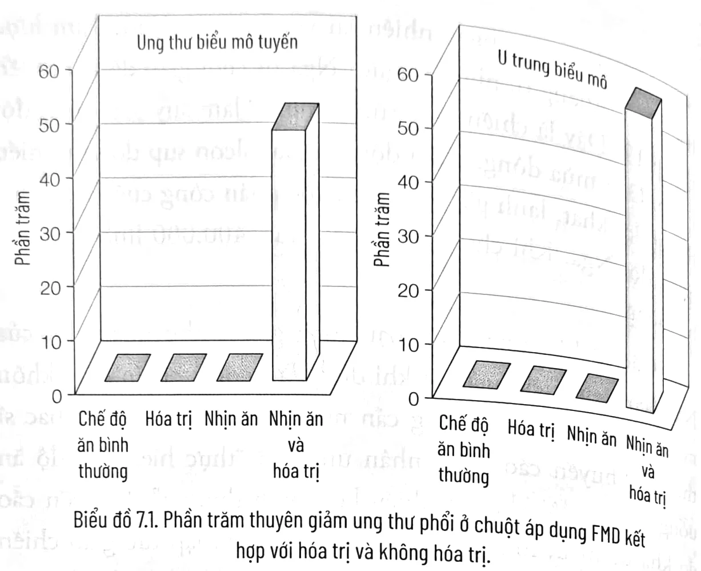
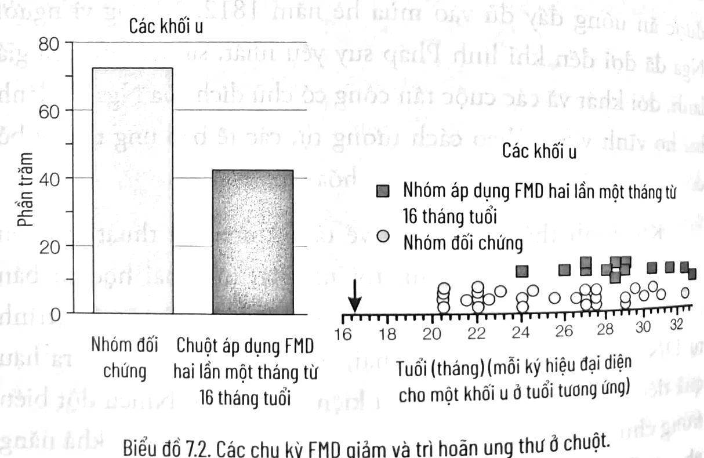
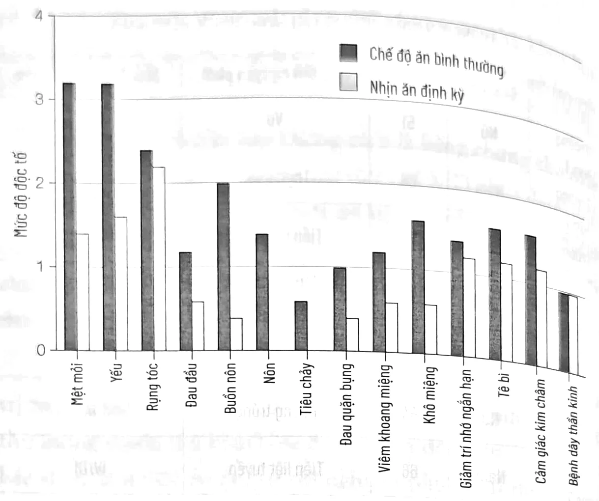
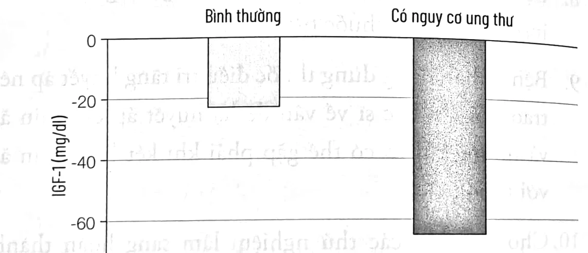

<!-- p.128 -->
# CHƯƠNG 7

## CHẾ ĐỘ NHỊN ĂN KHÔNG HOÀN TOÀN VÀ DINH DƯỠNG TRONG PHÒNG NGỪA, ĐIỀU TRỊ UNG THƯ¹

*[Tôi xin gửi lời cảm ơn đến Tanya Dorff, bác sĩ ung thư và phó giáo sư y học lâm sàng, Trung tâm Ung thư Toàn diện Norris Đại học Nam California; Alessio Nencioni, phó giáo sư, Tiến sĩ nội khoa và lão khoa, Bệnh viện Đại học Genova San Martino và Alessandro Laviano, giáo sư y học lâm sàng, Đại học Sapienza, Rome vì đã xem duyệt lại chương này.]*

### TẤM KHIÊN MA THUẬT

Quá trình đào tạo và nghiên cứu sau đại học của tôi về bệnh học, miễn dịch học, và sinh học thần kinh mang tính “ứng dụng lâm sàng” – tập trung vào việc đưa các khám phá khoa học cơ bản trở thành liệu pháp điều trị cho con người. Chính vì mục tiêu đó mà 15 năm trước, tôi đã quyết định chuyển hướng sang chủ yếu nghiên cứu lâm sàng. Như đã đề cập ở chương 2, việc chứng kiến những bệnh nhi ung thư phải chịu nhiều đau đớn tại Bệnh viện Nhi đồng Los Angeles đã thôi thúc tôi đi đến quyết định này. Tôi

¹ Nội dung của chương này không được sử dụng để tự chẩn đoán hoặc tự quản lý các biện pháp điều trị. Thông tin này dành cho các chuyên gia y tế đang theo dõi bệnh của bạn.

<!-- p.129 -->
nhận ra rằng cộng đồng y khoa đã có những hiểu biết khá sâu về ảnh hưởng của tổn thương DNA và tế bào đến tế bào ung thư như thế nào, nhưng hầu như chưa có kiến thức nền tảng về cách bảo vệ các tế bào bình thường, đó là trọng tâm nghiên cứu của phòng thí nghiệm của chúng tôi.

Nghiên cứu đầu tiên liên quan đến ung thư mà chúng tôi tiến hành trên chuột, như đã trình bày ở chương 2, thực chất rất đơn giản – về cơ bản là xuất phát từ của các nghiên cứu trên vi sinh vật.

Paola Fabrizio, một nghiên cứu sinh sau tiến sĩ trong nhóm đã cùng tôi công bố một loạt bài báo về các nghiên cứu sử dụng nấm men như một sinh vật mẫu để xác định các gen thúc đẩy quá trình lão hóa. Mario Mirisola, một nhà nghiên cứu khác trong phòng thí nghiệm của tôi, đã giúp tôi xác định mối liên quan giữa gen làm tăng tốc độ lão hóa và làm các tế bào dễ bị tổn thương hơn với một số dưỡng chất cụ thể. Đáng chú ý, các gen khiến tế bào yếu đi cũng là các gen đóng vai trò thủ phạm chính gây ung thư – hay còn gọi là gen sinh ung thư.

Quá trình đó diễn ra như sau: Khi một số gen nhất định trong tế bào ung thư bị biến đổi do đột biến (trình tự DNA bị đảo lộn), chúng trở thành gen sinh ung thư. Sự thay đổi này cho phép các tế bào ung thư phân chia nhiều hơn bình thường, ngay cả khi chúng nhận được tín hiệu ngừng phân chia. Chúng tôi phát hiện ra rằng gen sinh ung thư cũng khiến tế bào yếu và nhạy cảm hơn với các tổn hại do độc tố gây nên, bởi lúc này chúng có khả năng không tuân theo mệnh lệnh và tiếp tục nhân lên.

Khi tôi bắt đầu nghiên cứu về ung thư, mọi nhà nghiên cứu đều đang tìm kiếm một giải pháp kỳ diệu có thể phát hiện và tiêu

<!-- p.130 -->
diệt chỉ riêng tế bào ung thư. Tôi không nhớ đã nảy ra ý tưởng đó khi nào nhưng tôi nhớ đã gọi cho một trong những đồng nghiệp của mình, nhà nghiên cứu nổi tiếng về lão hóa, để báo với cô ấy: "Tôi nghĩ mình đã tìm ra cách phân biệt được tất cả các tế bào ung thư với tế bào bình thường. Đó không phải là một giải pháp kỳ diệu – mà chính là một *tấm khiên ma thuật*."

Tôi nghĩ cô ấy không hiểu tôi đang nói gì.

Đề xuất, sau này tôi gọi là "sức đề kháng với stress khác nhau", dựa trên ý tưởng nếu bạn bỏ đói một sinh vật, nó sẽ chuyển sang chế độ không phát triển, được bảo vệ cao – đây chính là "tấm khiên". Nhưng một tế bào ung thư sẽ không tuân theo mệnh lệnh này và tiếp tục nhân lên ngay cả khi bị bỏ đói, vì gen sinh ung thư bị mắc kẹt trong chế độ "luôn bật".

Hãy tưởng tượng đến chiến trường nơi người La Mã và người Carthageⁱ cổ đại đang đánh nhau và bị trộn lẫn vì trang phục rất giống nhau. Cách tiếp cận phổ biến của các liệu pháp ung thư là tìm kiếm một "mũi tên" (hay "viên đạn") ma thuật chỉ giết những người lính Carthage mà không làm hại người La Mã. Việc này thật khó, bởi đối với những cung thủ đứng cách xa gần 50 m thì ai nấy đều trông như nhau.

Nhưng giả sử trước khi bắn tên, cung thủ phát lệnh quỳ xuống và nâng cao khiên bằng tiếng Latinh, chẳng phải chỉ có quân La Mã mới hiểu được mệnh lệnh đó và tiến hành phòng thủ, trong khi binh lính Carthage vẫn tiếp tục chiến đấu và bị những mũi tên lao tới.

---

i. Carthage là tên gọi của một trung tâm và thành phố thủ đô cổ của nền Văn minh Carthage, phía đông hồ Tunis, ngày nay là khu vực ngoại ô Tunis, thủ đô của Tunisia.

<!-- p.131 -->
Ở ví dụ trên, người La Mã là tế bào bình thường của cơ thể, người Carthage là tế bào ung thư, cung thủ là bác sĩ điều trị, và các mũi tên là hóa trị liệu. Nếu bạn bỏ đói một bệnh nhân ung thư trước khi hóa trị, các tế bào bình thường sẽ phản ứng bằng cách dựng lên một lá chắn phòng thủ. Nhưng tế bào ung thư sẽ bỏ qua mệnh lệnh ẩn nấp, do đó dễ bị tấn công – đem lại một giải pháp tiềm năng loại bỏ các tế bào ung thư mà chỉ gây tổn thương tối thiểu cho các tế bào bình thường.

Ban đầu, khi tôi đề xuất cho bệnh nhân ung thư nhịn đói trước giờ hóa trị, các bác sĩ ung thư đều cho rằng đó là một ý kiến tối tệ. Vì bệnh nhân ung thư thường bị sụt cân trong quá trình hóa trị, bác sĩ ung thư hướng dẫn họ ăn nhiều hơn, chứ không phải ít hơn. Rõ ràng, chúng ta cần kết quả thuyết phục trên cá thể chuột trước khi được chấp thuận cho phép thử nghiệm lâm sàng trên người.

Tôi đã nhờ Changhan Lee, một trong những sinh viên của tôi ở phòng thí nghiệm Los Angeles, và Lizzia Raffaghello, nhà nghiên cứu ở Genoa, thực hiện một thí nghiệm đơn giản: chuyển cá thể chuột bị ung thư sang chế độ nhịn ăn, chỉ được uống nước trong hai hoặc ba ngày trước khi cho chúng điều trị bằng nhiều chu kỳ hóa trị.

Kết quả thật đáng kinh ngạc: hầu như tất cả những cá thể chuột nhịn ăn đều còn sống và di chuyển bình thường sau khi hóa trị liều cao. Tuy nhiên, những cá thể có chế độ ăn bình thường trước điều trị lại bị ốm và di chuyển rất ít sau khi hóa trị. Trong những tuần tiếp theo, 65% số chuột không nhịn ăn đã chết, trong khi gần như tất cả những cá thể nhịn ăn đều sống sót. Chúng tôi đã lặp lại thí nghiệm này bằng sử dụng nhiều loại thuốc hóa trị khác nhau. Như dự đoán, việc nhịn ăn tạo ra “sức

<!-- p.132 -->
đề kháng với nhiều loại stress” hay khả năng bảo vệ chống lại nhiều độc tố ở tế bào bình thường, ngoại trừ tế bào ung thư. Bây giờ chúng tôi đã biết cách tiếp cận này có tiềm năng lâm sàng lớn nhưng thật không dễ dàng để cộng đồng y khoa chấp nhận và trao cho nó một cơ hội.

### LỜI NHẮN ĐẾN CÁC NHÀ HOẠT ĐỘNG VÌ QUYỀN ĐỘNG VẬT

Đây có vẻ là thời điểm thích hợp để nói vài điều về vấn đề thử nghiệm trên động vật. Thỉnh thoảng tôi nhận được email từ các nhà hoạt động vì quyền động vật hỏi tại sao chuột phải chịu đau đớn và chết vì mục đích nghiên cứu.

Câu trả lời của tôi như sau:

Trước hết, đối tượng chúng tôi thử nghiệm nhiều nhất có thể là các tế bào và vi sinh vật, không phải chuột. Tuy nhiên, trước khi có thể bắt đầu bất kỳ thử nghiệm lâm sàng nào trên người, chúng tôi không có lựa chọn nào khác ngoài thử nghiệm các biện pháp can thiệp trên chuột.

Về việc ép nhịn ăn được cho là tàn nhẫn, cần lưu ý rằng giống như con người, chuột hoàn toàn có khả năng không ăn trong vài ngày. Thực vậy, việc nhịn ăn giúp chúng sống lâu, khỏe mạnh và ít bệnh tật hơn. Đúng là khi chúng tôi cho những cá thể chuột điều trị hóa chất, chúng phải chịu đựng nhiều đau đớn. Tôi cũng băn khoăn về việc này. Nó có vẻ sai về mặt đạo đức. Nhưng chúng tôi thật sự không còn bất kỳ lựa chọn nào khác.

Các nghiên cứu trên động vật được chúng tôi hạn chế đến mức tối thiểu cho đến khi có thể thử nghiệm lâm sàng trên người. Trong hầu hết mọi trường hợp, các nghiên cứu này nhắm tới các

<!-- p.133 -->
bệnh ở giai đoạn muộn, gây tử vong hoặc tàn phá sức khỏe các bệnh nhân.

Vài năm trước, tôi đã trả lời lá thư của một nhà hoạt động vì quyền động vật bằng câu hỏi sau: "Nếu con cái, chị gái hoặc bố của bạn sắp chết, và phương pháp điều trị duy nhất có thể cứu sống họ cần được thử nghiệm trước trên chuột, bạn có chấp nhận việc đó không? Hay bạn sẽ chọn cách nhìn người thân của mình ra đi?"

Tôi biết nhiều nhà hoạt động vẫn sẽ phản đối, nhưng tôi yêu cầu họ cần trung thực cân nhắc mọi hậu quả. Nếu họ không chấp nhận thử nghiệm trên động vật trong mọi trường hợp, ngay cả những trường hợp cần thiết để phát triển các phương pháp điều trị cho những căn bệnh chết người, thì họ đừng bao giờ dùng bất kỳ loại thuốc nào – kể cả aspirin hoặc thuốc kháng sinh – và nói người thân của họ cũng nên như vậy.

Tôi tin rằng các thí nghiệm trên động vật chỉ nên được thực hiện như tiền đề cho các thử nghiệm lâm sàng trên người trong điều trị bệnh thường gặp và bệnh giai đoạn muộn. Thật không may bởi khi chưa có phương án nào tốt hơn thì những thử nghiệm này dù tội lỗi nhưng lại vô cùng cần thiết.

### ĐIỀU TRỊ UNG THƯ (TRÊN CHUỘT)

Đây là một tình huống quân sự khác, tương tự với cuộc chiến chống lại ung thư: Năm 1812, Napoleon chỉ huy hơn 450.000 quân tới xâm lược nước Nga. Khi quân đội Pháp tiến về Moscow, các lực lượng Nga không chiến đấu. Họ rút lui, đốt cháy chính làng mạc và thị trấn của mình trước khi quân thù kịp tấn công.

<!-- p.134 -->
Napoleon vừa ngạc nhiên lại vừa bối rối. Cuộc xâm lược bắt đầu từ tháng 6, nhưng người Nga từ chối giao đấu cho đến tháng 12. Đây là chiến lược rút lui nhằm làm suy yếu quân đội Pháp. Đến mùa đông, quân đội của Napoleon sụp đổ sau nhiều tháng đói khát, lạnh giá và trước cuộc phản công cuối cùng của quân đội Nga. Khi chiến tranh kết thúc, 400.000 lính Pháp đã bỏ mạng.

Các tế bào ung thư hoạt động giống như quân đội của Napoleon, tiến lên ngay cả khi dừng lại mới là chiến lược khôn ngoan. Để sống sót, chúng cần nhiều dinh dưỡng. Các bác sĩ thường khuyến cáo bệnh nhân ung thư "thực hiện chế độ ăn uống tốt" và đôi khi "ăn nhiều hơn bình thường". Khuyến cáo đó khá dễ hiểu, như việc quân đội Nga nên lập tức giao chiến với quân đội của Napoleon ngay khi họ vừa đặt chân đến, và còn được ăn uống đầy đủ vào mùa hè năm 1812. Nhưng vì người Nga đã đợi đến khi lính Pháp suy yếu nhất, sự kết hợp của giá lạnh, đói khát và các cuộc tấn công có chủ đích của Nga đã đánh bại họ vĩnh viễn. Theo cách tương tự, các tế bào ung thư bị bỏ đói sẽ dễ bị tổn thương nhất bởi hóa trị.

Khi hình thành ý tưởng về tấm khiên ma thuật tạo nên nhờ vào quá trình nhịn ăn, tôi nhớ lại một bài học cơ bản từ sinh học tiến hóa: phần lớn các đột biến di truyền (trình tự DNA bị đảo lộn) đều có hại, nhưng chúng chỉ gây ra hậu quả tiêu cực trong một số điều kiện nhất định. Nhiều đột biến trong chuỗi DNA của tế bào ung thư có thể làm tăng khả năng phát triển của chúng, nhưng chính những đột biến đó sẽ cản trở đáng kể khả năng tồn tại của tế bào ung thư trong các môi trường thử thách, chẳng hạn dưới sự tấn công kép của việc nhịn ăn và hóa trị.

<!-- p.135 -->

*Biểu đồ 7.1. Phần trăm tuyên giảm ung thư phổi ở chuột áp dụng FMD kết hợp với hóa trị và không hóa trị.*

*Biểu đồ 7.2. Các chu kỳ FMD giảm và trì hoãn ung thư ở chuột.*

Kịch bản lý thuyết này liệu thực sự có hiệu quả? Các nghiên cứu trên động vật của chúng tôi và các nhà nghiên cứu khác cho thấy, ngoài việc bảo vệ các tế bào bình thường, nhịn ăn còn khiến hóa trị độc hơn nhiều với ung thư tế bào hắc tố,

<!-- p.136 -->
ung thư vú, ung thư tuyến tiền liệt, ung thư phổi, ung thư đại trực tràng, u nguyên bào thần kinh và nhiều loại ung thư khác. Trong nhiều trường hợp, các chu kỳ nhịn ăn (hoặc nhịn ăn không hoàn toàn) mang lại hiệu quả như hóa trị trong việc chống lại ung thư. Tuy nhiên, không chiến lược nào là tối ưu. Hiệu quả điều trị lâu dài chỉ đạt được bằng cách kết hợp cả nhịn ăn và hóa trị. Trong những nghiên cứu trên chuột, chúng tôi thấy rõ việc nhịn ăn kết hợp với hóa trị chữa được ung thư ngay cả ở giai đoạn cuối của bệnh, sau khi nó đã di căn. Không phải tất cả các cá thể chuột đều khỏi bệnh nhưng trong các thí nghiệm mà chúng tôi (cũng như những nhà nghiên cứu khác) đã thực hiện, tỷ lệ chữa khỏi đối với nhiều loại ung thư khác nhau thường đạt 20-60%.

### FMD VÀ SỰ TIÊU DIỆT TẾ BÀO UNG THƯ BẰNG LIỆU PHÁP MIỄN DỊCH

Trong các liệu pháp mới để điều trị và thậm chí chữa khỏi một số bệnh ung thư, có lẽ việc dựa vào hệ thống miễn dịch để tiêu diệt tế bào ung thư là liệu pháp hứa hẹn nhất. Trong một nghiên cứu vô cùng tiềm năng khác tại Đại học Nam California, chúng tôi đã chỉ ra rằng FMD có thể gây ra các tác động tương tự như liệu pháp miễn dịch.² Nghiên cứu trên tế bào ung thư vú và ung thư da phát hiện ra rằng FMD có hai chức năng chủ yếu: (1) làm suy yếu tế bào ung thư và loại bỏ tấm khiên bảo vệ chúng trước các tế bào miễn dịch; (2) đổi mới và tăng tốc hệ thống miễn dịch, khiến khả năng chống chọi ung thư trở nên quyết liệt hơn.³

<!-- p.137 -->
### FMD và các steroidⁱ liên quan đến hóa trị liệu

Các corticosteroidⁱⁱ "như prednisolone, methylprednisoloneⁱⁱⁱ và dexamethasone thường được sử dụng kết hợp với hóa trị liệu trong điều trị ung thư. Trong một ấn phẩm gần đây, chúng tôi nhận thấy corticosteroid dexamethasone làm tăng độc tính của thuốc hóa trị doxorubicin đối với chuột bằng cách tăng nồng độ glucose trong máu.⁴ Trong các chương trước, tôi đã mô tả cách glucose làm tăng tốc độ lão hóa của tế bào và khiến chúng yếu hơn khi tiếp xúc với độc tố. Do đó, bằng cách tăng glucose máu, corticosteroid làm cho tế bào bình thường ở chuột yếu hơn, trong khi có thể làm cho tế bào ung thư mạnh lên. Hiệu ứng này được đảo ngược khi kết hợp thêm chế độ nhịn ăn không hoàn toàn với dexamethasone và điều trị hóa chất. Như vậy, kết quả của chúng tôi chỉ ra rằng không bao giờ nên kết hợp corticosteroid với hóa trị liệu trừ khi không có giải pháp thay thế khả thi. Trên thực tế, bệnh nhân có nồng độ glucose cao khi kết hợp với hóa trị có nguy cơ mắc các bệnh nhiễm trùng và tỷ lệ tử vong cao hơn so với những bệnh nhân có đường huyết bình thường. Như vậy, cả dữ liệu trên chuột và dữ liệu lâm sàng sơ bộ của chúng tôi đều cho thấy các hormone steroid làm tăng đường huyết có thể có hại khi kết hợp với hóa trị.

i. Steroid là chất hóa học, thường là nội tiết tố, được cơ thể sản xuất tự nhiên, giúp các cơ quan, các mô và tế bào hoạt động.
ii. Corticosteroid là là nhóm thuốc được chỉ định trong nhiều bệnh lý khác nhau do có tác dụng chống viêm, chống dị ứng, ức chế miễn dịch.
iii. Methylprednisolone thuộc nhóm thuốc glucocorticoid (corticosteroid), có khả năng thay đổi phản ứng miễn dịch của người dùng, từ đó giúp giảm viêm ở một số tình trạng nhất định.

<!-- p.138 -->
### CHẾ ĐỘ NHỊN ĂN VÀ NHỊN ĂN KHÔNG HOÀN TOÀN TRONG ĐIỀU TRỊ UNG THƯ Ở NGƯỜI

Sau khi nghiên cứu đầu tiên của chúng tôi về tác dụng bảo vệ mạnh mẽ của việc nhịn ăn đối với những cá thể chuột đang điều trị hóa chất được công bố năm 2008, giới báo chí xôn xao với những câu chuyện xoay quanh việc nhịn ăn đã tạo nên “tấm khiên ma thuật” như thế nào và khả năng bảo vệ bệnh nhân ung thư của chúng. Một trong những bài báo trên *Los Angeles Times* (Nhật báo *Los Angeles*) đã thu hút sự chú ý của Nora Quinn, một thẩm phán địa phương gần đây được chẩn đoán mắc ung thư vú và chuẩn bị bước vào hóa trị. Ngay sau khi bài báo xuất hiện, một trong những người bạn của thẩm phán đã gọi báo với tôi khi tôi còn ở Đại học Nam California, rằng Quinn đã nhịn ăn trong tám ngày. Tôi đã rất hoảng hốt. “Thật điên rồ”, tôi nói. “Hãy bảo bạn của bà ăn trở lại ngay lập tức.”

Khi các bệnh nhân đọc được những tin tức đó, nhiều người quyết định vội vàng và tự đưa ra các phiên bản FMD nguy hiểm của họ. May thay cho Quinn, bà phản ứng tốt với liệu trình hóa trị kết hợp với khoảng thời gian nhịn ăn ngắn và ít chịu tác dụng phụ nặng nề trong quá trình điều trị. Trong cuộc trò chuyện gần đây với bà, tôi rất vui khi biết rằng bệnh của bà chưa tái phát.

Một ca thử nghiệm thành công khác của phương pháp FMD là phi công Jean-Jacques Trochon. Khi được chẩn đoán mắc ung thư thận di căn và nhiều khối u trong phổi, anh đã đọc về nghiên cứu trên cá thể chuột của chúng tôi và liên hệ với tôi để xin lời khuyên về phương pháp nhịn ăn trước khi hóa trị. Trochon cùng với bác sĩ ung thư của mình đã tuân thủ mọi hướng dẫn của tôi hết sức nghiêm ngặt, kết hợp FMD với liệu

<!-- p.139 -->
pháp dựa trên thực vật được phát triển bởi một nhà khoa học khác. Hai năm sau, anh khỏi bệnh ung thư và quay trở lại với công việc.

Những câu chuyện này không phải là bằng chứng cho thấy sự kết hợp của liệu pháp chống ung thư và FMD chữa được một số loại ung thư. Nhưng cùng với dữ liệu từ những thí nghiệm trên cá thể chuột và nghiên cứu lâm sàng, chúng hướng đến một chiến lược có tiềm năng cải thiện các phương pháp điều trị thông thường trong khi vẫn giảm được các tác dụng phụ.

Sau khi chúng tôi công bố nghiên cứu về nhịn ăn và hóa trị trên cá thể chuột năm 2008, email từ những bệnh nhân ung thư mong muốn thử FMD bắt đầu gửi tới dồn dập. Tôi cử một bác sĩ trẻ làm việc tại phòng thí nghiệm phụ trách theo dõi và trao đổi với các bác sĩ chuyên khoa ung thư của những bệnh nhân này.

Trong những lần tiếp xúc ban đầu với các bác sĩ ung thư lâm sàng, chúng tôi đã không được coi trọng. Nhưng chúng tôi đã so sánh tác dụng của việc nhịn ăn với thuốc hóa trị được lựa chọn trong điều trị nhiều loại ung thư. Chúng tôi biết rằng việc kết hợp cả hai biện pháp đã tăng cường hiệu quả hiệp đồng, ít nhất là trên cá thể chuột.

Chúng tôi gọi cho các bác sĩ chuyên khoa ung thư của từng bệnh nhân đã liên hệ với chúng tôi. Một số không trả lời cuộc gọi. Trong một số trường hợp, nhà nghiên cứu của tôi đã đích thân tới phòng khám để lấy được hồ sơ bệnh án. Cuối cùng, chúng tôi thu thập được dữ liệu của mười bệnh nhân: bảy nữ và ba nam, độ tuổi từ 44 đến 78, được chẩn đoán với các loại và giai đoạn ung thư khác nhau:

<!-- p.140 -->
### THÔNG TIN NHÂN KHẨU VÀ LÂM SÀNG CỦA CÁC BỆNH NHÂN

| | Giới tính | Tuổi | Ung thư nguyên phát | Giai đoạn chẩn đoán |
| --- | --- | --- | --- | --- |
| Trường hợp 1 | Nữ | 51 | Vú | IIA |
| Trường hợp 2 | Nam | 68 | Thực quản | IVB |
| Trường hợp 3 | Nam | 74 | Tiền liệt tuyến | II |
| Trường hợp 4 | Nữ | 61 | Phổi (Ung thư phổi không tế bào nhỏ) | IV |
| Trường hợp 5 | Nữ | 74 | Tử cung | IV |
| Trường hợp 6 | Nữ | 44 | Buồng trứng | IA |
| Trường hợp 7 | Nam | 66 | Tiền liệt tuyến | IV/DI |
| Trường hợp 8 | Nữ | 51 | Vú | IIA |
| Trường hợp 9 | Nữ | 48 | Vú | IIA |
| Trường hợp 10 | Nữ | 78 | Vú | IIA |

*Bảng 7.3. Dữ liệu cá nhân và lâm sàng của mười bệnh nhân tham gia trong nghiên cứu kết hợp nhịn ăn và hóa trị.*

Mỗi bệnh nhân tự nguyện nhịn ăn từ 48 đến 140 giờ trước và 5 đến 56 giờ sau khi hóa trị. Họ điều trị trung bình bốn chu kỳ hóa trị với các loại thuốc khác nhau, kết hợp với nhịn ăn. Không có báo cáo về các tác dụng phụ đáng kể do việc nhịn ăn gây ra, ngoại trừ đói và choáng váng. Sáu bệnh nhân đã trải qua hóa trị với chế độ nhịn ăn và không nhịn ăn cho biết tình trạng mệt mỏi, yếu và các tác dụng phụ đường tiêu hóa giảm khi nhịn ăn. Những bệnh nhân có tiến triển tốt ghi nhận chế độ nhịn ăn không cản trở việc giảm thể tích khối u hoặc chỉ số khối u do hóa trị.

<!-- p.141 -->

Biểu đồ 7.4. Tác dụng phụ bệnh nhân tự báo cáo sau hóa trị kết hợp/không kết hợp với nhịn ăn.

Kể từ đó, một số nghiên cứu lâm sàng khác được thực hiện.

### CÁC THỬ NGHIỆM LÂM SÀNG

Phối hợp với các bác sĩ ung thư tại Trung tâm Ung thư Toàn diện Norris thuộc Đại học Nam California, chúng tôi đã thực hiện một thử nghiệm lâm sàng với 18 bệnh nhân nhịn ăn, chỉ uống nước trong khoảng thời gian 24, 48 và 72 giờ trước khi tiếp nhận liệu trình hóa trị dựa trên bạch kim (platinum-based chemotherapy).⁶ Kết quả dưới đây cho thấy chế độ nhịn ăn 72 giờ có khả năng bảo vệ bệnh nhân khỏi các tác dụng phụ do hóa chất gây ra cao hơn so với chế độ nhịn ăn 24 giờ. Tuy nhiên, việc chỉ uống nước khó khăn đối với bệnh nhân đến mức phải mất hơn năm năm để hoàn thành nghiên cứu nhỏ này. Hạn chế đó dẫn đến nguồn tài trợ của Hiệp hội Ung thư Quốc gia thuộc Viện

<!-- p.142 -->
Y tế Quốc gia Hoa Kỳ nhằm phát triển chế độ FMD dành riêng cho bệnh ung thư (xem bên dưới).

| Độc tính | 24 giờ | 48 giờ | 72 giờ |
| --- | --- | --- | --- |
| **Thể trạng chung** | | | |
| Mệt mỏi Độ 1 hoặc 2 | 6 (100%) | 5 (71%) | 6 (86%) |
| Rụng tóc Độ 1 | 6 (100%) | 5 (71%) | 7 (100%) |
| **Tiêu hóa** | | | |
| Buồn nôn Độ 1 hoặc 2 | 6 (100%) | 6 (86%) | 3 (43%) |
| Nôn Độ 1 hoặc 2 | 5 (83%) | 3 (43%) | 0 |
| Táo bón Độ 1 hoặc 2 | 3 (50%) | 2 (28%) | 3 (43%) |
| Tiêu chảy Độ 1 hoặc 2 | 2 (33%) | 0 | 4 (57%) |
| **Huyết học** | | | |
| Giảm Bạch cầu trung tính Độ 1 hoặc 2 | 1 (17%) | 3 (43%) | 1 (14%) |
| Giảm Bạch cầu trung tính Độ 3 hoặc 4 | 4 (67%) | 1 (14%) | 2 (29%) |
| Giảm tiểu cầu Độ 1 hoặc 2 | 4 (76%) | 1 (14%) | 1 (14%) |
| **Xét nghiệm/ Chuyển hóa** | | | |
| Hạ natri máu (nồng độ natri huyết thanh thấp) Độ 1 | 1 (17%) | 1 (14%) | 1 (14%) |
| Hạ natri máu Độ 3 | 1 (17%) | 0 | 0 |
| Hạ kali máu (nồng độ kali huyết thanh thấp) Độ 1 | 1 (17%) | 2 (28%) | 0 |
| Hạ đường máu (nồng độ glucose huyết thanh thấp) Độ 1 hoặc 2 | 4 (67%) | 1 (14%) | 0 |
| AST/ALT tăng Độ 1 | 4 (67%) | 0 | 3 (43%) |
| **Thần kinh** | | | |
| Bệnh lý thần kinh ngoại biên Độ 1 | 3 (50%) | 1 (14%) | 1 (14%) |
| Chóng mặt Độ 1 hoặc 2 | 1 (17%) | 5 (71%) | 2 (29%) |

Bảng 7.5. Các tác dụng bảo vệ khác nhau của việc nhịn ăn 24, 48 và 72 giờ đối với tác dụng phụ của hóa trị liệu dựa trên bạch kim với bệnh nhân ung thư vú, buồng trứng, tử cung và phổi.

Đại học Leiden ở Hà Lan cũng công bố một thử nghiệm lâm sàng ngẫu nhiên nhỏ, so sánh 13 bệnh nhân trải qua hai ngày nhịn ăn chỉ uống nước với nhóm đối chứng.⁷ Nghiên cứu đó cũng cho thấy tính bảo vệ của việc nhịn ăn trước tác dụng phụ của hóa trị.

<!-- p.143 -->
Cuối cùng, một nghiên cứu tại Đại học Y Charité Berlin đã thử nghiệm tác động của FMD chứa rất ít calo ở 34 phụ nữ bị ung thư vú và ung thư buồng trứng. Mỗi người đều trải qua nhiều chu kỳ hóa trị, có hoặc không kèm nhịn ăn. Các tác dụng phụ do hóa trị liệu gây ra giảm rõ rệt ở những người áp dụng FMD. Nghiên cứu đó chưa được công bố.

Các thử nghiệm lâm sàng đang được tiến hành trên hơn 300 bệnh nhân nhằm đánh giá hiệu quả của chu kỳ FMD bốn ngày kết hợp với liệu pháp điều trị ung thư tiêu chuẩn. Các trung tâm tham gia thử nghiệm này bao gồm Mayo Clinic, Trung tâm Ung thư Toàn diện Norris Đại học Nam California, Trung tâm Y khoa Đại học Leiden và Bệnh viện Đại học Genova San Martino. Hơn 10 bệnh viện tại châu Âu và Mỹ cam kết tham gia các thử nghiệm tương tự khi nhận được tài trợ.

### FMD và điều trị ung thư: bằng chứng lâm sàng và hướng dẫn dành cho bác sĩ và bệnh nhân ung thư

* Thử nghiệm diện rộng trên động vật từ ít nhất sáu phòng thí nghiệm độc lập cho thấy hiệu quả của nhịn ăn hoặc FMD trong việc bảo vệ chống lại các tác dụng phụ do một loạt thuốc hóa trị gây ra.
* Thử nghiệm diện rộng trên động vật từ ít nhất sáu phòng thí nghiệm độc lập cho thấy hiệu quả của nhịn ăn hoặc FMD làm tăng tác dụng của liệu pháp điều trị tiêu chuẩn đối với ung thư vú, ung thư tuyến tiền liệt, ung thư đại trực tràng, ung thư tuyến tụy, u nguyên bào thần kinh, u tế bào thần kinh đệm, ung thư phổi, u trung biểu mô, ung thư tế bào hắc tố và những bệnh khác.

<!-- p.144 -->
* Ba thử nghiệm lâm sàng nhỏ đã hoàn tất và một báo cáo, về những ca bệnh với 75 bệnh nhân, cung cấp bằng chứng ban đầu cho thấy nhịn ăn và FMD là phương pháp an toàn và có tiềm năng trong việc bảo vệ bệnh nhân khỏi nhiều tác dụng phụ của hóa trị.
* Các thử nghiệm lâm sàng về Chemolieveⁱ tại các trung tâm ung thư hàng đầu, hiện đang thử nghiệm trên hơn 200 bệnh nhân, cung cấp bằng chứng bổ sung cho tính an toàn và tiềm năng của FMD bảo vệ chống lại các tác dụng phụ của hóa trị liệu.

Chemolieve, một sản phẩm FMD dành cho bệnh nhân ung thư, có thể được bác sĩ chuyên khoa ung thư khuyên dùng sau khi bệnh nhân hoàn thành các xét nghiệm bổ sung với kết quả dương tính. Cho đến khi sản phẩm này được chứng minh tính hiệu quả và đưa ra thị trường, FMD vẫn là một phương pháp điều trị ung thư chưa được kiểm chứng, mới là một phần của thử nghiệm lâm sàng và chỉ được kết hợp với các liệu pháp điều trị tiêu chuẩn dưới sự giám sát y tế. Bệnh nhân nên được thông báo về những rủi ro khi áp dụng một liệu pháp hỗ trợ chưa được đánh giá đầy đủ. Sau đây là đề xuất của tôi về phương pháp FMD dành cho các bác sĩ và bệnh nhân ung thư:

1. Nếu bác sĩ chuyên khoa ung thư đồng ý, bệnh nhân có thể nhịn ăn hoặc áp dụng FMD trong ba ngày trước và một ngày sau khi hóa trị, hoặc sử dụng các loại thuốc điều trị tiêu chuẩn khác. Tùy vào từng loại hóa chất được sử dụng và khoảng thời gian giữa các chu kỳ mà

___
i. Chemolieve® là sản phẩm thay thế bữa ăn 4 ngày đầu tiên dựa trên các biện pháp can thiệp chế độ ăn uống độc quyền để cung cấp cho cơ thể các chất dinh dưỡng quan trọng nhằm giảm tác dụng phụ bất lợi của hóa trị.

<!-- p.145 -->
chế độ này có thể thay đổi. Bệnh nhân nên tiếp tục trì hoãn chế độ ăn uống bình thường cho đến khi hóa chất trong máu xuống dưới mức độc hại (thường 24-48 giờ sau khi dùng thuốc). Nếu chu kỳ hóa trị kéo dài ba ngày, bệnh nhân có thể áp dụng FMD một ngày trước, ba ngày trong và một ngày sau hóa trị, tổng là năm ngày. Thời gian điều trị lâu hơn, dù khó kết hợp với việc nhịn ăn, có thể vẫn áp dụng được FMD với lượng calo cao hơn khi bác sĩ chuyên khoa ung thư chấp thuận.

2. Chúng tôi hiếm khi gặp các tác dụng phụ do FMD gây nên, hay xảy ra khi bệnh nhân tự nhịn ăn hoặc áp dụng FMD theo cách của riêng họ; một bệnh nhân bị tăng các chất chỉ điểm độc tố của gan do tự nhịn ăn trong khi sử dụng hỗn hợp các thuốc hóa trị. Một số bệnh nhân ngất xỉu khi tắm nước nóng sau nhiều ngày nhịn ăn – có thể là do hạ huyết áp và đường huyết. Một nguy cơ khác liên quan đến FMD: việc trở lại thói quen ăn uống bình thường ngay sau khi hóa trị có thể gây tổn thương gan do sự kết hợp của các thuốc độc với gan và sự tăng sinh của tế bào gan. Do đó, điều quan trọng là phải đợi tối thiểu 24 giờ sau khi hóa trị mới được trở lại chế độ ăn uống bình thường.

3. Trong khi đa số mọi người vẫn có thể lái xe hoặc vận hành máy móc một cách an toàn khi nhịn ăn, khả năng này ở một số người sẽ bị suy giảm. Để đảm bảo an toàn, hãy tránh cả hai hoạt động đó trong thời gian nhịn ăn.

4. Hai mươi tư giờ sau khi hóa trị, bệnh nhân chỉ nên ăn cơm, mì ống, bánh mì hoặc một loại thực phẩm tương tự có chứa carbohydrate, rau, súp rau và một số trái

<!-- p.146 -->
cây trong 24 giờ liên tiếp. Sau đó mới có thể tiếp tục chế độ ăn uống bình thường, đặc biệt chú ý đến dinh dưỡng (vitamin, khoáng chất, protein và các chất béo thiết yếu).

5. Bệnh nhân nên cố gắng lấy lại cân nặng bình thường trước khi thực hiện một chu kỳ nhịn ăn khác.

6. Đối với việc giảm cân do nhịn ăn, các bệnh nhân béo phì nên tham khảo ý kiến bác sĩ của họ về việc duy trì cân nặng mới hoặc trở lại cân nặng ban đầu.

7. Bệnh nhân tiểu đường không nên nhịn ăn trừ phi có sự chấp thuận của bác sĩ tiểu đường hoặc bác sĩ nội tiết.

8. Bệnh nhân không nên nhịn ăn khi đang dùng metformin, insulin hoặc các thuốc tương tự.

9. Bệnh nhân đang dùng thuốc điều trị tăng huyết áp nên trao đổi với bác sĩ về vấn đề hạ huyết áp do nhịn ăn và những rủi ro có thể gặp phải khi kết hợp nhịn ăn với thuốc.

10. Cho đến khi các thử nghiệm lâm sàng hoàn thành, nhịn ăn vẫn là một quy trình thử nghiệm và chỉ nên được cân nhắc với sự chấp thuận của bác sĩ chuyên khoa ung thư kết hợp với các liệu pháp điều trị tiêu chuẩn. Phương pháp này tốt nhất nên là một phần của thử nghiệm lâm sàng và trong những trường hợp chưa có lựa chọn nào khác, hoặc nếu có thì chúng lại không hiệu quả.

11. Giữa các chu kỳ nhịn ăn, chúng tôi khuyên bệnh nhân ung thư duy trì chế độ ăn ít đường, chủ yếu là thực vật, ít protein nhưng giàu dinh dưỡng cho phép họ duy trì

<!-- p.147 -->
cân nặng hợp lý và chỉ số BMIⁱ bình thường. Nên xin ý kiến một chuyên gia dinh dưỡng đã đăng ký để tránh suy dinh dưỡng và giảm cân ngoài ý muốn (xem Chế độ ăn Trường thọ chương 4).

### DINH DƯỠNG VÀ FMD TRONG PHÒNG NGỪA UNG THƯ

Mặc dù Chế độ ăn Trường thọ (xem chương 4) nói chung có thể được áp dụng để phòng ngừa ung thư, nó có thể đặc biệt có lợi đối với người có những đột biến di truyền nhất định làm tăng nguy cơ ung thư, chẳng hạn như các gen BRCAⁱⁱ. Cắt bỏ tuyến vú dự phòng và các thủ thuật phẫu thuật khác có thể giảm tỷ lệ mắc bệnh ung thư do di truyền, nhưng dinh dưỡng và FMD cũng có thể có ích.

Biểu đồ 7.6. Yếu tố tăng trưởng giống insulin-1 (IGF-1), liên quan đến ung thư và lão hóa, giảm nhiều hơn sau ba chu kỳ FMD ở người có nguy cơ bị ung thư (>225, hoặc với mức IGF-1 trên 225 ng/mL khi bắt đầu thử nghiệm).

i. Chỉ số BMI (Body Mass Index) hay còn gọi là chỉ số khối cơ thể, chỉ số thể trọng, là một công cụ thường được sử dụng để đo lượng mỡ trong cơ thể. Chỉ số BMI chuẩn được tính dựa trên chiều cao và cân nặng, áp dụng cho nam và nữ trưởng thành.

ii. Gen BRCA (Breast Cancer gene) gồm hai loại gen là BRCA1 và BRCA2, được phát hiện có liên quan đến khả năng mắc bệnh ung thư vú ở phụ nữ được chính thức công bố bởi các nhà khoa học tại Đại học Utah (Mỹ) vào năm 1994.

<!-- p.148 -->
Các can thiệp về chế độ ăn uống cũng có khả năng làm giảm nguy cơ tái phát ở những bệnh nhân ung thư có tình trạng đã thuyên giảm. Cần nhấn mạnh rằng bệnh nhân không nên thử thay thế phương pháp cắt bỏ tuyến vú dự phòng bằng các can thiệp dinh dưỡng khi hiệu quả của chúng vẫn chưa được chứng minh hoàn toàn.

Dưới đây là các khuyến nghị về chế độ ăn cho người có nguy cơ mắc ung thư cao:

1. Thực hiện Chế độ ăn Trường thọ, được mô tả trong chương 4, với lượng tiêu thụ protein giảm xuống mức thấp, khoảng 0,31 gram trên mỗi 0,45 kg trọng lượng cơ thể một ngày.

2. Giới hạn ăn cá một hoặc hai lần một tuần, còn lại sử dụng thực phẩm có nguồn gốc thực vật.

3. Giảm lượng đường xuống mức rất thấp. Cũng hạn chế tối đa mì ống và bánh mì. Duy trì đường máu thấp nhất có thể trong phạm vi an toàn.

4. Duy trì cân nặng và chỉ số BMI hợp lý (xem chương 4).

5. Tập thể dục thường xuyên (xem chương 5).

6. Cứ 1-3 tháng một lần, tùy thuộc vào cân nặng và tình trạng sức khỏe để thực hiện FMD kéo dài trong năm ngày (3-6 tháng một lần nếu bạn là người khỏe mạnh, có cân nặng và lượng mỡ bụng lý tưởng; mỗi tháng một lần nếu bạn thừa cân hoặc béo phì và có nguy cơ bị ung thư cao). Hãy nhớ rằng trong các nghiên cứu trên cá thể chuột, FMD có hiệu quả như

<!-- p.149 -->
hóa trị chống ung thư. Thay vì làm tổn thương các mô và cơ quan bình thường, nó lại bảo vệ chúng.

7. Cung cấp cho cơ thể các axit béo thiết yếu (omega-3 và omega-6), vitamin và khoáng chất từ nhiều loại rau (bông cải xanh, cà rốt, ớt xanh, cà chua, đậu garbanzo, đậu lăng, đậu Hà Lan, đậu đen...) và cá (cá hồi, cá trống). Hệ thống miễn dịch là một trong những hệ thống phòng thủ chính chống lại ung thư. Chế độ ăn uống phải được cân bằng để tiêu diệt các tế bào ung thư hoặc tiền ung thư mà không làm suy yếu hệ thống miễn dịch hay gây ra những thay đổi nội tiết tố khiến cơ thể dễ bị tổn thương. Xem các ví dụ về chế độ ăn nhiều dinh dưỡng ở cuối cuốn sách này.

8. Thảo luận với bác sĩ ung thư về giải pháp dùng 6 gram vitamin C hay Ester-C® hằng ngày trong vài tuần, sáu tháng một lần. Nhiều nghiên cứu đã chứng minh vitamin C có các đặc tính chống ung thư, mặc dù hiệu quả của nó trong việc ngăn ngừa ung thư còn vướng phải nhiều tranh cãi. Dù sao, uống vitamin C trong vài tuần, 6 tháng một lần với liều lượng này không có các tác dụng phụ đáng kể, bệnh nhân và bác sĩ có thể cân nhắc tiêu thụ vitamin C với liều cao hơn trong khoảng thời gian dài hơn.

9. Tiêu thụ nhiều chất béo tốt từ dầu ô liu, các loại hạt và cá; nhưng giảm tối đa chất béo bão hòa, ngay cả những chất béo có nguồn gốc thực vật.

10. Uống càng ít rượu càng tốt.

<!-- p.150 -->
Các thử nghiệm lâm sàng của chúng tôi xem xét FMD trong việc phòng ngừa và điều trị ung thư khi đã mắc, nhưng nếu kết quả ban đầu cho chúng ta một phát hiện khác, đó có thể là một vũ khí mới mạnh mẽ trong kho vũ khí để chiến đấu, và một ngày nào đó, đánh bại ung thư. Tiếp theo, hãy xem xét các nghiên cứu của chúng tôi về FMD và bệnh tiểu đường.
