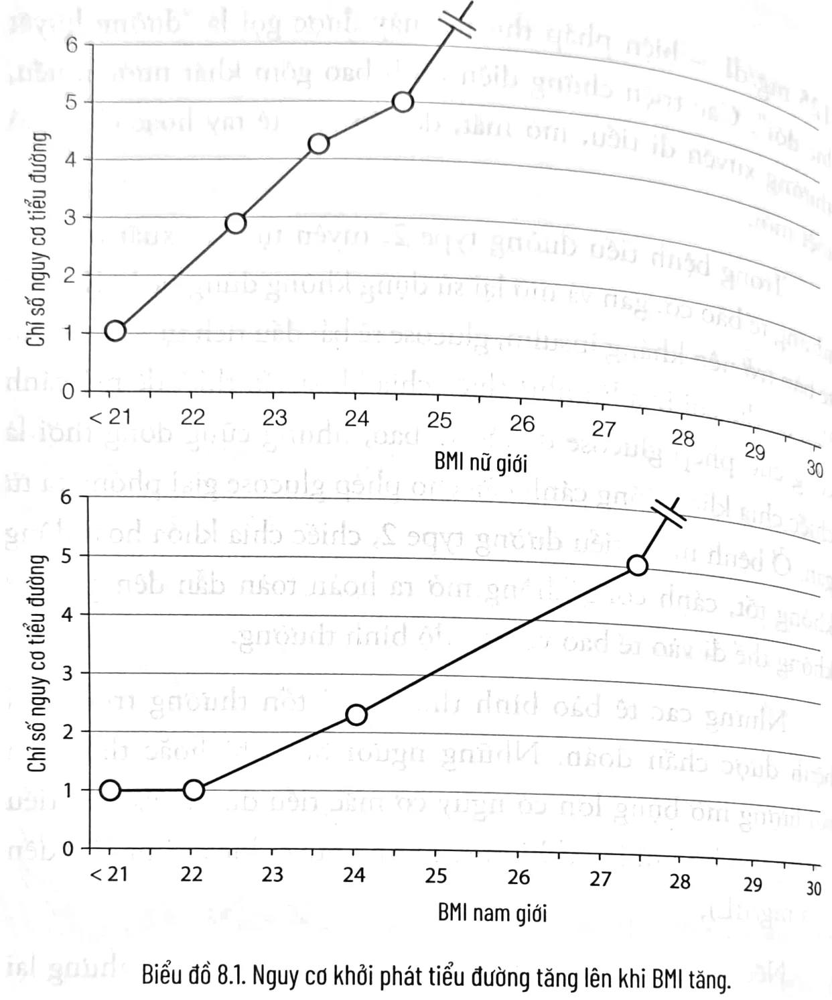
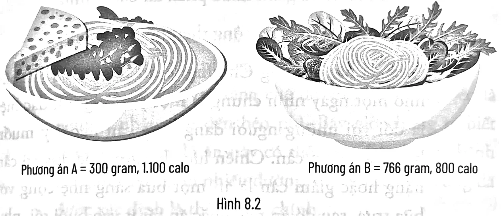
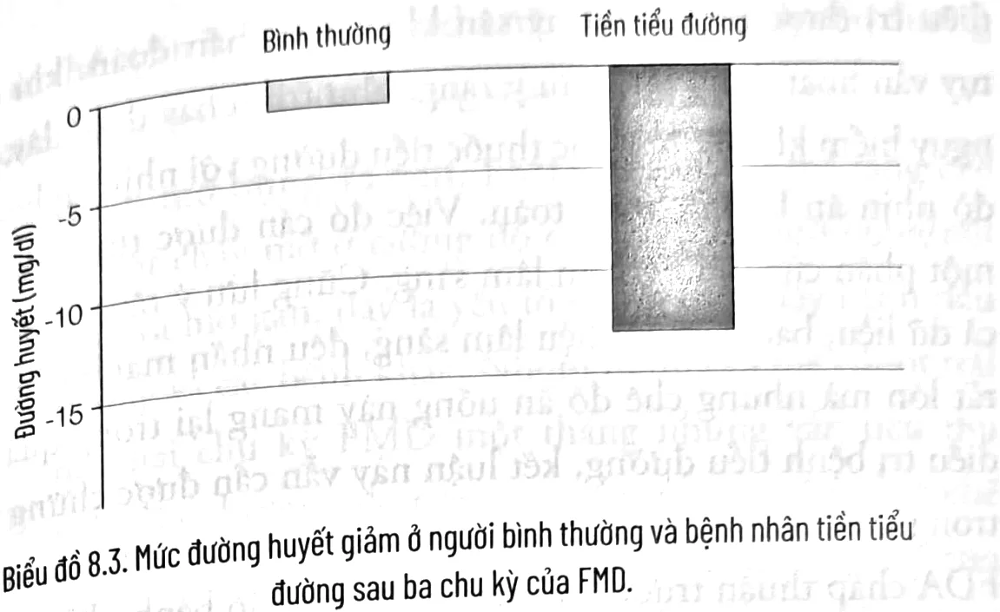
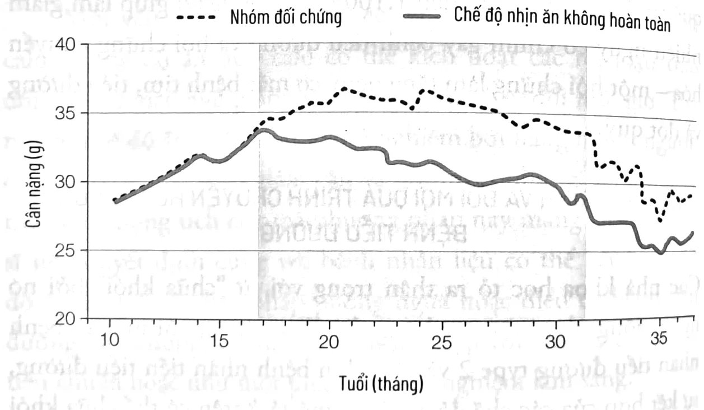
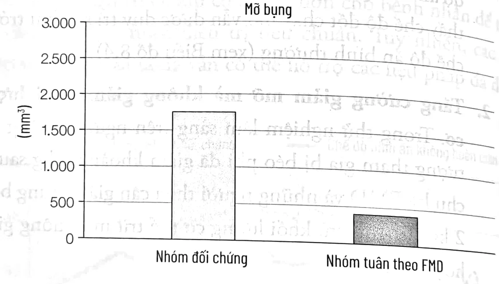

<!-- p.151 -->
# CHƯƠNG 8

## CHẾ ĐỘ NHỊN ĂN KHÔNG HOÀN TOÀN VÀ DINH DƯỠNG TRONG PHÒNG NGỪA, ĐIỀU TRỊ BỆNH TIỂU ĐƯỜNGⁱ

*[Tôi xin cảm ơn Hanno Pijl, bác sĩ nội tiết, chuyên gia về bệnh tiểu đường, giám đốc Phòng khám Nội tiết và Chuyển hóa tại Đại học Leiden và Clayton Frenzel, bác sĩ phẫu thuật giảm béo, vì đã xem xét chương này.]*

### TIỂU ĐƯỜNG TYPE 2

Bệnh tiểu đường type 2, cho đến nay là loại phổ biến nhất trong hai loại, ảnh hưởng tới hơn 27 triệu người ở Mỹ và 86 triệu người bị tiền tiểu đường, đồng nghĩa với việc họ có các yếu tố nguy cơ cao với bệnh tiểu đường. Theo Tổ chức Y tế Thế giới, số người được chẩn đoán bị tiểu đường trên toàn cầu đã tăng hơn bốn lần trong vòng 35 năm qua, từ 100 triệu người năm 1980 lên 422 triệu người năm 2014. Bệnh được chẩn đoán bằng cách đo nồng độ glucose trung bình trong máu (chỉ số HbA1c) hoặc nếu phát hiện lượng đường trong máu sau khi nhịn ăn qua đêm trên

---

i. Nội dung của chương này không được sử dụng để tự chẩn đoán hoặc tự quản lý các biện pháp điều trị. Thông tin này dành cho các chuyên gia y tế đang theo dõi bệnh của bạn.

<!-- p.152 -->
125 mg/dL – biện pháp thứ hai này được gọi là “đường huyết lúc đói”. Các triệu chứng điển hình bao gồm khát nước nhiều, thường xuyên đi tiểu, mờ mắt, dễ cáu gắt, tê tay hoặc chân, và mệt mỏi.

Trong bệnh tiểu đường type 2, tuyến tụy sản xuất insulin, nhưng tế bào cơ, gan và mỡ lại sử dụng không đúng cách. Khi các tế bào trở nên kháng insulin, glucose sẽ bắt đầu tích tụ trong máu. Bạn có thể coi insulin như chiếc chìa khóa cần thiết để mở cánh cổng cho phép glucose đi vào tế bào, nhưng cũng đồng thời là chiếc chìa khóa đóng cánh cửa cho phép glucose giải phóng ra từ gan. Ở bệnh nhân tiểu đường type 2, chiếc chìa khóa hoạt động không tốt, cánh cổng không mở ra hoàn toàn dẫn đến glucose không thể đi vào tế bào với tốc độ bình thường.

Nhưng các tế bào bình thường bị tổn thương trước khi bệnh được chẩn đoán. Những người béo phì hoặc thừa cân với lượng mỡ bụng lớn có nguy cơ mắc tiểu đường và tiền tiểu đường cao hơn nhiều (khi mức đường huyết lúc đói từ 100 đến 125 mg/dL).

Nếu hai người phụ nữ ở cùng chiều cao 1,65 m nhưng lại có sự khác biệt về cân nặng 70 kg và 59 kg thì nguy cơ mắc bệnh tiểu đường ở người có BMI 25 cao gấp sáu lần so với người có BMI 21. Tương tự, nếu cùng cao 1,73 m nhưng chỉ số BMI lần lượt là 27,5 và 22 thì một người đàn ông với cân nặng 69 kg sẽ có nguy cơ mắc tiểu đường thấp hơn năm lần so với người nặng 86,6 kg (xem Biểu đồ 8.1).¹

Một nghiên cứu khác chỉ ra cách tốt nhất để đánh giá nguy cơ mắc bệnh tiểu đường là đo lượng mỡ bụng thông qua vòng eo. Nam giới với số đo vòng eo trên 101,6 cm và nữ giới có vòng eo trên 86,4 cm có nguy cơ mắc bệnh cao nhất.²

<!-- p.153 -->

**Biểu đồ 8.1.** Nguy cơ khởi phát tiểu đường tăng lên khi BMI tăng.

### Dinh dưỡng, kiểm soát cân nặng và phòng ngừa bệnh tiểu đường

Duy trì cân nặng lý tưởng sẽ giảm thiểu xác suất mắc bệnh tiểu đường. Từ cả nghiên cứu trên khỉ và người, chúng tôi biết rằng một chế độ ăn uống hạn chế calo nghiêm ngặt có thể ngăn ngừa hoàn toàn bệnh tiểu đường hoặc giảm mạnh đường huyết lúc đói và mỡ bụng ở người, khiến những người này rất khó có khả năng mắc bệnh tiểu đường.³

Tuy nhiên, đại đa số mọi người không thể duy trì chế độ ăn hạn chế 30% calo và không muốn từ bỏ hầu hết những món ăn

<!-- p.154 -->
khoái khẩu; họ cũng không muốn mất phần lớn khối lượng cơ hoặc trở nên quá gầy, điều không thể tránh khỏi khi tình trạng hạn chế calo kéo dài. Ngoài ra, một số nghiên cứu cho thấy rằng không như những người có cân nặng bình thường, việc hạn chế calo không làm giảm đường huyết lúc đói ở người béo phì.⁴ Do đó, để ngăn ngừa bệnh tiểu đường, điều quan trọng là phải xác định các chiến lược phù hợp với đại đa số mọi người.

Trong phần tiếp theo, tôi sẽ trình bày cả những thay đổi trong chế độ ăn uống hằng ngày và chế độ nhịn ăn không hoàn toàn định kỳ có thể áp dụng để ngăn ngừa và đẩy lùi bệnh tiểu đường.

### CHẾ ĐỘ ĂN TRƯỜNG THỌ CÓ THỂ PHÒNG NGỪA VÀ ĐẢO NGƯỢC TÌNH TRẠNG BỆNH TIỂU ĐƯỜNG

Áp dụng Chế độ ăn Trường thọ (chương 4) có thể giúp ngăn ngừa và đẩy lùi bệnh tiểu đường ở một số đối tượng. Nó không chỉ giúp bạn duy trì hay đạt được cân nặng và lượng mỡ bụng hợp lý – đặc biệt khi kết hợp với các hướng dẫn tập luyện trong chương 5 – mà còn làm giảm tỷ lệ mắc bệnh tiểu đường không phụ thuộc vào cân nặng. Dưới đây là những can thiệp cụ thể về chế độ ăn có thể giúp ngăn ngừa và điều trị tiểu đường:

1. **Thời gian được phép ăn gói gọn tối đa trong vòng 12 tiếng mỗi ngày.**

Trong chương 4, tôi đã thảo luận về nghiên cứu liên quan đến khoảng thời gian ăn uống tối ưu hằng ngày. Nếu một người phụ nữ cao 1,57 m nặng 70 kg bắt đầu bữa sáng lúc 8 giờ sáng và kết thúc bữa ăn nhẹ cuối cùng lúc 11 giờ tối, tức cô ấy đang có một khoảng thời gian ăn uống kéo dài 15 tiếng mỗi ngày. Việc đó có thể ảnh hưởng đến cân nặng và cả giấc ngủ của cô ấy.⁵ Một chiến lược đơn giản để giảm về mức cân nặng phù hợp là rút

<!-- p.155 -->
ngắn khoảng thời gian ăn uống xuống còn 11 hoặc 12 giờ mỗi ngày – đồng nghĩa với việc ăn nhẹ lần cuối vào 7 hoặc 8 giờ tối.

Kỹ thuật này có thể được điều chỉnh để kiểm soát cân nặng tốt hơn nữa. Ví dụ: nếu việc giới hạn thời gian tiêu thụ thức ăn thành 11-12 giờ mỗi ngày chưa hiệu quả, có thể giảm xuống 10 hoặc thậm chí 8 giờ mỗi ngày (8 giờ sáng đến 6 giờ chiều hoặc 8 giờ sáng đến 4 giờ chiều), mặc dù giới hạn ít hơn 11-12 giờ có thể gây ra một số tác dụng phụ như sỏi mật. Hơn nữa, một số nghiên cứu chỉ ra rằng bỏ bữa sáng có thể có ảnh hưởng không tốt đến sức khỏe nói chung và tăng nguy cơ các bệnh tim mạch nói riêng. Tuy nhiên, việc tiêu thụ thức ăn trong vòng 11-12 giờ mỗi ngày thường xuất hiện ở các quần thể sống trường thọ, vì vậy khung thời gian thoải mái này có lẽ là một lựa chọn an toàn cho đến khi có các nghiên cứu sâu hơn.

2. Đảm bảo dinh dưỡng: ăn nhiều hơn, không phải ít hơn, nhưng tốt hơn.

Như đã thảo luận trong chương 4, nếu ăn 150 gram mì ống hoặc pizza với 150 gram phô mai, bạn có thể tiêu thụ 1.100 calo cho một khẩu phần tương đối nhỏ, thiếu vitamin và các khoáng chất quan trọng. Thay vào đó, nếu ăn 40 gram mì ống (khoảng 140 calo), thêm khoảng 400 gram đậu garbanzo (khoảng 330 calo), 312 gram rau hỗn hợp (khoảng 210 calo) và 14 gram dầu ô liu (khoảng 120 calo), bạn sẽ chỉ tiêu thụ 800 calo cho một khẩu phần lớn giàu protein, chất béo lành mạnh, carbohydrate phức, vitamin và khoáng chất.

<!-- p.156 -->
*Phương án A (lựa chọn sai)*

150 gram mì ống (540 calo) + 150 gram phô mai (550 calo) + 57 gram nước xốt (20 calo)

*Phương án B (lựa chọn đúng)*

40 gram mì ống (khoảng 140 calo) + 400 gram đậu garbanzo (ngâm và để ráo nước, khoảng 330 calo) + 312 gram rau hỗn hợp (khoảng 210 calo) + 14 gram dầu ô liu (khoảng 120 calo)

*Phương án B rõ ràng tốt hơn vì nhiều lý do.*

Phương án A = 300 gram, 1.100 calo Phương án B = 766 gram, 800 calo

Hình 8.2

* Phương án B cung cấp đủ protein, nhiều vitamin, khoáng chất, chất béo lành mạnh và các chất dinh dưỡng khác có thể nuôi dưỡng cơ thể và báo hiệu cảm giác no cho não.
* Giải phóng ít insulin hơn.
* Đòi hỏi lượng thức ăn gấp đôi phương án A, do đó sẽ làm đầy, giãn dạ dày và gửi lên não các tín hiệu về cảm giác no, đồng thời cung cấp ít hơn 30% calo.
* Thay thế chất béo động vật bão hòa trong phô mai bằng các chất béo không bão hòa đơn có tác dụng bảo vệ trong dầu ô liu.

<!-- p.157 -->
* Đối với nhiều người, phương án B thậm chí sẽ ngon miệng hơn phương án A, vì chất béo bão hòa và đường có xu hướng che lấp hương vị tự nhiên của các thành phần khác.
* Nhiều người cũng sẽ cảm thấy nhẹ nhõm hơn và tránh bị trào ngược axit dạ dày hoặc ợ chua, mặc dù đã ăn gấp đôi lượng thức ăn. Tất nhiên, một số người khi ăn quá nhiều trong một bữa, đặc biệt là vào buổi tối, có thể bị trào ngược axit ngay cả khi áp dụng phương án B. Trong trường hợp đó, tốt nhất bạn nên nói chuyện với bác sĩ chuyên khoa và giảm khẩu phần ăn của mình.

3. Ăn hai bữa một ngày cộng thêm một bữa nhẹ.

Như đã lưu ý trong Chương 4, ăn năm hoặc sáu bữa nhỏ một ngày nhìn chung là một ý tưởng tồi, đặc biệt là đối với những người đang tăng cân ngoài ý muốn hoặc cần giảm cân. Chiến lược lý tưởng để duy trì cân nặng hoặc giảm cân là ăn một bữa sáng nhẹ cộng với bữa trưa, sau đó ăn nhẹ hoặc ăn rất ít vào buổi tối, như thường thấy ở một số quần thể sống lâu. Lựa chọn khác là ăn nhẹ cho bữa sáng và bữa trưa, trong khi ăn chính cho bữa tối.

Lưu ý rằng đối với một số người, đặc biệt là những người lớn tuổi và ốm yếu, một bữa ăn chính trong ngày có thể gây khó tiêu hoặc trào ngược axit, trong trường hợp đó, có thể cần phải chuyển bữa ăn chính lên sớm hơn hoặc quay trở lại chế độ ăn sáng cộng với hai bữa ăn phụ mỗi ngày thay vì một bữa chính. Nếu không chắc chắn nếu có thể, tốt nhất bạn nên tham khảo ý kiến của chuyên gia dinh dưỡng để quyết định chiến lược tốt nhất.

<!-- p.158 -->
4. Tối đa hóa lượng carbohydrate phức tạp (ngũ cốc nguyên cám, rau củ, đậu đỗ); giảm mì ống, gạo và bánh mì; giảm thiểu đường và chất béo xấu.

Ngay cả khi đã đạt được cân nặng và vòng eo lý tưởng, bạn vẫn cần phải giảm tối đa lượng đường hoặc tinh bột (gạo, mì ống, bánh mì, nước ngọt...) cũng như chất béo bão hòa (phô mai, bơ, kẹo...). Gan sử dụng lượng đường dư thừa để tạo ra chất béo, có thể dự trữ ở đó hoặc vận chuyển đến các vị trí khác bao gồm bụng (mỡ nội tạng) và các vùng dưới da trên khắp cơ thể (lớp mỡ dưới da).

Vẫn còn rất nhiều tranh cãi về vai trò của chất béo trong việc dẫn đến béo phì và các bệnh lý khác. Trước đây, người ta thường tin rằng chế độ ăn nhiều chất béo là nguyên nhân dẫn đến béo phì. Bây giờ chúng ta biết rằng ngoài chế độ ăn này có thể góp phần gây ra bệnh béo phì, chế độ ăn nhiều đường, nhiều tinh bột cũng đã được xác định là thủ phạm chính.

Mặc dù ăn nhiều chất béo, ít carbohydrate sẽ giúp giảm cân trong hầu hết các trường hợp nhưng một phần trọng lượng cơ thể mất đi đáng kể là nhờ giảm nước và cơ. Hơn nữa, chế độ ăn giàu chất béo và protein, trong thời gian dài, là chế độ tồi tệ nhất trong tất cả, xét về cả tỷ lệ tử vong nói chung và tỷ lệ mắc ung thư hoặc tử vong do ung thư nói riêng (xem Chương 4).

Chất béo tốt – đặc biệt là từ dầu ô liu và các loại hạt (óc chó, hạnh nhân, hạt dẻ) – luôn gắn liền với sức khỏe và tuổi thọ. Hãy ăn một nắm các loại hạt mỗi ngày, rưới thật nhiều dầu ô liu vào món salad trộn và các món ăn khác.

<!-- p.159 -->
### 5. Áp dụng chế độ ăn ít nhưng đủ protein.

Mặc dù chúng ta biết béo phì làm tăng nguy cơ mắc bệnh tiểu đường, nhưng lượng protein tiêu thụ cũng là một nguyên nhân quan trọng không kém. Một nghiên cứu theo dõi 40.000 nam giới trong 20 năm cho thấy chế độ ăn ít carbohydrate, giàu protein có khả năng làm gia tăng nguy cơ mắc bệnh tiểu đường gấp hai lần.⁷ Những kết quả đó nhất quán với nghiên cứu mà chúng tôi đã thực hiện vào năm 2014 trên 6.000 người ở Mỹ. Nghiên cứu chỉ ra rằng nguy cơ tiểu đường tăng lên ở những người có lượng protein tiêu thụ cao nhất, mặc dù cỡ mẫu nhỏ làm hạn chế độ tin cậy của kết quả.⁸

Hai bài báo chúng tôi công bố vào năm 2011 và 2015 nghiên cứu về bệnh tật trên 100 bệnh nhân mắc hội chứng Laron sống ở Ecuador. Do đột biến trong gen thụ thể hormone tăng trưởng (GHR), họ lùn và có tỷ lệ béo phì cao hơn so với người thân của họ sống trong cùng một cộng đồng và cùng một chế độ ăn nhưng không mắc hội chứng Laron. Mặc dù béo phì là một trong những nguyên nhân chính dẫn đến tiểu đường nhưng không người nào có hội chứng Laron ở Ecuador mắc phải căn bệnh này. Đây là kết quả trùng khớp với các bài báo được thảo luận ở trên bởi protein là chất điều hòa chính của gen hormone tăng trưởng. Đồng thời, kết quả này cũng đưa ra những đề xuất tương tự rằng tiêu thụ nhiều protein có thể thúc đẩy bệnh tiểu đường, một phần do tăng hoạt động của hormone tăng trưởng và yếu tố tăng trưởng IGF-1, liên quan chặt chẽ với nhiều bệnh tật.

Sự thiếu hụt của thụ thể hormone tăng trưởng (có thể xem như có tác dụng tương tự với việc ăn ít protein)

<!-- p.160 -->
giúp loại bỏ hoặc làm giảm đáng kể quan hệ nhân quả của béo phì đối với bệnh tiểu đường. Trên thực tế, những con chuột có khiếm khuyết trong thụ thể hormone tăng trưởng cũng được bảo vệ khỏi bệnh tiểu đường – một kết quả củng cố thêm kết luận trên cơ thể người của chúng tôi. Bằng chứng mạnh nhất cho giả thuyết của chúng tôi được đưa ra vào năm 2015, khi chúng tôi đánh giá khả năng dung nạp glucose ở nhóm mắc hội chứng Laron. Không hề kháng insulin, hóa ra họ lại nhạy cảm với insulin, nghĩa là insulin của họ hoạt động tốt hơn bình thường, ngay cả ở những người thừa cân hoặc béo phì.⁹ Vì nguyên nhân chính của bệnh tiểu đường là kháng insulin, kết quả này có thể giải thích tại sao không có bệnh nhân Laron nào ở Ecuador mắc căn bệnh chuyển hóa này.

Các khuyến nghị nhằm ngăn ngừa bệnh tiểu đường trên đây cũng có thể hữu ích cho việc điều trị bệnh, mặc dù, theo các khuyến nghị về ung thư, cần có các nghiên cứu sâu hơn để chứng minh tác dụng đó.

### CHẾ ĐỘ NHỊN ĂN VÀ NHỊN ĂN KHÔNG HOÀN TOÀN TRONG ĐIỀU TRỊ BỆNH TIỂU ĐƯỜNG

#### Chế độ ăn 5:2

Hai biện pháp can thiệp ngắn hạn chủ yếu bao gồm nhịn ăn dưới một hình thức nào đó đã được chứng minh là có hiệu quả chống lại nhiều yếu tố nguy cơ gây bệnh tiểu đường (không xét đến các can thiệp hạn chế calo kéo dài từ hàng tuần đến hàng tháng). Một trong số đó là chế độ FMD định kỳ do phòng thí nghiệm của tôi phát triển. Biện pháp còn lại, được phát triển bởi bác sĩ Michelle Harvie của Đại học Manchester – và sau đó được bác

<!-- p.161 -->
sĩ, nhà báo Michael Mosley điều chỉnh và phổ biến thành chế độ ăn kiêng “5:2” – dành cho những người thừa cân, chỉ được tiêu thụ 500 đến 600 calo thực phẩm tương đối giàu protein hai ngày một tuần trong khoảng thời gian sáu tháng. Họ giảm mỡ bụng, cải thiện độ nhạy insulin và giảm huyết áp.¹⁰ Tuy nhiên, chế độ ăn này lại có tác động rất hạn chế lên nồng độ glucose ở những người thừa cân, đòi hỏi thời gian điều trị lâu hơn ở bệnh nhân tiểu đường.¹¹ Ưu điểm chế độ ăn kiêng này là chỉ cần sự giám sát y tế tối thiểu. Nhược điểm là hầu hết bệnh nhân béo phì và tiểu đường cảm thấy khó có thể duy trì chế độ này trong nhiều năm, bởi nó đặt ra một chế độ ăn uống vô cùng khắt khe hai ngày mỗi tuần. Hơn nữa, cần có các nghiên cứu để xác định những tác động sẽ xảy ra đối với bệnh nhân tiểu đường.

Một vấn đề cần lưu ý là việc xen kẽ một chế độ ăn 2.000 calo và chế độ ăn 500 calo có thể kích hoạt các rối loạn trao đổi chất và giấc ngủ giống như tình trạng thay đổi múi giờ. Tuy nhiên, chế độ ăn 5:2 đã được thử nghiệm bởi hàng nghìn người, đặc biệt với mục đích giảm cân và ghi nhận những phản hồi về nhiều tác động tích cực mà phương pháp này mang lại. Các bác sĩ nên quyết định cùng với bệnh nhân liệu có thể kết hợp chế độ ăn đó với các liệu pháp phòng ngừa hoặc điều trị bệnh tiểu đường hay không, tốt nhất là nên kết hợp với chế độ chăm sóc tiêu chuẩn hoặc như một phần của thử nghiệm lâm sàng.

### FMD VÀ ĐIỀU TRỊ BỆNH TIỂU ĐƯỜNG

Các thuốc điều trị bệnh tiểu đường sẽ can thiệp hoặc kích hoạt các enzyme làm giảm đường huyết, nhưng chúng không nhắm vào những nguyên nhân gốc rễ của bệnh tiểu đường – một vài trong số đó đã được biết đến và một vài vẫn đang trong quá trình nghiên cứu.

<!-- p.162 -->

Thử nghiệm lâm sàng ngẫu nhiên trên 100 bệnh nhân do chúng tôi thực hiện có kết quả rất hứa hẹn: nó cho thấy ba chu kỳ FMD với mỗi chu kỳ kéo dài năm ngày một tháng bắt chước quá trình nhịn ăn (750 đến 1.100 calo mỗi ngày) giúp làm giảm nhiều nguy cơ chính gây bệnh tiểu đường và hội chứng chuyển hóa – một hội chứng làm tăng nguy cơ mắc bệnh tim, tiểu đường và đột quỵ.

### TÁI LẬP TRÌNH VÀ ĐỔI MỚI QUÁ TRÌNH CHUYỂN HÓA ĐIỀU TRỊ BỆNH TIỂU ĐƯỜNG

Các nhà khoa học tỏ ra thận trọng với từ “chữa khỏi” bởi nó nghe giống như một sự phóng đại. Tuy nhiên, với một số bệnh nhân tiểu đường type 2 và phần lớn bệnh nhân tiền tiểu đường, sự kết hợp của các chế độ ăn được mô tả ở trên có thể chữa khỏi bệnh. Tôi không có ý nói rằng tất cả mọi người sẽ được chữa khỏi hoặc người bệnh tiểu đường dễ dàng thực hiện kế hoạch này. Tuy nhiên, dữ liệu từ các thử nghiệm trên cá thể chuột và người chỉ ra rằng, một số và có khả năng là nhiều bệnh nhân, theo đuổi lâu dài các chế độ ăn uống được nêu trong phần đầu của chương này hoặc FMD định kỳ, và tốt nhất là cả hai, cuối cùng có thể không còn mắc tiểu đường type 2, loại phổ biến nhất. Đặc biệt nếu việc

<!-- p.163 -->
điều trị được bắt đầu ngay sau khi được chẩn đoán, khi tuyến tụy vẫn hoạt động tốt. Lưu ý rằng, như trình bày dưới đây, sẽ rất nguy hiểm khi kết hợp các thuốc tiểu đường với nhịn ăn hoặc chế độ nhịn ăn không hoàn toàn. Việc đó cần được thực hiện như một phần của thử nghiệm lâm sàng. Cũng lưu ý rằng mặc dù tất cả dữ liệu, bao gồm dữ liệu lâm sàng, đều nhấn mạnh tiềm năng rất lớn mà những chế độ ăn uống này mang lại trong quá trình điều trị bệnh tiểu đường, kết luận này vẫn cần được chứng minh trong một thử nghiệm lâm sàng ngẫu nhiên quy mô lớn và được FDA chấp thuận trước khi có thể kê đơn cho bệnh nhân để thay thế cho các loại thuốc điều trị tiêu chuẩn. Tuy nhiên, các can thiệp về chế độ ăn uống vẫn có thể hỗ trợ các liệu pháp đã được FDA chấp thuận.

*Biểu đồ 8.4. Chuột áp dụng chế độ nhịn ăn không hoàn toàn giảm cân trong khi ăn lượng như nhau mỗi tháng.*

Tuy nhiên, nếu bạn có nguy cơ mắc bệnh tiểu đường cao hoặc đã vướng phải căn bệnh này rồi, tôi khuyến khích bạn trao đổi với bác sĩ của mình và cân nhắc việc thay đổi chế độ ăn uống hằng ngày hiện tại, nhằm phòng ngừa và điều trị bệnh. Các nghiên cứu của chúng tôi trên cả thể chuột và người chỉ ra rằng

<!-- p.164 -->
FMD có thể ngăn ngừa hoặc có khả năng đẩy lùi bệnh tiểu đường bằng cách thực hiện những hướng dẫn sau:

1. **Giảm mỡ bụng và gan.** FMD chuyển cơ thể sang chế độ đốt cháy mỡ ở cường độ cao, chủ yếu mỡ bụng/nội tạng và mỡ gan, đây là yếu tố chính thức đẩy bệnh tiểu đường và các bệnh khác. Nhóm những cá thể chuột trải qua hai chu kỳ FMD một tháng nhưng vẫn tiêu thụ một tổng lượng calo tương tự như những cá thể có chế độ ăn thông thường, tiếp tục giảm cân. Kết quả này cho thấy chế độ đốt cháy mỡ vẫn được duy trì sau khi trở lại chế độ ăn bình thường (xem Biểu đồ 8.4).

2. **Tăng cường giảm mỡ mà không giảm khối lượng cơ.** Trong thử nghiệm lâm sàng trên người, những đối tượng tham gia bị béo phì đã giảm khoảng 4 kg sau ba chu kỳ FMD và những người thừa cân giảm trung bình 2 kg. Tuy nhiên, khối lượng cơ thể trừ mỡ không giảm hoặc giảm rất ít.

3. **Đổi mới/tái tạo tế bào và tự thực bào.** Bằng cách làm cho nhiều tế bào già nua, bị hư hỏng trong các hệ thống chết hoặc ngừng hoạt động, FMD có khả năng loại bỏ tế bào xấu và thúc đẩy quá trình tái tạo bên trong tế bào (tự thực bào) cũng như sản xuất tế bào mới thông qua hoạt hóa tế bào gốc. Điều này dẫn đến sự phục hồi và trẻ hóa. Trên cá thể chuột, chúng tôi đã chứng minh quá trình này xảy ra trong nhiều cơ quan, bao gồm máu, não, cơ, gan và tuyến tụy. Ở người, dữ liệu từ các thử nghiệm lâm sàng cho thấy quá trình tái tạo tương tự đang diễn ra. Với những đối tượng khỏe mạnh có chỉ số đường huyết hoặc huyết áp thấp, tình trạng của họ thường ít

<!-- p.165 -->
hoặc không thay đổi sau chu kỳ FMD, đảm bảo các chỉ số an toàn trên ngưỡng nguy hiểm. Tuy nhiên, FMD thể hiện tác động lên nồng độ glucose, huyết áp và các yếu tố nguy cơ gây ra bệnh tiểu đường mạnh mẽ hơn ở những người có nguy cơ lão hóa và khả năng mắc bệnh tại thời điểm bắt đầu nghiên cứu. Những tác động này ở người cùng với dữ liệu từ nghiên cứu trên chuột, chỉ ra sự trẻ hóa hoặc tái tạo các tế bào bị tổn thương hoặc cả hai tác dụng trên.

Biểu đồ 8.5. Giảm mỡ bụng ở chuột được áp dụng FMD.

Nếu các tế bào cơ đáp ứng kém với insulin được sửa chữa, trẻ hóa hoặc đổi mới, chúng có thể phục hồi chức năng bình thường. (Không có gì ngạc nhiên khi kháng insulin tương đối hiếm gặp ở những người trẻ tuổi, đặc biệt là ở những người không béo phì, nhưng rất phổ biến ở người cao tuổi, ngay cả khi họ không bị béo phì.)

### FMD, TÁI TẠO TUYẾN TỤY, ĐẨY LÙI TIỂU ĐƯỜNG TYPE 1 VÀ TYPE 2 Ở CÁ THỂ CHUỘT

Trong một bài báo gần đây, chúng tôi đã chỉ ra rằng bên cạnh việc cải thiện chức năng của insulin, chu kỳ FMD còn thúc

<!-- p.166 -->
đẩy quá trình tái tạo các tế bào beta sản xuất insulin và đẩy lùi các triệu chứng của cả tiểu đường type 1 và type 2 ở những cá thể chuột có tuyến tụy không thể tạo ra đủ insulin, dẫn đến nồng độ đường máu rất cao.¹² Đặc biệt, FMD kích hoạt nhiều gen tuyến tụy, vốn thường xảy ra trong quá trình phát triển của phôi/bào thai, cho thấy rằng nó có thể gây ra một đáp ứng tự nhiên và phối hợp phức tạp để tạo ra các tế bào beta mới có chức năng, sản xuất lượng insulin bình thường.

Một lưu ý về insulin và chế độ nhịn ăn chỉ uống nước hoặc tương tự: Mặc dù tử vong ở những người nhịn ăn kéo dài rất hiếm gặp nhưng khi trường hợp này xảy ra, đó là một số ca liên quan đến sử dụng insulin. Một số bệnh nhân tử vong do kết hợp nhịn ăn với tiêm insulin, có thể là do insulin thường hoạt động kém ở bệnh nhân tiểu đường và việc nhịn ăn sẽ phần nào làm phản tác dụng của nó. Cùng một mũi tiêm insulin có thể làm nồng độ glucose giảm xuống mức bình thường ở bệnh nhân tiểu đường nhưng lại giảm đột ngột ở bệnh nhân tiểu đường nhịn ăn – dẫn đến sốc do hạ đường huyết và trong một số trường hợp gây ra tử vong. Nguy cơ tương tự với việc sử dụng chế độ nhịn ăn không hoàn toàn.

### CÂU CHUYỆN CẢNH BÁO (VỚI KẾT THÚC CÓ HẬU)

Tôi muốn chia sẻ một email nhận được từ một bệnh nhân xa lạ. Một mặt, bức thư củng cố sức mạnh của FMD định kỳ và Chế độ ăn Trường thọ hằng ngày trong ngăn ngừa và điều trị bệnh; mặt khác, nó chỉ ra mức độ nguy hiểm của việc tự điều trị. Bệnh nhân tiểu đường này đã mạo hiểm mạng sống của mình bằng cách kết hợp các loại thuốc giống insulin với phiên bản Chế độ ăn Trường thọ của riêng mình mà không hỏi qua ý kiến bác sĩ.

<!-- p.167 -->
*Thưa Tiến sĩ Longo,*

*Có lẽ ông không biết điều này, nhưng chính ông đã cứu sống tôi. Vào tháng 12, tôi bắt đầu hành trình xuống địa ngục của mình do bị liệt chân trái. Tôi đã phải ở trong bệnh viện vào đêm Giáng sinh. Hàng loạt xét nghiệm máu không xác định được điều gì đáng báo động nhưng tôi bị trào ngược axit dạ dày nặng, tiêu hóa kém và nôn mửa liên tục. Các xét nghiệm nội soi dạ dày, dị ứng và không dung nạp thực phẩm không có gì bất thường. Theo các bác sĩ, tình trạng sức khỏe của tôi vẫn ổn. Tôi đã loại bỏ thịt, sữa và thực phẩm chứa lactose ra khỏi chế độ ăn của mình từ tháng 3, và đạt được một số kết quả nhất định. Nhưng chỉ mới đi bộ hơn 150 m, tôi đã phải thở hổn hển rồi. Cân nặng của tôi tăng lên 122,5 kg ngay cả khi không ăn gì nhiều, kèm theo hiện tượng sưng phù ở chân và khắp cơ thể; các xét nghiệm hình ảnh cho thấy gan tôi nhiễm mỡ nặng, đã chuyển sang xơ gan. Gan của tôi chiếm phần lớn khoang bụng, gây áp lực lên dạ dày, có thể việc đó đã dẫn đến trào ngược, viêm ở đáy màng phổi và ho không ngừng.*

*Vào ngày 5 tháng 6, mọi thứ thay đổi. Tôi cầm trên tay một quyển tạp chí với trang bìa là bài viết về ông: “Chữa bệnh bằng cách ăn ít hơn”. Tôi đã sốc khi đọc bài báo. Xin nhớ rằng tôi là một người mắc bệnh tiểu đường (insulin, NovoRapid 18 đơn vị ba lần mỗi ngày, 22 đơn vị Lantus vào buổi tối – metformin và thuốc hạ áp). Tôi đã áp dụng chế độ ăn ông mô tả từ cuối tháng 6, và mọi thứ đã thay đổi. Kết quả: cân nặng của tôi giảm xuống còn 104 kg, tôi đi bộ hoặc chạy bộ trung bình 4,8 km mỗi ngày và hiện tại đang tham gia một lớp học lặn. Tôi không còn dùng thuốc (Lantus) vào buổi tối vì nó gây hạ đường huyết nghiêm trọng về đêm và giảm NovoRapid xuống 6 đơn vị vào buổi sáng, 10 đơn vị vào bữa trưa và 8 đơn vị vào bữa tối. Tôi không còn dùng metformin nữa. Tôi đã loại bỏ tất cả các loại thịt, sữa và các thực phẩm chứa lactose, bơ, bơ thực vật, đồ chiên rán, rượu, đồ ngọt và đường. Mức đường huyết trung bình của tôi không quá 145. Các bác sĩ bất ngờ với tình trạng hiện tại của tôi và muốn xin một bản sao của bài báo ấy.*

<!-- p.168 -->
May mắn thay, bệnh nhân đó không áp dụng FMD mà chỉ Chế độ ăn Trường thọ. Nhưng chỉ riêng điều đó cũng đủ để tái kích ứng các tế bào của anh ấy với insulin và gây hạ đường huyết nghiêm trọng vào ban đêm. Anh ấy đã mạo hiểm mạng sống của mình bằng cách thay đổi đột ngột mà không tham khảo ý kiến bác sĩ có kinh nghiệm về chế độ ăn và bệnh tiểu đường để được tư vấn trong quá trình chuyển đổi. Nếu kết hợp FMD với thuốc điều trị bệnh tiểu đường, có thể anh ấy đã không sống được.

Kết quả nghiên cứu của tôi chứng minh được tính ích lợi cho bệnh nhân này, nhưng nếu bạn mắc tiểu đường, tôi thực sự không khuyến khích bạn học theo anh ấy. Tất nhiên, sai lầm lớn là kết hợp chế độ ăn với insulin. Chỉ cần một lần đến gặp bác sĩ trước khi áp dụng chế độ ăn đó và có thể là FMD định kỳ, anh ấy thậm chí đã có thể làm tốt hơn mà không gặp phải nguy cơ bị sốc hạ đường huyết.

Nếu bác sĩ của bạn từ chối giúp bạn điều trị hoặc ngăn ngừa bệnh tiểu đường bằng các can thiệp về chế độ ăn uống, bạn nên cương quyết. Nếu họ vẫn từ chối, hãy tìm kiếm một bác sĩ chuyên về y học mở rộng hoặc liên hệ với L-Nutra và yêu cầu một bác sĩ chuyên khoa trong mạng lưới của họ.

Tôi không nói rằng các liệu pháp điều trị thông thường không mang lại hiệu quả. Nhưng tôi tin rằng các bác sĩ y khoa nên ưu tiên các liệu pháp nhằm chữa khỏi cho bệnh nhân chứ không chỉ làm chậm sự tiến triển của bệnh tật. Gần đây tôi đã triển khai một chương trình đào tạo cho các nhà sinh vật học, chuyên gia dinh dưỡng và bác sĩ y khoa về Chế độ ăn Trường thọ và FMD. Tôi hy vọng sẽ thiết lập được một mạng lưới các chuyên gia chuyên sâu ở nhiều quốc gia để giám sát bệnh nhân muốn sử dụng các chiến lược dinh dưỡng mô tả trong cuốn sách này.

<!-- p.169 -->
### ĐIỀU TRỊ BÉO PHÌ

Hầu hết công việc của tôi đều hướng đến mục đích ngăn ngừa hoặc tìm ra cách chữa trị các bệnh thông thường, chủ yếu là gây ra tác động trong quá trình lão hóa và từ đó sửa chữa, bảo vệ, tái tạo các thành phần tế bào và cơ quan. Thường thì tôi tập trung vào các nghiên cứu trên động vật và lâm sàng liên quan đến béo phì, tiểu đường, ung thư, bệnh tim hoặc Alzheimer, làm việc tại những trường đại học lớn và các bệnh viện liên kết. Nhưng mọi người viết thư cho tôi mỗi ngày, đặc biệt là khi họ đi vào bế tắc với những phương pháp y học truyền thống. Trong những trường hợp như vậy, tôi thu thập dữ liệu của từng bệnh nhân và ngoại suy từ những phát hiện khoa học hiện có để đưa ra một kế hoạch hành động, mà sau đó tôi sẽ trao đổi với bệnh nhân và bác sĩ của họ. Tôi muốn chia sẻ hai ca cực đoan trong số này, liên quan đến bệnh béo phì.

### TRƯỜNG HỢP 1

Tôi nhận được lá thư từ một người phụ nữ đã quyết định tự thực hiện FMD. Cô ấy viết: “Bây giờ tôi đã trải qua 15 chu kỳ FMD năm ngày. Tổng cộng, tôi đã giảm được 18 kg (từ 114 xuống còn 96 kg, tức là hơn 1 kg mỗi chu kỳ), mặc dù việc thiếu hụt ProLon FMD trong khoảng 10 tháng đã khiến tôi tăng lên gần 3 kg. Huyết áp của tôi đã giảm từ 130/80 xuống khoảng 120/70. Trong thời gian 3-4 tuần giữa các chu kỳ, tôi cảm thấy khỏe khoắn hơn và có thể làm việc nhiều giờ hơn mà không bị mất tập trung.”

“Chế độ ăn này không phải là thứ khiến tôi cảm thấy ‘vui thích’, tôi thích một chế độ ăn phong phú hơn là FMD. Tuy nhiên, tôi thấy khoảng thời gian ngắn (năm ngày) có thể chấp nhận được ở chỗ tôi không cảm thấy đói. Hơn nữa, sau năm

<!-- p.170 -->
ngày, tôi có thể trở lại chế độ ăn uống bình thường và vui vẻ ăn những gì tôi muốn. Để duy trì cân nặng, tôi cố gắng không say xỉn nhưng giữa các chu kỳ, tôi thỉnh thoảng có ăn hamburger, một vài cốc sữa chua đông lạnh và thậm chí một chiếc bánh ngọt, vì vậy đó không phải là một sự hy sinh khó khăn hay lớn lao.”

### TRƯỜNG HỢP 2

Trường hợp thứ hai là một người đàn ông béo phì mà tôi đã giúp đỡ, anh ấy đã thử mọi cách để giảm cân nhưng không có tác dụng. Anh ấy bắt đầu với cân nặng không lành mạnh 111 kg, vòng eo 127 cm và tỷ lệ mỡ cơ thể là 38%, khiến nguy cơ mắc bệnh tiểu đường rất cao. Anh ấy thực hiện ba chu kỳ FMD và kết quả cho thấy các chỉ số về cân nặng, huyết áp, protein phản ứng C (CRP: một thước đo phản ứng viêm), đường huyết đều được cải thiện. Tuy nhiên, mức độ cải thiện không nhiều, vì giữa các chu kỳ, anh ấy quay lại chế độ ăn nhiều chất béo, nhiều đường, nhiều tinh bột, do đó anh tăng cân trở lại. Tôi nói với anh ấy rằng nếu xét đến nguy cơ mắc bệnh cao mà mình đang gặp phải, và nên thực hiện bốn chu kỳ FMD liên tục dưới sự giám sát y tế.

Tôi biết các phòng khám nhịn ăn thường áp dụng cho bệnh nhân chế độ ăn 200 calo mỗi ngày trong bốn tuần mà không gặp nhiều vấn đề, vì thế ba tuần FMD, cung cấp ít nhất 750 calo mỗi ngày là hợp lý nếu bệnh nhân cẩn thận và phối hợp chặt chẽ với tôi cùng bác sĩ của anh ấy.

Chiến lược này giúp giảm 13,6 kg, lượng lớn mỡ bụng, tăng cường năng lượng và sức khỏe nói chung. Một năm sau, anh ấy duy trì được trọng lượng cơ thể của mình và báo cáo rằng FMD đã thay đổi thói quen ăn uống của mình.

Rõ ràng chỉ nên cân nhắc áp dụng nhiều chu kỳ FMD (hai trở lên) khi chế độ định kỳ thất bại. Phương pháp này phải được

<!-- p.171 -->
thực hiện với sự chấp thuận và giám sát chặt chẽ của một bác sĩ, tốt nhất là một người có chuyên môn về nhịn ăn kéo dài. Bệnh nhân có thể gặp một số tác dụng phụ nếu thực hiện không đúng cách hoặc sử dụng sai loại thực phẩm. Những tác dụng phụ đó bao gồm hạ huyết áp hay đường huyết quá mức và suy dinh dưỡng (thiếu một số vitamin, khoáng chất hoặc dưỡng chất thiết yếu). FMD cũng có thể gây ra một số tác dụng phụ với thuốc, khiến việc áp dụng kéo dài nguy hiểm đối với một số người – ví dụ: những người điều trị bằng insulin. Một mối lo ngại khác liên quan đến việc kết hợp giảm cân nhanh và tăng cân nhanh. Nhiều nghiên cứu cho thấy các chu kỳ giảm cân nhanh sau đó tăng cân trở lại có thể làm tăng bệnh tim mạch ở cả những người bình thường và những người đã bị bệnh tim.

Dựa vào các nghiên cứu nêu trên, việc tránh giảm cân rồi tăng trở lại đặc biệt quan trọng, do đó bệnh nhân phải cam kết tiếp tục thực hiện FMD mỗi tháng một lần sau khi trải qua nhiều chu kỳ FMD liên tiếp. Xin lưu ý rằng ProLon hoặc bất kỳ chế độ FMD nào chỉ là công cụ mà một bác sĩ có thể sử dụng để giúp kiểm soát tình trạng béo phì. Chúng tôi hiện vẫn đang nghiên cứu để hướng tới triển khai các thử nghiệm lâm sàng như một phần trong quy trình phê duyệt của FDA nhưng mọi thứ cần có thời gian. Cho đến khi đó, thông tin trong chương này cung cấp cơ sở vững chắc về chế độ ăn uống có thể bổ sung cho các biện pháp phòng ngừa và điều trị bệnh tiểu đường tiêu chuẩn.

Tiếp theo, hãy xem xét những nghiên cứu ban đầu đầy hứa hẹn của chúng tôi về Chế độ ăn Trường thọ và các tác dụng tích cực đối với bệnh tim mạch của FMD.
