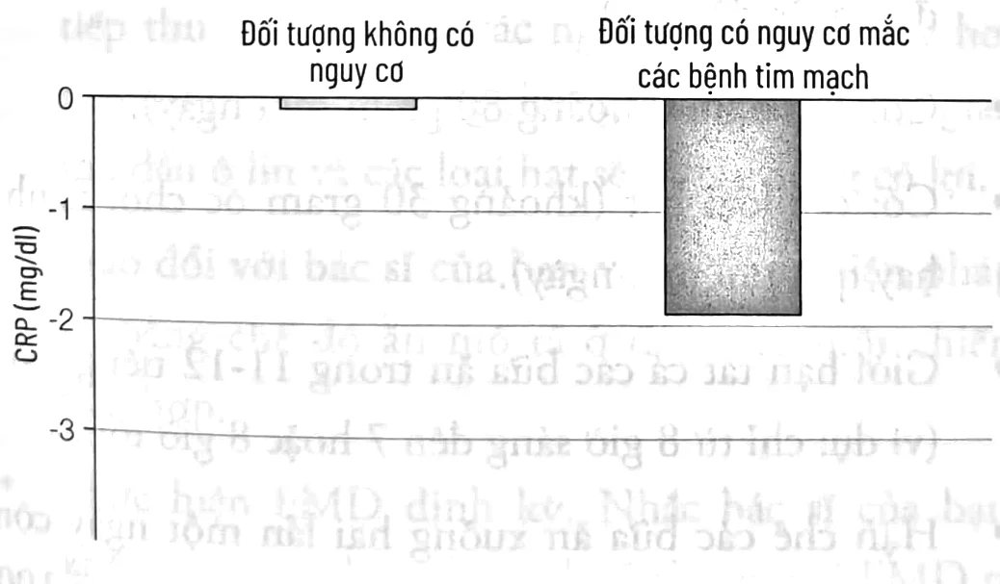

<!-- sách 179 · PDF 172 -->
# CHƯƠNG 9

## CHẾ ĐỘ NHỊN ĂN KHÔNG HOÀN TOÀN VÀ DINH DƯỠNG TRONG PHÒNG NGỪA, ĐIỀU TRỊ BỆNH TIM MẠCH¹

*[Tôi xin gửi lời cảm ơn đến Kurt Hong, bác sĩ, tiến sĩ, phó giáo sư và giám đốc của Trung tâm Dinh dưỡng Lâm sàng Đại học Nam California, Los Angeles, và Andreas Michalsen, bác sĩ trưởng khoa tại Trung tâm Nghiên cứu Thực nghiệm và Lâm sàng, Đại học Y khoa Charité Berlin vì đã duyệt lại chương này. Tôi cũng xin gửi lời cảm ơn đến Rafael De Cabo, tiến sĩ, Nghiên cứu viên Cao cấp, Ngành Lão khoa Ứng dụng, Viện Lão khoa Quốc gia (NIA), Baltimore.]*

Theo Hiệp hội Tim mạch Hoa Kỳ, bệnh tim mạch (CVD: cardiovascular disease) – một nhóm bệnh bao gồm bệnh mạch vành, đột quỵ, suy tim, tăng huyết áp và các bệnh lý động mạch – giết chết khoảng 801.000 người Mỹ mỗi năm. Cứ ba ca tử vong thì có một ca chết vì bệnh tim mạch. Ngoài ra, có khoảng 92 triệu người Mỹ đang sống chung với một bệnh lý nào đó liên quan đến tim mạch hoặc đang chịu di chứng của đột quỵ. Chi

---

i. Nội dung của chương này không được sử dụng để tự chẩn đoán hoặc tự quản lý các biện pháp điều trị. Thông tin này dành cho các chuyên gia y tế đang theo dõi bệnh của bạn.

<!-- sách 180 · PDF 173 -->
phí liên quan đến điều trị và tổn thất do giảm năng suất lao động ước tính khoảng 316 tỷ đô la Mỹ. Rõ ràng các loại thuốc và biện pháp can thiệp được chỉ định khác dường như không quá hiệu quả, do đó Chế độ ăn Trường thọ hằng ngày và phương pháp FMD có khả năng làm giảm tỷ lệ mắc phải và tiến triển của bệnh tim mạch. Khi nói đến bệnh tim mạch, hai nghiên cứu thử nghiệm trên khỉ, được thực hiện trong nhiều thập kỷ, cũng như nhiều nghiên cứu trên người là bằng chứng về tiềm năng của một số chế độ ăn uống nhất định trong việc phòng ngừa căn bệnh phổ biến này. Tôi sẽ bắt đầu bằng cách giải thích ngắn gọn về kết quả của chúng và thành tựu chúng ta có thể đạt được từ đó.

## PHÒNG NGỪA BỆNH TIM MẠCH Ở KHỈ

Với trình tự DNA giống người đến 93%, khỉ vàng có lẽ là sinh vật giống con người nhất mà chúng ta có thể nghiên cứu để tìm ra cách phản ứng của tuổi thọ với các can thiệp về chế độ ăn uống. Khỉ là loài động vật có thể mắc nhiều căn bệnh giống con người – bao gồm tiểu đường, ung thư và tim mạch. Với tuổi thọ kéo dài lên tới 40 năm, chúng ta có thể thực hiện nghiên cứu trên loài khỉ trong một thời gian dài nhưng vẫn kiểm soát được. Hai nghiên cứu quy mô lớn, một của Đại học Wisconsin và một của Viện Lão khoa Quốc gia Hoa Kỳ (NIA), đã đánh giá việc giảm khoảng 30% calo suốt đời ảnh hưởng đến tuổi thọ và bệnh tật ở khỉ vàng như thế nào.

Nghiên cứu của Đại học Wisconsin kéo dài hơn 20 năm do Tiến sĩ Richard Weindruch đứng đầu đã kết luận rằng chế độ ăn hạn chế calo (CR: calorie restricted) làm giảm tỷ lệ tử vong của khỉ xuống 26%, so với 63% ở nhóm đối chứng.¹

Bốn mươi hai phần trăm số khỉ áp dụng chế độ ăn thông thường mắc tiền tiểu đường hoặc tiểu đường, nhưng không con

<!-- sách 181 · PDF 174 -->
nào trong nhóm CR mắc một trong hai tình trạng đó. Ngoài ra, các bệnh tim mạch giảm 50% ở nhóm CR.²

Trái ngược với nghiên cứu Wisconsin, nghiên cứu NIA, dẫn đầu bởi Rafael de Cabo, lại không tìm thấy sự khác biệt rõ ràng về nguyên nhân tử vong giữa nhóm đối chứng và nhóm CR. Hai nhóm đều có tỷ lệ mắc bệnh tim mạch, bệnh thoái hóa dạng bột, ung thư và suy giảm sức khỏe nói chung tương tự nhau.³

Kết quả khác nhau giữa hai nghiên cứu trên khỉ kéo dài nhiều thập niên này nhấn mạnh tầm quan trọng của chế độ ăn bên cạnh việc hạn chế calo. Trong nghiên cứu NIA, nhóm đối chứng áp dụng một chế độ ăn lành mạnh, trong đó protein có nguồn gốc chủ yếu từ thực vật, bao gồm lúa mì, ngô, đậu tương, cỏ linh lăng và cá. Protein chiếm 17,3% tổng lượng calo, 5% chất béo, 5% chất xơ và 3,9% đường sucrose, cùng vitamin và khoáng chất. Sau cùng, chúng được cho ăn chỉ hai lần một ngày với khẩu phần đã được điều chỉnh theo độ tuổi, trọng lượng của từng cá thể.

Trong Nghiên cứu của Đại học Wisconsin, sữa (lactalbumin) là nguồn protein duy nhất. Chế độ ăn chứa 10% chất béo (chủ yếu từ dầu ngô), 5% cellulose và 28,5% sucrose. Không giống như trong nghiên cứu của NIA, nhóm đối chứng của Wisconsin được phép ăn bao nhiêu tùy thích, đại diện cho chế độ ăn uống điển hình của người phương Tây.

Nói cách khác, nhóm đối chứng của NIA được duy trì cân nặng hợp lý với chế độ ăn tương tự như Chế độ ăn Trường thọ được mô tả trong cuốn sách này, trong khi nghiên cứu của Wisconsin áp dụng chế độ ăn nhiều đường, protein có nguồn gốc động vật và được phép tăng cân. Không có gì đáng ngạc nhiên khi việc hạn chế calo trong nghiên cứu Wisconsin có tác dụng bảo vệ, chống lại lão hóa và bệnh tật, bởi vì nhóm đối chứng làm

<!-- sách 182 · PDF 175 -->
tiêu chuẩn để so sánh với nhóm thử nghiệm CR có một chế độ ăn uống không lành mạnh. Ngược lại, nhóm đối chứng NIA với một chế độ ăn lành mạnh đã giảm được 30% calo khiến chế độ ăn không có tác động đáng kể đến sự lão hóa hay tăng khả năng mắc hầu hết các bệnh lý, điều này nhấn mạnh tầm quan trọng của chế độ ăn uống hằng ngày, và ủng hộ kết luận của tôi xuyên suốt cuốn sách rằng những người duy trì một Chế độ ăn Trường thọ lý tưởng có thể giới hạn liệu trình FMD định kỳ chỉ hai lần một năm.

## CHẾ ĐỘ ĂN VÀ CÁCH PHÒNG NGỪA BỆNH TIM MẠCH

Quay trở lại nói về con người. Trong chương 4, tôi đã mô tả Chế độ ăn Trường thọ lý tưởng (có xem xét đến nghiên cứu trên khỉ của Wisconsin và NIA). Tuy nhiên, các phiên bản nhẹ nhàng hơn của chế độ ăn này, và các lợi ích của chúng, đã được khảo sát trong nhiều nghiên cứu. Một trong những chế độ ăn được nghiên cứu nhiều nhất cho thấy sức ảnh hưởng của nó đến lão hóa và bệnh tật, bao gồm bệnh tim mạch, là chế độ ăn Địa Trung Hải ở mức độ nghiêm ngặt nhất. Căn cứ khoa học đằng sau tính hiệu quả của nó chủ yếu bắt nguồn từ một trong năm Trụ cột – dịch tễ học – vì có rất ít thử nghiệm lâm sàng và nghiên cứu phân tử được thực hiện. Dữ liệu từ các nghiên cứu về những người trăm tuổi cho thấy tuổi thọ cực cao rất ít liên quan đến bản thân chế độ ăn Địa Trung Hải. Thay vào đó là một số nguyên liệu cụ thể và tần suất của chúng trong các chế độ ăn thường thấy ở Địa Trung Hải, Okinawa, Loma Linda và Costa Rica. Nói cách khác, chế độ ăn Địa Trung Hải dường như là một lựa chọn rất tốt, nhưng nếu chúng ta lưu ý tới tất cả các trụ cột thì Chế độ ăn Trường thọ, bao gồm liệu trình FMD định kỳ được trình bày trong chương 4 và 6, có thể sẽ đạt được nhiều lợi ích hơn nữa. Những người không thể tuân thủ nghiêm ngặt chế độ ăn đó vẫn

<!-- sách 183 · PDF 176 -->
có thể hưởng lợi bằng cách bổ sung một số thành phần điển hình của cả Chế độ ăn Trường thọ và chế độ ăn Địa Trung Hải.

### Sự khác biệt giữa chế độ ăn Địa Trung Hải tối ưu và Chế độ ăn Trường thọ

| | Chế độ ăn Địa Trung Hải | Chế độ ăn Trường thọ |
| --- | --- | --- |
| Dầu ô liu | Nhiều | Nhiều |
| Cây họ đậu | Nhiều | Nhiều |
| Ngũ cốc không tinh chế | Nhiều | Nhiều |
| Trái cây | Nhiều | Ăn ít, sau đó bổ sung nhiều hơn khi cao tuổi |
| Phô mai | Vừa phải | Không ăn/Ăn rất ít |
| Sữa chua | Vừa phải | Ăn ít, rồi ăn vừa phải sau 65-70 tuổi |
| Rượu vang | Vừa phải | Vừa phải |
| Thịt và sản phẩm từ thịt | Ít | Không ăn/Ăn rất ít |
| Sữa | Ít | Không ăn/Ăn rất ít |
| Trứng | Ít | Không ăn/Ăn rất ít, rồi ăn vừa phải sau 65-70 tuổi |
| Bơ | Ít | Không ăn/Ăn rất ít |
| Hàm lượng protein | Không đề cập | Ăn ít, rồi ăn vừa phải sau 65-70 tuổi |
| Tiêu thụ thực phẩm nói chung | Không đề cập | Bình thường, tiêu thụ đủ để duy trì khối lượng cơ khỏe mạnh sau 65-70 tuổi |
| Giới hạn thời gian dành cho hoạt động ăn uống | Không đề cập | Thời gian được phép ăn gói gọn trong 11-12 tiếng |

Nhiều nghiên cứu đã chỉ ra rằng chế độ ăn Địa Trung Hải mô tả trên đây liên quan đến giảm tỷ lệ mắc các bệnh mạn tính, bao gồm cả bệnh tim mạch.⁴ Ví dụ, một nghiên cứu tại Đại học Florence đã xem xét dữ liệu thu được từ 4,1 triệu người và tìm thấy mối tương quan rõ rệt giữa khả năng giảm nguy cơ bệnh tim mạch và việc tuân thủ tốt hơn chế độ ăn Địa Trung Hải.⁵

<!-- sách 184 · PDF 177 -->
Như với Chế độ ăn Trường thọ, lượng dầu ô liu và các loại hạt được hấp thụ có liên quan chặt chẽ đến tuổi thọ và khả năng bảo vệ cơ thể khỏi bệnh tim mạch. Để tìm hiểu xem liệu dầu ô liu và các loại hạt thực sự có bảo vệ chúng ta khỏi bệnh tật hay không, một nghiên cứu tại Đại học Barcelona ở Tây Ban Nha đã theo dõi 7.447 nam giới và nữ giới độ tuổi từ 58 đến 80 có nguy cơ mắc bệnh tim mạch. Những đối tượng này áp dụng chế độ ăn Địa Trung Hải có bổ sung thêm một lít dầu ô liu siêu nguyên chất mỗi tuần hoặc 30 gram các loại hạt hỗn hợp (15 gram hạt óc chó, 7,5 gram hạt phỉ, 7,5 gram hạnh nhân). Nhóm đối chứng thì ngược lại, họ sử dụng một chế độ ăn giảm chất béo.⁶ Nhóm nghiên cứu đã quan sát thấy tỷ lệ các biến cố tim mạch (đột quỵ, đau tim...) giảm ở nhóm chế độ ăn Địa Trung Hải được bổ sung dầu ô liu hoặc các loại hạt.⁷ Hơn năm năm sau, một quan sát cũng trên cùng những đối tượng đó cho thấy lượng chất béo không bão hòa đơn và không bão hòa đa có trong những thành phần như dầu ô liu và các loại dầu thực vật khác mà cơ thể họ hấp thụ liên quan đến khả năng giảm bệnh tim mạch, nhưng chế độ ăn giàu chất béo bão hòa và chất béo dạng trans lại làm tăng tỷ lệ bệnh tim mạch.⁸ Đáng chú ý, việc hấp thụ chất béo bão hòa từ cá và các thành phần nguồn gốc từ thực vật (các loại hạt) liên quan đến khả năng giảm bệnh tim mạch và tử vong.⁹

Như đã đề cập ở trên, một nghiên cứu của Havard trên gần 130.000 nam giới và nữ giới – ghi nhận hơn 20.000 trường hợp tử vong với 5.204 ca chết vì bệnh tim mạch – cho thấy những người có chế độ ăn ít carbohydrate, giàu protein có nguồn gốc chủ yếu từ động vật sẽ phải đối diện với nguy cơ tử vong do bất kỳ nguyên nhân nào cao gấp đôi và có nguy cơ tử vong vì bệnh tim mạch cao hơn 40%.¹⁰ Nếu một chế độ ăn ít carbohydrate nhưng thành phần chủ yếu đến từ thực vật thì nó không còn

<!-- sách 185 · PDF 178 -->
liên quan đến nguyên nhân gây ra tỷ lệ mắc bệnh tim mạch cao hơn nữa. Thực tế, chế độ này dường như còn làm giảm tỷ lệ các bệnh lý.

Một nghiên cứu khác trên một nhóm số lượng lớn nam giới ở độ tuổi trung niên cho thấy ăn nhiều protein nguồn gốc động vật làm tăng tỷ lệ đột quỵ và nhồi máu cơ tim, trong khi một lượng protein thực vật cao hơn thì có tác dụng bảo vệ.¹¹

Như kết quả từ các nghiên cứu của chúng tôi và những nghiên cứu khác đã chỉ ra, những người nạp nhiều protein nguồn gốc thực vật thường có tổng lượng protein hấp thụ thấp hơn hoặc thấp hơn nhiều, điều này cho thấy tỷ lệ mắc bệnh thấp hơn có thể nhờ vào lợi ích của thực phẩm có nguồn gốc thực vật và tổng lượng protein cơ thể hấp thụ thấp hơn, so với những người có khẩu phần ăn với hàm lượng lớn protein có nguồn gốc động vật.

Một nghiên cứu trên 43.396 phụ nữ ở Thụy Điển cho thấy hễ cứ thêm 5 gram protein và bớt 20 gram carbohydrate trong khẩu phần ăn sẽ làm tăng 5% tỷ lệ mắc bệnh tim mạch.¹²

Một nghiên cứu khác đánh giá 2.210 trường hợp nhồi máu không nguy hiểm đến tính mạng và 952 trường hợp tử vong vì bệnh tim cũng kết luận rằng tiêu thụ một lượng lớn thịt đỏ và chất béo tỷ lệ thuận với nguy cơ mắc bệnh tim ở phụ nữ, trong khi các loại hạt và đậu sẽ góp phần làm giảm nguy cơ này.¹³

Khi Roy Walford, cố vấn tiến sĩ của tôi, làm việc ở Biosphere 2, ông và bảy người khác sống trong môi trường khép kín trên vùng đất hoang mạc Arizona và có chế độ ăn hạn chế calo trong gần hai năm.¹⁴ Các bữa ăn của họ cung cấp ít hơn 1.800 calo mỗi ngày cho cơ thể, chủ yếu là ăn chay – bao gồm trái cây, ngũ cốc, đậu Hà Lan, các loại đậu, lạc, rau xanh, khoai tây, cùng với các loại rau khác, một ít sữa dê và sữa chua (khoảng 84 gram một ngày),

<!-- sách 186 · PDF 179 -->
cộng thêm lượng rất nhỏ thịt dê, thịt lợn, cá và trứng.¹⁴ Các yếu tố nguy cơ đối với bệnh tim mạch của tám người ở Biosphere có những thay đổi đáng kể sau khi áp dụng chế độ ăn này.

Một số nghiên cứu khẳng định kết quả của Biosphere 2 và cũng chỉ ra rằng việc hạn chế calo làm giảm viêm (nồng độ CRP) và các chỉ số khác liên quan đến bệnh tim mạch.

Tóm lại, những nghiên cứu này cho thấy nhiều yếu tố nguy cơ gây bệnh tim và đột quỵ có thể được ngăn ngừa và thậm chí điều trị hiệu quả bằng các can thiệp về chế độ ăn cụ thể. Tuy nhiên, như chúng ta đã biết từ các nghiên cứu trên khỉ vàng, hạn chế calo kéo dài là một biện pháp can thiệp cực đoan tuy mang lại ích lợi nhưng cũng gây ra các vấn đề khác.

| Yếu tố nguy cơ | Khi bắt đầu thử nghiệm | Trong quá trình thử nghiệm (chế độ ăn hạn chế calo) |
| --- | --- | --- |
| Huyết áp (mmHg) | 108/77 | 90/58 |
| Cholesterol (LDL) (mg/dL) | 105 | 60 |
| Triglyceride (mg/dL) | 115 | 80 |
| BMI | 23 | 19 |
| Đường máu lúc đói (mg/dL) | 92 | 70 |

*Bảng 9.1. Thử nghiệm Biosphere 2 ảnh hưởng tới các yếu tố nguy cơ bệnh tim mạch như thế nào.*

Ví dụ, như trong Bảng 9.1, chỉ số khối cơ thể sau khi hạn chế calo kéo dài thường đạt đến giá trị 19, ngay cả ở nam giới. Chỉ số BMI trung bình của một người sống sót sau thảm họa Diệt chủng là 14,2. Một cơ thể gầy mòn có thể gây ra nhiều ảnh hưởng tiêu cực trong khả năng chữa lành vết thương và chống lại nhiễm trùng.

Chúng ta cần vận dụng những gì học được từ các nghiên cứu lớn về hạn chế calo vào việc xác định chế độ ăn uống và các

<!-- sách 187 · PDF 180 -->
biện pháp can thiệp hiệu quả khác mà không dẫn đến tình trạng giảm cân quá mức và các tác dụng phụ nghiêm trọng.

## CHẾ ĐỘ ĂN UỐNG VÀ CÁCH ĐIỀU TRỊ BỆNH TIM MẠCH

Một số nghiên cứu đã tìm hiểu vai trò của can thiệp dinh dưỡng trong điều trị các bệnh tim mạch. Trong một nghiên cứu ngẫu nhiên từ những năm 1990, “chế độ ăn Ornish” được đặt tên theo nhà nghiên cứu y khoa Dean Ornish của Đại học California tại San Francisco được đưa vào sử dụng. Chế độ ăn này không chứa các sản phẩm có thành phần từ động vật, không caffeine, 10% lượng calo từ chất béo có trong ngũ cốc, rau, trái cây, đậu, hoặc thực phẩm từ đậu nành, và chỉ 12 gram đường mỗi ngày. Cùng với tập thể dục cường độ từ nhẹ đến trung bình và kiểm soát căng thẳng, những người tham gia nghiên cứu thấy nguy cơ phát triển xơ vữa mạch vành của họ được cải thiện chỉ sau một năm.¹⁷ Hai mươi ba trong số hai mươi tám bệnh nhân theo chế độ ăn này có sự thoái triển của xơ vữa động mạch; trong khi đó, sức khỏe của các đối tượng trong nhóm đối chứng có chiều hướng giảm sút.¹⁸

Sau năm năm áp dụng chế độ ăn Ornish, hình ảnh chụp cắt lớp phát xạ positron (PET) trong các phép đo được thực hiện ở cả trạng thái nghỉ và khi sử dụng thuốc gây áp lực lên tim của nhóm nghiên cứu cho thấy các bất thường liên quan đến bệnh tim giảm so với nhóm đối chứng.¹⁹

Một chế độ ăn tương tự được thử nghiệm đầu tiên trên một nhóm nhỏ và sau đó trên một nhóm lớn hơn các bệnh nhân được chẩn đoán mắc các bệnh về tim mạch do bác sĩ phẫu thuật Caldwell Esselstyn của Cleveland Clinic thiết kế. Tương tự như chế độ ăn Ornish, chế độ của Esselstyn cho phép các loại rau, đậu, ngũ cốc nguyên cám và trái cây, còn thịt, gia cẩm, cá, sữa, dầu, các loại hạt, hoặc bơ không được có trong khẩu phần ăn.

<!-- sách 188 · PDF 181 -->
Trọng tâm của chế độ ăn Esselstyn là duy trì lượng cholesterol ở mức rất thấp. Trong nghiên cứu ban đầu, ông cho 24 bệnh nhân bị bệnh động mạch vành nặng áp dụng chế độ ăn kiêng và theo dõi họ trong 12 năm. Trong tất cả 18 bệnh nhân duy trì được chế độ ăn này, bệnh động mạch vành đã dừng lại hoặc thoái lui. Sau 12 năm, 17 trong số 18 bệnh nhân duy trì mức cholesterol 145 mg/dL.

Tuy nhiên, chế độ ăn Esselstyn và Ornish vẫn có một số hạn chế. Trước hết, việc tuân thủ lâu dài các chế độ ăn đó của các đối tượng nói chung là không chắc chắn vì chúng quá hà khắc. Thứ hai, cả hai chế độ ăn trên đều bỏ qua lợi ích của các loại hạt, các loại chất béo từ thực vật khác và cá. Những thực phẩm này không làm tăng tỷ lệ bệnh tim mà hỗ trợ làm thuyên giảm căn bệnh này.²⁰ Việc kết hợp tiêu thụ với cá, dầu ô liu và các loại hạt được bắt gặp phổ biến trong các quần thể dân số với tuổi thọ cao kỷ lục, bao gồm những người Cơ Đốc Phục Lâm ở Loma Linda (mặc dù đa số họ không ăn cá), người Hy Lạp ở Ikaria, người Ý ở Calabria và Sardinia cùng người Nhật ở Okinawa (mặc dù họ không tiêu thụ nhiều dầu ô liu).

Việc củng cố kết luận liên quan đến lợi ích của các loại thực phẩm này vượt ngoài giới hạn những nghiên cứu về dịch tễ học, lâm sàng và người sống trăm tuổi. Những nghiên cứu hạn chế calo trên người không ngăn cấm các loại hạt, dầu ô liu, các chất béo khác hoặc cá, nhưng kết quả vẫn cho thấy lượng cholesterol toàn phần giảm đáng kể. Nồng độ cholesterol toàn phần và nồng độ LDL cholesterol của các đối tượng nghiên cứu trong nhóm CR đều đạt lần lượt là 125 mg/dL và 60 mg/dL, thấp hơn nhiều so với mức 150 và 80 (LDL) mg/dL mà Esselstyn coi là ngưỡng an toàn để chủ động phòng tránh bệnh tật.

<!-- sách 189 · PDF 182 -->
Tóm lại, mặc dù chế độ ăn Esselstyn và Ornish có vẻ có hiệu quả trong điều trị bệnh tim mạch, tôi khuyên bạn nên trao đổi với bác sĩ tim mạch của mình về việc áp dụng chế độ ăn uống điều trị bệnh tim mạch được trình bày ở cuối chương này, trong đó đã cân nhắc đến các nghiên cứu của họ cùng với năm Trụ cột Trường thọ. Các thay đổi của tôi cho phép sử dụng hàm lượng tương đối cao các loại hạt, dầu ô liu và một số loại cá có chứa nhiều axit béo omega-3, chẳng hạn như cá hồi. Tôi cũng yêu cầu giảm lượng tiêu thụ trái cây, mì ống, bánh mì và protein hằng ngày, điều mà nhóm nghiên cứu của tôi và những người khác cho rằng có gắn liền với khả năng tăng nguy cơ các bệnh liên quan đến tuổi tác.

### Chế độ nhịn ăn không hoàn toàn định kỳ trong phòng ngừa và điều trị bệnh tim mạch

Phòng thí nghiệm của tôi tập trung vào các biện pháp can thiệp đơn giản và hiệu quả nhằm hạn chế tối thiểu những thay đổi không mong muốn về thói quen. Cách tiếp cận của chúng tôi với các bệnh về tim mạch không dựa trên việc ngăn chặn hoạt động của các enzyme, chẳng hạn như những enzyme sản xuất cholesterol hay tác động lên huyết áp. Thay vào đó, mục tiêu của chúng tôi là *kích hoạt* khả năng của cơ thể trong việc thúc đẩy bảo vệ, tái tạo và trẻ hóa tế bào, giúp cải thiện chức năng và quay lại trạng thái trẻ trung, cũng như cơ thể khỏe mạnh hơn.

So với ung thư và tiểu đường, tác động của FMD định kỳ lên các yếu tố nguy cơ của bệnh tim mạch rất ấn tượng, mặc dù kết quả đó cần được kiểm chứng bởi các nghiên cứu lâm sàng lớn hơn.²¹ Khi chúng tôi đánh giá FMD trên người, các chất chỉ điểm bệnh tim mạch và tình trạng viêm của các đối tượng nghiên cứu giảm đi sau ba chu kỳ, mà không xuất hiện bất cứ tác dụng phụ nào. Các phát hiện khác bao gồm tác dụng giảm cân và lượng mỡ

<!-- sách 190 · PDF 183 -->
cơ thể mà không làm giảm khối lượng cơ. Khi áp dụng ba chu kỳ FMD, trong đó mỗi tháng áp dụng một lần kéo dài trong năm ngày rồi quay trở lại chế độ ăn bình thường, vòng eo của tất cả người tham gia giảm 4 cm.

Tuy nhiên, nhìn chung việc áp dụng các chu kỳ FMD ở nhóm người có yếu tố nguy cơ cao mắc các bệnh tim mạch tỏ ra có hiệu quả hơn nhiều so với nhóm người khỏe mạnh. Ví dụ, huyết áp tâm thu giảm khoảng 7 mmHg ở những đối tượng có chỉ số huyết áp cao ở mức độ vừa; triglyceride giảm 25 mg/dL ở các đối tượng triglyceride cao; và cholesterol xấu (LDL) giảm gần 22 mg/dL ở những người có nguy cơ. Điều đáng chú ý là sau ba chu kỳ FMD, CRP trở về mức bình thường, một yếu tố nguy cơ viêm quan trọng đối với bệnh tim mạch ở đa số các đối tượng nghiên cứu (Biểu đồ 9.2).

### TỔNG KẾT VỀ FMD VÀ BỆNH TIM MẠCH, KẾT QUẢ CỦA CÁC THỬ NGHIỆM LÂM SÀNG, CÁCH PHÒNG NGỪA VÀ ĐIỀU TRỊ

Trong nghiên cứu lâm sàng trên người của chúng tôi với cỡ mẫu 100, các chu kỳ FMD ảnh hưởng đến nhiều yếu tố nguy cơ hoặc chất chỉ điểm chính gây ra hoặc liên quan đến các bệnh tim mạch, đặc biệt ở những cá nhân có nguy cơ cao. Các kết quả của FMD liên quan đến các bệnh tim mạch bao gồm:

1. Giảm mỡ bụng và vòng eo.
2. Giảm đáng kể yếu tố nguy cơ viêm, protein phản ứng C (CRP).
3. Giảm cholesterol toàn phần và cholesterol xấu.
4. Giảm triglyceride.
5. Giảm huyết áp tâm thu và tâm trương.

<!-- sách 191 · PDF 184 -->
6. Giảm đường huyết lúc đói.

Sau đây là những hướng dẫn của tôi để phòng ngừa và điều trị bệnh tim mạch:

### PHÒNG NGỪA

1. Tuân theo Chế độ ăn Trường thọ ở Chương 4 và các hướng dẫn tập thể dục ở Chương 5.
2. Thực hiện chế độ FMD định kỳ. Với những cá nhân rất khỏe mạnh và không có yếu tố nguy cơ bệnh tim mạch, chúng tôi khuyến nghị thực hiện FMD sáu tháng một lần. Đối với những người thừa cân mang nhiều yếu tố nguy cơ bệnh tim mạch, bao gồm có tiền sử gia đình về bệnh tim hoặc đột quỵ, chúng tôi khuyến cáo nên thực hiện FMD mỗi tháng một lần cho đến khi đạt được cân nặng bình thường, sau đó có thể giảm xuống theo hướng dẫn ở Chương 6.

Biểu đồ 9.2. CRP, yếu tố nguy cơ đối với bệnh tim mạch, giảm sau ba chu kỳ FMD.

### ĐIỀU TRỊ

Chiến lược tối ưu và an toàn nhất là trao đổi với bác sĩ tim mạch của bạn về việc cân nhắc các thành phần của chế độ ăn Esselstyn,

<!-- sách 192 · PDF 185 -->
Ornish, Walford, Trường thọ và kết hợp chúng với thông tin mới từ các nghiên cứu lâm sàng và dịch tễ học được thảo luận trong chương này. Để biết thêm chi tiết cụ thể về các nguyên tắc bên dưới, hãy đọc kỹ chương 4.

* Không: thịt đỏ, thịt gia cầm hoặc các loại thịt khác (trừ cá).
* Không: sữa.
* Có: cá.
* Có: một lượng lớn rau (tốt nhất là hữu cơ).
* Có: các cây họ đậu, bao gồm đậu, đậu lăng, đậu garbanzo, đậu Hà Lan (tốt nhất nếu hữu cơ).
* Có: ngũ cốc nguyên cám, bao gồm mì ống và bánh mì, nhưng dưới 100 gram mỗi ngày.
* Có: trái cây, nhưng chỉ một hoặc hai quả mỗi ngày (ví dụ: một quả táo hoặc cam, hai nắm quả việt quất, dâu đen hoặc dâu tây).
* Có: dầu ô liu (khoảng 80 gram mỗi ngày).
* Có: các loại hạt (khoảng 30 gram óc chó, hạnh nhân hay quả phỉ mỗi ngày).
* Giới hạn tất cả các bữa ăn trong 11-12 tiếng một ngày (ví dụ: chỉ từ 8 giờ sáng đến 7 hoặc 8 giờ tối).
* Hạn chế các bữa ăn xuống hai lần một ngày cộng với một bữa ăn nhẹ ít đường, nhiều chất xơ ít hơn 100 calo, nếu bạn có BMI trên 25.
* Hạn chế đường dưới 10 gram mỗi ngày.
* Ăn khoảng 0,31 đến 0,36 gram protein cho 0,45 kg trọng lượng cơ thể mỗi ngày. Nếu bạn nặng 59 kg, bạn

<!-- sách 193 · PDF 186 -->
nên ăn khoảng 40-47 gram protein mỗi ngày, trong đó 30 gram nên được tiêu thụ trong một bữa để tối đa sự tổng hợp hóa cơ bắp.

* Tập thể dục theo hướng dẫn trong chương 5.
* Chế độ ăn uống tôi đề xuất khác với chế độ ăn Ornish ở chỗ nó cho phép tiêu thụ nhiều chất béo từ cá, dầu ô liu và các loại hạt. Tuy nhiên, nếu nghiên cứu của Barcelona cho phép gần một lít dầu ô liu mỗi tuần thì mức chất béo cho phép trong chế độ ăn của tôi thấp hơn. Vì chế độ ăn trong nghiên cứu Barcelona rõ ràng có tác dụng bảo vệ chống lại bệnh tim mạch, còn chế độ ăn mà tôi trình bày ở đây là một sự dung hòa, trong đó đã xét đến các thành quả nghiên cứu trong nhiều thập niên qua và bằng chứng mà Ornish, Esselstyn và những người khác đã chứng minh rằng nên áp dụng một chế độ ăn rất ít chất béo. Đồng thời, chế độ ăn mà tôi đề xuất cũng đã tiếp thu kết quả của các nghiên cứu gần đây hơn cho thấy rằng có rất ít bằng chứng khẳng định việc giảm tiêu thụ dầu ô liu và các loại hạt sẽ có tác dụng có lợi.
* Trao đổi với bác sĩ của bạn về áp dụng biện pháp điều trị bằng chế độ ăn mô tả ở đây như một chiến lược tích hợp.
* Thực hiện FMD định kỳ. Nhắc bác sĩ của bạn rằng không nên kết hợp dùng thuốc hạ áp với FMD trừ khi chắc chắn rằng huyết áp của bạn vẫn duy trì trong mức bình thường.

Hãy nhớ rằng, vì các can thiệp chế độ ăn uống được mô tả trong chương này chưa được kiểm chứng bằng các thử nghiệm

<!-- sách 194 · PDF 187 -->
lâm sàng ngẫu nhiên lớn để điều trị bệnh tim mạch, chúng chỉ nên được sử dụng để hỗ trợ cho các biện pháp tiêu chuẩn. Kết quả ban đầu của chúng tôi chắc chắn đủ hứa hẹn để bạn và các bác sĩ điều trị cân nhắc. Trong khi đó, chúng tôi vẫn tiếp tục làm việc và nghiên cứu hướng tới các thử nghiệm lớn hơn và để đạt được sự chấp thuận của FDA. Cũng tương tự đối với những vấn đề chúng ta sẽ xem xét tiếp theo sau đây, các bệnh thoái hóa thần kinh, đặc biệt là bệnh Alzheimer và suy giảm trí tuệ khác.
