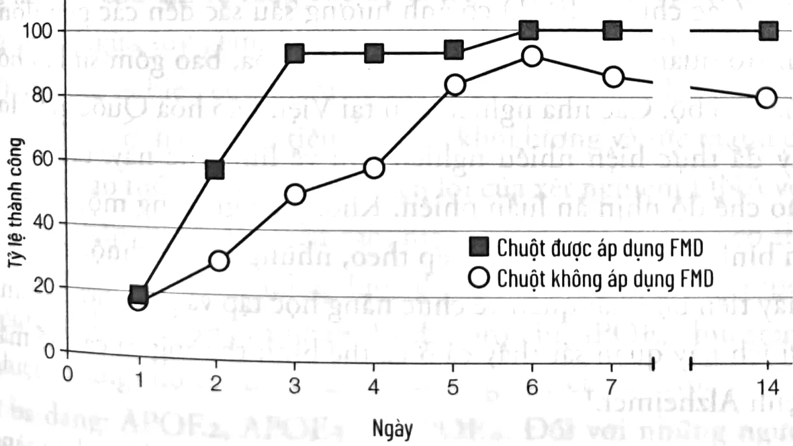

<!-- sách 195 · PDF 188 -->
# CHƯƠNG 10

## CHẾ ĐỘ NHỊN ĂN KHÔNG HOÀN TOÀN VÀ DINH DƯỠNG TRONG PHÒNG NGỪA VÀ ĐIỀU TRỊ ALZHEIMER CÙNG CÁC BỆNH LÝ THOÁI HÓA THẦN KINH KHÁCⁱ

[*Tôi xin gửi lời cảm ơn nhà thần kinh học Markus Bock, một chuyên gia về ứng dụng chế độ ăn ketoⁱⁱ và chế độ nhịn ăn không hoàn toàn tại Trung tâm Nghiên cứu Thực nghiệm và Lâm sàng, Đại học Y khoa Charité Berlin, và Patrizio Odetti, trưởng khoa lão khoa tại Bệnh viện Đại học Genova San Martino vì đã duyệt lại chương này.*]

Chức năng và tổn thương não bộ từ lâu đã là trọng tâm và đam mê nghiên cứu của tôi. Giống như lão hóa, đó là một thách thức khoa học tiêu biểu dễ khiến người ta nản chí. Bộ não thường bị ảnh hưởng bởi bệnh tật, ví dụ như Alzheimer và Parkinson, làm người bệnh và những người xung quanh khổ sở. Tuy nhiên, tôi có quen và đã dành thời gian với nhiều

---

i. Nội dung của chương này không được sử dụng để tự chẩn đoán hoặc tự quản lý các biện pháp điều trị. Thông tin này dành cho các chuyên gia y tế đang theo dõi bệnh của bạn.
ii. Chế độ ăn keto (còn gọi là Ketogenic) là chế độ ăn ít carbohydrate (carb) và nhiều chất béo tốt. Thực đơn Keto giúp cơ thể đốt cháy năng lượng nhiều hơn mà không cần phải kiêng nghiêm ngặt.

<!-- sách 196 · PDF 189 -->
người ở độ tuổi 90 hay 100, họ vẫn sắc sảo và hóm hỉnh. Mục tiêu của tôi là giúp được càng nhiều người càng tốt, để họ có thể sống lâu và các năng lực tâm thần vẫn minh mẫn bình thường. Chương này chủ yếu tập trung vào bệnh Alzheimer và các dạng sa sút trí tuệ khác – cụ thể là dinh dưỡng và FMD có thể ảnh hưởng như thế nào đến tỷ lệ mắc và tốc độ tiến triển của chúng. Mặc dù bệnh Parkinson cũng là một trong những lĩnh vực mà nhóm nghiên cứu của tôi quan tâm, chúng tôi vẫn chưa hoàn thành các nghiên cứu liên quan đến nó. Chúng tôi rất hy vọng Chế độ ăn Trường thọ và FMD sẽ có tác dụng tích cực đối với bệnh Parkinson, nhưng sẽ là quá sớm để suy đoán về các kết quả trước khi thực hiện nghiên cứu cơ bản và lâm sàng về bệnh này.

### BỆNH ALZHEIMER

Bệnh Alzheimer chiếm 60-80% trong tất cả các dạng sa sút trí tuệ. Triệu chứng tiêu biểu là chứng mất trí nhớ gây cản trở các sinh hoạt bình thường hằng ngày. Ở giai đoạn đầu của bệnh, bệnh nhân gặp khó khăn trong việc ghi nhớ các thông tin mới. Sau đó họ trở nên mất định hướng, thay đổi tâm trạng, hành vi và thường nghi ngờ các thành viên trong gia đình hoặc người chăm sóc, những người họ không nhớ và không nhận ra. Khi mất trí nhớ trở nên nghiêm trọng, bệnh nhân có thể khó nói, đi lại kém và thậm chí khó nuốt.

Khi tôi bắt đầu nghiên cứu về bệnh Alzheimer tại phòng thí nghiệm của nhà sinh học thần kinh Caleb Finch ở Đại học Nam California năm 1997, người ta kỳ vọng vào một loại vắc xin có thể chống lại protein có tên beta-amyloid, tích tụ trong não của bệnh nhân Alzheimer mà các nhà khoa học cơ bản nhất trí rằng nó tham gia vào cơ chế gây bệnh theo một cách nào đó,

<!-- sách 197 · PDF 190 -->
bởi nó có liên quan đến yếu tố cả di truyền và không di truyền. Hai mươi năm sau, chiến lược này vẫn chưa đưa ra bất kỳ biện pháp điều trị hiệu quả nào và hàng trăm phòng thí nghiệm vẫn đang tìm kiếm cách chữa bệnh. Cũng không chắc rằng sự tích tụ beta-amyloid liệu có thật sự là nguyên nhân gây bệnh chính hay không.

Trong khi chúng ta vẫn đang tiếp tục tìm kiếm phương pháp chữa trị bệnh Alzheimer, chỉ cần kéo dài thời gian khởi bệnh trung bình thêm năm năm cũng sẽ làm giảm gần một nửa số bệnh nhân. Điều này là vì thời điểm phát bệnh ở độ tuổi lớn đến mức nhiều bệnh nhân sẽ chết vì một nguyên nhân khác trước khi bệnh phát tác. Vì vậy, bệnh Alzheimer là một ứng cử viên sáng giá cho việc sử dụng các can thiệp chế độ ăn uống như FMD, có nhiều ảnh hưởng đến quá trình lão hóa, làm chậm khởi phát hoặc tiến triển của bệnh.

### Phòng ngừa bệnh Alzheimer ở cá thể chuột

Không ngạc nhiên khi lão hóa là yếu tố nguy cơ chính dẫn đến căn bệnh này. Tỷ lệ mắc bệnh tăng hơn 100 lần từ 60 đến 95 tuổi. Các nghiên cứu trên cá thể chuột đã cung cấp nền tảng hiểu biết về bệnh Alzheimer, vì các gen của người được biết đến là nguyên nhân gây bệnh có thể được đưa vào bộ gen của chuột, thúc đẩy một số quá trình mất trí nhớ và suy giảm khả năng học tập quan sát thấy ở bệnh nhân Alzheimer.

Một lần nữa, chúng tôi không vui khi phải hy sinh những cá thể chuột để tìm kiếm biện pháp can thiệp cho bệnh Alzheimer. Nhưng trước khi chúng tôi có thể bắt đầu thử nghiệm trên người, không có lựa chọn nào khác ngoài thực hiện các thử nghiệm sơ bộ trên cá thể chuột. Cũng xin lưu ý rằng chuột được sử dụng

<!-- sách 198 · PDF 191 -->
trong các nghiên cứu của chúng tôi dường như không phải chịu đau đớn; sự suy giảm nhận thức do các đột biến mà chúng tôi tạo ra tương tự với những gì xảy ra ở người mắc Alcheimer sống đến tuổi rất cao.

Nhờ những nghiên cứu này, nhóm của tôi cùng với một nhóm bác sĩ lão khoa và các nhà thần kinh học lâm sàng tại Đại học Genova hiện đã sẵn sàng bắt đầu một thử nghiệm lâm sàng về việc sử dụng FMD trong phòng ngừa và điều trị Alzheimer. Chúng tôi đã thực hiện các nghiên cứu sơ bộ về ảnh hưởng của FMD đến nhận thức ở những người bình thường tham gia vào nghiên cứu và thu được kết quả tích cực rất hứa hẹn, có thể dùng làm nền tảng vững chắc cho các nghiên cứu về bệnh Alzheimer. Mục tiêu của phần này không phải là xem xét tất cả các nghiên cứu trên cá thể chuột liên quan đến chế độ ăn và bệnh Alzheimer, mà là đặt nền móng cho các chế độ ăn cụ thể trong phòng ngừa và điều trị các bệnh thoái hóa thần kinh.

Nghiên cứu đầu tiên của chúng tôi đã cố gắng trì hoãn sự khởi phát của bệnh Alzheimer bằng cách điều chỉnh các gen đẩy nhanh tốc độ lão hóa. Chúng tôi sử dụng cá thể chuột “chuyển ba gen”, tức là chúng mang ba đoạn gen đột biến của con người liên quan đến bệnh Alzheimer (APP, PS1 và tau). Hầu hết các trường hợp Alzheimer xảy ra sau 70 tuổi nên chúng tôi đã không chọn chế độ ăn ít calo kéo dài, vì ngay cả khi chứng minh được là có hiệu quả, nó cũng không thể áp dụng một cách an toàn với người cao tuổi. Chúng tôi quyết định điều chỉnh hoạt động của hai cặp gen chính thúc đẩy quá trình lão hóa bằng cách đánh lừa các tế bào, cho chuột ăn chế độ bình thường thiếu chín axit amin thiết yếu (những axit amin cơ thể không thể tạo ra: isoleucine, leucine, lysine, methionine, phenylalanine, threonine, tryptophan, valine

<!-- sách 199 · PDF 192 -->
và arginine). Chúng tôi cũng cho những cá thể chuột tiêu thụ một lượng dư thừa các axit amin không thiết yếu cơ thể người có thể tạo ra mà không cần phải lấy từ thức ăn. Nói cách khác, chế độ ăn uống thử nghiệm giống hệt với chế độ ăn bình thường ngoại trừ chứa ít axit amin thiết yếu và nhiều axit amin không thiết yếu hơn.

Từ khi còn non cho đến tuổi trưởng thành, cá thể chuột được áp dụng chế độ ăn này cách tuần, luân phiên với chế độ bình thường. Thay đổi rất nhỏ này mang đến kết quả đầy thuyết phục, thể hiện rõ ràng thông qua việc giảm 75% nồng độ của yếu tố tăng trưởng thúc đẩy lão hóa và ung thư IGF-1 ở những cá thể chuột trong nhóm nghiên cứu. Đặc biệt, ảnh hưởng của can thiệp này đối với nồng độ IGF-1 tiếp tục tiếp diễn, thậm chí sau khi chuột trở lại chế độ ăn bình thường. Nhiều tháng sau, những cá thể chuột sử dụng chế độ ăn hạn chế protein cách tuần làm tốt hơn trong một số bài kiểm tra nhận thức khác nhau, cho thấy rằng chúng được bảo vệ khỏi các triệu chứng bệnh Alzheimer.

Biểu đồ 10.1. Sự cải thiện các bài kiểm tra nhận thức ở chuột áp dụng các chu kỳ nhịn ăn không hoàn toàn.

<!-- sách 200 · PDF 193 -->
Những kết quả này là bằng chứng về tiềm năng của công nghệ dinh dưỡng – nghĩa là, hiểu về ảnh hưởng của thành phần thực phẩm lên một số gen và quá trình nhất định trong việc tìm kiếm các chế độ ăn trị liệu có tác dụng phụ tối thiểu và lợi ích tương đương hoặc vượt trội hơn phương pháp điều trị bằng thuốc. Điều này khác với khái niệm “dược thực phẩm” (nutraceuctical), phần lớn chỉ thực phẩm được thiết kế với hàm lượng cao các phân tử cụ thể có chức năng sinh học hoặc y học. Ví dụ, vitamin C cô đặc thu được từ quả sơ ri Acerola có thể được coi là một dược thực phẩm.

Trong một nghiên cứu tôi đã đề cập trước đây, những cá thể chuột được áp dụng chế độ FMD giảm calo theo chu kỳ kéo dài bốn ngày, hai lần một tháng (tổng số là tám ngày trong tháng), bắt đầu từ tuổi trưởng thành. Về già, những cá thể chuột này có khả năng học tập và ghi nhớ tốt hơn nhiều so với các cá thể ở nhóm đối chứng (xem Biểu đồ 10.1). Chúng tôi quan sát thấy những cải thiện về hiệu suất trong tất cả các bài kiểm tra, bao gồm phối hợp vận động (trên bánh xe quay), cả trí nhớ ngắn hạn và dài hạn.

Các chu kỳ FMD có ảnh hưởng sâu sắc đến các gen đóng vai trò quan trọng trong quá trình lão hóa, bao gồm sự lão hóa của não bộ. Các nhà nghiên cứu tại Viện Lão hóa Quốc gia Hoa Kỳ đã thực hiện nhiều nghiên cứu về lĩnh vực này, tập trung vào chế độ nhịn ăn luân phiên. Không ăn gì trong một ngày và ăn bình thường vào ngày tiếp theo, những cá thể chuột này cho thấy tiến bộ nhất quán về chức năng học tập và ghi nhớ. Những lợi ích này quan sát thấy cả ở cá thể bình thường và cá thể mắc bệnh Alzheimer.¹

Hiện chúng tôi đã sẵn sàng bắt đầu các thử nghiệm lâm sàng để kiểm chứng tác dụng của chế độ ăn tương tự nhưng ít calo hơn trên người.

<!-- sách 201 · PDF 194 -->
### Phòng ngừa bệnh Alzheimer ở người thông qua chế độ ăn uống

Chế độ FMD định kỳ có tác dụng tốt đối với hầu hết mọi người, bởi nó thúc đẩy quá trình kéo dài tuổi thọ trong tình trạng cơ thể khỏe mạnh hơn, nhưng do lượng calo cung cấp rất thấp, chế độ này không được khuyến nghị áp dụng với những người trên 70 tuổi. Việc áp dụng một chế độ ăn ngăn ngừa bệnh Alzheimer nhưng lại gây suy giảm hệ thống miễn dịch hoặc làm cho bệnh nhân ốm yếu hơn thì có ý nghĩa gì? Vì vậy, một can thiệp về chế độ ăn uống chỉ có thể được khuyến nghị khi tiềm năng phòng ngừa hoặc điều trị bệnh của nó phải lớn hơn khả năng gây ra các tác dụng phụ bất lợi. Do đó, những rủi ro tối thiểu của việc sử dụng FMD ở một người 65 tuổi có thể chấp nhận được nếu người này có nguy cơ mắc bệnh Alzheimer cao; việc này chỉ nên được xem xét cho đến tuổi 70 hoặc ở một độ tuổi cao hơn thì còn tùy thuộc vào khả năng duy trì cân nặng và khối lượng cơ bình thường, tình trạng sức khỏe tổng thể cộng thêm ý kiến chuyên môn của bác sĩ thần kinh. Đáng chú ý, một số nghiên cứu chỉ ra rằng chế độ ăn hạn chế calo giúp cải thiện và ngăn ngừa suy giảm khối lượng cơ ở động vật cao tuổi hơn. Vì thế, cần nghiên cứu thêm để xác định xem liệu FMD định kỳ có tác động tích cực hay tiêu cực đến khối lượng và sức mạnh cơ ở người cao tuổi. Nhờ vào tính tiện lợi của xét nghiệm DNA với chi phí thấp và độ đặc hiệu cao, hiện nay chúng ta cũng có thể xem xét các chế độ ăn uống được điều chỉnh để ngăn ngừa một bệnh cụ thể với từng cá nhân. Ví dụ, protein APOE, chịu trách nhiệm mang cholesterol và các phân tử giống cholesterol, tồn tại ở ba dạng: APOE2, APOE3 và APOE4. Đối với những người có hai bản sao của gen APOE4, đặc biệt là phụ nữ có nguy cơ mắc bệnh Alzheimer gấp 15 lần mức trung bình. Trong dân số

<!-- sách 202 · PDF 195 -->
nói chung, khả năng mắc Alzheimer sau 85 tuổi là hơn 40%; với người có hai bản sao (alen) của gen APOE4, nguy cơ này lên đến 91% – với một nửa trong số họ phát bệnh ở tuổi 68.² Tôi khuyến khích bất cứ ai có cha mẹ hoặc ông bà mắc bệnh Alzheimer nên xét nghiệm di truyền để xác định mình có các yếu tố nguy cơ mắc bệnh hay không. Nếu có, họ nên trao đổi với bác sĩ về việc áp dụng các khuyến nghị về chế độ ăn uống sau đây.

### CHẾ ĐỘ ĂN TRƯỜNG THỌ THÊM NHIỀU DẦU Ô LIU VÀ CÁC LOẠI HẠT

FMD định kỳ có thể hiệu quả trong ngăn ngừa các bệnh về nhận thức ở chuột và có tiềm năng trên cả con người, nhưng chế độ ăn hằng ngày cũng đóng vai trò quan trọng đối với khả năng nhận thức. Mặc dù chúng tôi vẫn đang tiến hành các nghiên cứu về tác động tích cực của Chế độ ăn Trường thọ đối với các bệnh thoái hóa thần kinh, một chế độ ăn hằng ngày *đã* được chứng minh là có tác dụng bảo vệ khỏi sự suy giảm nhận thức, đó là chế độ ăn Địa Trung Hải với hàm lượng dầu ô liu cao.³

Một nghiên cứu kéo dài sáu năm ở Barcelona, Tây Ban Nha, với mục đích ban đầu để nghiên cứu về tim mạch (và được đề cập trong chương trước) đã tiến hành theo dõi 447 tình nguyện viên (ở độ tuổi trung bình là 67) có nguy cơ mắc bệnh tim mạch cao nhưng không có vấn đề về mặt nhận thức. Những người tham gia được chỉ định ngẫu nhiên vào nhóm sử dụng chế độ ăn Địa Trung Hải có bổ sung dầu ô liu siêu nguyên chất hoặc 30 gram các loại hạt mỗi ngày, và một nhóm khác có chế độ ăn kiểm soát được khuyên giảm chất béo trong khẩu phần ăn. Những người trong nhóm chế độ ăn Địa Trung Hải với dầu ô liu hoặc các loại hạt đã thể hiện tốt hơn trong bài kiểm tra

<!-- sách 203 · PDF 196 -->
nhận thức so với nhóm đối chứng áp dụng chế độ ăn hạn chế chất béo.⁴

Với người trên 60 tuổi – và có thể ở người trẻ hơn – chế độ ăn Địa Trung Hải bổ sung dầu ô liu hoặc các loại hạt có liên quan đến việc cải thiện chức năng nhận thức. Tuy nhiên, một phân tích trên nhiều nghiên cứu về chế độ ăn Địa Trung Hải và các bệnh thoái hóa thần kinh kết luận rằng tuân thủ chế độ ăn này chỉ làm giảm 13% nguy cơ mắc các bệnh thoái hóa thần kinh.⁵ Do đó, để tối ưu hóa sức khỏe não bộ và trì hoãn hoặc phòng ngừa bệnh Alzheimer, tôi đề xuất Chế độ ăn Trường thọ bổ sung thêm các dưỡng chất từ dầu ô liu và các loại hạt, như mô tả dưới đây. Mặc dù hiệu quả của chế độ ăn này trong việc ngăn ngừa sa sút trí tuệ vẫn chưa được chứng minh, nhưng có tiềm năng lớn hơn vì nó đại diện cho một phiên bản chặt chẽ hơn của chế độ ăn Địa Trung Hải và bổ sung thêm các chất dinh dưỡng mà lợi ích đã được kiểm chứng.

### CÀ PHÊ VÀ DẦU DỪA

Vai trò của cà phê đối với sức khỏe và tuổi thọ đã gây ra nhiều tranh cãi. Mặc dù các nghiên cứu trước đây cho rằng cà phê là một yếu tố nguy cơ đối với nhiều bệnh liên quan đến tuổi tác, bao gồm ung thư và bệnh tim mạch, các nghiên cứu tỉ mỉ hơn sau này chỉ ra rằng tiêu thụ cà phê ở mức vừa phải thực ra có thể bảo vệ chống lại các bệnh, bao gồm Parkinson, tiểu đường type 2 và bệnh gan. Một vài nghiên cứu đề xuất rằng cà phê cũng có thể bảo vệ chống lại bệnh Alzheimer.

Các nhà nghiên cứu tại Đại học Nam Carolina đã xem xét những nghiên cứu đánh giá mối quan hệ giữa việc tiêu thụ cà phê và mức độ sa sút trí tuệ được công bố từ năm 1966 đến năm 2014. Họ đã tìm hiểu 11 nghiên cứu với tổng số 29.000

<!-- sách 204 · PDF 197 -->
người tham gia. Nói chung, không có sự khác biệt về nguy cơ phát triển chứng sa sút trí tuệ giữa người uống cà phê và người không uống cà phê. Tuy nhiên, nguy cơ mắc bệnh Alzheimer của nhóm tiêu thụ lượng cà phê lớn nhất giảm khoảng 30%. Uống ba hoặc bốn tách cà phê mỗi ngày có thể có tác dụng chống lại bệnh Alzheimer, vì nó được chứng minh là có khả năng bảo vệ khỏi bệnh Parkinson.⁶ Một phần có thể do hàm lượng polyphenol trong cà phê cao. Tuy nhiên, kiểu tiêu thụ cà phê này có thể gây ra tác dụng phụ và chỉ nên cân nhắc sử dụng nếu bạn có nguy cơ mắc Alzheimer cao và cần thực hiện dưới sự giám sát y tế.

Dầu dừa có hàm lượng chất béo bão hòa cao. Nhưng không giống các chất béo bão hòa khác có cấu tạo chủ yếu từ axit béo chuỗi dài (với 13 đến 21 nguyên tử carbon trong chuỗi), dầu dừa chứa nhiều axit béo chuỗi trung bình (MCFA, hoặc chất béo có từ 6 đến 12 nguyên tử carbon trong chuỗi). MCFA dễ dàng biến đổi thành các thể ketone, giống các phân tử được tạo ra với nồng độ cao trong thời gian nhịn ăn. Bộ não bắt đầu sử dụng ketone như nguồn năng lượng chính trong thời gian nhịn ăn kéo dài và khi khan hiếm glucose.

Trong một nghiên cứu trên bệnh nhân Alzheimer, tiêu thụ 40 ml dầu dừa nguyên chất mỗi ngày giúp cải thiện khả năng nhận thức. Kết quả này phù hợp với các nghiên cứu khác cho rằng axit béo chuỗi trung bình bảo vệ chống lại chứng sa sút trí tuệ. Trong khi vai trò bảo vệ của dầu dừa cần phải được chứng minh thông qua các nghiên cứu lâm sàng lớn, dữ liệu được công bố cho thấy rằng nó có thể cải thiện nhận thức ở bệnh nhân mắc bệnh Alzheimer.⁷ Đáng chú ý, Hiệp hội Tim mạch Hoa Kỳ đưa dầu dừa vào nhóm những thực phẩm chứa chất béo bão hòa có

<!-- sách 205 · PDF 198 -->
khả năng gây hại. Trong khi người ta còn đang tranh luận sôi nổi liệu mối lo ngại này có chính đáng hay không thì vẫn cần cân nhắc đến khả năng sử dụng dầu dừa thường xuyên có thể làm tăng nguy cơ bệnh tim mạch khi sử dụng nó để phòng ngừa hoặc điều trị chứng sa sút trí tuệ.

### CHẤT BÉO “XẤU” VÀ BỆNH ALZHEIMER

Trong khi các chất béo chuỗi trung bình trong dầu dừa và chất béo không bão hòa đơn trong dầu ô liu có thể ngăn ngừa bệnh Alzheimer, chất béo bão hòa và các chất béo khác, hay còn gọi là những chất béo “xấu” thì ngược lại, ngoài bệnh tim mạch, chúng còn có thể làm tăng nguy cơ mắc chứng sa sút trí tuệ. Một số nghiên cứu chỉ ra rằng tiêu thụ lượng lớn axit béo bão hòa hoặc axit béo dạng trans sẽ làm tăng nguy cơ sa sút trí tuệ. Trong các nghiên cứu được thực hiện tại Dự án Sức khỏe và Lão hóa Chicago, tiêu thụ axit béo bão hòa và dạng trans có liên quan đến nguy cơ mắc Alzheimer tăng cao.⁸ Những phát hiện này ủng hộ việc áp dụng Chế độ ăn Trường thọ, gần như không có chất béo bão hòa và chất béo trans với hàm lượng lớn trong thực phẩm có nguồn gốc từ động vật (đặc biệt là thịt đỏ, bơ, phô mai, sữa nguyên kem, thịt lợn và kẹo).⁹

### DINH DƯỠNG ĐẦY ĐỦ

Một số vitamin và chất dinh dưỡng khác được đề xuất là có tác dụng bảo vệ thần kinh, tức là có khả năng bảo vệ tế bào thần kinh khỏi bị tổn thương. Cách nhìn này có lẽ quá đơn giản, nhưng một số nghiên cứu đã gợi ý sự thiếu hụt axit béo omega-3, các vitamin B, C, D và E xuất hiện trong tình trạng lão hóa não bộ và sa sút trí tuệ. Đến nay, hầu hết các nghiên cứu đều không cho thấy mối liên quan rõ ràng nào giữa việc bổ sung vitamin và các

<!-- sách 206 · PDF 199 -->
chất dinh dưỡng này ở liều cao với khả năng bảo vệ chống lại chứng sa sút trí tuệ.

Điều đó cho thấy tất cả các chế độ ăn uống nên chứa một lượng vừa đủ các thực phẩm giàu tất cả các chất dinh dưỡng (xem phụ lục B về các loại thực phẩm có các chất nêu trên với hàm lượng cao nhất). Trên thực tế, tổng quan các nghiên cứu cho thấy bệnh nhân Alzheimer có mức folate và vitamin A, B₁₂, C và E thấp hơn bình thường. Không có gì ngạc nhiên nếu trong tương lai, tình trạng thiếu hụt một số chất dinh dưỡng được chứng minh phần nào gây bệnh Alzheimer. Vì vậy, mặc dù việc bổ sung hàm lượng vitamin hoặc axit béo cao có thể chưa được chứng minh mang lại tác dụng bảo vệ, nhưng nó sẽ giúp cơ thể tránh nguy cơ thiếu chất, đẩy nhanh quá trình thoái hóa não và chứng sa sút trí tuệ. Thực phẩm giàu vitamin có thể làm giảm nguy cơ mắc Alzheimer nhưng việc bổ sung vitamin B lại hầu như không hiệu quả, ngoại trừ ở những quốc gia có thực phẩm không được bổ sung vitamin folate.¹⁰

### CÂN NẶNG VÀ VÒNG EO PHÙ HỢP VỚI ĐỘ TUỔI

Mối liên hệ giữa chỉ số BMI và khả năng nhận thức khá phức tạp, có sự thay đổi theo từng độ tuổi. Ở người trẻ và trung niên, chỉ số BMI cao có liên quan đến tình trạng suy giảm nhận thức hoặc đến nguy cơ sa sút trí tuệ cao hơn khi họ già đi. Tuy nhiên, chỉ số BMI cao hơn một chút ở người cao tuổi có liên quan đến việc cải thiện khả năng nhận thức và tỷ lệ tử vong thấp hơn. Do đó, điều quan trọng là phải duy trì cân nặng khỏe mạnh và vòng eo lý tưởng cho đến 65 tuổi. Mục tiêu tiếp theo là đạt được giới hạn trên của chỉ số BMI và vòng eo khỏe mạnh. Đối với nam giới, chỉ số BMI trong khoảng từ 22 đến 23 có thể gọi là lý tưởng cho đến

<!-- sách 207 · PDF 200 -->
năm 65-70 tuổi, nhưng ngoài độ tuổi đó, chỉ số BMI từ 23 đến 25 có thể sẽ tốt hơn nhằm tránh mất khối lượng cơ và các thiếu hụt bất lợi khác.

Mục tiêu này có thể đạt được bằng cách bổ sung một lượng nhỏ thực phẩm không được phép hoặc sử dụng rất hạn chế trong Chế độ ăn Trường thọ, chẳng hạn như trứng, phô mai dê hoặc cừu và sữa chua, sô cô la đen, trái cây, hàm lượng cá và hải sản cao hơn. Những thực phẩm này chỉ nên được tiêu thụ ở mức độ vừa phải ngay cả ở lứa tuổi cao hơn. Bổ sung chúng vào Chế độ ăn Trường thọ có thể giúp ngăn ngừa giảm cân và mất cơ, đặc biệt là khi tiêu thụ protein (0,4 gram protein cho 0,45 kg trọng lượng cơ thể) kết hợp với luyện tập cơ bắp và tập thể dục (xem chương 5).¹¹

### ĐIỀU TRỊ BỆNH ALZHEIMER BẰNG CHẾ ĐỘ ĂN UỐNG

Các can thiệp bằng chế độ ăn nhằm phòng ngừa chứng sa sút trí tuệ bao gồm dầu dừa, dầu ô liu và Chế độ ăn Trường thọ cũng có thể giúp những bệnh nhân mắc Alzheimer hoặc bệnh nhân bị suy giảm nhận thức nhẹ, một tình trạng thường xuất hiện trước giai đoạn sa sút trí tuệ.

Tuy nhiên, không giống như vai trò của chúng trong điều trị ung thư, tiểu đường, hay các bệnh về tim mạch, vai trò của các can thiệp chế độ ăn uống trong điều trị bệnh Alzheimer và các dạng sa sút trí tuệ khác không được biết đến nhiều và vẫn còn mang tính chất suy đoán. Bởi bệnh Alzeimer đang tàn phá bệnh nhân và gia đình họ, và hầu hết bệnh nhân Alzheimer không đủ khả năng để chờ đợi các nghiên cứu trong tương lai, tôi sẽ mô tả các nghiên cứu trên chuột mà chúng tôi đã hoàn thành cũng như các nghiên cứu sắp được thực hiện trên bệnh nhân Alzheimer, mà tôi tin rằng có tiềm năng.

<!-- sách 208 · PDF 201 -->
Một lần nữa, mục đích của những biện pháp can thiệp này không hẳn là chữa khỏi Alzheimer mà là cố gắng trì hoãn sự khởi phát của bệnh trong năm năm hay mười năm hoặc lâu hơn thế nữa. Chỉ có bác sĩ chuyên khoa thần kinh về Alzheimer mới có thể quyết định bệnh nhân có nên thử một chế độ ăn nhất định nào không. Phải hiểu rằng đây là một chiến lược chưa được chứng minh và còn nhiều rủi ro, cần được đánh giá lâm sàng trong các thử nghiệm lớn trước khi có thể xác định tính an toàn và hiệu quả của nó. Tốt nhất, nên thử các đề xuất sau đây như một phần của một thử nghiệm lâm sàng đã được phê duyệt.

Như đã nói, chúng tôi đạt được những kết quả khả quan trong một nghiên cứu trên cá thể chuột có chế độ ăn không có protein được bổ sung thêm các axit amin không thiết yếu luân phiên với chế độ ăn bình thường có hàm lượng cao protein mỗi tuần. Với sự chấp thuận của một chuyên gia thần kinh giàu kinh nghiệm, bệnh nhân Alzheimer có thể thử chế độ ăn ít protein (0,1 đến 0,15 gram protein cho mỗi 0,45 kg trọng lượng cơ thể) xen kẽ hàng tuần với chế độ ăn tương đối giàu protein (0,45 gram protein cho 0,45 kg trọng lượng cơ thể). Bệnh nhân sẽ có một chế độ ăn chủ yếu là carbohydrate và chất béo “tốt” (không có thịt, cá, trứng, sữa hoặc phô mai và hàm lượng thấp đậu đỗ) trong một tuần, tiếp đó là Chế độ ăn Trường thọ bình thường giàu dinh dưỡng vào tuần tiếp theo. Chế độ ăn nên bổ sung khoảng 40 ml dầu dừa mỗi ngày. Trong “tuần nuôi dưỡng”, nên ăn cá hồi và các loại cá khác có nhiều dầu omega-3 (xem phụ lục B) ít nhất ba lần một tuần, chú ý tránh các loại cá có hàm lượng thủy ngân cao.

Tiếp tục các chu kỳ luân phiên rất ít protein và lượng protein bình thường trong ít nhất sáu tháng để xem liệu: (1) khả năng nhận thức có được cải thiện và (2) bệnh nhân duy trì cân nặng

<!-- sách 209 · PDF 202 -->
cộng thêm khối lượng cơ bình thường cũng như không xuất hiện các triệu chứng khác. Nếu trọng lượng cơ thể hoặc khối lượng cơ giảm hơn 5%, các chu kỳ tiếp theo nên được trì hoãn cho đến khi bệnh nhân trở lại cân nặng khỏe mạnh.

Một lựa chọn đầy rủi ro khác là thực hiện FMD hằng tháng, chế độ chúng tôi đã đánh giá trên những người từ 20 đến 70 tuổi nhưng không thử nghiệm với đối tượng lớn tuổi hơn hoặc bệnh nhân Alzheimer (xem chương 6). Trong một nghiên cứu sơ bộ nhỏ, chúng tôi đã quan sát thấy những cải thiện về khả năng nhận thức ở những người áp dụng ba liệu trình FMD với chu kỳ hằng tháng. Kết quả này nhất quán với những tác dụng mạnh mẽ của chu kỳ FMD hai lần một tháng, bắt đầu từ độ tuổi trung niên đối với quá trình tái tạo thần kinh và cải thiện chức năng nhận thức ở cá thể chuột khi chúng già đi.¹²

Lưu ý rằng FMD tiềm ẩn rất nhiều rủi ro ở người cao tuổi, đặc biệt đối với những người có sức khỏe yếu, nhẹ cân, bị sụt cân trong quá trình tiến triển của bệnh. Giữa các chu kỳ FMD, bệnh nhân nên áp dụng một chế độ ăn nhiều dinh dưỡng, dựa trên thực vật và cá có hàm lượng protein tương đối cao (0,45 gram protein cho mỗi 0,45 kg trọng lượng cơ thể).

Tôi nhấn mạnh một lần nữa rằng những can thiệp này chỉ được xem xét khi không có các lựa chọn khả thi khác và dựa theo khuyến nghị của chuyên gia thần kinh, cùng với các biện pháp phòng ngừa và cảnh báo nêu trên, và tốt hơn là như một phần của thử nghiệm lâm sàng.

### RÈN LUYỆN THỂ CHẤT LẪN TINH THẦN

Duy trì hoạt động thể chất và tinh thần đã được chứng minh có tác dụng phòng ngừa chứng sa sút trí tuệ do tuổi tác. Tổng quan tất cả các nghiên cứu về tập thể dục và sa sút trí tuệ, bao

<!-- sách 210 · PDF 203 -->
gồm 800 bệnh nhân và 18 thử nghiệm lâm sàng ngẫu nhiên, kết luận rằng hoạt động thể chất – đặc biệt là các bài tập aerobic, chẳng hạn như chạy và bơi – giúp cải thiện chức năng nhận thức ở bệnh nhân sa sút trí tuệ (xem hướng dẫn tập thể dục trong chương 5).¹³

Tập thể dục quan trọng trong cả phòng ngừa và điều trị chứng sa sút trí tuệ. Đương nhiên, đối với những bệnh nhân già yếu, sử dụng xe đạp tại chỗ có thể phù hợp hơn chạy bộ hoặc bơi lội. Sức cản bàn đạp có thể được điều chỉnh để đạt được độ khó phù hợp nhưng không gây tổn hại về thể chất cho bệnh nhân.

Một cách khác để ngăn chặn Alzheimer và các chứng sa sút trí tuệ khác là duy trì hoạt động của não bộ. Đọc sách, giải câu đố và chơi trò chơi máy tính đã được chứng minh là hỗ trợ cải thiện nhận thức, ngăn ngừa hoặc trì hoãn chứng sa sút trí tuệ.¹⁴

### TÓM TẮT: CÁCH PHÒNG NGỪA VÀ ĐIỀU TRỊ CÁC BỆNH THOÁI HÓA THẦN KINH

#### Phòng ngừa

Sau đây là hướng dẫn dành cho người có nguy cơ cao mắc chứng sa sút trí tuệ (người có tiền sử gia đình hoặc bị suy giảm nhận thức sớm):

1. Áp dụng Chế độ ăn Trường thọ và FMD định kỳ.
2. Kết hợp nhiều dầu ô liu (50 ml mỗi ngày) và các loại hạt (30 gram mỗi ngày).
3. Uống cà phê. Đối với những người có nguy cơ tương đối thấp, hãy duy trì ở mức một hoặc hai tách mỗi ngày; đối với những người có nguy cơ cao, uống tối đa ba hoặc bốn tách mỗi ngày. Trao đổi với bác sĩ của bạn nếu gặp vấn đề.

<!-- sách 211 · PDF 204 -->
4. Sử dụng 40 ml dầu dừa mỗi ngày nhưng hãy cân nhắc nguy cơ bệnh tim mạch (những ai mắc hoặc có nguy cơ mắc phải bệnh tim mạch không nên dùng dầu dừa).
5. Tránh chất béo bão hòa và chất béo dạng trans.
6. Tránh tất cả các sản phẩm có nguồn gốc động vật, ngoại trừ cá chứa ít thủy ngân và phô mai hoặc các sản phẩm khác từ sữa dê.
7. Áp dụng chế độ ăn bổ dưỡng chứa omega-3, vitamin B, vitamin C, D và E.
8. Uống vitamin tổng hợp và khoáng chất mỗi ngày.

#### Điều trị

Sau đây là hướng dẫn cho những người đã được chẩn đoán mắc Alzheimer hay chứng sa sút trí tuệ. Kế hoạch điều trị này phải được chấp thuận và giám sát bởi chuyên gia thần kinh và nên được kết hợp với phương pháp điều trị tiêu chuẩn.

1. Tuân thủ tất cả các khuyến nghị về chế độ ăn phòng ngừa sa sút trí tuệ nêu trên.
2. Trao đổi với bác sĩ thần kinh của bạn về việc theo đuổi chế độ ăn thiếu protein và axit amin thiết yếu luân phiên với chế độ ăn cung cấp hàm lượng calo bình thường và/hoặc chu kỳ FMD định kỳ.

Với Alzheimer và các bệnh khác khởi phát muộn hơn, điều quan trọng cần ghi nhớ là các chế độ ăn hạn chế calo và chất dinh dưỡng tiềm ẩn nhiều nguy cơ đối với người cao tuổi, vì vậy bác sĩ thần kinh của bệnh nhân đó nên làm việc với chuyên gia dinh dưỡng đã đăng ký nhằm tối ưu hóa các tác động lên chức năng não bộ đồng thời giảm thiểu các rủi ro và tác dụng phụ.

<!-- sách 212 · PDF 205 -->
Mặc dù có thể các nghiên cứu của chúng tôi về Alzheimer chủ yếu dựa trên suy đoán, đây là một lĩnh vực tôi cảm thấy đặc biệt đam mê. Bằng cách tác động lên quá trình lão hóa thông qua việc sử dụng các chiến lược như Chế độ ăn Trường thọ, chúng ta có thể trì hoãn và thậm chí ngăn ngừa bệnh tật và vẫn khỏe mạnh như Emma Morano hay Salvatore Caruso, những người nhớ rõ không chỉ những gì họ làm trước đó một giờ mà còn nhiều câu chuyện và thậm chí là cả những bài hát thời trẻ. Đó là tham vọng của tôi và chúng tôi đang làm việc với các phòng thí nghiệm và các nhà nghiên cứu trên thế giới để biến nó thành hiện thực.
