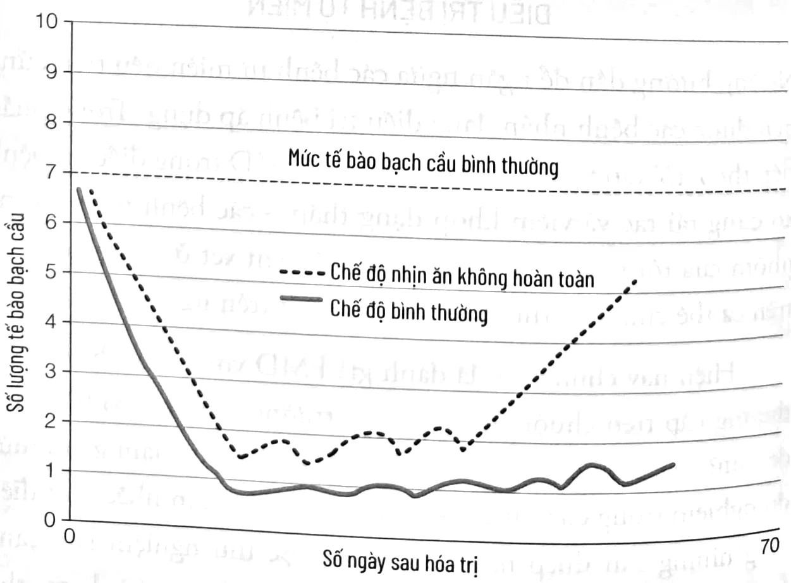
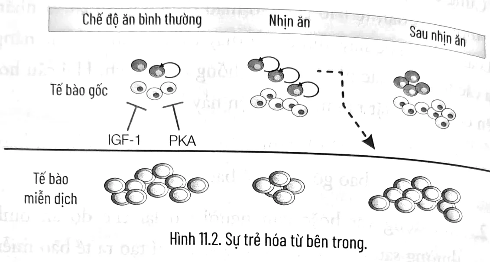

<!-- p.206 -->
# CHƯƠNG 11

## CHẾ ĐỘ NHỊN ĂN KHÔNG HOÀN TOÀN VÀ DINH DƯỠNG TRONG PHÒNG NGỪA, ĐIỀU TRỊ BỆNH LÝ VIÊM CŨNG NHƯ BỆNH TỰ MIỄNⁱ

*[Tôi xin gửi lời cảm ơn Kurt Hon, bác sĩ, tiến sĩ, phó giáo sư và giám đốc Trung tâm Dinh dưỡng Lâm sàng Đại học Nam California, Los Angeles và Andreas Michalsen, bác sĩ trưởng tại Trung tâm Nghiên cứu thực nghiệm và Lâm sàng, Đại học Y khoa Charité – Berlin vì đã duyệt lại chương này.]*

### LÃO HÓA VÀ HỆ THỐNG TỰ MIỄN

Trong quá trình lão hóa, các tế bào của hệ thống miễn dịch ở người bị tổn thương hoặc hoạt động trục trặc. Tế bào bạch cầu là trung tâm của hệ thống miễn dịch – bao gồm tế bào lympho T, đại thực bào và bạch cầu trung tính – tạo ra các yếu tố gây viêm một cách tự nhiên. Bình thường chúng đóng vai trò chính trong điều hành các chức năng miễn dịch khác nhau, từ chống lại, tiêu diệt vi khuẩn và virus đến loại bỏ các tế bào bị hư hỏng, trong đó có các tế bào ung thư.

---

i. Nội dung của chương này không được sử dụng để tự chẩn đoán hoặc tự quản lý các biện pháp điều trị. Thông tin này dành cho các chuyên gia y tế đang theo dõi bệnh của bạn.

<!-- p.207 -->
Nhưng khi con người dần lớn tuổi, cùng với bệnh tật, việc sản xuất các tế bào miễn dịch và các yếu tố gây viêm có thể bị rối loạn. Khi điều đó xảy ra, quá trình viêm có thể được kích hoạt ngay cả khi không cần thiết, dẫn đến tình trạng viêm hệ thống mức độ thấp khắp cơ thể. Trong một số trường hợp, hệ miễn dịch, sau đó, sẽ phát triển mạnh mẽ, chống lại các tế bào hoặc các phân tử bình thường trong tế bào, dẫn đến sự tự nhận biết, trong đó hệ thống miễn dịch tấn công các bộ phận trong chính cơ thể – đây là những gì xảy ra trong các bệnh tự miễn như xơ cứng rải rác, bệnh Crohnⁱ và tiểu đường type 1.

Một cách để xác định người có tình trạng viêm hệ thống – được coi là một yếu tố nguy cơ của nhiều bệnh lý như ung thư và bệnh tim mạch – là đo lường nồng độ của protein phản ứng Cⁱⁱ trong máu. Gan vốn sản xuất CRP để đáp ứng với tình trạng viêm toàn thân. Nghiên cứu cho thấy rằng khoảng 1/3 số người trưởng thành ở Mỹ bị viêm toàn thân khi xét nghiệm CRP, nhưng phần lớn người dân châu Âu và các nước khác cũng bị ảnh hưởng – hậu quả của quá trình lão hóa bình thường và các hành vi không lành mạnh như có các chế độ ăn phương Tây, béo phì và tiếp xúc với nhiễm trùng. Chế độ ăn Địa Trung Hải có liên quan đến khả năng giảm nguy cơ bệnh tật, vì vậy nhiều người châu Âu tin rằng họ được bảo vệ bởi chế độ ăn uống của mình. Không may, như đã trình bày trong các chương trước, ngay cả hình thức nghiêm ngặt nhất của chế độ ăn Địa Trung Hải cũng có tác dụng có lợi rất hạn chế đối với lão hóa và bệnh

---
i. Bệnh Crohn viết tắt là IBD (Inflammatory Bowel Disease) gây ra viêm nhiễm, lây lan và đi sâu vào thành của đường tiêu hóa gây loét, chảy máu.
ii. Protein phản ứng C (C-Reactive Protein – CRP) là một loại protein do gan tạo ra khi có nhiễm trùng hoặc do các tình trạng gây ra phản ứng viêm trong cơ thể.

<!-- p.208 -->
tật. Bởi hầu hết người châu Âu không biết chế độ ăn Địa Trung Hải có những yêu cầu gì và khó có thể tuân thủ theo hình thức nghiêm ngặt nhất, hiếm khi chế độ này được áp dụng ngay cả ở khu vực Địa Trung Hải.

Một phân tích mới đây trên toàn thế giới, cho thấy từ 8-9% dân số toàn cầu được chẩn đoán với 1 trong 29 bệnh tự miễn thường gặp² – phổ biến nhất là tiểu đường type 1, xơ cứng rải rác, bệnh Crohn, viêm đa cơ, vẩy nến, lupus và viêm khớp dạng thấp.

Đáng báo động là số ca bệnh tự miễn mới được chẩn đoán gia tăng nhanh chóng trong 30 năm qua. Ở thập niên trước, tỷ lệ mắc bệnh trên toàn thế giới tăng lên 19% một năm.³ Nói cách khác, các bệnh tự miễn dường như tăng gấp đôi về số lượng cứ sau năm năm. Trong khi sự gia tăng này phần nào có thể nhờ những tiến bộ trong chẩn đoán và nhận thức với một số tình trạng nhất định, các yếu tố môi trường và chế độ ăn uống có thể cũng là nguyên nhân.

### DINH DƯỠNG VÀ CÁC BỆNH TỰ MIỄN

Béo phì có liên quan đến nhiều bệnh tự miễn như xơ cứng rải rác và viêm khớp dạng thấp. Nó cũng có thể liên quan đến bệnh Crohn và các bệnh tự miễn khác ở ruột.⁴ Vì các tế bào mỡ có thể là tác nhân gây ra các phân tử gây viêm như TNF alpha và IL-6, mối liên hệ giữa béo phì và các rối loạn tự miễn dịch có thể liên quan đến mỡ bụng. Mỡ tích tụ ở bụng và những nơi khác trong cơ thể có thể tạo ra các phân tử kích thích phản ứng miễn dịch, thúc đẩy tế bào miễn dịch chống lại các tế bào bình thường khác của cơ thể.

<!-- p.209 -->
Tiêu thụ nhiều muối cũng góp phần gây nên các bệnh tự miễn, có thể bằng cách thúc đẩy sự hoạt hóa của tế bào lympho T – thủ phạm chính gây ra nhiều bệnh tự miễn. Cần nhiều nghiên cứu hơn để xác định và hiểu được vai trò của natri trong các rối loạn tự miễn, nhưng vì muối cũng là yếu tố liên quan đến bệnh tim mạch, nên những người đã được chẩn đoán hoặc có nguy cơ cao mắc các bệnh tự miễn thường được khuyến cáo chỉ tiêu thụ một lượng muối vừa phải.

Chế độ ăn cũng có thể ảnh hưởng đến hệ thống miễn dịch thông qua việc thay đổi hệ vi khuẩn trong ruột, bởi chúng điều hòa nhiều tế bào miễn dịch khác nhau. Chế độ ăn phương Tây được chứng minh có thể gây viêm cho các loại vi sinh vật trong ruột người.⁵ Nghiên cứu cho thấy quần thể vi khuẩn trong ruột những người có chế độ ăn phương Tây với các thành phần từ động vật có thể nhanh chóng chuyển thành một quần thể ít viêm hơn đơn giản bằng cách chuyển sang chế độ ăn có nguồn gốc chủ yếu từ thực vật.⁶

### Ăn giống như tổ tiên của bạn

Một yếu tố tiềm tàng chưa được hiểu rõ giải thích được sự gia tăng nhanh chóng các bệnh tự miễn trên thế giới có liên quan tới các lựa chọn mở rộng trong nguồn cung cấp thực phẩm toàn cầu hóa hiện đại. Phòng thí nghiệm của tôi chỉ mới bắt đầu nghiên cứu khía cạnh này của các bệnh tự miễn. Tuy nhiên, chúng tôi nghi ngờ rằng một số khía cạnh nhất định của chế độ ăn toàn cầu hóa ngày nay có thể kích hoạt các phản ứng tự miễn dịch. Ví dụ, trong một nghiên cứu, việc tiêu thụ sữa bò ở trẻ em có liên quan đến tăng quá trình tự miễn dịch chống lại các tế bào tuyến tụy tạo ra insulin, dẫn đến tăng nguy cơ mắc bệnh tiểu đường type 1.⁷ Cuối cùng, chúng ta có thể liên kết được DNA của một người

<!-- p.210 -->
(bộ gen) với thực phẩm họ nên tránh để ngăn ngừa các rối loạn tự miễn hoặc chứng không dung nạp. Lời khuyên tốt nhất của tôi là “hãy ăn theo tổ tiên của bạn”.

Điều này có nghĩa là tìm hiểu về quê hương của cha mẹ, ông bà và cụ tổ của bạn, cũng như những loại thức ăn phổ biến ở đó. Tổ tiên của tôi đều đến từ Ý, và vì thế, chế độ ăn của tôi có nhiều cà chua, đậu cô ve, đậu garbanzo và dầu ô liu. Cà chua được biết đến là có khả năng kích hoạt phản ứng miễn dịch ở một nhóm người nhỏ và chúng bắt đầu xuất hiện ở nước Ý chỉ 400 năm trước, nhưng khoảng thời gian đó là đủ lâu để có nguy cơ tối thiểu gây ra sự tự miễn dịch hoặc không dung nạp phổ biến ở người Ý ngày nay. Ngược lại, thế hệ sau của người Nhật hoặc người miền nam nước Ý có khả năng mắc chứng không dung nạp lactose khi trưởng thành vì cả hai nhóm dân số này đều không sử dụng sữa trong chế độ ăn truyền thống.

Nếu ông bà của tôi đến từ Okinawa, tôi sẽ đưa khoai tây và tảo biển vào chế độ ăn của mình; nếu họ đến từ Đức, ta sẽ có bắp cải và măng tây. Nghe có vẻ phức tạp, nhưng thực tế thì không phải vậy. Bạn chỉ cần hỏi cha mẹ hay ông bà mình hoặc một người già đã từng sống cùng khu vực với họ. Cố gắng hoàn thành một danh sách đầy đủ, vì mọi thành phần trong chế độ ăn của họ có lẽ đã được lựa chọn kỹ để đảm bảo dinh dưỡng đầy đủ. Mặc dù một ngôi làng nhỏ như của cha mẹ tôi ở miền nam nước Ý đã không tiến hành các nghiên cứu khoa học để xác định chế độ ăn uống nào tốt và không tốt. Nhưng vì tất cả mọi người đều quen biết nhau và nếu có một người bị thiếu vitamin B₁₂ do không bao giờ ăn cá hoặc thịt hoặc trứng, những người khác trong thị trấn sẽ truyền tai nhau. Cuối cùng họ học được cách tránh tình trạng thiếu vitamin B₁₂. Tương tự, nếu nhiều

<!-- p.211 -->
em bé uống sữa bò và gặp vấn đề, cha mẹ chúng sẽ nhận ra và chuyển con của họ sang uống sữa dê. Việc lựa chọn thực phẩm như vậy có thể dễ dàng bắt gặp hơn ở các ngôi làng và thị trấn nhỏ, nhưng cũng có thể ở các thành phố nếu mọi người sống cả cuộc đời của họ ở một nơi. Khả năng xảy ra ở Mỹ hoặc ở các thành phố lớn như London hay Tokyo sẽ ít hơn, những nơi có tính chất nhất thời và mọi người ít nắm về căn bệnh hay thói quen ăn uống của hàng xóm.

Chúng tôi chưa có bằng chứng chắc chắn rằng “ăn giống như tổ tiên của bạn” sẽ ngăn ngừa bệnh tật và giúp tăng tuổi thọ. Tôi cũng không đề xuất rằng bạn nên ăn chính xác những gì ông bà của bạn đã ăn, đúng hơn là bạn nên kết hợp những gì họ đã ăn với Chế độ ăn Trường thọ được mô tả trong cuốn sách này.

Khi bạn không có thời gian chờ đợi cho đến lúc các nghiên cứu khoa học và lâm sàng cuối cùng được hoàn thành, việc sử dụng tất cả các thông tin sẵn có là lựa chọn hợp lý. Trong trường hợp này, giả thuyết một thị trấn với 2.000 người dân và các thị trấn xung quanh – cùng với các bác sĩ làm việc ở những thị trấn này – có thể phát hiện ra nhiều ưu và nhược điểm liên quan đến những thức ăn cụ thể thông qua việc quan sát tác động của chúng trong nhiều thập niên và học hỏi từ ông bà cha mẹ họ. Bạn sẽ tìm thấy nhiều thông tin trong đó là chính xác. Một số thì không, nhưng rủi ro khi áp dụng chiến lược này gần như bằng không vì thực phẩm phổ biến và an toàn trên bàn ăn của tổ tiên bạn rất khó có thể gây hại cho bạn.

Bạn cũng cần phải biết những gì tổ tiên bạn không ăn. Khi thị trường hiện nay tràn ngập thực phẩm sức khỏe và siêu thực phẩm – từ cải xoăn đến curcumin, quinoa đến hạt chia – có thể cung cấp hàm lượng vitamin hoặc protein cao, những nguyên

<!-- p.212 -->
liệu và thực phẩm đa dạng này có thể có hại hơn là có lợi đối với những người mà tổ tiên của họ chưa từng ăn qua. Quinoa, nguồn gốc từ vùng Andes của Peru, có thể hoàn toàn an toàn cho những người mà tổ tiên của họ đã sử dụng nó như một nguyên liệu chính trong chế độ ăn. Nó cũng có thể tốt đối với số đông người trên thế giới. Nhưng nó có thể gây dị ứng, không dung nạp, thậm chí gây bệnh tự miễn ở số ít người – đặc biệt là những người tiếp xúc với các yếu tố khác góp phần gây ra bệnh tự miễn. Ví dụ, người ta đã chứng minh quinoa làm tăng phản ứng miễn dịch ở chuột, có thể đó là bằng chứng về khả năng dẫn đến bệnh tự miễn ở người,⁸ từng gây ra dị ứng nghiêm trọng ở nhiều bệnh nhân tại Mỹ và Pháp⁹. Do đó, nếu tất cả tổ tiên của bạn 300 năm trước sống ở Đức, tốt nhất bạn nên tránh “thực phẩm tốt cho sức khỏe” từng không phải là thành phần chính trong chế độ ăn uống của người Đức trước kia như quinoa và nghệ.

## ĐIỀU TRỊ BỆNH TỰ MIỄN

Những hướng dẫn để ngăn ngừa các bệnh tự miễn nêu trên cũng nên được các bệnh nhân đang điều trị bệnh áp dụng. Trong phần tiếp theo, tôi tập trung vào việc sử dụng FMD trong điều trị bệnh xơ cứng rải rác và viêm khớp dạng thấp – các bệnh tự miễn mà nhóm của tôi và những người khác đã xem xét ở cả nghiên cứu trên cá thể chuột và thử nghiệm lâm sàng trên người.

HHiện nay chúng tôi đã đánh giá FMD với hai bệnh tự miễn thường gặp trên chuột. Trong cả hai trường hợp, nó có hiệu quả đến mức ngạc nhiên, gợi ý rằng FMD có khả năng làm giảm mức độ nghiêm trọng của nhiều bệnh tự miễn. Hãy cân nhắc một điều rằng những can thiệp này vẫn đang được thử nghiệm lâm sàng hoặc trong phòng thí nghiệm và cho đến khi hoàn thành các thử

<!-- p.213 -->
nghiệm lâm sàng lớn hơn, chúng ta không thể biết liệu chúng có hiệu quả đối với con người hay không, chúng ta cũng không thể loại trừ khả năng xảy ra tác dụng phụ nghiêm trọng ở một số ít bệnh nhân.

### Xơ cứng rải rác

Bệnh xơ cứng rải rác (MS) là một rối loạn tự miễn, trong đó các tế bào miễn dịch (tế bào lympho T) tấn công vỏ bọc xung quanh các sợi thần kinh trong hệ thần kinh trung ương. Biểu hiện lâm sàng bao gồm yếu một hoặc nhiều chi, mất một phần hoặc toàn bộ thị giác một bên và đau toàn cơ thể. Bệnh nhân thường tái phát theo từng đợt, có thể ngắn nhưng theo chu kỳ. Ở một số bệnh nhân, các triệu chứng tiến triển. Nghiên cứu của chúng tôi liên quan đến FMD và các bệnh tự miễn bắt đầu sau khi phát hiện việc nhịn ăn làm giảm đáng kể số lượng tế bào bạch cầu ở chuột, số lượng đó trở lại bình thường sau đó khi chúng tiếp tục chế độ ăn cũ (Biểu đồ 11.1).¹⁰

<!-- p.214 -->
*Biểu đồ 11.1. Các chu kỳ nhịn ăn tái tạo các tế bào miễn dịch sau hóa trị.*

Cũng trong nghiên cứu đó, chúng tôi đã chỉ ra khi nhịn ăn trong thời gian dài, tế bào gốc tạo máu được kích hoạt và nhân lên. Loại tế bào gốc này, được tìm thấy trong máu, có khả năng tạo ra các tế bào khác nhau của hệ thống miễn dịch. Hai câu hỏi nghiên cứu được đặt ra sau phát hiện này là:

1. Nhịn ăn có thiên hướng tiêu diệt các tế bào bị rối loạn chức năng, bao gồm các tế bào tự miễn?
2. Khi động vật hoặc con người trở lại chế độ ăn bình thường sau nhịn ăn, tế bào gốc sẽ chỉ tạo ra tế bào miễn dịch khỏe mạnh hay các tế bào mới cũng trở nên tự miễn?

Sau khi công bố phát hiện của mình, tôi bắt đầu nhận được email từ những người đã đọc nghiên cứu của chúng tôi trên các tài khoản đa phương tiện và thử nhịn ăn để chống lại các rối loạn tự miễn của họ. Một số người nói rằng bốn hoặc năm ngày FMD đã làm thuyên giảm và thậm chí còn chữa khỏi các bệnh tự miễn trong một số trường hợp.

Kết quả của thử nghiệm đầu tiên trên cá thể chuột rất đáng chú ý. Để thay thế các tế bào tự miễn bằng tế bào khỏe mạnh, chúng tôi đưa ra giả thuyết, đầu tiên phải loại bỏ các tế bào xấu. Việc đó đã phát huy hiệu quả. Các chu kỳ FMD không chỉ làm giảm mức độ nghiêm trọng của bệnh xơ cứng rải rác ở tất cả các cá thể chuột mà một số cá thể đã phát triển bệnh không còn biểu hiện các triệu chứng. Mỗi chu kỳ FMD tiêu diệt một phần các tế bào tự miễn dịch và ba chu kỳ đã loại bỏ các triệu chứng bệnh ở 20% số cá thể chuột. FMD hoạt động theo một cách đặc biệt

<!-- p.215 -->
khác: nó thúc đẩy sự tái tạo myelinⁱ bị hư hỏng trong tủy sống của chuột.

Hình 11.2. Sự trẻ hóa từ bên trong.

Các chu kỳ FMD đã đảo ngược tình trạng tự miễn trong một nhóm chuột bằng cách: (1) tiêu diệt các tế bào miễn dịch xấu, (2) tạo ra những tế bào mới khỏe mạnh và (3) kích hoạt các tế bào tiền thân (tương tự như tế bào gốc), có thể tái tạo các dây thần kinh bị tổn thương. Đây là một ví dụ về sự “trẻ hóa từ bên trong”. FMD loại bỏ nhiều tế bào, nhưng nó đặc biệt hiệu quả trong việc tiêu diệt các tế bào miễn dịch già và hư tổn đã mất khả năng phân biệt giữa tế bào của cơ thể và các sinh vật xâm nhập ngoại lai như vi khuẩn và virus. Nhịn ăn làm tăng số tế bào gốc nhưng làm giảm tế bào miễn dịch. Sau khi ăn trở lại, tế bào gốc tạo ra các tế bào miễn dịch mới và khỏe mạnh (Hình 11.2)

Ở chuột, FMD còn có thể làm được nhiều hơn thế: nó dường như còn thúc đẩy cơ thể phát hiện tổn thương tại tủy sống – giống như việc phát hiện tổn thương da sau một vết cắt – kích hoạt các tế bào gốc và tế bào tiền thân để sửa chữa các tổn

---

i. Myelin là một chất béo bao bọc xung quanh các sợi thần kinh, hỗ trợ việc tăng tốc độ giao tiếp điện giữa các tế bào thần kinh.

<!-- p.216 -->
thương. FMD có thể thực sự chữa khỏi bệnh xơ cứng rải rác ở người hay không?

Phối hợp với các nhà nghiên cứu khác, chúng tôi đã thực hiện một thử nghiệm lâm sàng ngẫu nhiên trên bệnh nhân xơ cứng rải rác (tái phát – phục hồi) để xác định điều đó. Hai mươi bệnh nhân bị xơ cứng rải rác đã được yêu cầu thực hiện một chu kỳ FMD bảy ngày, sau đó áp dụng chế độ ăn Địa Trung Hải trong sáu tháng. Những nhà lâm sàng cộng tác với chúng tôi tại Đại học Y khoa Charité Berlin đã lựa chọn chế độ ăn Địa Trung Hải thay vì Chế độ ăn Trường thọ. Trong các nghiên cứu về MS trong tương lai, chúng tôi mong muốn kết hợp FMD định kỳ với Chế độ ăn Trường thọ hằng ngày. Một nhóm đối chứng gồm 20 bệnh nhân xơ cứng rải rác tiếp tục chế độ ăn bình thường.

Trước khi tiến hành chu kỳ FMD một ngày, bệnh nhân sẽ nạp 800 calo từ trái cây, gạo và/hoặc khoai tây. Tiếp theo là bảy ngày nhịn ăn, bệnh nhân tiêu thụ 200-350 calo mỗi ngày từ nước dùng hoặc nước ép rau, bổ sung dầu hạt lanh (omega-3) ba lần mỗi ngày. Bệnh nhân được khuyên nên uống 2 đến 3 lít chất lỏng không đường (nước và trà thảo mộc). Sau giai đoạn FMD bảy ngày, bệnh nhân dần được quay lại với thức ăn dạng rắn trong ba ngày. Bệnh nhân áp dụng chế độ ăn Địa Trung Hải dựa trên thực vật trong sáu tháng tiếp theo (xem chương 4). Thêm 20 bệnh nhân xơ cứng rải rác được áp dụng “chế độ ăn keto” (rất nhiều chất béo, protein bình thường và ít carbohydrate) trong sáu tháng; chế độ ăn keto trước đây đã cho thấy sự cải thiện tình trạng của bệnh nhân xơ cứng rải rác.

Sau khi nghiên cứu kết thúc, những bệnh nhân thực hiện một chu kỳ FMD đã có những biểu hiện cải thiện đáng kể về chất lượng cuộc sống, sức khỏe thể chất và tinh thần. Tác dụng

<!-- p.217 -->
phụ không liên quan đến bệnh xơ cứng rải rác xảy ra tương tự nhau trên khoảng 20% bệnh nhân ở cả nhóm có chế độ thường và nhóm FMD. Các tác dụng phụ phổ biến nhất là nhiễm trùng hô hấp và nhiễm trùng tiết niệu, nhưng không có dấu hiệu của tổn thương gan hoặc cơ quan khác. Chín mươi phần trăm bệnh nhân trong nhóm FMD có thể hoàn thành giai đoạn thử nghiệm. Suốt trong thời gian nghiên cứu sáu tháng, bốn trường hợp tái phát đã được quan sát thấy ở nhóm đối chứng và ba trường hợp ở nhóm FMD.

Nhìn chung, nghiên cứu này chỉ ra rằng FMD là phương pháp an toàn và có thể hiệu quả ở bệnh nhân xơ cứng rải rác, mặc dù cần thêm các nghiên cứu lớn hơn để khẳng định những kết quả đó. Đặc biệt, trong khi các cá thể chuột trải qua nhiều chu kỳ FMD, nhưng những người trong nghiên cứu này chỉ thực hiện một chu kỳ bảy ngày nên có khả năng hiệu quả sẽ lớn hơn khi thử nghiệm nhiều chu kỳ và sau đó là Chế độ ăn Trường thọ trên bệnh nhân xơ cứng rải rác. Hiện chúng tôi đang chuẩn bị tiến hành một số thử nghiệm lâm sàng lớn hơn trên hàng trăm bệnh nhân mắc chứng bệnh này có áp dụng nhiều chu kỳ FMD.

### Bệnh Crohn và viêm đại tràng

Sau khi chúng tôi công bố nghiên cứu của mình về nhịn ăn và miễn dịch, Jenni Russell – một nhà báo của tờ *Times of London* – mắc căn bệnh tự miễn đã viết vài bài báo về nó. Bên dưới là một trong những bài báo này. Vào thời điểm đó, còn quá sớm để nói với các nhà báo những nghiên cứu của chúng tôi về bệnh xơ cứng rải rác và các rối loạn tự miễn dịch khác, nhưng chúng tôi đã tin rằng sẽ có những kết quả đầy hứa hẹn.

<!-- p.218 -->
### *NHỊN ĂN ĐÃ THAY ĐỔI TÔI SAU KHI Y HỌC THẤT BẠI*

*Jenni Russel*
*Times of London, 22 tháng Tư năm 2015*

*Trong 10 năm qua, cuộc sống của tôi đã thay đổi. Tôi không viết sách, chuyển nhà, có con, tìm đến một đức tin, hay đổi việc. Thay vào đó, tôi từ một người kiệt sức vì một căn bệnh nan y, đã duy trì được sự sống bằng bốn loại thuốc, trở thành một người khỏe mạnh và tràn đầy năng lượng. Sự thay đổi đáng kinh ngạc đó có được là nhờ vào một liệu pháp đơn giản, không mất tiền và không được Sở Y tế Quốc gia xem xét: đó là nhịn ăn.*

*Tôi đã thử nhịn ăn vì tuyệt vọng. Đã hai thập niên trôi qua kể từ khi tôi mắc một căn bệnh tự miễn nghiêm trọng thường khiến tôi ngủ 12 tiếng một ngày và đôi khi làm tôi nằm liệt giường trong nhiều tháng. Tình trạng càng trở nên tồi tệ hơn sau khi tôi trải qua đợt hóa trị ung thư cách đây năm năm. Bác sĩ nói tôi không thể sống nếu thiếu thuốc ức chế miễn dịch; khi thử dừng thuốc, tôi đã được đưa đến bệnh viện cấp cứu ngay sau đó và mất vài ngày để truyền dịch.*

*Đó cũng là thời điểm tôi đọc được nghiên cứu từ Đại học Nam California. Nhà lão khoa sinh học hàng đầu Valter Longo đã nghiên cứu về tác động của nhịn ăn trên cá thể chuột trong 20 năm và phát hiện ra rằng nếu cá thể chuột bị bỏ đói trong ba ngày, hệ thống miễn dịch của chúng sẽ bắt đầu tái tạo. Thiếu ăn buộc tủy xương tạo ra các tế bào gốc, thay thế đáp ứng miễn dịch không tốt bằng đáp ứng bình thường. Nhịn ăn gián đoạn trong sáu tháng khiến tình trạng bệnh được cải thiện ổn định. Longo cho biết liệu pháp này có thể có hiệu quả rõ rệt với bất kỳ ai mắc rối loạn tự miễn hoặc có hệ thống miễn dịch kém đi theo tuổi tác. Ông cảnh báo rằng không có gì là chắc chắn cho đến khi các thử nghiệm trên người được thực hiện.*

*Tôi không có gì để mất khi thử nó, ngoại trừ dễ trở nên cáu gắt và giảm một ít cân nặng. Tôi bắt đầu lần nhịn ăn đầu tiên trên một chuyến đi thuyền giữa biển bão. Nó dễ dàng hơn rất nhiều bởi dù sao tôi đã mất cảm giác thèm ăn và tôi không bắt buộc*

<!-- p.219 -->
phải làm bất cứ thứ gì ngoại trừ nằm trên giường và đọc sách. Tuy nhiên, nó rất nhàm chán vì không có gì để trông chờ ngoài nước nóng, nước lạnh, nước có ga; trà đen, trà xanh và trà bạc hà. Tôi cảm thấy rất đói, và thỉnh thoảng chóng mặt, nhưng cảm giác đó sẽ biến mất. Tôi nhịn ăn trong hai ngày rưỡi và nghĩ rằng chắc không có kết quả gì. Vào ngày thứ tư, tôi thức dậy trong trạng thái khỏe hơn so với nhiều năm nay.

Kể từ đó tôi đã nhịn ăn thêm ba lần, lần gần đây nhất kéo dài trong bốn ngày. Nhịn ăn không vui chút nào. Tôi không thể nhịn ăn khi đang làm việc, hoặc nấu ăn cho người khác nhưng mình lại không được ăn. Bạn cần được tự do ngủ bất cứ khi nào cơ thể đang phẫn nộ của bạn phàn nàn. Bạn cần một số thú vui khác để lấp đầy thời gian khi đang tiếc nuối rằng chẳng có bữa ăn nào chờ đợi mình phía trước; đọc sách, xem phim, bầu bạn cùng người vợ hoặc người chồng cũng như bạn bè của mình.

Tôi chỉ làm việc này bởi kết quả đạt được rất ấn tượng. Tôi đã dừng mọi loại thuốc và lần đầu tiên kể từ khi bị bệnh, tôi không phải hạn chế năng lượng và thời gian của mình. Tôi không thể biết liệu tình trạng này sẽ sẽ kéo dài được trong bao lâu, nhưng tôi đã trở thành một người quảng bá âm thầm cho phương pháp nhịn ăn này. Nhịn ăn, như một bác sĩ nói gần đây, có thể là thuốc chữa bách bệnh mà Tây y đã lãng quên.

Trong vài năm gần đây, các nhà nghiên cứu về tiểu đường đã tìm ra cách có thể chữa khỏi bệnh bằng chế độ ăn với 600 calo mỗi ngày trong tám tuần. Nghiên cứu trước đó của Longo cho thấy nhịn ăn cũng hiệu quả như hóa trị trong điều trị ung thư. Kết hợp cả hai, nhịn ăn ngay trước và sau khi điều trị, tăng hiệu quả của hóa trị lên đến 40% trong khi giảm thiểu tác dụng phụ. Tế bào ung thư đối phó rất kém khi đồng thời bị đầu độc và bỏ đói. Nhưng tế bào bình thường tăng cường khả năng bảo vệ, bởi nhịn ăn đóng cửa các con đường cho phép độc tố vào trong. Vì 1/5 số ca tử vong liên quan đến ung thư là do tác động của hóa trị liệu, đây có thể là một bước đột phá lớn.

<!-- p.220 -->
Hiện chúng tôi đã thực hiện các nghiên cứu trên cá thể chuột về bệnh Crohn. Kết quả tuy chưa được công bố chính thức, nhưng tôi có thể khẳng định rằng chúng đầy triển vọng. Bệnh nhân bị bệnh Crohn, viêm đại tràng hoặc bệnh viêm đường tiêu hóa khác nên trao đổi với bác sĩ của họ về việc sử dụng FMD để hỗ trợ liệu pháp điều trị tiêu chuẩn. Nếu bác sĩ thần kinh đồng ý, hãy làm theo quy trình FMD trong bài báo của chúng tôi về xơ cứng rải rác¹² hai tháng một lần cho đến khi các triệu chứng cải thiện hoặc bạn thấy rõ ràng rằng chế độ ăn không giúp ích gì. Tốt nhất là thực hiện việc này như một phần của thử nghiệm lâm sàng.

### Viêm khớp dạng thấp

Viêm khớp dạng thấp là một bệnh viêm tự miễn mạn tính làm phá hủy nhiều khớp. Nó ảnh hưởng đến khoảng 1% trong tổng dân số và 2% trong số người trên 60 tuổi trên khắp thế giới. Nhịn ăn hoặc các chế độ ăn rất ít calo trong một đến ba tuần đã được chứng minh là có hiệu quả trong điều trị viêm khớp dạng thấp (RA: rheumatoid arthritis). Tình trạng viêm và đau điển hình của RA có thể cải thiện trong vài ngày kể từ khi bắt đầu nhịn ăn,¹³ nhưng chúng sẽ quay trở lại sau khi bệnh nhân tiếp tục chế độ ăn uống bình thường. Nếu ăn chay sau giai đoạn nhịn ăn, một số tác dụng sẽ duy trì.¹⁴ Liệu pháp kết hợp tạo ra những kết quả có lợi kéo dài nhiều năm.¹⁵ Hiệu quả của cách tiếp cận này được xác nhận bởi bốn nghiên cứu khác nhau, trong đó có hai thử nghiệm lâm sàng ngẫu nhiên.¹⁶ Đối với nhiều bệnh nhân có thể nhịn ăn kéo dài và sẵn sàng thay đổi vĩnh viễn chế độ ăn uống của họ, các chu kỳ nhịn ăn có thể không chỉ hỗ trợ mà còn có thể thay thế điều trị y tế.¹⁷

Điều chưa được thử nghiệm trong điều trị RA là thực hiện nhiều đợt hay định kỳ các chu kỳ FMD từ một đến ba tháng một lần thay vì một chu kỳ duy nhất theo sau là những thay đổi lớn

<!-- p.221 -->
về chế độ ăn uống. Nghiên cứu của chúng tôi về bệnh xơ cứng rải rác, bệnh Crohn và một số bệnh tự miễn khác kết hợp với kết quả lâm sàng cho thấy FMD làm giảm tình trạng viêm toàn thân ở đa số bệnh nhân có CRP cao khi bắt đầu thử nghiệm, điều này gợi ý rằng cách lý tưởng để điều trị RA là áp dụng nhiều chu kỳ FMD, mỗi chu kỳ kéo dài năm ngày (xem chương 6) cứ từ một đến ba tháng một lần. Giữa các chu kỳ, tôi khuyến nghị áp dụng Chế độ ăn Trường thọ được mô tả trong chương 4. Chúng tôi có bằng chứng cho thấy chu kỳ FMD hằng tháng có thể có lợi cho bệnh nhân RA ngay cả khi không chuyển sang chế độ ăn Địa Trung Hải hoặc Chế độ ăn Trường thọ. Mặc dù tôi không đề xuất điều này, nhưng có thể nói với những người không thể thay đổi chế độ ăn của họ, việc thực hiện phương pháp FMD kéo dài trong năm ngày mỗi tháng có thể là một lựa chọn tốt. Đặc biệt, FMD có lợi thế là cung cấp lượng calo tương đối cao, điều này cho phép bệnh nhân thực hiện FMD dưới giám sát y tế nhưng không phải nằm tại một phòng khám. Cần cân nhắc rằng trong thử nghiệm sơ bộ về bệnh xơ cứng rải rác của chúng tôi, FMD kéo dài một tuần là an toàn và có thể hiệu quả trong việc cải thiện chất lượng cuộc sống của bệnh nhân. Xem xét các nghiên cứu trước đây về RA, FMD định kỳ bảy ngày có thể hiệu quả hơn một chu kỳ ngắn. Sau những nghiên cứu trong tương lai, chúng ta sẽ biết thêm về hiệu quả của FMD đối với các bệnh tự miễn khác nhau. Chúng ta cũng sẽ biết thêm về thời gian và tần suất của chế độ ăn phù hợp nhất để điều trị các bệnh này.

### TỔNG KẾT: PHÒNG NGỪA VÀ ĐIỀU TRỊ CÁC BỆNH TỰ MIỄN

#### Phòng ngừa

1. Thực hiện Chế độ ăn Trường thọ, đảm bảo duy trì được cân nặng hợp lý và vòng eo nhỏ.

<!-- p.222 -->
2. Tránh chế độ ăn nhiều muối.

3. Ăn những thực phẩm mà tổ tiên của bạn đã ăn thường xuyên và tránh những thực phẩm không phải là một phần trong chế độ ăn của họ.

#### Điều trị

1. Áp dụng tất cả những thay đổi trong phần “Phòng ngừa” nêu trên.

2. Với sự chấp thuận và giám sát chặt chẽ của bác sĩ và tốt nhất là như một phần của thử nghiệm lâm sàng, luân phiên Chế độ ăn Trường thọ với FMD kéo dài năm ngày hằng tháng hoặc FMD bảy ngày được mô tả ở trên hai tháng một lần.
