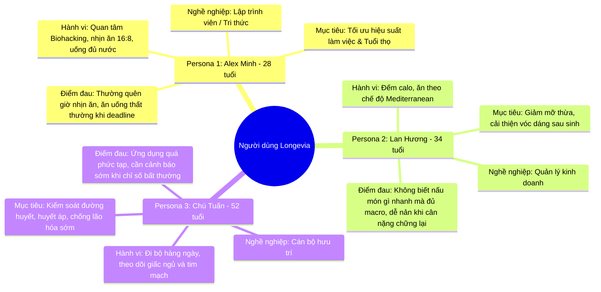
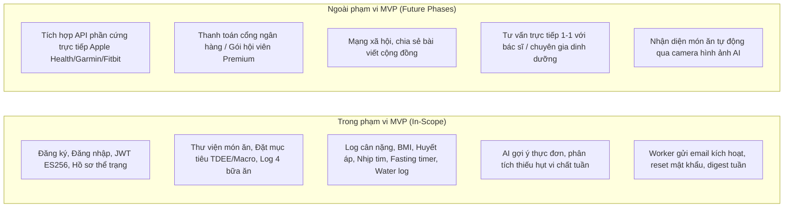

# Business Requirement Document (BRD) — Longevia

---

## 1. Tóm tắt điều hành (Executive Summary)

**Longevia** là nền tảng số hỗ trợ chăm sóc sức khỏe chủ động và tối ưu hóa tuổi thọ khỏe mạnh (**Healthspan**). Hệ thống kết hợp giữa khoa học dinh dưỡng chính xác, theo dõi chỉ số sinh học cơ thể và trí tuệ nhân tạo (Google AI) nhằm cung cấp giải pháp cá nhân hóa toàn diện cho người dùng trong việc xây dựng và duy trì lối sống lành mạnh.

Khác với các ứng dụng chỉ đếm calo thuần túy hoặc theo dõi vận động thông thường, Longevia tập trung vào triết lý **Y học dự phòng (Preventive Medicine)** và **Khoa học trường thọ (Longevity Science)**:
- Giảm thiểu các yếu tố nguy cơ gây viêm mạn tính và lão hóa tế bào sớm.
- Tối ưu hóa chu kỳ trao đổi chất thông qua nhịn ăn gián đoạn (Intermittent Fasting) và cân bằng vi chất.
- Ứng dụng AI để phân tích sự chênh lệch dinh dưỡng và đưa ra khuyến nghị hành động tức thời, chính xác và có thể thực hiện được.

---

## 2. Vấn đề kinh doanh & Cơ hội thị trường (Problem & Market Opportunity)

### 2.1 Vấn đề thực tế (Pain Points)
1. **Khoảng cách giữa Tuổi thọ và Tuổi khỏe (The Healthspan vs. Lifespan Gap)**: Con người ngày càng sống thọ hơn nhưng 10–15 năm cuối đời thường phải đối mặt với các bệnh mạn tính không lây (tiểu đường type 2, tim mạch, rối loạn chuyển hóa, suy giảm nhận thức).
2. **Quá tải và nhiễu loạn thông tin dinh dưỡng**: Người dùng bị bao vây bởi hàng loạt chế độ ăn trào lưu (Keto, Carnivore, Low-carb, Vegan) mà không biết chế độ nào thực sự phù hợp với thể trạng, tiền sử dị ứng và mục tiêu sinh học của bản thân.
3. **Thiếu tính kết nối giữa Dinh dưỡng - Chỉ số cơ thể - Thói quen**: Các ứng dụng hiện nay thường phân mảnh: một app để đếm calo, một app theo dõi cân nặng, một app đếm giờ nhịn ăn. Người dùng không thấy được bức tranh tổng thể về việc một bữa ăn ảnh hưởng thế nào đến huyết áp, giấc ngủ và tiến trình sinh học.
4. **Khó duy trì thói quen dài hạn**: Thiếu động lực và phản hồi thông minh kịp thời khiến hơn 70% người dùng từ bỏ kế hoạch ăn uống lành mạnh sau 3 tuần đầu tiên.

### 2.2 Cơ hội thị trường
- Nhu cầu về các sản phẩm công nghệ chăm sóc sức khỏe cá nhân hóa (Personalized Wellness & Longevity Tech) đang tăng trưởng vượt bậc trên toàn cầu.
- Mô hình cung cấp đề xuất tự động bằng AI kết hợp kiểm soát dữ liệu định lượng mang lại giải pháp chi phí thấp nhưng hiệu quả cao so với việc thuê chuyên gia dinh dưỡng cá nhân.

---

## 3. Mục tiêu kinh doanh & Chỉ số thành công (Business Goals & Success Metrics)

### 3.1 Mục tiêu kinh doanh (Business Objectives)
- **BO-1**: Xây dựng nền tảng backend vi dịch vụ chuẩn mực, bảo mật, có khả năng mở rộng cao, phục vụ đồng thời Web App và Mobile App.
- **BO-2**: Cung cấp trải nghiệm theo dõi dinh dưỡng và chỉ số sức khỏe trực quan, giảm thiểu thời gian nhập liệu nhật ký bữa ăn của người dùng xuống dưới 2 phút mỗi ngày.
- **BO-3**: Đạt tỷ lệ người dùng ứng dụng gợi ý thực đơn thông minh từ AI trên 65% tổng số người dùng hoạt động.

### 3.2 Chỉ số đo lường hiệu quả (KPIs & Metrics)

| Mã | Chỉ số đo lường | Mục tiêu MVP | Mục tiêu 6 tháng |
| :--- | :--- | :--- | :--- |
| **NSM** | **North Star Metric**: Số ngày ghi nhận thói quen liên tục trung bình (Average Active Streak) | ≥ 7 ngày | ≥ 21 ngày |
| **KPI-1** | Tỷ lệ kích hoạt tài khoản thành công qua email (Activation Rate) | ≥ 85% | ≥ 92% |
| **KPI-2** | Tỷ lệ người dùng đạt mục tiêu Calo/Macro hàng ngày (Target Hit Rate) | ≥ 50% | ≥ 65% |
| **KPI-3** | Tỷ lệ chấp nhận gợi ý thực đơn từ AI (Recommendation Acceptance) | ≥ 60% | ≥ 75% |
| **KPI-4** | Thời gian phản hồi API trung bình qua Gateway Nginx (p95 Latency) | < 250ms | < 150ms |

---

## 4. Chân dung người dùng mục tiêu (User Personas)

---

## 5. Quy tắc nghiệp vụ cốt lõi (Core Business Rules)

1. **BR-01 (Toàn vẹn xác thực)**: 
   - Một tài khoản được định danh duy nhất bằng một địa chỉ email hợp lệ.
   - Mật khẩu phải có độ dài tối thiểu 8 ký tự, bao gồm chữ hoa, chữ thường, chữ số và ký tự đặc biệt.
   - Mã token xác thực danh tính tuân thủ cơ chế khóa bất đối xứng ES256 theo [ADR 001](../decisions/001-authn-authz-architecture.md).
2. **BR-02 (Cá nhân hóa mục tiêu dinh dưỡng)**:
   - Mục tiêu năng lượng cơ bản (BMR) và tổng năng lượng tiêu hao hàng ngày (TDEE) được tính toán theo công thức chuẩn y khoa Mifflin-St Jeor dựa trên cân nặng, chiều cao, tuổi, giới tính và hệ số vận động.
   - Hệ thống cho phép người dùng điều chỉnh tỷ lệ macro phù hợp với các chế độ ăn: Cân bằng (Balanced), Địa Trung Hải (Mediterranean), Ít tinh bột (Low-Carb) hoặc Thuần chay (Vegan).
3. **BR-03 (Bảo vệ người dùng khi gợi ý bữa ăn)**:
   - Các gợi ý món ăn từ AI **bắt buộc** phải lọc và loại trừ 100% các thành phần dị ứng mà người dùng đã khai báo trong hồ sơ sức khỏe.
   - Khi lượng calo trong ngày đã chạm trần (vượt quá 105% mục tiêu), hệ thống không gợi ý bữa ăn chính mà chỉ gợi ý các loại đồ uống không calo hoặc các thói quen thư giãn/giấc ngủ.
4. **BR-04 (Tính riêng tư và phi y tế - Medical Disclaimer)**:
   - Longevia là nền tảng hỗ trợ lối sống, **không phải là thiết bị y tế hay cơ sở khám chữa bệnh**.
   - Mọi phân tích chỉ số sinh học và đề xuất vi chất từ AI chỉ mang tính chất tham khảo khoa học, luôn kèm khuyến cáo tham vấn bác sĩ chuyên khoa đối với các trường hợp bệnh lý nền.
5. **BR-05 (Bảo lưu dữ liệu & Tính nhất quán lịch sử)**:
   - Khi người dùng cập nhật thông tin chiều cao/cân nặng hiện tại, các bản ghi nhật ký bữa ăn và chỉ số trong quá khứ không bị tính toán lại, nhằm bảo toàn dữ liệu lịch sử trung thực.

---

## 6. Phạm vi dự án (Project Scope)

---

## 7. Rủi ro kinh doanh & Biện pháp giảm thiểu (Risks & Mitigations)

| Rủi ro | Mức độ | Biện pháp giảm thiểu |
| :--- | :---: | :--- |
| **Phản hồi sai lệch từ AI (Hallucination)** | Cao | Sử dụng cấu trúc System Prompt nghiêm ngặt, ràng buộc AI chỉ được chọn nguyên liệu trong danh mục an toàn, ép buộc định dạng JSON schema đầu ra. |
| **Người dùng bỏ dở việc log bữa ăn do tốn thời gian** | Cao | Thiết kế tính năng lưu món ăn yêu thích, copy thực đơn hôm trước, và tìm kiếm tức thì. |
| **Rò rỉ dữ liệu chỉ số sức khỏe nhạy cảm** | Nghiêm trọng | Phân tách cơ sở dữ liệu riêng biệt theo từng service, mã hóa dữ liệu đường truyền (TLS), không chia sẻ token private key giữa các container. |
| **Chi phí gọi API AI tăng cao** | Trung bình | Kiến trúc Recommendation Service dạng Stateless, chỉ gọi AI khi người dùng chủ động yêu cầu; áp dụng caching thực đơn mẫu phổ biến. |
