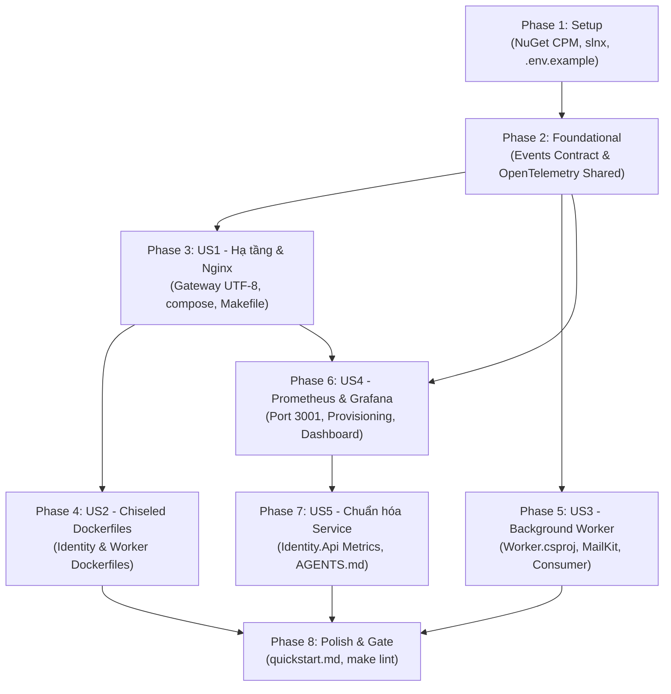

# Tasks: Hạ tầng, Nginx Gateway, Background Worker & Giám sát Grafana

**Input**: Kế hoạch kỹ thuật từ `specs/mavil-001-infra-observability/plan.md`  
**Trạng thái**: Phase 1–7 đã xong (đã commit); Phase 8 đang thực hiện qua `speckit-orchestrate`  
**Tất cả công việc phải tuân thủ nghiêm ngặt định dạng**: `- [ ] TXXX [P?] [US?] Mô tả công việc với đường dẫn tệp cụ thể`

---

## Phase 1: Setup (Khởi tạo Cấu hình & Gói Thư viện Tập trung)

**Mục đích**: Chuẩn bị các gói phụ thuộc NuGet, biến môi trường và cấu trúc giải pháp trước khi viết code.

- [x] T001 [P] Khai báo tập trung các gói NuGet `MailKit` (4.11.0), `StackExchange.Redis` (2.8.24) và bộ `OpenTelemetry` (1.20.x — nâng từ 1.11.x vì core 1.11–1.12 dính advisory GHSA-g94r-2vxg-569j, xem quyết định trong báo cáo orchestrate) trong `Directory.Packages.props`
- [x] T002 [P] Cập nhật các biến môi trường mẫu cho Mailpit, Brevo SMTP Relay, Redis, Prometheus, Grafana trong `.env.example` (100% comment tiếng Anh theo Hiến pháp; `SMTP__HOST` ghi rõ 3 profile: `mailpit` trong compose / `localhost` chạy tay / `smtp-relay.brevo.com` Prod)
- [x] T003 Đăng ký project `src/Services/Worker/Worker.csproj` vào giải pháp trong `longevia-be.slnx`

---

## Phase 2: Foundational (Hợp đồng Sự kiện & Thư viện Dùng chung)

**Mục đích**: Xây dựng các thành phần nền tảng mà các service và worker đều phụ thuộc vào.

- [x] T004 [P] Định nghĩa 2 Event Contract bất biến có `SchemaVersion = 1` (`UserRegisteredEvent` trong `src/Shared/Events/UserRegisteredEvent.cs`, `PasswordResetRequestedEvent` trong `src/Shared/Events/PasswordResetRequestedEvent.cs`) kèm chỉ mục version tại `contracts/events/v1/README.md`; serializer bỏ qua field lạ
- [x] T005 [P] Thêm PackageReferences cho OpenTelemetry vào `src/Shared/Longevia.Shared.csproj`
- [x] T006 Xây dựng extension `AddObservability()` và `MapPrometheusScrapingEndpoint()` trong `src/Shared/Observability/OpenTelemetryExtensions.cs`

---

## Phase 3: User Story 1 - Quản lý & Khởi động Hạ tầng Phát triển Cục bộ (Priority: P1)

**Mục tiêu**: Cung cấp bộ lệnh `make infra-up` khởi chạy toàn bộ phụ trợ (PostgreSQL pgvector, Redis, RabbitMQ, Mailpit, Nginx, Swagger-UI) một chạm.

**Tiêu chí kiểm thử độc lập**: Chạy `make infra-up` và kiểm tra phản hồi HTTP 200 từ `http://localhost:8080/healthz` và cấu trúc lỗi JSON tiếng Việt UTF-8 khi truy cập route không tồn tại.

- [x] T007 [P] [US1] Nâng cấp cấu hình Nginx Gateway hỗ trợ UTF-8 charset, custom 404 ProblemDetails, `location /healthz` do Nginx tự trả `ok` 200 (không proxy), timeout và header SSE/WebSockets trong `deployments/nginx/nginx.conf` (giữ nguyên route `/swagger/` gộp đang có)
- [x] T008 [P] [US1] Cập nhật `deployments/docker-compose.yml` chuyển image `postgres` sang `pgvector/pgvector:pg17`, thêm container `redis` (In-Memory) và container `mailpit`; mở rộng `deployments/postgres/init/01-databases.sh` bật `CREATE EXTENSION IF NOT EXISTS vector` cho từng DB; khai báo đủ 3 mạng `edge`/`internal_net`/`data_net` và gắn mạng đúng `plan.md` §7
- [x] T009 [US1] Bổ sung các make targets `infra-up`, `infra-down`, `docker-up`, `docker-down`, `docker-stop`, `docker-logs` vào `Makefile`

**Điểm kiểm soát**: Hạ tầng phụ trợ khởi động hoàn chỉnh, Nginx Gateway phản hồi đúng chuẩn RFC 7807 tiếng Việt.

---

## Phase 4: User Story 2 - Đóng gói Container Chiseled Non-Root (Priority: P1)

**Mục tiêu**: Đóng gói microservices `Identity.Api` và `Worker` trên nền runtime `aspnet:10.0-noble-chiseled` siêu nhẹ, non-root.

**Tiêu chí kiểm thử độc lập**: Chạy lệnh build docker cho Identity và Worker, xác minh image build thành công với user `app` (UID 1654).

- [x] T010 [P] [US2] Viết multi-stage Dockerfile cho Identity Service sử dụng `aspnet:10.0-noble-chiseled` trong `src/Services/Identity/Dockerfile` (assert: user `app`, image < 180MB theo SC-002)
- [x] T011 [P] [US2] Viết multi-stage Dockerfile cho Background Worker sử dụng `aspnet:10.0-noble-chiseled` trong `src/Services/Worker/Dockerfile` (assert: user `app`, image < 180MB theo SC-002)
- [x] T012 [US2] Cấu hình và kích hoạt container `identity` và `worker` trong `deployments/docker-compose.yml` tuân thủ phân tách 3 mạng `edge`/`internal_net`/`data_net` theo `plan.md` §7 (identity, worker: `edge` + `data_net`); xác nhận `depends_on: condition: service_healthy` cho identity/worker (Edge Case khởi động chậm, `spec.md:88`)

**Điểm kiểm soát**: Hai container được build và khởi chạy thành công trong mạng Docker của dự án.

---

## Phase 5: User Story 3 - Background Worker & Tự động hóa Gửi Email (Priority: P1)

**Mục tiêu**: Xây dựng service Worker kết nối RabbitMQ, gửi email qua MailKit hỗ trợ cả Mailpit (Local) và Brevo SMTP Relay (Production).

**Tiêu chí kiểm thử độc lập**: Kích hoạt sự kiện gửi email từ Worker và xác minh email HTML xuất hiện trên Web UI của Mailpit tại `http://localhost:8025`.

- [x] T013 [P] [US3] Khởi tạo dự án Worker Service .NET 10 tham chiếu MassTransit, MailKit, Shared trong `src/Services/Worker/Worker.csproj`
- [x] T014 [P] [US3] Định nghĩa interface `IEmailSender` và DTO `EmailMessage` trong `src/Services/Worker/Adapters/Email/IEmailSender.cs`
- [x] T015 [US3] Cài đặt `SmtpEmailSender` sử dụng MailKit hỗ trợ cả No-Auth (Mailpit) và TLS StartTLS (Brevo SMTP Relay `smtp-relay.brevo.com:587`) trong `src/Services/Worker/Adapters/Email/SmtpEmailSender.cs` (KHÔNG log token/password)
- [x] T016 [P] [US3] Xây dựng 4 mẫu email HTML responsive (Verification, Reset Password, Welcome, Weekly Digest) trong `src/Services/Worker/Templates/EmailTemplates.cs` — Worker CHỈ render từ payload đủ, mọi số liệu tổng hợp do producer chuẩn bị; kèm unit test render (assert subject/link/token xuất hiện)
- [x] T017 [US3] Cài đặt `UserRegisteredConsumer` và `PasswordResetRequestedConsumer` tiêu thụ event từ RabbitMQ trong `src/Services/Worker/Consumers/` kèm retry exponential backoff (2s, 5s, 10s) + DLX/DLQ theo `data-model.md` §1.3, idempotency qua Redis dedup (trùng event → ack bỏ qua), kèm test trùng event + field lạ + assert log không chứa token (redaction)
- [x] T018 [US3] Cấu hình DI, nạp biến môi trường `SMTP__*`, `RABBITMQ_HOST`, khai báo tường minh topology MassTransit (exchange `longevia.events`, queue `worker.email`, DLX) + tích hợp `AddObservability("Worker")` và `MapPrometheusScrapingEndpoint()` trong `src/Services/Worker/Program.cs`

**Điểm kiểm soát**: Worker tiêu thụ thông điệp từ RabbitMQ và gửi email thành công tới Mailpit / Brevo SMTP Relay.

---

## Phase 6: User Story 4 - Giám sát Hiệu năng với Prometheus & Grafana (Priority: P2)

**Mục tiêu**: Dựng Prometheus và Grafana trên cổng `3001` (nhường `3000` cho Frontend), tự động nạp Datasource và Dashboard ASP.NET Core.

**Tiêu chí kiểm thử độc lập**: Truy cập `http://localhost:3001`, xác nhận Grafana mở được ngay (Anonymous `Viewer` — chỉ xem, không sửa cấu hình), Prometheus Datasource đã kết nối và Dashboard ASP.NET Core hiển thị biểu đồ.

- [x] T019 [P] [US4] Viết cấu hình scrape Prometheus cào dữ liệu từ các service mỗi 10 giây trong `deployments/prometheus/prometheus.yml` (targets: `identity`, `worker`, `prometheus` self; RabbitMQ qua plugin `rabbitmq_prometheus` bật trong compose, nếu plugin không khả dụng thì bỏ target này và ghi lý do)
- [x] T020 [P] [US4] Cấu hình tự động kết nối Datasource Prometheus trong `deployments/grafana/provisioning/datasources/prometheus.yml`
- [x] T021 [P] [US4] Cấu hình tự động nạp Dashboard provider trong `deployments/grafana/provisioning/dashboards/dashboards.yml`
- [x] T022 [P] [US4] Tạo tệp định nghĩa Dashboard giám sát ASP.NET Core (.NET Runtime, Memory, Throughput, Latency p95, HTTP Status Codes) trong `deployments/grafana/provisioning/dashboards/aspnetcore-overview.json`
- [x] T023 [US4] Thêm container `prometheus` (port 9090) và `grafana` (port 3001:3000, anonymous role `Viewer`) vào `deployments/docker-compose.yml`, gắn mạng `edge`; Grafana provision datasource + dashboard, zero manual setup

**Điểm kiểm soát**: Prometheus thu thập metrics thành công và Grafana hiển thị trực quan biểu đồ hiệu năng tại cổng 3001.

---

## Phase 7: User Story 5 - Chuẩn hóa Hướng dẫn & Đo lường cho Service (Priority: P2)

**Mục tiêu**: Tích hợp mẫu đo lường vào Identity Service và hoàn thiện tài liệu hướng dẫn trong `AGENTS.md`.

**Tiêu chí kiểm thử độc lập**: Chạy stack đầy đủ `make docker-up` trước (Prometheus không thuộc `make infra-up`). Gateway không route `/metrics` và image runtime chiseled **không có shell/curl** (không dùng `docker compose exec ... curl`). Xác minh bằng đường thật: `curl "http://localhost:9090/api/v1/query?query=up%7Bjob%3D%22identity%22%7D"` trả `"value":["...,"1"]` (Prometheus đã scrape `identity:8080/metrics`), hoặc chạy container curl tạm trên mạng `longevia_edge`: `docker run --rm --network longevia_edge curlimages/curl -fsS http://identity:8080/metrics`.

- [x] T024 [US5] Tích hợp `AddObservability("IdentityService")` và `MapPrometheusScrapingEndpoint()` vào `src/Services/Identity/Identity.Api/Program.cs`
- [x] T025 [US5] Thêm PackageReferences OpenTelemetry vào `src/Services/Identity/Identity.Api/Identity.Api.csproj`
- [x] T026 [US5] Xác minh nội dung hướng dẫn Observability trong `AGENTS.md` (đã bổ sung ở plan) đầy đủ, chính xác cho các developer khác (2 dòng chuẩn, cổng 3001, cấm hardcode)

**Điểm kiểm soát**: Mọi microservice có thể kích hoạt đo lường với 2 dòng code và hiển thị trên Grafana.

---

## Phase 8: Polish, Cross-Cutting & Verification

**Mục đích**: Kiểm tra toàn diện chất lượng, kiểm tra gate và hoàn thiện tài liệu.

- [x] T027 [P] Kiểm tra tính nhất quán của file mẫu môi trường `.env.example` (100% comment tiếng Anh, đủ biến T002)
- [x] T028 Thực hiện kịch bản kiểm thử trong `specs/mavil-001-infra-observability/quickstart.md` và ghi số đo: `time make infra-up` (SC-001 ≤ 30s, phạm vi hạ tầng lõi `INFRA_SERVICES`), p95 `/healthz` < 50ms, email xuất hiện trên Mailpit < 1s (SC-003), `docker images` < 180MB (SC-002), và xác minh SC-004 bằng Grafana API (`/api/datasources`, `/api/search?query=ASP.NET`) chứ không chỉ mở mắt nhìn
- [x] T029 Chạy kiểm tra chất lượng mã nguồn toàn bộ giải pháp với `make lint` (0 warning, 0 error) + `make test PROJECTS=<path>` scoped cho Shared/Worker/Identity theo gate `AGENTS.md` §2; kèm **negative control** cho test mới (T016/T017): cố tình phá code → test đỏ đúng lý do → phục hồi → test xanh, ghi lại cả hai màu
- [x] T031 Viết smoke test e2e tự động `scripts/smoke/infra-smoke.ps1` (chạy sau `make docker-up` và sau T033): publish `UserRegisteredEvent` qua RabbitMQ → assert mail xuất hiện qua Mailpit API trong 5s; assert metrics/Prometheus bằng `curl http://localhost:9090/api/v1/targets` + query `up{job="identity"}`/`up{job="worker"} == 1` (image chiseled không có curl nên không dùng `docker compose exec`; nếu cần gọi trực tiếp thì `docker run --rm --network longevia_edge curlimages/curl -fsS http://identity:8080/metrics`); assert gateway `GET /api/unknown-service/test` → 404 `application/problem+json` với title tiếng Việt UTF-8 và `GET /api/identity/health` khi `identity` đã stop → 502 ProblemDetails JSON (T033). Script phải `exit ≠ 0` khi bất kỳ assert sai; chạy **một lần với assert cố tình sai** (ví dụ đổi kỳ vọng 502→200) để thấy đỏ đúng lý do rồi phục hồi — ghi lại cả hai lần (Hiến pháp §V: 1 đường e2e thật qua hạ tầng thật)
- [x] T030 Tạo `specs/mavil-001-infra-observability/frontend-guide.md` mô tả gateway 404/502 ProblemDetails UTF-8 + prefix stripping `/api/<service>/` (client surface duy nhất tính năng này đổi), kèm đếm sync-check
- [x] T032 [P] Bổ sung `healthcheck` cho `nginx` (`/healthz`) và `mailpit` (`/livez`) trong `deployments/docker-compose.yml` để US1 AS1 ("Healthy") kiểm được bằng `docker compose ps` (fixup Phase 3)
- [x] T033 Mở rộng `deployments/nginx/nginx.conf`: map `error_page 502 503 504` sang ProblemDetails JSON UTF-8 (`status` tương ứng, không trả trang HTML mặc định) theo Edge Case spec.md dòng 89 (fixup Phase 3)
- [x] T034 Nâng `MailKit` 4.11.0 → 4.18.1 trong `Directory.Packages.props` (đồng thời cập nhật `plan.md` §2 cho khớp), gỡ `<WarningsNotAsErrors>NU1902;NU1903</WarningsNotAsErrors>` và comment DEFERRED khỏi `src/Services/Worker/Worker.csproj`, rồi xác minh `make vuln` không còn advisory (fixup Phase 5; SC-005 / security advisory; `Directory.Packages.props` là shared file đã khai trong plan §5)

---

## Dependencies & Thứ tự Thực thi

---

## Chiến lược Thực thi Song song (Parallel Execution)

- **Nhóm Setup & Foundational**: T001, T002, T004, T005 có thể thực hiện đồng thời.
- **Nhóm Hạ tầng & Nginx**: T007 và T008 thực hiện song song.
- **Nhóm Worker**: T013, T014, T016 thực hiện song song trước khi lắp ráp vào T015, T017, T018.
- **Nhóm Giám sát**: T019, T020, T021, T022 thực hiện song song.
