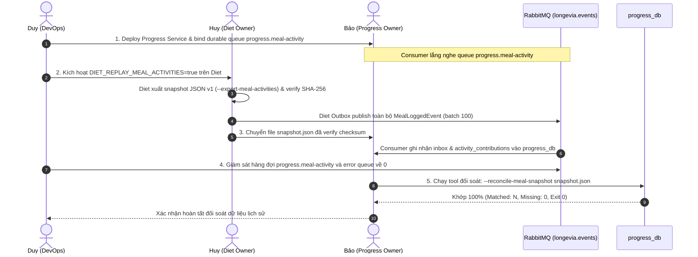

# Vận hành đối soát Meal Activity Snapshot JSON v1 & Replay Runbook

Tài liệu hướng dẫn quy trình vận hành đồng bộ dữ liệu bữa ăn lịch sử giữa **Diet Service** (Producer — Huy) và **Progress Service** (Consumer — Bảo), được điều phối bởi Duy (DevOps).

Dữ liệu Diet PR #12 đã được **MERGED vào main** (commit `4c62273dd04d1f54423f002ec3ac32459ebb0732`). Producer outbox, historical replay và JSON snapshot exporter của Diet đã chính thức sẵn sàng trên codebase chung.

---

## 1. Runbook Vận hành Phối hợp (Huy, Bảo, Duy)



### Bước 1: Bảo & Duy chuẩn bị hạ tầng nhận tin (Progress Consumer & Queue Binding)
1. Deploy Progress Service phiên bản có consumer `MealLoggedConsumer`.
2. Kiểm tra container `progress` đã khởi động và tự động bind durable queue:
   - Exchange: `longevia.events` (topic).
   - Routing key: `diet.meal.logged`.
   - Queue: `progress.meal-activity`.
   - Error queue: `progress.meal-activity_error`.
3. Bắt buộc hàng đợi phải tồn tại trước khi phát tin để tránh thất thoát message.

### Bước 2: Huy xuất snapshot và kích hoạt Replay trên Diet
1. Nâng cấp toàn bộ Diet writers lên phiên bản có producer v1.
2. Xuất snapshot chuẩn hóa từ cơ sở dữ liệu `diet_db`:
   ```bash
   dotnet Diet.Api.dll --export-meal-activities /artifacts/diet/snapshot.json
   ```
3. Chạy script kiểm tra checksum SHA-256 độc lập:
   ```powershell
   pwsh scripts/diet/verify-meal-activity-snapshot.ps1 -Path /artifacts/diet/snapshot.json
   ```
4. Kích hoạt cờ môi trường `DIET_REPLAY_MEAL_ACTIVITIES=true` khi khởi động Diet Service để đẩy toàn bộ bản ghi bữa ăn lịch sử qua Outbox Pattern vào RabbitMQ.
5. Sau khi hoàn tất enqueue, trả biến môi trường về `false`.

### Bước 3: Duy giám sát RabbitMQ Drain
1. Truy cập RabbitMQ Management (`http://localhost:15672`).
2. Giám sát hàng đợi `progress.meal-activity`:
   - Số lượng message unacked / ready giảm dần về 0.
   - Hàng đợi lỗi `progress.meal-activity_error` không phát sinh message nào.

### Bước 4: Bảo thực hiện đối soát Snapshot với Progress DB
1. Chạy lệnh đối soát:
   ```powershell
   pwsh scripts/progress/reconcile-meal-activity-snapshot.ps1 -SnapshotPath artifacts/diet/snapshot.json
   ```
2. Hoặc chạy trực tiếp qua binary Progress:
   ```bash
   dotnet Progress.Api.dll --reconcile-meal-snapshot artifacts/diet/snapshot.json
   ```
3. Cơ chế đối soát:
   - Xác thực cấu trúc JSON v1 và SHA-256 checksum của toàn bộ entries.
   - Mở transaction PostgreSQL ở mức cô lập `RepeatableRead` kèm `SET TRANSACTION READ ONLY`.
   - Phân tích theo từng batch 500 ID.
   - Đối chiếu:
     - Bảng `activity_contributions`: phải tồn tại duy nhất 1 bản ghi với `Source = 'Diet.Meal'` và `SourceLogId = MealLogId`, đúng `UserId` và `Date`.
     - Bảng `processed_meal_events`: phải tồn tại duy nhất 1 bản ghi với `EventId = MealLogId`, đúng `UserId` và `BusinessDate`.
4. Mã thoát (Exit Codes):
   - `0`: **PASS** — Khớp 100% toàn bộ bản ghi trong snapshot.
   - `2`: **FAIL** — Sai lệch dữ liệu (thiếu inbox hoặc contribution, sai lệch UserId/Date).
   - `3`: **FAIL** — File snapshot không hợp lệ (sai schema, sai format, sai checksum SHA-256).
   - `4`: **FAIL** — Lỗi kết nối cơ sở dữ liệu hoặc cấu hình connection string không hợp lệ.

---

## 2. Tính Hoàn chỉnh Lịch sử (Dashboard Completeness)

- **Thực trạng**: Endpoint `GET /api/progress/dashboard/summary` hiện trả về 8 trường dữ liệu canonical:
  `CurrentWeightKg`, `InitialWeightKg`, `WeightDeltaKg`, `CurrentBmi`, `CurrentStreakDays`, `BestStreakDays`, `FastingThisWeekCompleted`, `AverageSleepHours`.
- **Ràng buộc**: Theo thỏa thuận thiết kế hiện tại, Progress **không tự ý bổ sung thêm trường DTO** (như `isHistoryComplete`) vào dashboard response vì chưa có sự thống nhất từ Product Owner và Frontend.
- **Quy tắc an toàn**:
  - Không tuyên bố chuỗi ngày hoạt động (streak) là hoàn chỉnh chỉ dựa trên test suite.
  - Việc công bố tính hoàn chỉnh của streak cho người dùng phụ thuộc vào việc hoàn tất runbook đối soát (Exit Code 0) trên môi trường triển khai thực tế.
